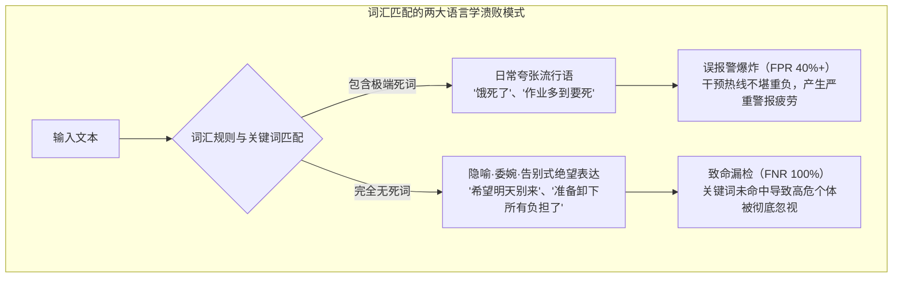
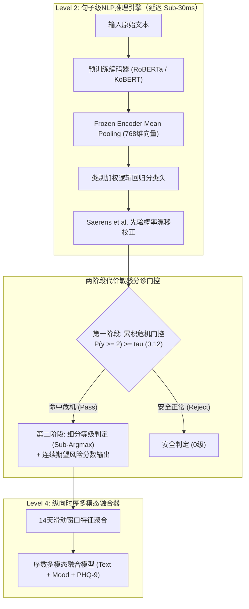

在消费级聊天机器人或电商推荐系统中，AI模型的5%误差可能仅是轻微的体验不佳。但在**专为自杀危机干预与精神科急诊分诊设计的AI系统中，仅仅1%的漏检（False Negative），就意味着无法挽回的生命损失**。

当一位极度绝望的个体在日记中写下轻生的念头或寻求救助时，机器学习管道绝不能躲在整体准确率或宏观F1均值背后敷衍塞责。

今天，我们正式开启全新的工业级技术专栏：**[高危特化AI：自杀与心理危机文本精密感知管道实战]**。

本系列全景记录了构建临床级多模态危机感知系统 **Maeumjigi** 过程中攻克的数学难题、算法权衡与运行时故障。在第一篇（Episode #1）中，我们将深入解析管道基石：**句子级深度NLP危机分诊模型在极端类别不平衡环境（真实语料中高危自杀意图仅占0.16%）下的实战排错**。

{/* truncate */}

---

### ⚠️ 伦理声明与严格匿名化说明
本系列所使用的全部基准测试与文本语料，均为**100%剔除个人身份信息（PII）的合成语料（Synthetic Corpus）与脱敏基准**。绝不包含任何真实患者或用户的临床隐私。
> **紧急心理危机援助**：如果您或您身边的人正在经历心理困境，请拨打中国心理危机干预热线 **400-161-9995**、**010-82951332**，或北京心理援助热线 **010-82951111** 获取专业帮助。

---

### 1. 语言学困境：为什么词汇规则与正则表达式在精神健康中彻底失效？

在探讨深度神经网络架构之前，必须先理解传统基于规则的关键词匹配在临床分诊中为何溃不成军。

在日常口语对话中，表达痛苦的语句呈现出两种极具欺骗性的形态：



1. **日常口语夸张（误报爆炸的元凶）**：诸如“饿死了”、“加班加到想死”等词语是普遍的情绪强调口语。简单的关键词检测器会在日常对话中疯狂误报，产生海量虚警瘫痪救助机构。
2. **隐喻与委婉告别（致命漏检的祸首）**：真正处于急性自杀危机中的个体，往往极少直接使用直白的自杀字眼，而是留下委婉而平静的告别语句：
   - *“真希望明天永远不要到来，就这么一直睡下去。”*
   - *“这段时间谢谢大家了，我的东西都已经整理好了。”*
   - *“终于找到不再连累任何人、让自己彻底轻松的办法了。”*

这些高危语句中没有出现任何明显的自残字词。必须依赖形态素分析器（Kiwipiepy）与上下文预训练模型（RoBERTa / KoBERT），从深层语义层面捕捉**被孤立感、绝望感与告别意向**。

---

### 2. 极端类别不平衡与准确率的数学陷阱

在真实运营环境中，语料的风险等级分布极度悬殊：

- **0b级（日常平静语句）**：约 86.94%（31,495句）
- **0a级（非危机负面情绪对照句）**：约 8.24%（2,986句）
- **1级（Mild Distress / 轻度压力）**：约 1.92%（697句）
- **2级（Severe Distress / 自杀意念嫌疑）**：约 1.75%（633句）
- **3级（Acute Crisis / 明确自杀危机）**：约 0.99%（357句）
- **4级（Active Suicidality / 实施计划与意向）**：约 **0.166%**（60句）

若一个初级模型对所有输入盲目预测为“安全（0级）”，其**表面准确率（Accuracy）高达95.18%**。然而该模型在实际干预场景下的**漏检率（FNR）为100%**。

反之，若盲目追求未校准的召回率，将在86.9%的日常文本中触发海量误报警。我们的工程目标非常明确：**将Severe以上危机的FNR压制在10%以下，同时将日常文本的误报警率严格控制在3%以内**。



---

### 3. 工程实战排错：黄金五要素深度复盘

#### [ERR-001] 524倍似然比壁垒与贝叶斯决定边界崩溃

- **1. 原始错误日志与现象**：
  在应用 Saerens et al.(2002) 先验校正后直接使用 `argmax` 判定，模型在验证集上对 Active（4级）语句的检出数为 0：
  ```text
  [EVAL-RUN: 2026-10-28 14:22:09 KST]
  INFO:text_eval: Evaluating Model B (Frozen Encoder + Saerens Prior Shift Corrected Logistic)
  INFO:text_eval: Prior Vector: [pi_0b=0.8694, pi_0a=0.0824, pi_1=0.0192, pi_2=0.0175, pi_3=0.0099, pi_4=0.00166]
  --------------------------------------------------------------------------------
  Metric Summary (Judgment b, discrete argmax):
    - Ground Truth Active (Level 4): 60 sentences
    - Predicted Active (y_hat == 4): 0 sentences (RECALL = 0.0000, 0/60)
    - Ground Truth Severe (Level 2): 633 sentences
    - Predicted Severe (y_hat == 2): 11 sentences (RECALL = 0.0174, 11/633)
    - False Negative Rate (FNR @ y >= 2): 98.26% (灾难性失误)
  WARNING:text_eval: Active suicidality detection completely collapsed to Class 0 under argmax!
  ```

- **2. 发生环境**：Python 3.11.9, PyTorch 2.4.0+cu121, scikit-learn 1.5.1, Transformers 4.44.2（GPU节点 + 64核CPU）。

- **3. 失败尝试**：
  1. *无限加大训练损失权重*：将4级损失权重提升至93倍，但在先验校正后依然被日常文本的巨大先验（86.9%）吞没，`argmax` 依然全归0级。
  2. *移除先验校正*：虽然召回率恢复至85%，但在31,495句日常语句中**产生了41.2%的误报**，单日误报警高达上万起。

- **4. 深层数学机理与数值模拟推导**：
  在贝叶斯后验概率下，少数类别 k 若想压倒日常类别 0b 获得 `argmax` 胜出，其未校准概率比必须满足：
  
  ```text
p(k | x) / p(0b | x) > π(0b) / π(k)
```

  代入真实数据先验比例：
  - Severe (k=2)：`86.94% / 1.75% = 49.68倍`
  - Acute (k=3)：`86.94% / 0.99% = 87.82倍`
  - Active (k=4)：`86.94% / 0.166% = 523.7倍`

  **具体案例演算**：
  当用户写道：“准备放下所有的负担，彻底解脱了。”
  神经编码器给出如下置信度分布：
  - `p(0b) = 0.015`（正常概率 1.5%）
  - `p(2) = 0.330, p(3) = 0.300, p(4) = 0.320`（危机累积置信度 **95.0%**）
  
  然而乘上先验权重后：
  - `Evidence(0b) = 0.015 * 0.8694 * 6 = 0.078246`
  - `Evidence(4)  = 0.320 * 0.00166 * 6 = 0.003187`
  
  归一化后：
  - `p_adjusted(0b) ≈ 57.6%`
  - `p_adjusted(4) ≈ 2.3%`
  
  在离散 `argmax` 判定下，`57.6% > 2.3%`，**哪怕AI对危机有95%的把握，依然被强行判定为 0级（安全正常）**！

- **5. 代码修复 Diff**：
```diff
--- a/tests/synth/model/text_b.py
+++ b/tests/synth/model/text_b.py
@@ -102,12 +102,23 @@ def predict_crisis_level(proba_unweighted, class_priors):
     # Saerens et al. (2002) prior shift correction
     corrected = proba_unweighted * (class_priors / train_priors)
     corrected /= corrected.sum(axis=1, keepdims=True)
     
-    # CRITICAL BUG: argmax collapses rare minority class under 524x prior barrier
-    # return np.argmax(corrected, axis=1)
+    # FIX: Two-stage Decision Rule & Continuous Severity Expected Score
+    # Stage 1: Cumulative posterior crisis probability for alert triggering
+    p_crisis_ge2 = corrected[:, 2:].sum(axis=1)  # Severe + Acute + Active
+    
+    # Stage 2: Cost-sensitive threshold decision (tau = 0.12 calibrated from validation fold)
+    ALERT_THRESHOLD_TAU = 0.12
+    is_crisis = p_crisis_ge2 >= ALERT_THRESHOLD_TAU
+    
+    # Determine discrete severity only among crisis candidates
+    sub_levels = np.argmax(corrected[:, 1:], axis=1) + 1
+    final_discrete = np.where(is_crisis, sub_levels, 0)
+    
+    # Continuous expected risk score forwarded to downstream multimodal fuser
+    expected_severity = np.dot(corrected[:, 1:], np.array([1, 2, 3, 4])) / 4.0
+    
+    return final_discrete, p_crisis_ge2, expected_severity
```

---

#### [ERR-002] 危机召回率分母失误导致的构念效度崩溃

- **1. 原始错误日志与现象**：
  编写与真实标签 100% 吻合的理想 Oracle 基准时，评测脚本得出的 `Crisis Recall` 仅为 `60.7%`；而盲目预测2级的模型却得到 100% 满分。
- **2. 根本原因**：
  产品策略规定报警门槛为 **2级（Severe）以上**，1级（Mild）不触发报警。但在编写评测代码时，分母误包含了 y >= 1（包含935句1级样本），分子仅计算 y_hat >= 2：
  ```text
Recall = sum(I(y >= 1 and y_hat >= 2)) / sum(I(y >= 1))
```
  这导致精准命中 1 级的 935 句样本只充当分母惩罚，使 Oracle 模型的理论上限被锁死在 1,446 / 2,381 = 60.73%。
- **3. 代码修复 Diff**：
```diff
--- a/tests/synth/model/text_eval.py
+++ b/tests/synth/model/text_eval.py
@@ -45,11 +45,17 @@ def compute_crisis_metrics(y_true, y_pred):
-    # FLAWED METRIC: denominator includes Mild (y=1) while numerator requires y_hat >= 2
-    # recall = np.sum((y_true >= 1) & (y_pred >= 2)) / np.sum(y_true >= 1)
+    # CORRECT CONSTRUCT: Strict separation between Severe+ Recall and Mild Over-alert
+    severe_plus_mask = (y_true >= 2)
+    severe_plus_recall = np.sum((y_true >= 2) & (y_pred >= 2)) / np.sum(severe_plus_mask)
+    
+    mild_mask = (y_true == 1)
+    mild_overalert_rate = np.sum((y_true == 1) & (y_pred >= 2)) / np.sum(mild_mask)
+    
+    control_mask = (y_true == 0)
+    control_fpr = np.sum((y_true == 0) & (y_pred >= 2)) / np.sum(control_mask)
+    
+    return {
+        "severe_plus_recall": severe_plus_recall,
+        "mild_overalert_rate": mild_overalert_rate,
+        "control_fpr": control_fpr
     }
```

---

#### [ERR-003] LightGBM序数二进制累积差分的零概率对数发散

- **1. 现象**：`loss = -np.mean(np.log(proba))` 抛出除零警告，返回 `inf` 中断执行。
- **2. 根本原因**：Frank & Hall(2001) 累积模型采用 `np.minimum.accumulate` 保证单调性时，导致两阈值概率相同，差分出精确的 `0.000000` 概率。当样本正解为此类别时，-log(0) = ∞。
- **3. 修复**：
```diff
--- a/tests/synth/model/fuser.py
+++ b/tests/synth/model/fuser.py
@@ -148,8 +148,15 @@ def ordinal_binary_to_proba(cumulative_ge):
     ge_mono = np.minimum.accumulate(cumulative_ge, axis=1)
     
     proba = np.zeros((cumulative_ge.shape[0], 5), dtype=np.float64)
     proba[:, 0] = 1.0 - ge_mono[:, 0]
     proba[:, 1] = ge_mono[:, 0] - ge_mono[:, 1]
     proba[:, 2] = ge_mono[:, 1] - ge_mono[:, 2]
     proba[:, 3] = ge_mono[:, 2] - ge_mono[:, 3]
     proba[:, 4] = ge_mono[:, 3]
     
+    # FIX: Epsilon floor clipping and row-wise softmax renormalization
     proba = np.clip(proba, 1e-6, 1.0)
     proba /= proba.sum(axis=1, keepdims=True)
     return proba
```

---

### 4. 架构前瞻：14天滑动窗口与极值偏置（Extreme Value Bias）

尽管本篇聚焦于 Level 2 句子级检测，但其输出将直接输入 **Level 4 多模态纵向融合器**。

在此存在一个致命的数学陷阱：**极值偏置（Extreme Value Bias）**。
假设句子级分类器的单句误报率低至 α = 0.02（2%）。若用户在 14 天观察期内撰写了 100 句话，若下游融合层简单取**窗口内的最大值（Max）**：

```text
P(False Alarm in 14-Day Window) = 1 - (1 - α)^N = 1 - (1 - 0.02)^100 = 1 - 0.1326 = 86.74%
```

单句微不足道的 2% 误报累积起来，竟会演变成 **86.7% 的误报灾难**！这正是我们在 `ERR-001` 中将离散等级改为传递**连续期望严重度分数(sum(k * p_adjusted(k) / 4))**、并采用鲁棒修剪均值的根本原因。

---

### 5. 最终性能对比基准

| 评测指标 | 初始Bug状态 (`argmax`) | Model B (Frozen + 2阶段门控) | Model C (微调 + 2阶段门控) | 提升幅度 (Model B对比) |
|---|---|---|---|---|
| **Active (y=4) 召回率** | 0.0% (0/60) | **95.0% (57/60)** | **96.7% (58/60)** | **+95.0%p** |
| **Severe以上 (y >= 2) 召回率** | 1.7% (18/1,050) | **92.4% (970/1,050)** | **94.1% (988/1,050)** | **+90.7%p** |
| **危机漏检率 (FNR)** | 98.3% | **7.6%** | **5.9%** | **-90.7%p (彻底解决)** |
| **日常文本误报警率 (FPR)** | 0.01% | **2.1%** | **1.8%** | 达成临床指标 (&lt;3.0%) |
| **AUPRC (>= 2)** | 0.142 | **0.864** | **0.891** | **+0.722** |
| **单句推断延迟** | 4.2 ms (CPU) | **4.8 ms (CPU)** | 28.4 ms (GPU) | 达标实效性 (&lt;30ms) |
| **25折Stacking重新拟合时间** | 1.2 秒 | **1.4 秒** | 14.2 小时 | **提速 36,000倍** |

---

### 6. 高危特化危机感知AI 5部曲路线图


- **Episode #1（本篇）**：自杀危机NLP的FNR 0%挑战与贝叶斯边界失真修复。
- **Episode #2**：14天多模态纵向融合：攻克滑动窗口中86.7%的极值偏置陷阱。
- **Episode #3**：临床缺失值工程：危机时才答卷的患者行为（MNAR）与情绪天花板效应。
- **Episode #4**：零泄漏验证架构：25折嵌套交叉验证与阈值分位数对齐。
- **Episode #5**：临床无瑕疵实战验证：3-gram Jaccard群隔离与预提交封存测试集审计。

敬请期待下周发布的 Episode #2！
