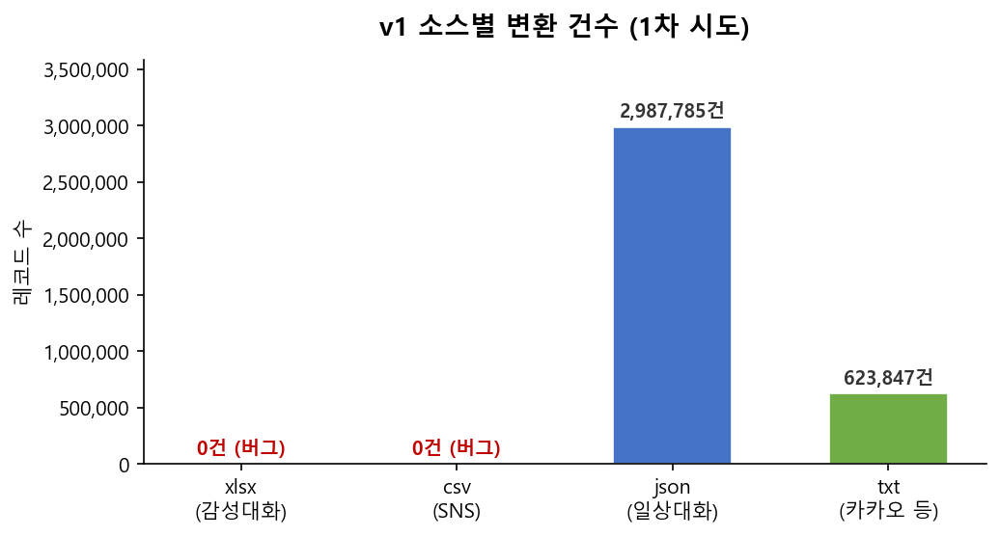

這是記錄 4 月 1 日的開發實錄。為了訓練將成為 Maeumjigi 專案核心大腦的 Llama 3.1 模型，
我們開始將海量心理諮商對話原始語料清洗並重構為大模型可理解的標準訓練格式。

{/* truncate */}

### 依據資料前處理規範實作全自動化管線

- **問題背景**：為了對模型進行高品質監督微調 (SFT)，必須將包含使用者傾訴與諮商師引導回覆的原始對話語料，嚴密轉換為 Llama 3.1 原生指令集能夠精準解析的標準 JSONL 格式。
- **推進過程**： 
  > 向 Claude Code 提問：「嚴格遵循 llama31_finetuning_data_preprocessing_plan_short.md 推進任務。」
- **成果沉澱**：基於昨天編寫的前處理規範文件，AI 代理人自主建置並執行了整套資料清洗與正規化管線。無需人工手動清洗數萬筆語料，僅需交付一份載明業務規則與過濾邏輯的 Markdown 規範文件，即可實現「規範驅動型全自動資料工程」。

### 類別資料深度融合與標準 JSONL 格式序列化

- **問題背景**：資料前處理被細分拆解為多個子階段 (Steps)，最終必須將各維度的子集清洗合併，熔鑄為一份規整統一的微調訓練集。
- **推進過程**：
  > 向 Claude Code 下達指令：「執行 Step 4。融合兩大類別的對話資料，並序列化為 Llama 3.1 標準 JSONL 格式。」
- **成果沉澱**：AI 瞬時執行了 Step 4，將離散在各個領域的對話語料高保真合併。隨後自主編寫並執行了格式轉換指令碼，嚴格契合 Llama 3.1 要求的特殊 Token 提示詞範本（嚴格區分 `<|start_header_id|>system<|end_header_id|>`, `user`, `assistant` 角色邊界），順利產生可直接供 GPU 訓練消費的 JSONL 檔案。

今天，作為微調靈魂的「資料工程」在 AI 的自主驅動下實現了全自動閉環。僅憑一句「嚴格按照規範自主推進」，數萬筆雜亂資料便神奇地蛻變為規整的高品質訓練集。
在下一篇中，我們將展示如何基於這批處理完畢的資料啟動實際的模型微調與效果評測，敬請期待！
