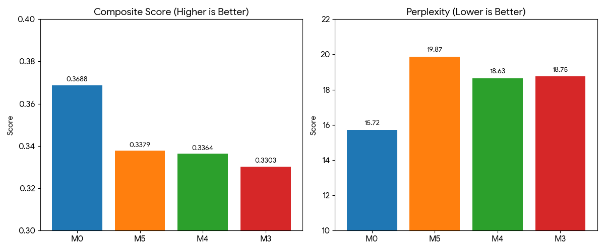

這是記錄 4 月 3 日的開發實錄。在這一天，我們正式啟動了為深度學習大模型 (Llama 3.1) 餵養高品質心理對話語料的資料深度精煉工程。
這也是我們首次建置起由高級大型語言模型 (Claude) 自主閱讀上下文並高精度標註複雜情緒標籤的龐大管線。

{/* truncate */}

### 心理對話情緒多維重構與深度映射 (v3 -> v4)

- **問題背景**：既有公開資料集 (`Emotion_train_dataset_v3`) 的原始情緒標籤粒度粗糙，難以契合嚴謹的心理諮商與同理心引導目標。在總量超過 100 萬筆的原始語料中，必須精準剔除無關雜訊，完成情緒屬性的重構與映射。
- **推進過程**： 
  > 團隊探討：「清洗範圍涵蓋全部 100 萬筆……由 Claude 扮演資深心理諮商專家，通讀上下文並精準判定情緒。僅保留符合我們嚴格定義的心理諮商標籤體系樣本，其餘全部過濾剔除。」
- **成果沉澱**：確立了 `v4_plan.md` 規範。首期鎖定 10 萬筆樣本做為切入點，編寫自動化指令碼深度串接 Claude API，實作了上下文語意理解與情緒重新標註。

### 大型語言模型 API 帳單的現實重壓

- **問題背景**：隨著海量文本密集湧入大型語言模型 (Claude) 進行批次分析，消耗的輸入與輸出 Token 數量呈指數級暴增。
- **推進過程**：
  > 「我明明已經訂閱了 Claude Pro 會員，難道呼叫 API 還要單獨收費嗎？」
  > 「有沒有辦法直接利用 Claude Code 而非 Anthropic API？計費壓力太大了。」
  > 「初步跑完 10 萬筆，實際帳單扣費高達 10.27 美元！」
- **成果沉澱**：我們深刻體會到了現實商業 API 的規則——個人 Claude Pro 網頁訂閱（每月 20 美元）與 Python 指令碼中按 Token 計費的 Anthropic 商業 API 完全獨立。僅測試處理 10 萬筆樣本，短短數小時內就產生了 10.27 美元（約合新台幣 330 元）的帳單。按此推算，若將全部 100 萬筆資料逐一送入，成本將是天文數字。這一天讓我們切身體會到了模型輕量化、提示詞壓縮以及樣本分層抽樣 (Sampling) 的極端重要性。

今天，我們結結實實地撞上了深度學習資料工程中不可避免的現實高牆——「算力與 API 成本」。
雖然最終成功提煉出了一批極具含金量的高品質情緒語料 (`v4_report.md`)，但也迫使我們在後續的模型微調與資料合成中，全面確立了在「成本與效能」之間尋求極致平衡的架構思維！
