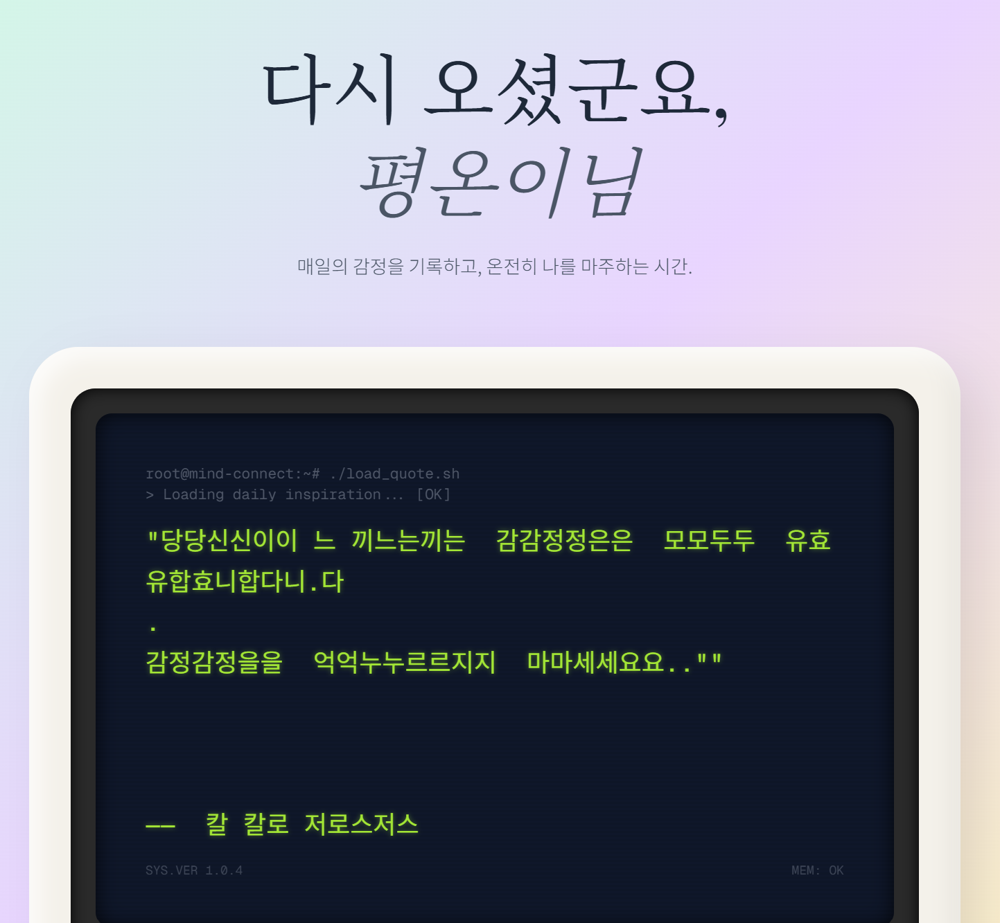

4 月 5 日，我們既完成了對前期歷經波折的資料前處理全流程 (v1~v4) 的深度總結與終期彙報自動化，
又正式啟動了將直接面向終端使用者的 Maeumjigi Web 前端工程。

{/* truncate */}

### 終極文件工程：從 Markdown 到視覺化圖表與 DOCX 報告全自動產生

- **問題背景**：需要向指導教授和團隊成員直觀、系統地呈現這段跨越 4 個版本的海量資料清洗與重構歷程。
- **推進過程**： 
  > 向 Claude Code 提問：「請系統總結資料前處理全過程 (v1, v2, v3, v4) 並撰寫終期技術報告……為每個版本附上典型對話樣本。」
  > 「請將這份 Markdown 轉換為標準的 DOCX 文件……將能夠視覺化的統計指標繪製為圖表並自動嵌入。」
- **成果沉澱**：AI 展現了驚豔的自動化協同能力——自主通讀我們此前編寫的 Python 清洗指令碼與 JSON 中繼資料，瞬間提煉出邏輯嚴密的 Markdown 報告。更令人驚嘆的是，它自主在背景安裝了 `python-docx` 與 `matplotlib` 相依套件，編寫轉換指令碼，將 Markdown 編譯為排版優雅的 Word (DOCX) 檔案，並自動繪製出情緒類別分布直方圖嵌入文中！這徹底顛覆了人工手動拼湊彙報資料的低效模式。

### 基於 Next.js 的高回應前端工程初始化

- **問題背景**：大模型微調之餘，系統必須提供一個讓使用者（官兵）能夠順暢傾訴交流的 Web 聊天互動介面。
- **推進過程**：指示 AI 初始化基於 Next.js 框架的現代化前端工程鷹架。
- **成果沉澱**：在 `maeumjigi/frontend/` 目錄下成功初始化了包含 `package.json`、`tsconfig.json` 的 TypeScript 全端工程，搭建了兼顧極速首頁渲染與響應式設計的現代 Web 架構。

今天我們見證了 AI 遠超單一程式碼撰寫的全面生產力——在「文件提煉、資料圖表視覺化、跨格式檔案編譯」等高階工程輔助場景下展現出驚人的成熟度。
翻過了資料前處理這座險峻高山，我們正式揚起直面使用者的 Web 前端研發之帆！
