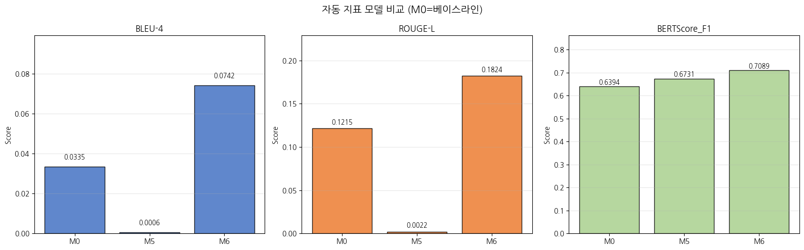

4 月 7 日，我們既在本地成功跑通了團隊成員開發的前端服務，
又啟動了透過前沿 AI 自主「合成 (Synthesis)」 6 萬筆高品質多輪同理心對話資料的重量級管線，以填補長尾心理諮商情境的語料空白。

{/* truncate */}

### 填補語料盲區：大模型自主合成對話資料 (v5)

- **問題背景**：單純依賴前期清洗的語料 (v4)，在防範自殺危機介入與細粒度憂鬱症情境下涵蓋度仍顯不足。為此，我們計畫呼叫 Claude API，嚴格依照 Llama 3.1 訓練範式（System, User, Assistant），全新合成 6 萬筆貼合真實諮商語境的虛構心理介入樣本。
- **推進過程**： 
  > 「我們計畫建構一份由 Claude 全量產生的 v5 心理對話資料集，請給出架構方案。」
  > 「我希望獲得嚴格契合 Llama 3.1 格式規範的 6 萬筆 JSONL 資料集。」
- **成果沉澱**：確立了 `v5_plan.md` 架構方案並全面開動批次合成指令碼。然而，API 呼叫的帳單消耗速度再次成為了絆腳石。

### 永無止境的成本突圍戰：提示詞工程與批次處理最佳化

- **問題背景**：讓頂級商業大模型無休止地創作 6 萬筆對話語料，使得數天前經歷過的帳單危機再度爆發——指令碼剛執行一會兒，10 美元帳戶餘額便瞬間蒸發殆盡。
- **推進過程**：
  > 「嚴格按照 step8_generate_v5_optimized.py 執行能顯著壓縮 Token 消耗嗎？」
  > 「當前剛燒掉 10 美元，但總進度才推進了一小段，必須全面最佳化！」
- **成果沉澱**：透過對提示詞實施極致工程剪裁（壓縮 System Prompt 冗餘、精簡非必要解釋輸出）並升級管線程式碼 (`step8_generate_v5_optimized.py`)，成功消除了輸出 Token 的無效浪費，同時加入了高可用斷點續傳保存機制。

### 接手團隊前端工程並順利完成本地整合

- **推進過程**： 
  > 「這是隊友提交的前端工程儲存庫，我在本地啟動需要執行哪些步驟？」
  > 「排查資料庫 (DB) 遷移時報出的異常……」
  > 「已成功執行至 Step 6 前端頁面，請給出背景優雅結束與下次一鍵喚醒的標準流程。」
- **成果沉澱**：成功接手 `mental-health` 儲存庫程式碼，在本地完成相依套件安裝並化解了 DB 遷移衝突，使前端 Web 互動介面與後端大模型服務實作了完美會師。

今天不僅超越了簡單的資料前處理，更在實踐中深度落地了當前深度學習最熱門的 **「合成資料產生 (Synthetic Data Generation)」** 範式——由高級 AI 撰寫教科書來培育另一個垂直領域 AI。
在直面帳單危機的同時實作了深度架構最佳化，並順利點亮了前端互動介面！
