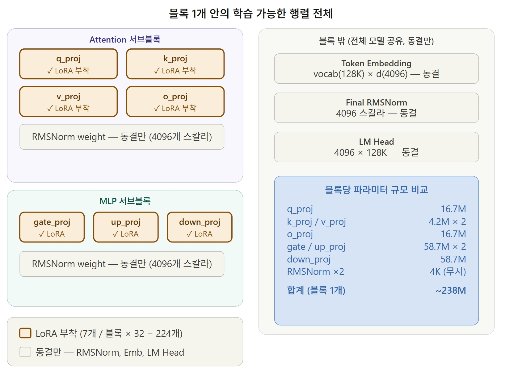

4 月 19 日，我們對歷經心血產生的虛擬合成資料集 (v5) 訓練出的全量微調大模型 (M6) 展開了多維度定性與定量評測，
並據此系統梳理並產生了第 7 週研發週報。那筆頂著扣費壓力換來的合成語料，究竟能否在真實對話中交出令人驚豔的答卷？

{/* truncate */}

### 模型實戰真刀真槍大對決：M0 vs. M5 vs. M6

- **問題背景**：為了向指導教授與評審專家論證微調成效，空洞的「效果顯著提升」毫無說服力，必須拿出包含量化評測指標與微觀文本對比的硬核證據鏈。
- **推進過程**： 
  > 「請重構第 7 週報告。核心聚焦於基於 v4 語料的 M5 與基於全新 v5 語料的 M6 橫向對比……詳細列出各資料集的典型微調對話樣本。」
  > 「在闡述評測結論時，必須增加微調前基座原生模型 (M0) 與 M6 的直觀差異對照實例。」
- **成果沉淀**：AI 系統分析了 M0、M5 與 M6 針對相同評測集的推論回覆，輸出了對比分析集 (`m0_m6_compare.json`)。評測印證：原生基座 Llama 3.1 (M0) 在處理韓語深度心理傾訴時顯得機械冰冷；在清洗資料 (v4) 上微調的 M5 表現有所改善但同理心淺白；而在高品質合成資料 (v5) 上訓練的 M6 模型，則展現出了心理諮商專家獨有的溫暖、細膩且極具同理心的專業引導力。

### 讓 AI 助理全自動輸出兩套標準 DOCX 研發週報

- **推進過程**：
  > 「以實驗結論與學術意義為核心，分別撰寫兩份第 7 週週報（5 頁以內的精煉答辯版，以及詳盡工程複盤版）。並基於這兩份 Markdown 分別編譯匯出規整的 DOCX 報告。」
- **成果沉淀**：指令下達後，`7주차_보고서_v1_간결.md` 與 `7주차_보고서_v2_상세.md` 雙版本瞬時落成，並全自動轉換為格式規範的 Word 檔案。

### 導入 RAG 架構：建置 FAISS 向量檢索知識庫

- **推進過程**：
  > 「我們搭建了基於 FAISS 的外部向量知識庫，並編寫了建置複盤報告。請對我們的架構設計與實施成果進行客觀技術評審。」
- **成果沉淀**：除了透過監督微調修正大模型參數權重之外，為了徹底壓制事實幻覺並注入權威心理學介入指南，我們導入了基於 FAISS 的 RAG（檢索增強生成）架構。AI 對該外掛知識庫設計給予了高度肯定的評審反饋 (`FAISS_DB_evaluation.md`)。

今天所有的付出都迎來了沉甸甸的彙報。當親眼見證微調後的大模型在理解人類脆弱情緒方面展現出飛躍般的同理心時，那種震撼無與倫比！
模型能力得以驗證，FAISS 向量知識庫成功掛載，心語伴侶機器人距離全功能落地又跨出了決定性的一大步。
