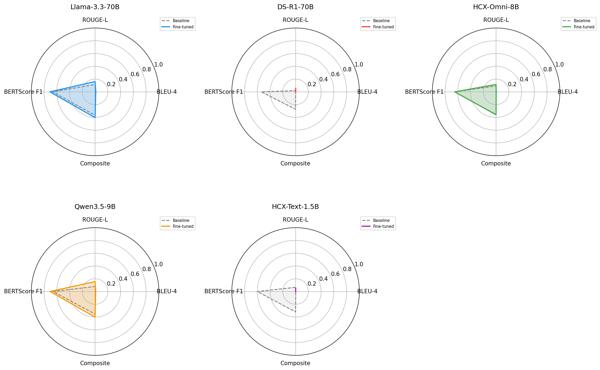

5 月 3 日，在徹底摸透 8B 小參數模型的技術脈絡後，我們團隊終於向大型語言模型的效能天花板發起衝鋒——挑戰 **70B (700 億超大參數量)** 模型的領域微調。
我們同時鎖定了 Llama 3.3 70B 與 DeepSeek-R1 70B 兩大旗艦底座，但不出所料，瞬間迎面撞上了嚴苛的物理顯示記憶體高牆。

{/* truncate */}

### 70B 龐然大物降臨與顯示記憶體溢位 (OOM) 絕望陰霾

- **問題背景**：豪情萬丈地將 70B 微調程式碼部署至 GPU 伺服器剛一跑通，各種顯示記憶體崩潰報錯便接踵而至。
- **推進過程**： 
  > 「我已將伺服器上的 fine_tuning 目錄及指令碼同步拉取至本地。請通讀程式碼並排查導致崩潰的根本死穴。」
  > 「針對 DeepSeek-R1 的 70B 模型結構無需調整注意力遮罩嗎？請評估潛在報錯點。」
- **成果沉淀**：剛在監控面板中分析 `train_log.jsonl` 並估算收斂耗時沒幾分鐘，70B 參數量龐大的權重與反向傳播活化值便瞬間吞噬了整塊 GPU 顯示記憶體，控制台無情拋出 `CUDA out of memory (OOM)` 致命例外！

### GPU 顯示記憶體極致瘦身戰役：QLoRA 與超參數動態壓榨

- **問題背景**：「伺服器顯示記憶體利用率已死死鎖死在 100% MAX！」若不能將顯示記憶體開銷壓縮至物理安全線下，訓練將被反覆強行中止。
- **推進過程**：
  > 「調整參數為 save_steps = 50, save_total_limit = 10, eval_steps = 50, patience = 10。」
  > 「請對設定的提早結束 (Early Stopping) 條件進行收斂合理性評估。」
  > 「已在 ft_configs.yaml 中將兩大 70B 模型的 max_seq_length 砍至 512，為何 nvitop 監控依然顯示顯示記憶體死死頂格滿載？」
- **成果沉淀**：我們果斷將單次注意力序列長度 (`max_seq_length`) 腰斬至 512，並大幅精簡檢查點持久化超參數。然而透過 `nvitop` 實況監測發現，顯示記憶體依然在斷崖邊緣劇烈顛簸，更在第 100~150 步之間發生成式假死凍結。

馴服 70B 這種吞金巨獸絕非易事。我們透過 AI 高頻投餵堆疊日誌尋找最佳化突破口，反覆驗證 4-bit NF4 量化、Paged AdamW 最佳化器與梯度檢查點 (Gradient Checkpointing) 等極致降顯示記憶體黑科技。
我們究竟能否成功跑完 70B 模型的完整微調週期？懸念將在下一篇開發日誌全面揭曉！

---

## 核心總結與技術要點

- **70B 超大規模模型微調挑戰**：啟動對 Llama 3.3-70B 與 DeepSeek-R1-70B 的 LoRA 微調，直面硬體算力與顯示記憶體技術天花板。
- **顯示記憶體瞬間頂格與 OOM 崩潰**：隨著 70B 龐大參數矩陣加載，伺服器顯示記憶體即刻告急，頻繁出現進程凍結與 Out-of-Memory (OOM) 異常中斷。
- **激進的顯示記憶體瘦身工程**：將單次注意力序列長度 (`max_seq_length`) 深度截斷至 512，精簡檢查點保留機制並優化提早結束 (Early Stopping) 參數。
- **算力集群邊界實證**：實測驗證了學術級與消費級集群在應對超大模型時的承載極限，凸顯量化與參數高效微調策略的必要性。

