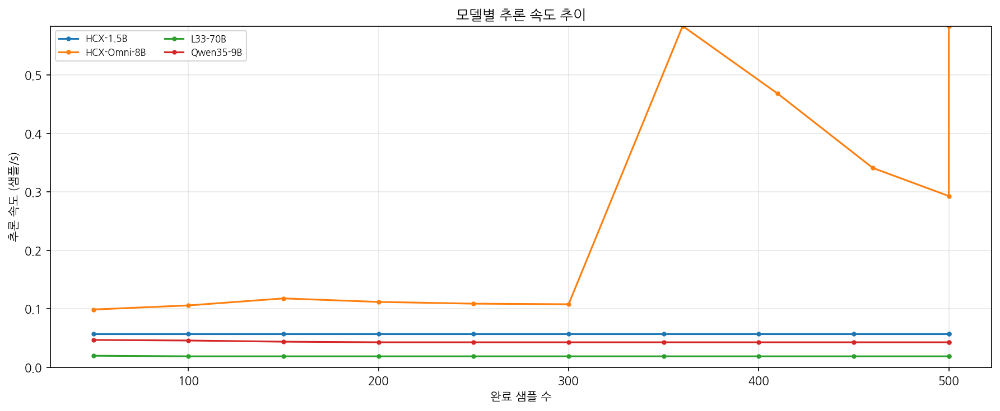

5 月 7 日，我們對傾注心血完成微調的 5 大代表性大模型（Llama 3.3-70B、DSR1-70B、HCX-Omni-8B、Qwen35-9B、HCX-Text-1.5B）的實驗資料進行了全景彙總，
並全面展開了深度視覺化與輕量化本地評測環境的建置。

{/* truncate */}

### 模型多維橫向對齊：本地輕量級視覺化環境配置

為了在個人筆記型電腦上脫離沉重的 GPU 伺服器獨立審視對比分析資料，我們全新重構了 `31_comparison_local.ipynb` 指令碼。

> 「此前在伺服器上執行的 30_comparison.ipynb 能否直接在本地工作站無縫執行？」
> 「請給出在當前 VSCode 選定 Jupyter 核心中安裝 pandas、matplotlib、seaborn 與 bert_score 的標準化指引。」

在本地環境配置過程中，我們遇到了核心崩潰 (Kernel Crashed) 以及 `ModuleNotFoundError: No module named 'ft_utils'` 等典型相依路徑異常，但透過精準校準模組定址順利化解。針對 DSR1-70B 等模型在訓練時偶發的 `ft_metrics.json` 遺失，也編寫反向解析指令碼實作了指標資料的完整搶救。

### 5 大模型全景綜合報告與多維收斂圖表繪製

核心任務是建置能夠一眼洞察 5 大模型效能鴻溝的高解析度視覺化圖表。我們與 AI 聯合制定了 `5MODELS_ORGANIZATION_PLAN_present.md` 規範方案，展開了結構化資料製圖。

> 「圖表中的虛線與平滑粗線分別代表什麼物理意義？請將所有模型的 Training Loss 與 Eval Loss 分別匯聚繪製成兩幅橫向對比大圖。」
> 「剔除平滑擬合粗線，保留更具實驗真實細節的高解析度原始收斂折線並持久化匯出。」

我們最佳化了 AI 輸出的 Matplotlib 渲染參數，最終匯出了排版極為規整的 `03_training_loss_all.png` 與 `04_eval_loss_all.png`。此外，還同步完成了揭示各模型 LoRA 秩分解 (Rank Decomposition) 特性分析圖以及 GPU 顯示記憶體佔用對照雷達圖 (`02_gpu_memory.png`)。

依托這組嚴密規整的實驗圖表，我們為下週舉行的畢業專題階段性中期評審準備好了無可挑剔的成果佐證。在這 5 大各具特色的候選模型中，究竟誰能拔得頭籌，成為心語伴侶的終極決策大腦？
