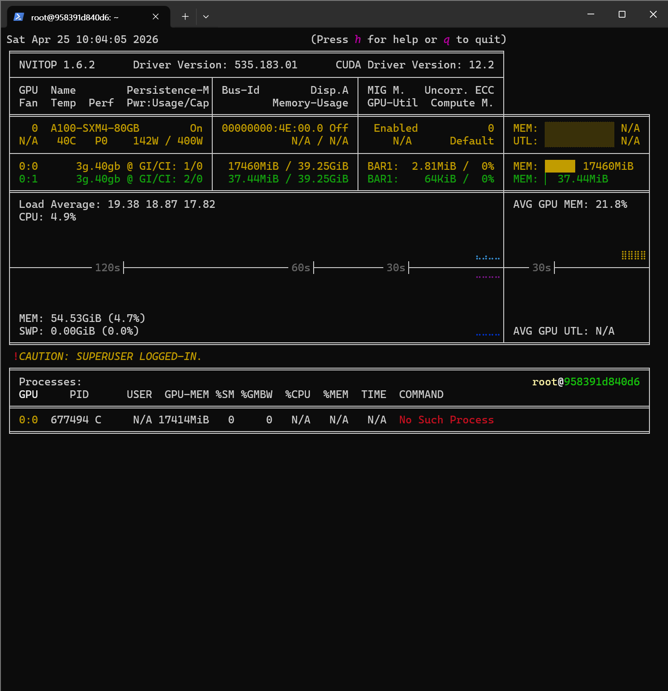

5 月 8 日，原本是我們基於此前的全量微調成果緊鑼密鼓趕製畢業專題中期簡報投影片 (PPT) 的關鍵日子。
然而，正在滿懷欣喜填充評測表格時，我們卻突然揪出了一個令人毛骨悚然、顛覆前期結論的技術暗傷！

{/* truncate */}

### 觸目驚心：排查出 LoRA 超參數配比的致命失誤

在與 AI 共同校對即將編入簡報資料的模型架構圖與超參數明細時，我們意外注意到了反常端倪：

> 「仔細審視微調後的回覆樣本，句式長度居然比未經微調的基座模型還要簡短侷促。原本以為是將 LoRA 的 r 設為 8、alpha 設為 16 導致瓶頸維度壓縮過度……」
> 「等等，縮放因子比例是 $\alpha/r$？天哪，我此前一直當成了 $r/\alpha$ 去配置……？！我到底以怎樣扭曲的比例應用了 LoRA 權重？！」

在 LoRA 微調標準實踐中，通常將 `alpha` 設為與 `rank` 相等或為其 2 倍以保持平滑縮放。然而，由於公式記憶倒置，我們竟無意中以顛倒的縮放係數極大地抑制或暴擊了參數梯度更新。難怪微調後的大模型在很多情境下回覆短促斷裂——禍根恰恰潛伏在最初的設定項中。

### 絕不妥協：果斷打響第二輪深度微調 (fine_tuning_2)

雖已具備第一輪評測資料，但為了追求心語伴侶的極致心理介入水準，絕不能將就掩蓋問題。我們當即建立 `fine_tuning_2` 目錄，全面打響第二輪糾偏微調：

> 「本輪選定模型涵蓋 HCX-Text-1p5B、Llama33-70B 與 Qwen35-9B。在 MIG-0 實例上執行 rank=16, alpha=16，在 MIG-1 上對比測試 rank=16, alpha=8。」
> 「從 Daily_train_dataset.jsonl 中篩選出字元長度最長的前 2000 筆長程心理對話，單獨提煉為 Daily_train_dataset_long.jsonl 強化長文本產生能力。」

為了徹底扭轉短回覆缺陷，我們專門提煉出長文本高品質子集，並借助 MIG 多實例 GPU 分配方案展開超參數平行對照微調。

### 算力訓練與行動端 App 開發雙線狂飆

在模型在伺服器叢集中全速重新微調的同時，研發腳步一刻不停——正式啟動讓真實使用者能夠隨身使用的前端行動端 App 工程！

> 「在本地啟動 maeum-app 行動端需要展示 QR Code……但我誤敲了 npx go start 導致報錯頻出。請指導如何正確調出 Expo 除錯 QR Code 並在實機上預覽？」

我們利用 React Native (Expo) 初始化了行動端應用程式 `maeum-app`，成功調出除錯控制台並配置了品牌圖示 (`assets/logo.png`)。後端的 AI 大腦與前端的使用者門面正同步孕育破繭，這是充滿技術激情的一天！

---

## 核心總結與技術要點

- **攻克 LoRA 超參數比例配置失誤**：排查確診回覆內容被反常截斷係誤解了 rank 與 alpha 縮放因子的配比機制，果斷推翻錯誤配置並重建參數空間。
- **拉開第 2 輪多模型並行微調序幕**：劃定 MIG 多實例 GPU 算力分區，對照評測 rank=16 下 alpha=8 與 alpha=16 的泛化表現。
- **構建長程對話專項資料集**：專門篩選提煉出字元量最豐富的前 2000 組真實對話（`Daily_train_dataset_long.jsonl`），倒逼模型習得充沛的長句同理心能力。
- **啟動 React Native 行動端工程**：借助 Expo 架構成功初始化 `maeum-app` 客戶端，打通實機 QR Code 無線除錯鏈路與核心視覺資產配置。

