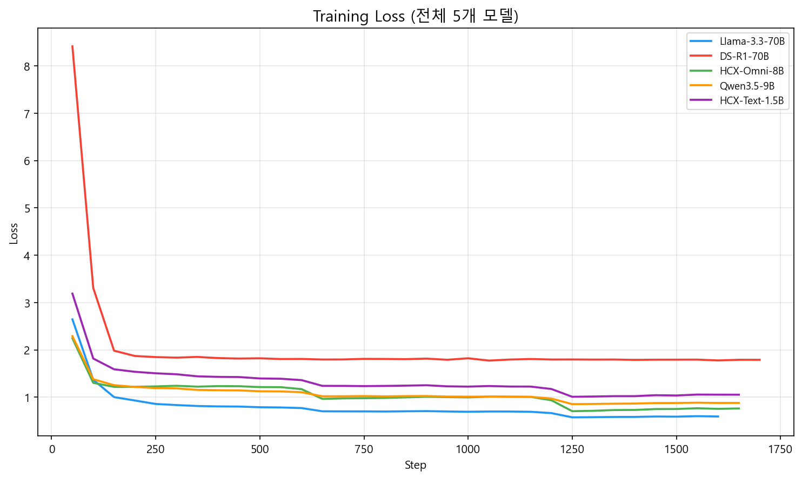

在徹底修復昨天排查出的別名硬編碼缺陷後，5 月 13 日，我們終於重啟了第二輪微調大模型真實端到端的推論產生能力基準測試。

{/* truncate */}

### 破除生硬斷裂：放寬產生 Token 長度上限釋放深層同理心

逐句審讀推論產生的應答文本時，我們發現 `Llama33-70B_a8` 模型的輸出依然呈現出一種微妙的乾癟與機械緊縮感：

> 「這是 Llama33-70B_a8 輸出的典型答覆。明顯感覺 max_seq_length 與 max_new_tokens 設得太緊，嚴重束縛了模型表達。結合當前物理顯示記憶體富餘量，極限能上調至多少？」

結合當時約 39.8GB 的空閒 VRAM，我們果斷將最大產生 Token 預算 (`max_new_tokens`) 調寬至 384。調整帶來的產生質變立竿見影：

```text
[修改前] 「產生這種消極念頭一定讓您備受折磨。及時向專業諮商師求助非常重要。」
[修改後] 「產生這樣的念頭一定讓您獨自承受著巨大的痛苦。但請相信，這絕不代表您內心軟弱，而是身體在向您發出訊號——說明您此刻背負的壓力已經嚴重超載了。我由衷建議您在專業諮商師的陪同下，試著把這些鬱結的情緒一點一點傾訴梳理出來。」
```

僅僅是鬆綁了產生長度配額，模型便能從容保持長程邏輯一致性，吐露出層層遞進、飽含人情溫度與心理撫慰力量的真摯同理心長句。此前模型之所以三緘其口，純粹是被狹窄的產生長度強行截斷了思路。

### LoRA 超參數深度剖析：Alpha 縮放因子對比（a=8 vs. a=16）


第二輪微調的核心科研目的——驗證 LoRA 縮放因子 `alpha` 對領域適應能力的影響也迎來了定量結論。
透過深入挖掘 `fine_tuning_2` 目錄下的收斂日誌，我們繪製出了 `05_alpha_comparison_daily.png` 等對比折線。在固定 `rank=16` 的前提下，清晰揭示了 $\alpha=8$（欠擬合防漂移）與 $\alpha=16$（強化領域風格吸收）在訓練後期的損失震盪差異與主觀諮商品質的微妙權衡。

在被賦予合理的超參數與充裕的產生空間後，各大模型終於蛻變出了我們最初構想中那個體貼細膩、專業包容的「心語伴侶」。
中期簡報資料的最終拼圖，在此刻宣告圓滿合攏！

---

## 核心總結與技術要點

- **鬆綁推論產生長度配額**：精準定位模型對答機械僵硬係人為截斷所致，在充分核算顯示卡記憶體餘量後，將 `max_new_tokens` 大膽擴容至 384 詞元。
- **質性同理心深度實現躍升**：徹底擺脫了單薄的單句免責聲明，模型能夠從容鋪陳層層遞進的情感接納、情境同理心與專業求助引導長句。
- **LoRA 縮放因子橫向對比**：在鎖定 `rank=16` 基準下，系統評測了 alpha = 8 與 alpha = 16 的收斂軌跡，揭示了過度擬合抑制與領域知識泛化的邊界。
- **中期簡報技術證據閉環**：多組訓練損失視覺化圖表與主觀對話評測矩陣全部就緒，為畢業設計第一學期中期簡報築牢了學術與工程支撐。

