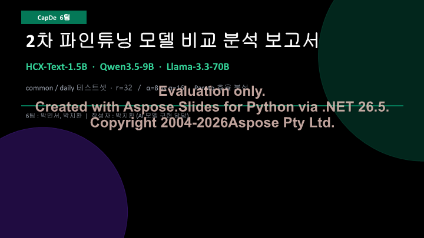

5 月 17 日，我們迎來了工程量極為密集的後端資料庫整合測試與實驗報告全自動產生攻堅戰。

{/* truncate */}

### 借助 AI 實作複雜實驗報告與 DOCX 自動化組裝

面對第二輪微調 (`fine_tuning_2`) 沉澱的海量指標與模型橫向對比圖，人工撰寫長篇技術報告已不現實。

> 「請設計一套專門用於解析各模型推論評測資料的提示詞框架，儲存為 report_prompt.md，並驅動大模型全自動撰寫綜合對比報告。」
> 「最終產物必須為排版規整的 Word (.docx) 檔案而非純文字 Markdown。」

我們透過精準的元提示詞工程，驅使 AI 自主解析多維指標（Loss 趨勢、困惑度、Alpha 縮放因子下的語意敏感度），一鍵匯出了圖文並茂的正式技術報告草案。

### 後端 PostgreSQL 資料庫整合測試與「401 Unauthorized」死結泥潭

報告編寫告一段落，為了全面壓測系統端到端穩定性，我們將 `backup.sql` 資料全量灌入本地 PostgreSQL 資料庫。

> 「向資料庫匯入備份完成，前端與後端成功啟動並存取首頁，但點擊所有子選單均毫無回應。」
> 「輸入認證資訊反覆提示密碼錯誤：INFO: POST /auth/login 401 Unauthorized」

資料庫雖成功復原，系統卻深陷登入鑑權全面癱瘓的死結陷阱。我們編寫了獨立診斷指令碼 `debug_login.py`，通宵排查密碼雜湊加鹽演算法與 FastAPI JWT 檢驗機制，反覆重啟 Uvicorn 除錯服務，最終精準修復了遷移導致的雜湊模式錯配。

### 技術架構升維思考：導入本體與知識圖譜 (Knowledge Graph)

> 「防範自殺心理介入的核心生命線在於確定性的高安全底線。單純押注黑盒 LLM 難免面臨幻覺風險，結合本體論 (Ontology) 與知識圖譜 (Knowledge Graph) 建構複合防護網，才能實作高穩定性的自律系統。」

深夜，為了打破單一模型參數記憶的黑盒局限，我們開始起草 `chatbot_design_prompt.md`，深度布局知識圖譜與外部規則引擎的融合方案。隨著五月中旬的推進，心語伴侶的技術架構正在邁向宏大的全端工程新高度！
