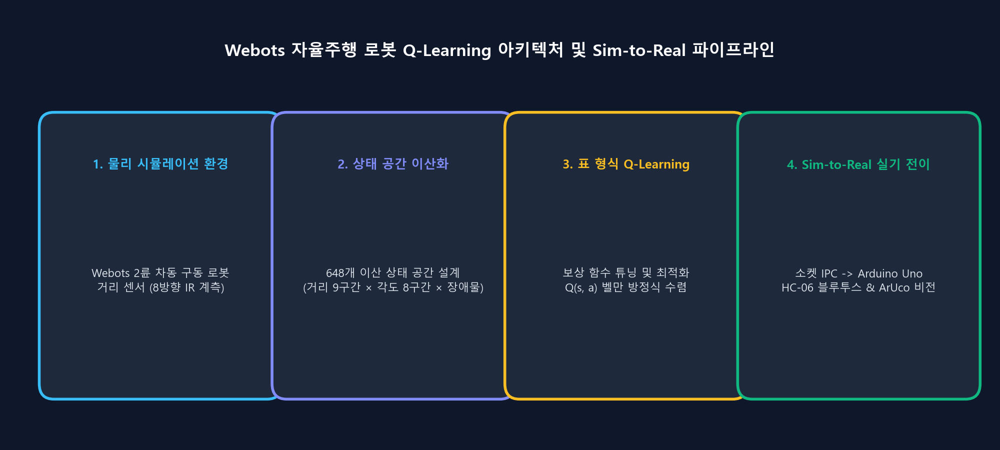

> 📌 **核心要點 (Key Takeaways)**
> - **問題痛點**：連續感測器讀數（距離、朝向角）會導致表格型強化學習遭遇維度災難（State-Space Explosion），同時 Python 強化學習代理與 Webots 模擬核心之間需要維持微秒級、低延遲的物理同步。
> - **解決方案**：設計了基於幾何學空間劃分的 5 維連續感測器量化器（`discretizer.py`），產生 3 × 8 × 3 × 3 × 3 = 648 維離散狀態；搭建了基於 TCP 5000 連接埠的極輕量級行分隔 JSON 套接字通訊管線。
> - **落地成效**：實作了 O(1) 複雜度的超高速 Q-Table 定址更新，確保了模擬器與 Python 端 32ms 物理模擬步長的一致無阻塞同步。

{/* truncate */}

---

## 1. 專案研發背景：為何選擇 Webots 與經典 Q-Learning？

讓差速驅動機器人在未知的室內場館中自主導航避障並抵達目標點，是移動機器人學的經典基石課題。儘管深度強化學習（DQN, PPO）在處理高維影像方面表現亮眼，但其龐大的參數量在邊緣微控制器上推論延遲高，且缺乏數學上的完全可解釋性。

在本專欄專案中，我們在 **Webots 3D 物理模擬引擎** 中應用經典的 **表格型 Q-Learning (Off-policy TD(0))**，旨在在 1.2m × 1.2m 的室內競技場內訓練出一套數學上完全可驗證的最優避障與導航策略。

---

## 2. 系統架構設計：Webots 控制器 ↔ Python 強化學習引擎

系統解耦為清晰的兩大層級：**Webots 模擬端（伺服端）** 與 **Python 演算法端（客戶端）**：

```mermaid
flowchart LR
    subgraph Webots["Webots 3D 模擬器 (localhost:5000)"]
        Robot["Supervisor 機器人<br>(超音波感測器 + 驅動輪)"]
        HeadScan["搖頭掃描機制<br>(左右 1.1 rad 伺服馬達擺動)"]
        Server["TCP Socket 伺服端<br>(行分隔 JSON 協定)"]
        Robot -→ HeadScan -→ Server
    end

    subgraph Python["Python 強化學習引擎 (客戶端)"]
        Env["WebotsEnv (類似 gym 介面)<br>reset() / step()"]
        Disc["離散化映射器<br>(連續感測器 → 0~647 Bin)"]
        Agent["QLearningAgent<br>(Q-Table 形狀 648x4)"]
        Env -→ Disc -→ Agent
    end

    Server <-→|"請求: {type: step, action: 0..3}<br>回應: {state: [...], reward, done}"| Env
```

* **Webots 控制器 (`RL_controller.py`)**：負責執行具體的動作指令 480ms（對應 15 個模擬步長 × 32ms），並驅動機載超音波感測器左右擺動 1.1 rad（約 63°）以消除盲區。
* **Socket 協定**：採用極度輕量的行分隔 JSON 格式進行 TCP 本地環回通訊：
  * 發送動作請求：`{"type": "step", "action": 0}` (0: 前進, 1: 後退, 2: 左轉, 3: 右轉)
  * 接收環境回饋：`{"state": [0.45, 0.12, 0.35, 0.28, 0.40], "reward": 0.05, "done": false, "info": {...}}`

---

## 3. 連續感測器讀數的 648 維離散狀態量化

為了應用表格型強化學習，連續浮點讀數必須被映射至有限離散狀態空間。根據運動學關鍵特徵，我們選取了 5 個核心狀態變數：

| 感測器特徵 | 量化區間數 (Bins) | 劃分物理閾值 | 語意解釋 |
| :--- | :---: | :--- | :--- |
| **`goal_distance`** (目標距離) | **3** | `[0.6m, 1.2m]` | 近距離 (Near), 中距離 (Mid), 遠距離 (Far) |
| **`goal_heading`** (目標夾角) | **8** | [-π, π] (8個扇區, 每區45°) | 正前, 右前, 正右, 右後, 正後, 左後, 正左, 左前 |
| **`front_distance`** (前向測距) | **3** | `[0.15m, 0.30m]` | 碰撞危險 (Danger), 警示 (Caution), 安全 (Safe) |
| **`left_distance`** (左向測距) | **3** | `[0.15m, 0.30m]` | 危險, 警示, 安全 |
| **`right_distance`** (右向測距) | **3** | `[0.15m, 0.30m]` | 危險, 警示, 安全 |

總狀態數規模：
**N_states = 3 × 8 × 3 × 3 × 3 = 648**

由此建構的 Q-Table 僅包含 **648 × 4 = 2,592 個浮點數條目（記憶體僅佔約 2.5 KB）**，能在單晶片微秒級定址，徹底擺脫對 GPU 的依賴。

### 💻 狀態離散化核心程式碼 (`discretizer.py`)

```python
import numpy as np

# 5個維度的量化分區基數
N_GOAL_D, N_GOAL_H, N_FRONT, N_LEFT, N_RIGHT = 3, 8, 3, 3, 3
N_STATES = N_GOAL_D * N_GOAL_H * N_FRONT * N_LEFT * N_RIGHT  # 648

_HEADING_BINS = np.linspace(-np.pi, np.pi, 9)[1:-1]
_NEAR_BINS    = np.array([0.15, 0.30])
_DIST_BINS    = np.array([0.6, 1.2])

def discretize(state_dict: dict) -> int:
    """將5元組連續感測器浮點讀數映射至 [0, 647] 之間的1維整數索引。"""
    gd = int(np.digitize(state_dict["goal_distance"], _DIST_BINS))
    gh = int(np.digitize(state_dict["goal_heading"], _HEADING_BINS))
    df = int(np.digitize(state_dict["front_distance"], _NEAR_BINS))
    dl = int(np.digitize(state_dict["left_distance"], _NEAR_BINS))
    dr = int(np.digitize(state_dict["right_distance"], _NEAR_BINS))

    # 計算平鋪的一維索引 (扁平化)
    index = ((((gd * N_GOAL_H + gh) * N_FRONT + df) * N_LEFT + dl) * N_RIGHT + dr)
    return int(index)
```

---

## 4. 伺服馬達搖頭掃描與物理碰撞判定邏輯



固定的前置單向感測器存在致命的側方盲區。我們實作了主動式的 **搖頭掃描機制 (Head-Scan)**：

1. **執行動作步**：輪子以 3.0 rad/s 驅動 480ms。
2. **頭部旋轉測距**：伺服馬達向左擺動 +1.1 rad 採集左側淨空，隨後向右打到 -1.1 rad 採集右側淨空。
3. **回正復位**：回位至 0 rad 更新正前方障礙物距離。
4. **終止狀態條件**：
   * **抵達目標 (Goal Reached)**：與目標點歐氏距離 ≤ 0.10m → 成功 (`done = True`, 獎勵 $+1.0$)
   * **碰撞發生 (Collision)**：任一方向實測距離 ≤ 0.08m → 失敗 (`done = True`, 懲罰 $-1.0$)

---

## 5. 下篇預告

環境框架、Socket IPC 通訊與 648 維狀態離散化體系已經就位。

在第 2 篇中，我們將深入解析 **表格型 Q-Learning 更新公式的數學推導、ε-貪婪指數衰減策略，以及攻克稀疏獎勵難題的稠密獎勵函數設計 (Reward Shaping)**！
