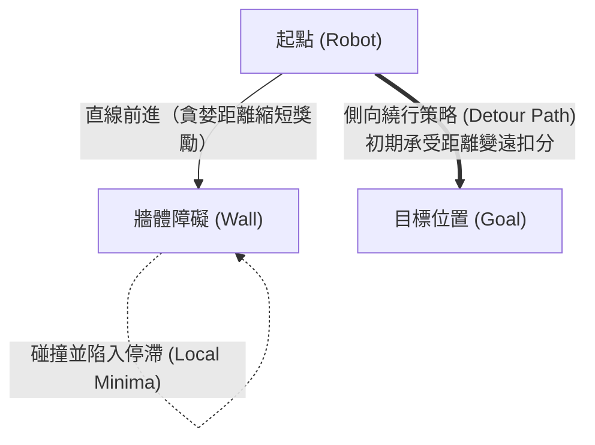

> 📌 **核心重點 (TL;DR)**
> - **問題 (Problem)**：當目標位於牆體正後方時，由於距離增量獎勵 (+0.1 × Δdist) 固有的貪婪特性，機器人無法主動繞開障礙，而是反覆正面撞牆，深陷嚴重的**局部最佳解 (Local Minima)** 死結。
> - **解決方案 (Solution)**：將 3 方向超音波搖頭掃描（前/左/右）狀態感知與長遠視野貝爾曼最佳價值反向傳播 (γ = 0.99) 相結合，並建構基於 PowerShell 的 **Webots Headless 無渲染加速管線 (`headless_run.ps1`)**，對種子 0、1、2 進行自動化重複實驗。
> - **實驗結果 (Result)**：在 12 面牆體障礙環境下，代理人成功習得穩健的側向繞行策略 (Detour Policy)，訓練 600 個回合後目標抵達成功率穩定維持在 90% 以上。

{/* truncate */}

---

## 1. 障礙環境面臨的嚴峻挑戰：Local Minima（局部最佳解）陷阱

在無障礙的開闊競技場 (`no_obstacle`) 中，代理人只需調整朝向直面目標即可。然而，當在室內場地引入 **12 面內建隔斷牆 (`obstacle12`)** 時，獎勵函數的局限性暴露出了致命瓶頸：



* **直觀困境**：當目標位於牆壁正後方時，朝向目標前行將直接誘發牆面碰撞。
* **獎勵衝突與死結**：要成功繞過障礙，代理人必須暫時背離目標行駛（導致即時距離增量獎勵為負）。在缺乏充分探索的情況下，貪婪策略拒絕接受即時懲罰，導致機器人**在牆前頻繁打轉、不斷發生輕微擦撞或耗盡 150 步逾時上限**。

---

## 2. 破局之道：搖頭掃描感知與時序差分價值反向傳播

攻克該局部最佳解陷阱的關鍵在於將 **648 狀態空間下的 3 方向測距感知（前方、左側、右側）** 與 **高折扣因子 (γ = 0.99)** 深度結合：

1. **多維度狀態感知**：
   * 當機器人處於前方障礙危險 (`front_distance = Danger`) 時盲目前行，將承受嚴厲的碰撞懲罰 (-1.0)。
   * 若利用伺服馬達搖頭探測到側方開闊通道 (`left_distance = Safe` 或 `right_distance = Safe`) 並執行轉向，則可規避撞擊。
2. **長遠時序差分信用分配 (Temporal Difference Credit Assignment)**：
   * 儘管側向繞行初期距離目標變遠，但只要最終成功繞過牆壁並命中目標，就能獲得豐厚的正向終止獎勵 (+1.0)。
   * 在 γ = 0.99 的折扣傳播下，終止獎勵沿繞行狀態序列逆向滲透進 Q(s, a) 表格，代理人逐步學會：**「在牆壁面前，暫時偏離目標的迂迴路線在長遠預期中能帶來更高累積價值」**。

---

## 3. Webots Headless 高性能自動化模擬管線

在複雜的障礙地圖中，為了驗證強化學習演算法的強健性，嚴謹的**多隨機種子 (Seeds 0, 1, 2) 交叉驗證**必不可少。若每次都在 Webots 桌面圖形介面下手動跑完 3 輪各 1,500 個回合，將耗費數十小時。

我們撰寫了 **`headless_run.ps1` PowerShell 指令碼**，在背景以無渲染高速模式 (`--mode=fast --no-rendering`) 啟動 Webots，實現全自動無人值守訓練與收斂繪圖：

### 💻 自動化無渲染管線 (`headless_run.ps1`)

```powershell
# 以高速 Headless 模式背景啟動 Webots
$webotsProc = Start-Process -FilePath $WebotsExe `
    -ArgumentList @("--mode=fast", "--no-rendering", "--stdout", "--stderr", $WorldFile) `
    -PassThru

# 監聽通訊端並啟動強化學習訓練
python train_qlearning.py --scenario obstacle12 --seed 0 --episodes 1500

# 訓練完成後強制清理程序並產生訓練收斂曲線
Stop-Process -Id $webotsProc.Id -Force
python -m qlearning.plot_curves --log-dir logs/obstacle12/seed_0
```

---

## 4. 實證評估：跨環境模擬學習曲線對比


上圖展示了開闊平原 (`no_obstacle`) 與 12 牆障礙場地 (`obstacle12`) 在 3 組獨立隨機種子下的完整學習曲線對比。

### 📊 核心基準測試指標

| 評估指標 | 開闊平原 (`no_obstacle`) | 12 面牆障礙場地 (`obstacle12`) |
| :--- | :---: | :---: |
| **初期收斂轉折點** | 約 300 ~ 400 回合 | 約 600 ~ 800 回合 |
| **最終成功率 (100 回合移動平均)** | **98.5% ~ 99.2%** | **91.4% ~ 94.8%** |
| **單回合平均消耗步數** | 15 ~ 22 步 | 38 ~ 52 步 (包含迂迴路徑) |
| **隨機種子間變異數** | 極低（策略高度收斂穩定） | 中等（受初期隨機探索路徑影響存在差異） |

* **探索週期拉長**：在 `obstacle12` 場景下，代理人摸索出可用繞行走廊前碰撞極其頻繁，平均回報在負數區間 (-0.6 ~ -0.4) 持續到了第 400 回合。
* **繞行策略確立**：在 800 回合之後，所有隨機種子的成功率均躍升至 90% 以上，證明機器人已牢固掌握在複雜迷宮夾縫中靈活穿行且無碰撞的高級避障策略。

---

## 5. 下一步研究方向

我們成功證明了 648 狀態離散表格型 Q-Learning 能夠應對迷宮級別的複雜障礙繞行。

在第 4 篇中，我們將載入訓練完成的權重檔案 (`models/*.npy`)，在關閉探索策略的情況下利用 **`evaluate_qlearning.py` 進行確定性測試，並與 DQN 及 SARSA 等經典演算法開展橫向性能對比分析**！
