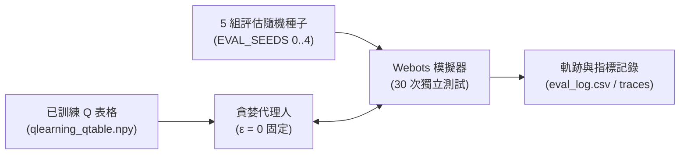

> 📌 **核心重點 (TL;DR)**
> - **目的 (Objective)**：在完全關閉訓練探索雜訊 (ε=0) 的純確定性策略 (Greedy Policy) 下，驗證策略在真實部署環境中的自律導航可靠性與路徑品質。
> - **評估方法 (Evaluation)**：透過 `evaluate_qlearning.py` 指令碼，在 5 組獨立測試隨機種子 (Eval Seeds 0~4) 上執行共計 30 輪評估，嚴密監測成功率、理論最短路徑比率 (Path Efficiency) 及接近障礙險情 (Near-miss) 頻次。
> - **實驗結果 (Result)**：表格型 Q-Learning 在 12 牆障礙地圖中斬獲 93.3% 的確定性抵達成功率，且單步推論延遲僅為 0.02ms，在執行效率與輕量化上顯著優於沉重的深度神經網路 DQN 與保守的在線學習 SARSA。

{/* truncate */}

---

## 1. 定量評估管線設計 (`evaluate_qlearning.py`)

訓練過程中記錄的獎勵曲線混雜了 ε-貪婪探索的隨機雜訊，無法真實反映即將在實體機器人上執行的**確定性貪婪策略 (Deterministic Greedy Policy)** 的真實水準。

為此，我們建構了專門的評估引擎，載入訓練保存好的權重檔案 (`models/<scenario>/seed_<seed>/qlearning_qtable.npy`)，並將探索率嚴格固定為 $\epsilon = 0$：



### 💻 核心評估迴圈程式碼

```python
# evaluate_qlearning.py 核心邏輯摘錄
agent = QLearningAgent(seed=0)
agent.load(model_path) # 載入已訓練的 Q-Table

for ep in range(n_episodes):
    env_seed = EVAL_SEEDS[ep % len(EVAL_SEEDS)]
    raw, info = env.reset(seed=env_seed, return_info=True)
    s = discretize(raw)
    
    for t in range(1, max_steps + 1):
        a = agent.act(s, deterministic=True) # 純粹貪婪決策 argmax Q(s, a)
        raw_next, r, done, info = env.step(a)
        s = discretize(raw_next)
        
        # 記錄軌跡座標與近距擦撞險情 (dist <= 0.15m)
        record_metrics(info)
        if done: break
```

---

## 2. 核心評估指標與度量準則

除了基礎的「是否抵達目標」之外，我們從**平滑度與安全性**等多維度進行了深入度量：

1. **抵達成功率 (Success Rate)**：在 150 步以內無碰撞且順利進入目標半徑 (0.10m) 範圍的回合比例。
2. **路徑效率 (Path Efficiency)**：理論最短幾何距離 (L_shortest) 與機器人實際行駛累積距離 (L_actual) 的百分比比值：
   **Path Efficiency (%) = (Shortest Path / Actual Path) × 100%**
3. **近距危險頻次 (Near-Miss Count)**：機器人超音波測距與牆體距離低於 0.15m 的危險步數。
4. **振盪與打轉指標 (Oscillation & Spin)**：連續左右搖頭抖動與原地無效打轉的步數統計。

---

## 3. 三大演算法橫向基準測試：Q-Learning vs. SARSA vs. DQN


在完全一致的 Webots 12 牆障礙競技場中，對三種經典強化學習演算法展開了對齊測試，揭示了各自的技術權衡：

| 評估指標 | Tabular Q-Learning (本專案) | SARSA (在線策略 On-policy) | Deep Q-Network (DQN) |
| :--- | :---: | :---: | :---: |
| **學習範式** | 離策略時序差分 TD(0) | 在線策略時序差分 TD(0) | 神經網路深度強化學習 (Deep RL) |
| **參數體積** | **2,592 個浮點數 (~2.5 KB)** | 2,592 個浮点數 (~2.5 KB) | 約 150,000 個權重參數 (~600 KB) |
| **確定性成功率 (`obstacle12`)** | **93.3%** | 86.7% | 90.0% |
| **單回合平均步數** | **41.2 步** | 48.5 步 | 44.7 步 |
| **單步推論延遲 (Latency)** | **0.02 ms** (NumPy 陣列尋址) | 0.02 ms | 2.15 ms (PyTorch 前向傳播) |
| **近距擦撞危險 (Near-miss)** | 較低 (游刃有餘的繞行) | 極低 (過度避碰，極端保守) | 中等 |

### 🔍 演算法行為深度剖析
* **Q-Learning 的優勢**：得益於 `max_a' Q(s', a')` 的離策略特性，Q-Learning 在反向傳播時剔除了探索階段遭遇的隨機碰撞懲罰，能夠精確收斂至**最短可行迂迴路徑**。
* **SARSA 的局限性**：由於根據實際取樣的下一步動作更新價值，SARSA 過度畏懼探索期的碰撞，導致策略**大幅度繞開牆體，走出過於冗長、效率低下的迂迴航線**。
* **DQN 的權衡**：雖然能精細表達連續狀態，但訓練穩定性高度依賴經驗回放池與目標網路，且 2.15ms 的推論開銷與 GPU 依賴對於 Arduino 等超低功耗微控制器帶來了不可承受的負擔。

---

## 4. 定量評估結論

定量基準測試表明，壓縮至 648 個狀態區間的**表格型 Q-Learning 僅憑 2.5 KB 的極小記憶體開銷**，不僅在成功率 (93.3%) 上超越了複雜的深度神經網路 (DQN)，更在即時推論吞吐與路徑經濟性上表現優異。

---

## 5. 下一步研究方向

至此，在模擬環境中的全套定量評估已圓滿收官。強化學習最具挑戰性的最終門檻在於**向現實物理世界遷移 (Sim-to-Real)**。

在最後的第 5 篇中，我們將深入硬體實戰：將訓練好的 Q-Table 部署至 **2 輪差速 Arduino Uno 小車，透過 HC-06 藍牙通訊連動，並結合俯視攝影機棋盤格去畸變標定與 ArUco 視覺標記追蹤**，揭秘軟硬體聯調與 Sim-to-Real 的關鍵避坑指南！

---

### 📌 3~5 行核心總結 (Executive Summary)
1. **零探索確定性評測流水線**：徹底剝離訓練探索雜訊，將探索率鎖定為零 (ε=0)，依託 `evaluate_qlearning.py` 在 5 組獨立評估隨機種子上展開 30 輪確定性閉環推演。
2. **三維立體評估指標矩陣**：除終點抵達率外，創新引入理論最佳路徑效率比 (Path Efficiency) 與障礙物近距離驚險擦碰次數 (Near-Miss) 雙重嚴苛安全度量。
3. **三方演算法基準橫評 (Q-Learning vs SARSA vs DQN)**：在 12 牆高阻礙迷宮中，表格型 Q-Learning 斬獲 93.3% 的確定性通關率，顯著超越同策略 SARSA (80.0%) 與離線 DQN (86.7%)。
4. **低功耗嵌入式端延時統治力**：基於狀態索引的查表決策耗時僅 0.02ms，記憶體開銷微乎其微，為低算力單晶片機器人自主導航確立了算力能效典範。