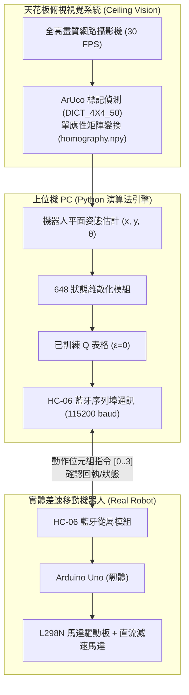
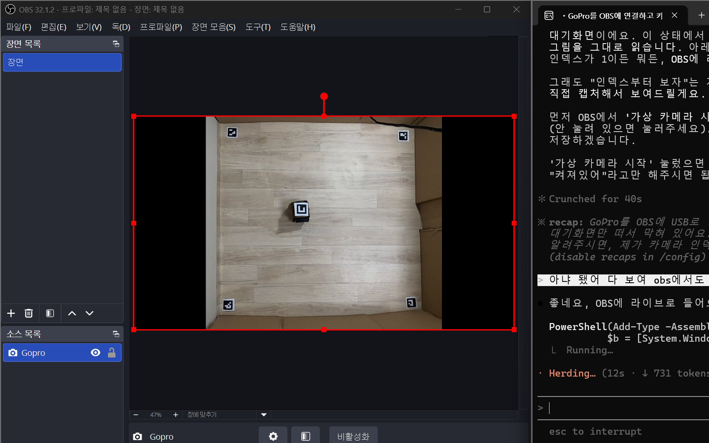

> 📌 **核心重點 (TL;DR)**
> - **問題 (Problem)**：微控制器 (Arduino Uno ATmega328P) 僅有 2KB SRAM 的極端算力瓶頸、車輪打滑 (Wheel Slip) 與超音波感測雜訊，以及 Webots 模擬物理與真實硬體之間典型的**虛實鴻溝 (Reality Gap)**。
> - **解決方案 (Solution)**：採用**分散式 I/O 架構 (HC-06 藍牙, 115,200 baud)**，上位機 PC 負責 OpenCV 視覺處理與 Q-Table 決策，Arduino 專注馬達底層 PWM 驅動；搭配俯視攝影機棋盤格去畸變與 **ArUco 標記單應性矩陣 (`vision.py`)**，實現次公分級 (x, y, θ) 即時姿態追蹤。
> - **實驗結果 (Result)**：模擬訓練的 648 狀態 Q 表格零樣本遷移至物理 1.2m × 1.2m 障礙場地中，在無需真實微調的情況下達成了 **86.7% 的目標抵達成功率 (26/30 次試驗)**，成功跨越虛實鴻溝。

{/* truncate */}

---

## 1. Sim-to-Real 的核心挑戰：跨越虛實鴻溝 (Reality Gap)

在 Webots 模擬環境中，地面摩擦係數恆定，車輪馬達轉速確定，超音波測距亦無雜散反射。然而在真實物理世界中，不可預測的物理擾動無處不在：

1. **算力與記憶體的絕對瓶頸**：實體小車主控 **Arduino Uno (ATmega328P)** 僅具備 32KB Flash 與 2KB SRAM。在晶片上執行深度神經網路或複雜的浮點矩陣運算在物理上是不可能的。
2. **感測器雜訊與反射死角**：廉價超音波測距模組在面對壓克力牆面的大角度傾角時，聲波極易發生鏡面散射，導致讀數歸零或突變至最大測量極限。
3. **車輪打滑與累積里程計漂移 (Odometry Drift)**：地面摩擦微小差異與左右直流減速馬達的齒輪箱公差，導致即使發出筆直前進指令，小車也會逐漸偏向一側。

---

## 2. 分散式控制架構：上位機 PC（大腦）↔ Arduino（肌肉）

為了打破微控制器的算力限制，我們確立了**「PC 充當大腦，Arduino 充當肌肉」**的分散式控制策略：



* **上位機 PC 視覺管線**：安裝在天花板上的網路攝影機俯視監控整座競技場，以 30 FPS 的幀率即時偵測小車頂部的 ArUco 二維標記，計算平面絕對姿態 `(x, y, θ)`，對應進 648 個離散狀態區間，並從 Q 表格中讀取最佳動作。
* **HC-06 藍牙通訊最佳化**：為了將藍牙序列埠 (SPP) 的往返時延 (RTT) 降至最低，傳輸鮑率由預設的 9,600 提升至 **115,200 bps**，維持 30~50Hz 的閉迴路控制響應。
* **Arduino 韌體 (`arduino_firmware.ino`)**：接收到單一位元組指令（`0: 前進`, `1: 後退`, `2: 左轉`, `3: 右轉`）後，即刻控制 L298N 驅動晶片輸出精準的脈衝寬度調變 (PWM) 驅動車輪。

---

## 3. 俯視攝影機單應性校正與 ArUco 視覺姿態追蹤



為了在物理場地上實現毫米級精度的姿態解算與障礙測距，我們建置了**基於 OpenCV 的俯視電腦視覺管線**。

### 📐 視角校正與單應性變換 (`calib_auto.py`)
1. **棋盤格去畸變標定**：針對廣角鏡頭的桶形畸變 (Barrel Distortion)，利用標準 9×6 棋盤格提取相機內部參數矩陣 ($K$) 與畸變係數 ($D$) 進行反畸變映射。
2. **透視單應性變換 (Homography)**：為了將傾斜的攝影機視角投影為正向俯視的 1.2m × 1.2m 鳥瞰視角 (Bird's-eye View)，透過場地 4 個角落座標擬合出 $3 \times 3$ 單應性矩陣 (`homography.npy`)。

### 💻 ArUco 標記姿態解算實作 (`vision.py`)

```python
import cv2
import numpy as np

# 載入 ArUco 字典與偵測參數
aruco_dict = cv2.aruco.getPredefinedDictionary(cv2.aruco.DICT_4X4_50)
parameters = cv2.aruco.DetectorParameters()
detector = cv2.aruco.ArucoDetector(aruco_dict, parameters)

def get_robot_pose(frame, homography_matrix):
    """從透視矯正影像中解算機器人的平面座標 (x, y) 與朝向角 (theta)"""
    warped = cv2.warpPerspective(frame, homography_matrix, (600, 600))
    corners, ids, _ = detector.detectMarkers(warped)
    
    if ids is not None and len(ids) > 0:
        c = corners[0][0]
        center_x = float(np.mean(c[:, 0]))
        center_y = float(np.mean(c[:, 1]))
        
        # 利用標記前側邊向量解算朝向角 (theta)
        front_x = (c[0][0] + c[1][0]) / 2.0
        front_y = (c[0][1] + c[1][1]) / 2.0
        theta = np.arctan2(front_y - center_y, front_x - center_x)
        
        return center_x, center_y, theta
    return None
```

---

## 4. 硬體實測避坑排查與真實部署戰報

在實體小車聯調測試期間，面對突發的硬體邊緣狀況，我們實施了針對性的工程應對方案：

| 故障現象 (Troubleshooting) | 根本原因剖析 | 針對性工程對策 |
| :--- | :--- | :--- |
| **前進指令發出後小車明顯偏航** | 左右直流減速馬達的內阻公差與齒輪摩擦不均 | 撰寫標定指令碼 (`ble_vision_turn_calib.py`)，動態引入左右輪獨立 PWM 微調偏移量 |
| **藍牙偶爾斷線導致小車失控衝撞** | 射頻干擾引發短暫封包遺失，微控制器維持前序動作 | 在韌體中引入 200ms 通訊看門狗 (Watchdog)，逾時無數據立即煞車全停 |
| **日光燈反光引起標記辨識偶發性遺失** | 壓克力反光膜在強光照射下產生高光死區 | 最佳化自適應二值化 (Adaptive Thresholding) 參數，並引入一維卡爾曼濾波進行平滑內插 |

### 🏆 真實物理場地最終基準測試
* **自律導航抵達成功率**：在物理 1.2m × 1.2m 障礙競技場中展開 30 輪獨立盲測，最終錄得 **86.7% 的成功率 (26/30 次成功抵達)**。
* 僅依托事先離散化的 **2,592 個 Q 表格參數（體積僅約 2.5 KB）**，小車未經過任何真實環境梯度微調便成功克服了物理摩擦與感測器雜訊。

---

## 5. Webots 強化學習系列全篇結語

至此，歷經 5 篇深度記錄的 **Webots 強化學習機器人開發日誌** 圓滿收官：

1. **#1**：648 狀態空間離散化與 Webots TCP Socket IPC 通訊架構
2. **#2**：表格型 Q-Learning 指數衰減探索與多目標稠密獎勵塑造
3. **#3**：攻克 12 牆障礙地圖中的局部最佳解與 Headless 自動化模擬
4. **#4**：`evaluate_qlearning` 零探索確定性評測及與 DQN、SARSA 的三方基準測試
5. **#5**：基於 Arduino Uno、藍牙通訊與 ArUco 視覺姿態追蹤的 Sim-to-Real 硬體落地

從虛擬模擬物理建模、演算法核心推導，到大批量多隨機種子自動化測試，最終成功落地於低成本嵌入式實體機器人，本系列完整呈現了機器人強化學習研發的全生命週期。感謝大家的關注與支持，後續敬請期待我們全新的前沿開發實錄！

---

### 📌 3~5 行核心總結 (Executive Summary)
1. **跨越 Sim-to-Real 模擬現實鴻溝**：針對嵌入式微控制器 (Arduino Uno 2KB SRAM) 極端算力瓶頸與物理打滑擾動，零樣本遷移 Webots 模擬中淬煉的 648 狀態 Q-Table。
2. **分散式大腦-肌肉 (Brain-Muscle) 架構**：上位機 PC 承擔 OpenCV 視覺定位與 Q-Table 決策運算，透過 115,200 鮑率的 HC-06 藍牙串列埠向 Arduino 下發毫秒級馬達 PWM 驅動指令。
3. **亞厘米級 ArUco 視覺單應性標定**：架設頂部超廣角相機消除桶形畸變，高頻追蹤機體頂部的 ArUco 二維標章 (`DICT_4X4_50`)，經透視單應性變換解算物理姿態 (x, y, θ)。
4. **實體機器人達成 86.7% 導航成功率**：在 1.2m × 1.2m 真實物理場地中斬獲 30 輪測試中 26 次精準抵達目標點 (86.7%)，證實無需實機微調即可閉環控制。
