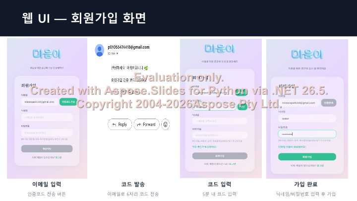

步入 6 月，Maeumjigi 畢業專題團隊完成了第一學期全部核心功能的攻堅研發，
將全部精力傾注於生產發布不可或缺的**安全防護網 (Safety Wrapper) 構築**與**學期終期簡報**衝刺。

{/* truncate */}

### 2:1 黃金配比模型的勝利與 Safety Wrapper 安全防護網架構

> 「我們最終選定大模型的科學依據與決策結果是什麼？」
> 「確立為 2:1 配比模型。請基於 safety_wrapper 設計外掛安全鎖方案，將其深度串接主大模型 (Main LLM 2:1) 作為強制防禦鏈路。」

依托第 4 輪微調的嚴格基準橫向測評，我們將「同理心諮商語料」與「日常閒聊語料」按 2:1 科學配比訓練的模型正式敲定為主服務 LLM。然而，鑑於心理防範自殺介入系統的特殊敏感性，系統絕不容許哪怕一次大模型幻覺 (Hallucination) 或致命誘導回答。

為此，我們架構並落地了 **Safety Wrapper 雙層安全過濾防護網**：在使用者輸入與大模型輸出兩端設定雙向即時攔截器。一旦偵測到極高危自殺傾向訊號 (Active Suicidality)，系統繞過黑盒大模型，毫秒級無縫熔斷切換至預先固化的危機介入專業應急回應協定 (Resource Inquiry Cues)。

### 雲端 GPU (AWS EC2) 預算測算與終期簡報完美謝幕

> 「我們需要一份契合系統部署規格的 AWS EC2 成本測算清單。連續執行 5 個月 g5.2xlarge 執行個體的預算是多少？」
> 「基於全週期研發成果，編寫第一學期終期簡報投影片 1학기_최종발표_마음지기.pptx！」

針對暑假期間全端服務（前端/後端/向量知識庫/微調大模型）的持續運作，我們測算了基於 Amazon EC2 GPU (g5.2xlarge) 執行個體的 5 個月生產部署預算方案。

6 月 18 日，我們彙聚了後端架構（PostgreSQL、分頁、鑑權）、前端互動（情緒日記、社群看板）以及大模型核心演算法（4 輪微調演進與 Safety Wrapper 安全防護網）的全景成果，圓滿完成了**第一學期畢業專題終期簡報 (PPTX)**！

至此，心語伴侶在第一學期規劃的各項核心指標全部高品質超額達成。前後端穩定連動、微調大模型與雙層安全防護網嚴絲合縫，各模組如精密齒輪般順暢運轉。暑假期間，我們將完成系統在雲端 GPU 伺服器的全面安家，在即將到來的第二學期，攜真實使用者的定向測試與更強大的客製化心理介入服務重裝歸來！
敬請繼續見證心語伴侶團隊永不落幕的前沿創新征程！
