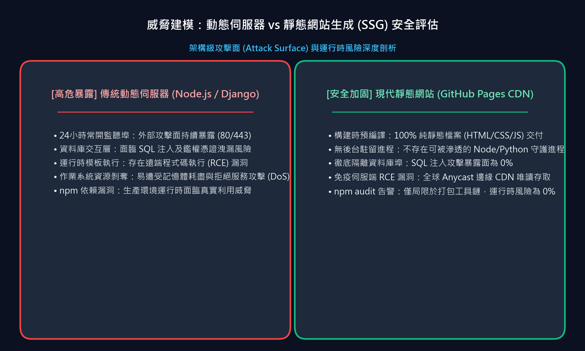
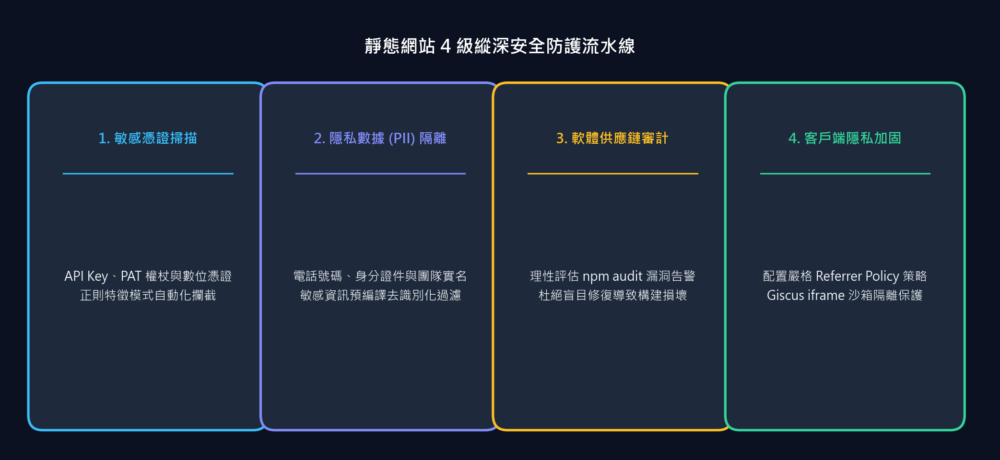

每一位現代前端開發者都曾體驗過腎上腺素飆升的瞬間：當你在一個乾淨整潔的文件或部落格程式碼庫中執行 `npm audit` 時，終端機突然噴湧出一片觸目驚心的鮮紅警告：

```text
45 vulnerabilities (15 moderate, 15 high, 15 critical)
To address all issues (including breaking changes), run:
  npm audit fix --force
```

看到諸如 **Critical (嚴重)**、**Remote Code Execution (遠端代碼執行/RCE)** 和 **Prototype Pollution (原型鏈污染)** 這樣的高危詞彙，人類的第一反應往往是毫不猶豫地敲下 `npm audit fix --force`，試圖讓這些刺眼的紅字立刻消失。

然而，在基於 **靜態網站產生器 (SSG)**（例如部署在 GitHub Pages 或 AWS S3 上的 Docusaurus、Next.js 或 Hugo）的世界裡，這樣做往往是一個嚴重的工程誤判——它不僅無法真正提升你的安全水位，反而會破壞生產環境的建構流程。

在本文中，我們將深入剖析 **靜態網站的威脅模型 (Threat Model)**，揭示打包編譯期漏洞與線上伺服端漏洞的本質差異，並分享一套經生產檢驗的 **4 層靜態安全加固藍圖**，保護真正核心的資產：你的機密憑證、訪客隱私以及程式碼庫完整性。

{/* truncate */}

---



---

## 1. 核心工程權衡概述

1. **編譯期工具不等於線上執行時**：在 `npm audit` 中被標記的依賴套件（例如 `tinypool`、`serialize-javascript`、`postcss-selector-parser`）是僅在開發者本地執行 `npm run build` 時被 Node.js 呼叫的編譯打包依賴。
2. **CDN 邊緣零後端服務**：一旦編譯完成，GitHub Pages 分發的僅僅是不可變的純靜態 HTML、CSS 和客戶端 JavaScript。在生產環境中，**不存在任何常駐執行的 Node.js 守護程序**，沒有任何開放監聽的後端連接埠，也完全沒有資料庫連線。
3. **`--force` 的破壞性**：盲目執行 `npm audit fix --force` 會強行降級核心框架（例如將 Docusaurus 回退到舊版本），破壞對 React 19 的相容性、MDX v3 渲染管線以及未來功能開關架構。
4. **靜態網站真正的攻擊面**：靜態部落格面臨的真正威脅是 **公開 Git 提交歷史中的 API 金鑰外洩**、**資料集中的個人隱私 (PII) 暴露** 以及 **客戶端跨域數據洩漏**。

---

## 2. 深度拆解 45 個漏洞：編譯期 vs 執行時

讓我們審查一下稽核日誌中實際報告的典型 CVE：

### A. Tinypool 原型鏈污染 (`GHSA-5gmw-xhrv-c9v3` - Critical 嚴重)
- **漏洞原理**：如果向 `tinypool` 的 Worker 初始化選項中傳入不可信的使用者輸入，攻擊者可污染 `Object.prototype`。
- **靜態網站現實**：`tinypool` 僅在 `@docusaurus/faster` 內部用於在建構期間跨 CPU 核心並行處理打包任務。所有的輸入參數均嚴格來自於開發者自身的 `docusaurus.config.ts`。線上外部訪客根本無法向你本地的 CPU 程序池發送任何 HTTP 負載。

### B. Serialize-JavaScript 遠端代碼執行 (`GHSA-5c6j-r48x-rmvq` - High 高危)
- **漏洞原理**：透過精心建構的 RegExp 標誌或序列化日期實作遠端代碼執行。
- **靜態網站現實**：Webpack 僅使用它將內部編譯區塊序列化為靜態 `.js` 代碼束。一旦寫入 `build/` 目錄，這些 JavaScript 僅僅是透過 HTTPS 分發的靜態資源檔案，伺服端完全不發生任何反序列化過程。

### C. PostCSS Selector Parser CPU 耗盡 (`GHSA-rj75-hqrm-r3gf` - Moderate 中危)
- **漏洞原理**：解析器在處理特定平鋪選擇器時具有二次方時間複雜度，可透過惡意 CSS 字串導致拒絕服務 (DoS)。
- **靜態網站現實**：被解析的 CSS 檔案完全是專案自身的主題樣式表（`custom.css`）。除非攻擊者擁有向你 Git 儲存庫推送程式碼的權限，否則建構機器永遠不會解析不可信的外部 CSS。

在這種情況下強行執行 `npm audit fix --force`，npm 會嘗試將 `@docusaurus/core` 從 `3.10.2` 強制降級到 `3.7.0`。這會直接導致 Docusaurus v4 特性與 React 19 渲染徹底崩潰——為了修復一個在你的物理架構中根本不可能被觸發的漏洞，反而親手向生產程式碼中引入了致命 Bug。

---

## 3. 真正重要的防線：4 層靜態安全加固藍圖

如果建構工具漏洞風險極低，靜態網站工程師應該將安全精力投入到哪裡？以下是本部落格實施的縱深防禦體系。



### 第一道防線：Git 提交前自動化金鑰掃描 (Pre-Commit Secret Scanning)

對於公開開源的技術部落格而言，最大的滅頂之災是在 Git 提交中不慎洩露 OpenAI 金鑰 (`sk-...`)、GitHub Token (`ghp_...`) 或 AWS 存取憑證 (`AKIA...`)。

我們編寫了自動化稽核指令碼（`tools/audit_security.py`），利用 Git 的底層物件資料庫，在提交前掃描所有追蹤檔案：

```python
PATTERNS = [
    (r'(?i)(api[_-]?key|secret|token|password|auth|bearer)\s*[:=]\s*["\']([^"\']{8,})["\']', "Potential Key Assignment"),
    (r'ghp_[a-zA-Z0-9]{36}', "GitHub Personal Access Token"),
    (r'sk-[a-zA-Z0-9]{32,}', "OpenAI API Key"),
    (r'AIzaSy[a-zA-Z0-9_-]{33}', "Google API Key"),
    (r'AKIA[0-9A-Z]{16}', "AWS Access Key"),
    (r'-----BEGIN\s+(RSA\s+)?PRIVATE\s+KEY-----', "Private Key Certificate"),
]
```

在每次程式碼發布前執行此稽核工具，確保硬編碼的敏感 Token 絕不會逃逸至遠端公開儲存庫。

### 第二道防線：個人身分識別資訊 (PII) 嚴格去識別化

在發布涉及 AI 資料集盲測的技術專欄時（例如我們的 23 篇心靈守護者心理諮商系列或 5 篇 ANPR 視覺 AI 系列）：
- **合成資料優先**：所有心理對話案例均由大模型流程（`synth_gen`）端到端合成，絕不使用真實患者對話記錄，從源頭上杜絕醫療隱私外洩。
- **正則敏感資訊排查**：自動化校驗所有 Markdown 內容，防範電話號碼或身分登記字號等敏感欄位意外流出。

### 第三道防線：深度強化的 `.gitignore` 規範

許多標準的 `.gitignore` 僅僅忽略了 `.env.local`，卻留下了 `.env`。我們將設定進行了工業級強化，徹底阻斷敏感金鑰、憑證及原始分析記錄：

```gitignore
# 環境變數與機密憑據保護
.env
.env.*
*.pem
*.key
*.pfx
*.cert
*credential*
*.secret

# 資料分析原始匯出檔案
*.csv

# 廢棄的舊版本範本
_old/
```

### 第四道防線：客戶端隱私保護與 Iframe 沙盒隔離

即使沒有後端伺服器，靜態網站也必須尊重訪客隱私並防止數據外洩：

1. **嚴格的 Referrer 策略**：在 `docusaurus.config.ts` 的 `<head>` 中注入安全請求頭：
   ```typescript
   themeConfig: {
     metadata: [
       { name: 'referrer', content: 'strict-origin-when-cross-origin' },
     ],
   }
   ```
   確保訪客點擊外鏈跳轉時，瀏覽器會自動截斷部落格的具體文章路徑及參數，防止內部 URL 洩漏。

2. **Giscus 留言系統沙盒化**：透過 GitHub Discussions 承載互動評論時，配置：
   - `emitMetadata="0"`：禁止 iframe 廣播跨頁面訊息，防範第三方指令碼窺探討論詳情；
   - `loading="lazy"`：延遲載入留言模組，直到訪客真正滾動至文章底部才觸發執行。

---

## 4. 給開發者的核心啟示

- **面對 `npm audit` 保持清醒**：時刻區分 **建構期依賴** 與 **線上執行時依賴**。
- **警惕 `--force` 陷阱**：自動降級往往會在修復虛幻安全隱患的同時，親手向生產環境注入真實的破壞性 Bug。
- **聚焦真正的攻擊面**：建立程式碼提交前金鑰掃描、清洗敏感資料集、配置嚴密的客戶端隱私策略，守護真正的數位核心。