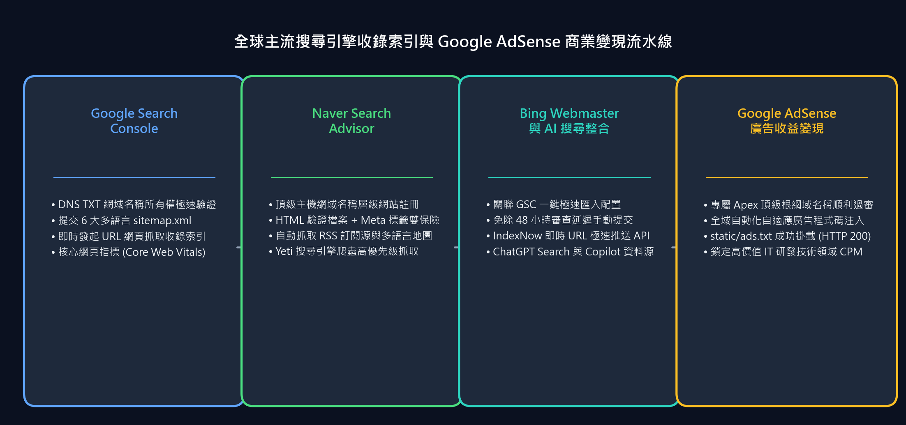

在 GitHub Pages 的二級子網域（`username.github.io/project`）下託管技術部落格，對於開發者而言是一種極其敏捷的分享途徑。然而，隨著技術讀者群的擴大以及開啟商業化變現的需要，你會撞上一堵堅硬的規則高牆：**Google AdSense（谷歌廣告聯盟）嚴格禁止針對 `*.github.io` 等免費二級子網域提交網站申請**。為了取得 AdSense 官方發布商資格、累積長期的網域權威度（Domain Authority）並獲取全球各區域的自然搜尋流量，擁有一個專屬的**頂級獨立根網域（Apex Custom Domain）**是必不可少的基石。

將靜態文件或技術部落格遷移至獨立網域，絕非只是簡單修改一條 DNS 解析記錄。它涉及網域註冊商的權威名稱伺服器委派、邊緣 SSL 終結、規範化重新導向、自動化發布商 `ads.txt` 託管，以及跨越各大搜尋引擎站長工具平台特有的 UI 隱蔽陷阱。

在本指南中，我們將全面復盤從 `jbjihwan.github.io/global_blog` 零停機遷移至 `https://globaldevlog.com` 的端到端全過程，涵蓋高可用 DNS 架構設計、AdSense 審核合規設定，以及在 Google Search Console、Naver Search Advisor 和 Bing Webmaster Tools 中遇到的真實索引問題的排查方案。

{/* truncate */}

---


---

## 1. 架構戰略：Porkbun + Cloudflare + GitHub Pages

將根網域（例如 `globaldevlog.com`）綁定至 GitHub Pages 時，最原始的方法是將 `A 記錄` 直接指向 GitHub 官方的 4 個 Anycast IP（`185.199.108.153` 等）。這種方式雖然可用，但缺失了現代雲端必備的邊緣安全防護、DDoS 攻擊清洗以及自動化 HTTPS 憑證續期。

為此，我們構建了高可用的**三層解耦生產架構**：

| 層級 | 服務商 | 核心職責 |
| :--- | :--- | :--- |
| **網域註冊商 (Registrar)** | **Porkbun** | 網域購買、終身免費 WHOIS 隱私保護、DNSSEC 支援、權威 NS 委派 |
| **邊緣 DNS 與安全層** | **Cloudflare** | 全球 Anycast DNS、**根網域 CNAME 扁平化 (Flattening)**、Universal SSL 邊緣憑證、惡意 Bot 清洗 |
| **靜態源站 (Origin SSG)** | **GitHub Pages** | 承載由 Docusaurus 編譯產生的純靜態產物、零伺服器維護成本、`gh-pages` 分支自動化同步 |

### Porkbun 名稱伺服器委派
在 Porkbun 網域管理控制台中，將預設的註冊商 Nameservers 替換為 Cloudflare 分配的專用邊緣伺服器：
```text
NS: roan.ns.cloudflare.com
NS: sneh.ns.cloudflare.com
```

### Cloudflare CNAME 扁平化設定
根據 RFC 1034 規範，根網域（`@`）因需共存 SOA/NS 記錄而在傳統上無法配置 CNAME。Cloudflare 藉助其專利技術 **CNAME 扁平化 (CNAME Flattening)** 完美解決了這一限制，可無縫將 `@` 解析指向 GitHub Pages：
- **Type**: `CNAME` | **Name**: `@` | **Target**: `jbjihwan.github.io` | **Proxy status**: Proxied (已開啟代理/橘色雲朵)
- **Type**: `CNAME` | **Name**: `www` | **Target**: `jbjihwan.github.io` | **Proxy status**: Proxied (已開啟代理/橘色雲朵)
- **SSL/TLS 模式**: 設定為 **Full (完全)** 或 **Full Strict (完全嚴格)**，確保端到端的 HTTPS 雙向加密傳輸。

---

## 2. Docusaurus 核心配置遷移

為了平滑地將子路徑路由（`/global_blog/`）整體切換為獨立網域根路徑（`/`），我們需要更新 `docusaurus.config.ts`：

```typescript
const config: Config = {
  title: 'Global Dev Blog',
  url: 'https://globaldevlog.com',
  baseUrl: '/',
  organizationName: 'jbjihwan',
  projectName: 'global_blog',
  trailingSlash: false,
  // ...
};
```

### 靜態 CNAME 檔案配置
GitHub Pages 依靠部署分支根目錄下的純文字 `CNAME` 檔案來識別流量歸屬。必須將其放置在 `static/CNAME`：
```text
globaldevlog.com
```
執行 `npm run deploy` 時，Docusaurus 會自動將 `static/` 目錄中的所有檔案拷貝到編譯輸出的根目錄，確保 GitHub 路由引擎始終將指向 `globaldevlog.com` 的造訪請求正確映射到該儲存庫。

---

## 3. 靜態部落格 Google AdSense 審核配置

Google AdSense 審核的核心流程包括：確認網站所有權、檢測合規的發布商非同步指令碼、以及抓取位於網站根目錄下的 `ads.txt` 檔案。

### A. 非同步植入發布商指令碼
在 `docusaurus.config.ts` 的 `scripts` 陣列中非同步引入 Google AdSense 載入器：

```typescript
  scripts: [
    {
      src: 'https://pagead2.googlesyndication.com/pagead/js/adsbygoogle.js?client=ca-pub-4654073335496617',
      async: true,
      crossorigin: 'anonymous',
    },
  ],
```

### B. 根目錄部署 `ads.txt` 並完成線上驗證
在 `static/ads.txt` 中填入官方認證的發布商憑證：
```text
google.com, pub-4654073335496617, DIRECT, f08c47fec0942fa0
```
部署後透過終端機 curl 立即驗證 HTTP 200 狀態碼：
```bash
curl -I https://globaldevlog.com/ads.txt
# HTTP/2 200
# content-type: text/plain; charset=utf-8
```

---



---

## 4. 多搜尋引擎 SEO 實戰與疑難雜症排查

向各大搜尋引擎提交網站地圖時，各家平台往往有著獨特的互動規則和容易誤踩的 UI 陷阱：

### A. Google Search Console：無法刪除錯誤網站地圖的互動陷阱
在提交多語言網站地圖（`sitemap.xml`, `ko/sitemap.xml`, `ja/sitemap.xml`, `es/sitemap.xml` 等）時，若不慎誤將網站根網址 `https://globaldevlog.com/` 作為網站地圖提交，會在列表裡留下永久性的“包含錯誤”警報。

許多開發者點擊該行表格右側的縱向三點圖示（`⋮`），卻發現彈出的選單中只有反灰的“查看網頁編入索引情況”，完全找不到任何刪除按鈕。

**解決策略：**
1. 切勿點擊表格行最右側的選單按鈕。**請直接點擊該網站地圖的網址文字本身**，進入**網站地圖詳情頁面**。
2. 在詳情頁面右上角（靠近搜尋欄下方區域），點擊頁面頂部的三點圖示（`⋮`）。
3. 在彈出的選單中點擊 **[刪除網站地圖]**，即可乾淨徹底地移除該錯誤項目。
4. 若多語言網站地圖（如 `es/sitemap.xml`）因網路或 DNS 快取抖動偶發“無法抓取”，直接在上方“新增網站地圖”輸入框中重新輸入並提交，系統會立即發起二次抓取並重新整理為**成功**狀態。

### B. Naver Search Advisor：“請按主機層級輸入 URL”
Naver 佔據韓國本土主流搜尋份額。在其站長平台操作時需注意：
1. **主機層級報錯**：在初始“網站登記”彈窗中直接提交 `https://globaldevlog.com/sitemap.xml` 會觸發彈窗警告：*“URL을 호스트 단위로 입력해주세요 (請按主機層級輸入 URL)”*。該視窗僅用於登記主網域（`https://globaldevlog.com`）。
2. **所有權雙保險**：同時部署 HTML 校驗檔案（`static/naver<hash>.html`）與頁面元標籤（`themeConfig.metadata`），確保無論採用何種檢驗機制均能秒級通過。
3. **提交網站地圖與 RSS**：在管理控制台（點擊網站列表中的網域）：
   - 進入 **[請求] > [提交網站地圖]**：輸入 `sitemap.xml`
   - 進入 **[請求] > [提交 RSS]**：輸入 `https://globaldevlog.com/blog/rss.xml`
4. **加速 Yeti 蜘蛛抓取**：在 **[請求] > [網頁抓取]** 中，手動提交核心路徑（`blog`, `ko/blog` 等），促使搜尋引擎蜘蛛快速造訪。

### C. Bing 站長工具與 AI 搜尋 (Copilot / ChatGPT Search) 接入
Bing Webmaster Tools 不僅為必應搜尋提供數據，同時也是 Copilot、ChatGPT Search、Yahoo 和 DuckDuckGo 的底層索引源泉。
- **GSC 一鍵匯入**：直接授權 Google 帳號登入，可瞬間同步已驗證的網域所有權與全部網站地圖。
- **跨越 48 小時數據同步延遲**：GSC 自動同步通常需要 24 至 48 小時。直接進入左側 **[Sitemaps]** > 點擊 **[Submit sitemap]** 手動錄入 `https://globaldevlog.com/sitemap.xml`，即可免去等待，即刻驅動必應爬蟲全量入庫。

---

## 5. 生產環境最終檢查清單

在正式推廣你的獨立網域之前，請確保以下項目全部核驗通過：

- [x] **DNS 解析狀態**：`globaldevlog.com` 和 `www` 均在無 SSL 憑證告警的前提下正常回應。
- [x] **規範化 CNAME**：`static/CNAME` 已打包部署至 GitHub Pages 源站。
- [x] **AdSense 核心資產**：`https://globaldevlog.com/ads.txt` 正常返回 HTTP 200 且發布商 ID 完全符合。
- [x] **多語言網站地圖**：各語言專屬網站地圖（`/sitemap.xml`, `/ko/`, `/ja/`, `/es/`, `/zh-Hans/`, `/zh-Hant/`）均返回 HTTP 200。
- [x] **三大搜尋引擎收錄**：Google、Naver 和 Bing 均已成功完成所有權驗證，RSS 訂閱源均處於活躍抓取狀態。

憑藉這套現代化的工程基礎設施，你的靜態部落格不僅享有邊緣 CDN 的極致載入速度、零伺服器帳單開支，更獲得了覆蓋全球主要語系的頂級搜尋可見度，並為 Google AdSense 商業化變現奠定了堅實的基石。

---

### 📌 3~5 行核心總結 (Executive Summary)
1. **零成本企業級邊緣架構**：告別免費 `github.io` 次網域，透過 Porkbun、Cloudflare Anycast DNS 與 GitHub Pages 組合，在零伺服器帳單前提下實現全球加速與全鏈路 SSL。
2. **CNAME 扁平化與標準網域規範化**：藉助 Cloudflare CNAME Flattening 攻克 RFC 1034 根網域解析瓶頸，實現 `www` 向主網域的無縫平滑重定向。
3. **AdSense 驗證與 ads.txt 全面護航**：在靜態頁面 `<head>` 中硬編碼所有權中繼標籤並根目錄部署 `static/ads.txt`，徹底阻斷檢索器 404 檢索失敗陷阱。
4. **全球三大搜尋引擎全量收錄**：將多語言網站地圖與 RSS 訂閱源同步提交至 Google、Naver 與 Bing 站長平台，規避主機級報錯並最大化自然搜尋流量。
