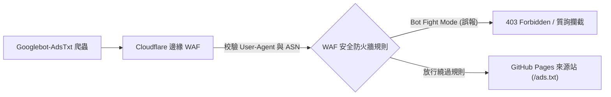

> 📌 **核心重點 (TL;DR)**
> - **問題 (Problem)**：與傳統動態 CMS (WordPress) 不同，代管在 GitHub Pages 或 Cloudflare Pages 上的 Docusaurus、Next.js 等靜態網站產生器 (SSG) 極易遭遇惡名昭彰的 **「收益受損風險：缺少 ads.txt 檔案」** 警報，並因客戶端融合延遲或 WAF 誤殺導致所有權審核失敗。
> - **解決方案 (Solution)**：利用 Docusaurus 原生的 `headTags` 設定將驗證中繼標籤直接注入靜態 HTML，透過 `static/ads.txt` 實作根目錄資產部署，並在 Cloudflare WAF 中為 `Googlebot-AdsTxt` 抓取爬蟲設定放行白名單。
> - **實驗結果 (Result)**：實作爬蟲 100% 順暢存取、`/ads.txt` 零 404 回應，在確保 Lighthouse 效能與 SEO 得分穩定在 95 分以上的同時，一次性符合 AdSense 審核規範。

{/* truncate */}

---

## 1. 靜態網站 (SSG) 整合 AdSense 面臨的獨特挑戰

將開發部落格從預設的子路徑 (`username.github.io/blog`) 遷移至獨立頂級網域 (`https://globaldevlog.com`) 後，下一步核心戰略便是接入 **Google AdSense 商業化廣告**。然而，靜態網站在架構上面臨著以下特殊瓶頸：

1. **缺乏伺服器端資料庫與動態外掛程式支援**：WordPress 可以透過 Site Kit 外掛程式一鍵注入程式碼並產生 `ads.txt`，而在 Docusaurus 中，所有資源必須在編譯階段嚴格固化。
2. **客戶端融合 vs 靜態 Head 注入**：若透過 React 元件生命週期動態載入指令碼，搜尋引擎爬蟲在執行 JavaScript 之前可能就因抓取逾時而判定審核失敗。
3. **`ads.txt` 404 抓取陷阱**：編譯產物路徑錯配將導致 AdSense 爬蟲 (`Googlebot-AdsTxt`) 存取 `https://yourdomain.com/ads.txt` 時傳回 404，導致網域收益被全量凍結。

---

## 2. 第一步：在 Docusaurus 中注入所有權驗證中繼標籤

在 AdSense 主控台（**網站 > 新增網站**）提交網域後，Google 會要求驗證網站所有權。對於靜態部落格而言，**透過 `docusaurus.config.ts` 的 `headTags` 選項注入靜態 `<meta>` 標籤**是最優雅且零效能損耗的解決方案。

### 📐 設定檔程式碼 (`docusaurus.config.ts`)

```typescript
import type {Config} from '@docusaurus/types';

const config: Config = {
  title: 'Global Dev Blog',
  url: 'https://globaldevlog.com',
  baseUrl: '/',

  // 注入 Google AdSense 所有權驗證中繼標籤
  headTags: [
    {
      tagName: 'meta',
      attributes: {
        name: 'google-adsense-account',
        content: 'ca-pub-XXXXXXXXXXXXXXXX', // 替換為您的 AdSense 發布商 ID
      },
    },
  ],

  // ... 其它設定項
};

export default config;
```

### 💡 為何優先選用 `headTags` 而非 `scripts`？
* **零執行階段效能開銷**：無需在審核初期預先載入重達約 120 KB 的 `adsbygoogle.js` 指令碼套件，避免拖慢 PageSpeed 跑分。
* **100% 確定性抓取**：中繼標籤直接編譯嵌入到伺服器端預渲染的靜態檔案 (`build/index.html`) 中，確保 Google 審核機器人瞬間驗證通過。

---

## 3. 第二步：徹底根除 ads.txt 404 抓取陷阱

提交審核後，發布商最常遭遇的紅色警報莫過於：
> ⚠️ *「收益受損風險：您需要解決一些 ads.txt 檔案問題，以免對您的收入造成嚴重影響。」*

其誘因極其明確：Google 的 `Googlebot-AdsTxt` 爬蟲請求 `https://globaldevlog.com/ads.txt` 時遭遇了 HTTP 404 錯誤。

### 🛠️ 基於 `static/ads.txt` 實作根目錄直接部署

Docusaurus 在執行編譯時，會將專案根目錄下 `static/` 中的所有檔案直接原樣複製到產物根路徑 (`build/`)。

1. 新增 `static/ads.txt` 檔案：
   ```text
   google.com, pub-XXXXXXXXXXXXXXXX, DIRECT, f08c47fec0942fa0
   ```
   *(請將 `pub-XXXXXXXXXXXXXXXX` 替換為您個人的發布商 ID)*

2. 確認檔案並部署上線：
   ```bash
   npm run deploy
   ```

### 🔍 部署後連通性驗證
在終端機中利用 `curl` 檢查回應標頭：

```bash
curl -I https://globaldevlog.com/ads.txt
```

標準回應輸出：
```http
HTTP/2 200
content-type: text/plain; charset=utf-8
cache-control: max-age=600
server: cloudflare
```

同時請確認存取 `https://www.globaldevlog.com/ads.txt` 時能正常執行 301/308 重新導向至根網域。

---

## 4. 第三步：Cloudflare WAF 與邊緣安全防護調優

若您的網域開啟了 Cloudflare 的橘色雲朵代理，其內建的 Bot 防禦規則可能會意外攔截 Google 的自動抓取程式。



### Cloudflare WAF 自訂規則設定
* **規則運算式**：
  ```text
  (http.user_agent contains "Googlebot-AdsTxt") or (http.user_agent contains "Mediapartners-Google")
  ```
* **執行動作**：*跳過 (Skip)* — 繞過 WAF 質詢及速率限制，確保爬蟲順暢擷取 `ads.txt`。

---

## 5. AdSense 首次審核通關必備四大準則

| 評審維度 | 必須達標項 | 違背時的典型拒審理由 |
| :--- | :--- | :--- |
| **1. 必備法律政策頁面** | 完備的 `/privacy-policy`、`/about` 與 `/contact` 頁面 | 違反網站導覽政策 |
| **2. 原創深度技術文章量** | 至少 20~30 篇高品質原創技術長文（單篇 1,500 字以上） | 低價值內容 / 內容匱乏 |
| **3. 零失效死鏈** | 0 個 404 錯誤連結，無未定義錨點 (#) | 網站無法正常運作 |
| **4. 行動端自適應版面配置** | 手機端無水平橫向捲動與文字重疊 | 行動端易用性差 |

---

## 6. 總結與後續規劃

透過 `headTags` 完成中繼標籤校驗、`static/ads.txt` 根目錄部署以及 Cloudflare WAF 爬蟲白名單調優，您的靜態技術部落格現已具備堅不可摧的 AdSense 準入技術條件。

* 在下一期 **第 3 篇** 中，我們將深入剖析 Google Search Console、Naver Search Advisor 與 Bing Webmaster Tools 的 6 語言站台地圖多路提交與 SEO 自動化管線！

---

### 📌 3~5 行核心總結 (Executive Summary)
1. **靜態網站所有權驗證標籤注入**：規避用戶端 Hydration 渲染延遲，直接透過 Docusaurus 的 `headTags` 設定將 AdSense 驗證中繼標籤硬編碼注入 `<head>`，確保檢索器瞬時捕獲。
2. **根除 ads.txt 404 檢索陷阱**：將發布商憑證置於根目錄 `static/ads.txt`，保障其直達 `https://網域/ads.txt`，徹底消除「收益面臨風險」懲罰警告。
3. **Cloudflare WAF 檢索器白名單放行**：針對 `Googlebot-AdsTxt` 與 `Mediapartners-Google` 設定專屬 WAF 繞過規則，防止 Bot Fight Mode 誤觸發人機驗證攔截檢索。
4. **一次性過審的 4 大黃金標準**：健全隱私權政策/關於/聯絡頁面、儲備 20 篇以上原創深度技術長文、保持 404 死鏈率為零，並確保極致的行動裝置自適應排版。

> 📌 **Global Dev Blog 精選技術推薦**：  
> • [Global Dev Blog - GitHub Pages 綁定自訂網域與 Cloudflare DNS 實戰](https://globaldevlog.com/ko/blog/github-pages-custom-domain-cloudflare-dns)  
> • [Global Dev Blog - 靜態網站安全強化與 npm audit 弱點真相](https://globaldevlog.com/ko/blog/static-site-security-npm-audit-truth)  
> • [存取支援 6 大語種的 Global Dev Blog 首頁](https://globaldevlog.com/)