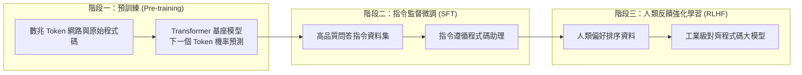

歡迎回到史丹佛大學尖端軟體工程課程 **CS146S：現代軟體開發者 (The Modern Software Developer)** 第2講的技術解析。

在第1講中，我們探討了軟體工程師從傳統打字員轉型為 AI 智慧代理人指揮家的巨變。在**第2講（第一週）**中，課程深入探討這場革命的核心：**程式碼大型語言模型（Coding LLMs）**的內部運作機制與**提示詞工程（Prompt Engineering）**。

結合 Andrej Karpathy 的經典講座《Deep Dive into LLMs》、OpenAI《How OpenAI Uses Codex》及 Google Cloud、DAIR.AI 的最新研究，本篇剖析 LLM 處理程式碼的數理本質、**「瑞士起司模型」**的潛在缺陷，以及**「信任但必須驗證 (Trust but Verify)」**的嚴格工程架構。

{/* truncate */}

---

### 1. 程式碼大模型的三階段訓練架構

---

### 2. 瑞士起司模型與防禦性工程驗證

AI 雖能瞬間生成結構優美的程式碼，但本質上仍為機率統計模擬器，極易在邊界條件或記憶體釋放中出現漏洞（瑞士起司孔洞）。因此，工程團隊必須嚴格實施「信任但必須驗證」原則，結合靜態類型檢查、單元測試自動化與屬性模糊測試。

### 課程參考資料
- **官方 YouTube 影片播放清單**: [Stanford CS146S: The Modern Software Development (YouTube Playlist)](https://www.youtube.com/playlist?list=PLxpwjSdVZQ95OWe3QvkVEcU1f1X-6NDj9)
- **主要文獻**: Andrej Karpathy, *Deep Dive into LLMs*; OpenAI, *How OpenAI Uses Codex*; Google Cloud & DAIR.AI, *Prompt Engineering Guide*.
- **學術機構**: 史丹佛大學電腦科學系
