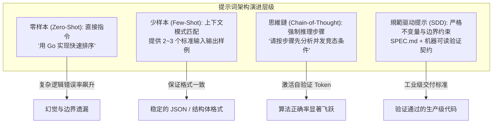
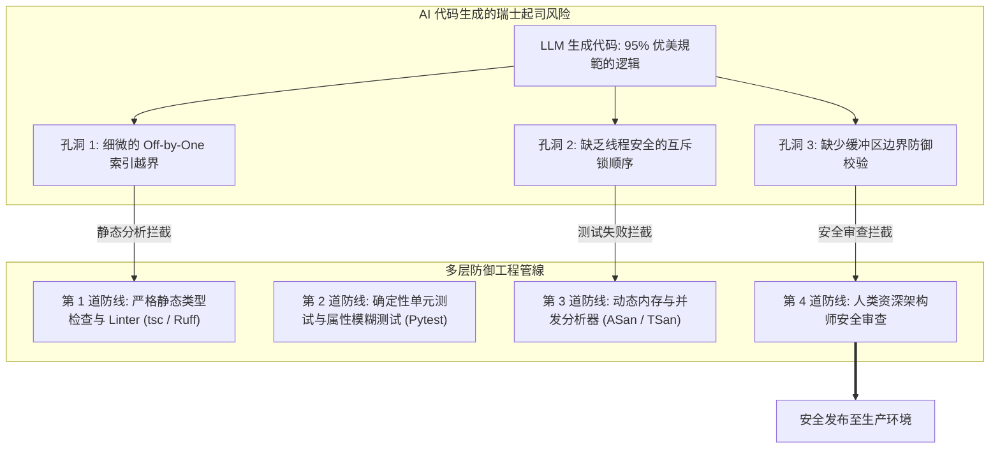

欢迎回到史丹佛大学前沿软件工程课程 **CS146S：现代软件开发者 (The Modern Software Developer)** 第2讲的技术深度解析。

在第1讲中，我们确立了宏观架构视角：现代软件工程师正从手工代码打字员向调度多智能体协作的交响乐指挥家演进。在**第2讲（第一周）**中，课程直接切入驱动这场变革的核心引擎：**代码大语言模型（Coding LLMs）**与**提示词工程（Prompt Engineering）**。

结合 Andrej Karpathy 的经典讲义《Deep Dive into LLMs》、OpenAI 论文《How OpenAI Uses Codex》以及 Google Cloud 与 DAIR.AI 的最新提示词工程研究，本讲全面揭示大型語言模型理解代码的数理本质，深度剖析 AI 代码生成中的**“瑞士起司模型”**风险，并阐明**“信任但必须验证（Trust but Verify）”**的工业级防御架构。

{/* truncate */}

---

### 1. 代码大型語言模型的底层解构：三阶段训练管線

要高效调度和调试 AI 编程助手，工程师必须理解模型权重的锻造过程。现代大型語言模型绝非單體规则引擎，而是经历严密的**三阶段训练管線**：

```mermaid
flowchart LR
    subgraph 阶段一 ["阶段一：预训练 (Pre-training)"]
        D1[数万亿 Token 网页与开源代码] --> N1[Transformer 基座模型<br/>下一个 Token 概率预测 P(w_t | Context)]
    end

    subgraph 阶段二 ["阶段二：指令监督微调 (SFT)"]
        N1 --> D2[高质量指令问答数据对<br/>注入对话与格式规则]
        D2 --> N2[指令遵循代码助手<br/>确立专业开发者角色]
    end

    subgraph 阶段三 ["阶段三：人类反馈强化学习 (RLHF)"]
        N2 --> D3[人类偏好排序评估<br/>训练奖励模型 (Reward Model)]
        D3 --> N3[工业级对齐代码大型語言模型<br/>安全、对齐且确定性输出]
    end
```

#### 1.1. 预训练 (Pre-training)：无监督海量吸收
解码器专用 (Decoder-only) Transformer 吞吐数 PB 源码，通过 **BPE (Byte-Pair Encoding)** 切分为 Token（约3~4字符或常见代码片段如 `def `, `return `）。
损失函数极为简洁——**下一个 Token 预测 (Next-Token Prediction)**：

```text
P(w_t | w_1, w_2, ..., w_t-1) = Softmax(W_v * h_t-1)
```

通过数万亿 Token 的交叉熵损失最小化，网络隐式习得语法树与算法逻辑。但此时它只是一个超级自动补全机。

#### 1.2. 监督微调 (SFT) 与强化学习 (RLHF)
- **SFT**：学习数万对高质量 `<问题, 模范解答>`，掌握 Markdown 排版与边界情况处理。
- **RLHF / DPO**：通过人类偏好排序与奖励模型，使用 PPO 或 DPO 算法微调权重，惩罚低效和不安全代码。

> **核心认知**：AI 编写的代码不是意识的产物，而是对全世界顶级工程师可能写出的“理想代码”进行**超高速统计模拟**的结果。

---

### 2. 软件工程视角下的提示词工程 (Prompt Engineering)

提示词工程绝非简单的“聊天技巧”，而是从概率模型中提取确定性结果的严密工程方法：



#### 思維鏈 (Chain-of-Thought, CoT)
在要求生成复杂并发或算法代码时，注入指令：
> *"在编写代码前，请分步骤分析可能存在的3种竞态条件，并在文本中明确列出内存屏障不变量。"*

模型生成的中间推理 Token 成为自生上下文，大幅降低逻辑缺陷。

---

### 3. AI 代码生成的“瑞士起司模型”

Andrej Karpathy 引入安全工程中的 **瑞士起司模型 (Swiss Cheese Model)**：模型生成的 200 行代码看似毫无破绽，却常常隐藏着细微的边界溢出或死锁（起司孔洞）。



由于代码结构极为工整，人类极易陷入**自动化偏差 (Automation Bias)**。未经多层防御验证直接合并 AI 代码，孔洞一旦贯通必将导致生产事故。

---

### 4. “信任但必须验证”工程防御架构

```mermaid
sequenceDiagram
    autonumber
    actor Dev as 软件架构师 (人类)
    participant Spec as SPEC.md 不变量契约
    participant LLM as 代码大型語言模型 (Claude Code / Cursor)
    participant Gate as 自动化验证门禁
    participant Prod as 生产环境主分支

    Dev->>Spec: 编写規範文档与不变量
    Dev->>LLM: 派发任务与上下文規範
    LLM->>LLM: 执行思維鏈 (CoT) 逐步推理
    LLM->>Gate: 提交实现代码与配套单元测试

    rect rgb(30, 41, 59)
        note over Gate: 自动化多层验证管線
        Gate->>Gate: 1. 严格静态类型分析 (0 警告)
        Gate->>Gate: 2. 自动化单元与集成测试
        Gate->>Gate: 3. 基于属性的随机模糊测试
    end

    alt 任意测试未通过
        Gate-->>LLM: 反馈错误堆栈追踪 (循环工程)
        LLM->>Gate: 提交自愈修复补丁
    else 全部门禁 100% 通过
        Gate-->>Dev: 提交无瑕疵 Git Diff 与测试报告
        Dev->>Dev: 架构合规与安全终审
        Dev->>Prod: 合并至主干发布
    end
```



---

### 5. 提示词范式对比矩阵

| 评估维度 | 对话式零样本 (Zero-Shot) | 少样本模式匹配 (Few-Shot) | 史丹佛 CS146S 規範驱动 (SDD) |
| :--- | :--- | :--- | :--- |
| **输入形式** | 自然语言聊天 (`"修复这个错误"`) | 系统提示词 + 2~3 个标准 JSON 样例 | 形式化 Markdown 規範 (`SPEC.md`) + 契约 |
| **模型认知** | 无约束单次 Token 输出 | 受样例格式约束的条件输出 | 思維鏈步骤推理 + MCP 工具沙箱调用 |
| **幻觉风险** | **高** (未知边界下 30~45%) | 语法**低**，业务逻辑**中** | **极低** (由自动化测试门禁完全兜底) |
| **可复现性** | 低 (语气微调即引发变动) | 高 (严格遵守格式) | 完全可复现 (Git 版本化协同管控) |

---

### 6. 史丹佛课堂 Q&A：大型程式庫下的“上下文稀释”难题

> **问：为什么 LLM 在做刷题算法时表现优异，但在企业 10 万行大型程式庫中却频繁制造破坏性改动？**

**教员解答**：
这是典型的**上下文饱和 (Context Saturation)** 与 **注意力稀释 (Attention Dilution)**。
大型語言模型存在 **“迷失在中间 (Lost in the Middle)”** 现象：过多不相关代码冲淡了注意力权重，模型只关注首尾提示而遗漏中间的关键不变量。现代工程必须依靠 **代码仓符号图谱 (Repo Mapping)** 与 Tree-sitter AST 精准提取关键依赖。

---

### 7. 第 2 讲核心总结

1. **认清工具本质**：代码大型語言模型是经过预训练、SFT 和 RLHF 训练的概率 Token 模拟器。
2. **驾驭思維鏈**：引入 CoT 产生显式推理步骤，大幅提升逻辑正确率。
3. **警惕瑞士起司**：抛弃自动化偏差，严查隐蔽边缘漏洞。
4. **信任但必须验证**：构建覆盖静态检查、單體测试与模糊测试的自动化门禁。

---

### 课程参考资料
- **官方 YouTube 教学视频列表**: [Stanford CS146S: The Modern Software Development (YouTube Playlist)](https://www.youtube.com/playlist?list=PLxpwjSdVZQ95OWe3QvkVEcU1f1X-6NDj9)
- **核心文献**: Andrej Karpathy, *Deep Dive into LLMs*; OpenAI, *How OpenAI Uses Codex*; Google Cloud & DAIR.AI, *Prompt Engineering Guide*.
- **学术机构**: 史丹佛大学计算机科学系
