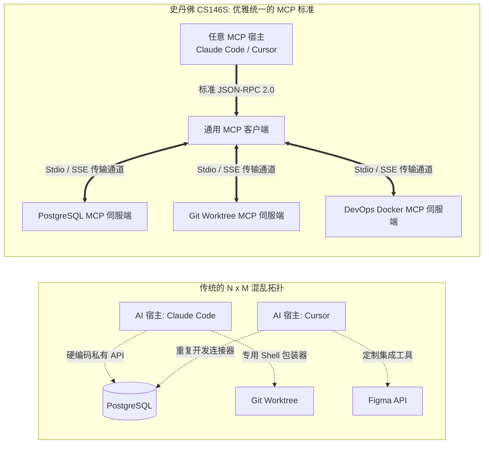
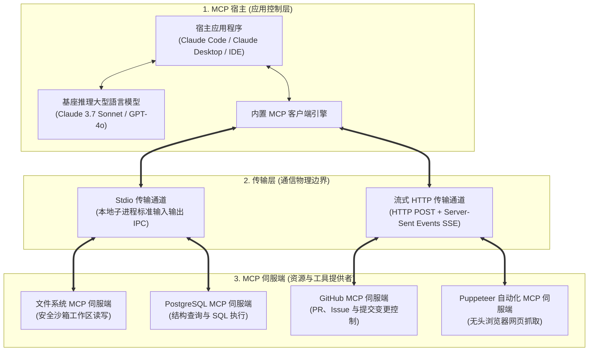

欢迎回到史丹佛大学尖端软件工程课程 **CS146S：现代软件开发者 (The Modern Software Developer)** 第3讲的深度技术解析。

在第1讲中我们确立了从打字员到指挥家的范式转移，在第2讲中剖析了代码大型語言模型的概率本质与多层防御门禁。在**第3讲（第二周）**中，课程直击现代 AI 工程的核心痛点：**“如何让孤立的基础大型語言模型以安全、标准化、可插拔的方式与外部数据库、终端和 API 进行交互？”**

在2024年之前，为大型語言模型连接企业资源需要编写大量脆弱的手工胶水代码。本讲全面解析由 Anthropic 主导并作为史丹佛核心课程的**模型上下文协议 (Model Context Protocol, MCP)**——它正在像当年微软的 **语言服务器协议 (Language Server Protocol, LSP)** 统一代码编辑器生态一样，成为智能体系统的通用适配器标准。

{/* truncate */}

---

### 1. 碎片化危机：为什么我们需要“AI 时代的 LSP”？

过去，每当市场上出现新的 AI 编程环境（Cursor、Claude Code、GitHub Copilot），面对相同的企业底层基础设施（Git 仓库、PostgreSQL 数据库、云服务），各家工具都必须从零编写重复的专用连接器。

2010年代，微软通过推出 **LSP** 终结了各大编辑器重复编写多语言编译器的梦魇。

**Model Context Protocol (MCP)** 在 AI 智能体领域达成了完全相同的架构突破：通过将模型的推理认知与物理工具的实际执行彻底解耦，建立了基于 **JSON-RPC 2.0 的即插即用工业标准**。

---

### 2. MCP 三层系统拓扑结构

1. **MCP 宿主 (Host)**：统揽用户体验、管控模型上下文窗口，并掌管用户安全授权的顶层应用。
2. **MCP 客户端 (Client)**：常驻宿主内部，与各伺服端建立 1 对 1 连接，负责生命周期初始化与工具调用序列化。
3. **MCP 伺服端 (Server)**：轻量级独立进程，以标准化方式向外暴露数据资源与可执行函数。

---

### 3. 双传输层对比：Stdio 本地管道 vs. Streamable HTTP/SSE

| 传输维度 | Stdio 管道传输 (本地超高速 IPC) | 流式 HTTP/SSE 传输 (远程云端服务) |
| :--- | :--- | :--- |
| **通信机制** | 本地子进程的标准输入 (`stdin`) 和标准输出 (`stdout`) | 客户端请求为 HTTP POST，伺服端流式返回为 SSE |
| **延迟与开销** | **极低延迟** (操作系统原生管道，无网络及 TLS 握手) | 网络往返延迟 + TLS 传输加密开销 |
| **安全防线** | 本地操作系统文件权限与进程沙箱隔离 | OAuth 2.0 Bearer 令牌、mTLS 与企业网络防火墙 |
| **典型应用** | 本地文件读写、Git 分支操作、本地 SQLite 查询 | 企业级集中式数据库集群、远程 SaaS 接口 |

---

### 4. MCP 三大核心原語 (Core Primitives)

1. **资源 (Resources - 只读上下文数据)**：类似 GET 请求。以标准 URI (`postgres://db/users`) 提供文件、日志与数据库结构，供模型读取而不产生副作用。
2. **工具 (Tools - 可执行动作)**：由模型主动发起的物理函数。使用严密 JSON Schema 定义参数，宿主在执行前必须征求人类批准。
3. **提示词 (Prompts - 结构化工作流模板)**：伺服端受控的标准操作模板（如 `/代码审查`、`/生成单测`）。

---

### 5. Claude Code 实战工具调用循环 (Tool-Calling Loop)

```mermaid
sequenceDiagram
    autonumber
    actor Dev as 软件工程师
    participant Host as Claude Code (宿主)
    participant Model as Claude 3.7 Sonnet (大型語言模型)
    participant Client as MCP 客户端
    participant Server as PostgreSQL MCP 伺服端

    Dev->>Host: "诊断用户 ID 8492 结算失败的原因"
    Host->>Client: 获取可用工具列表 (tools/list)
    Client->>Server: JSON-RPC tools/list
    Server-->>Client: 返回 [query_orders, inspect_logs]
    Client-->>Host: 将工具 Schema 注入模型系统提示词

    Host->>Model: 发送提示词 + 工具規範 + 用户问题
    Model->>Model: 思維鏈 (CoT): 判定必须先读取订单数据
    Model-->>Host: 停止原因: tool_use (query_orders, 参数: {id: 8492})

    rect rgb(30, 41, 59)
        note over Host,Dev: 人在回路安全授权门禁
        Host->>Dev: 确认执行工具: query_orders(8492)? [Y/n]
        Dev-->>Host: 确认: Y
    end

    Host->>Client: 派发工具调用指令
    Client->>Server: JSON-RPC tools/call (query_orders)
    Server-->>Client: 返回 JSON: {status: 'failed', error: '余额不足'}
    Client-->>Host: Tool Result 载荷反馈

    Host->>Model: 将工具执行结果回填进上下文窗口
    Model->>Model: 分析根本原因并合成最终回答
    Model-->>Host: "结算失败系 Stripe Webhook 触发余额不足异常所致。"
    Host-->>Dev: 输出最终诊断分析报告
```

---

### 6. 史丹佛 CS146S 课堂 Q&A

> **问：MCP 与传统的 OpenAI 函数调用 (Function Calling) 或 LangChain 工具究竟有何本质区别？**

**教员解答**：
函数调用纯粹是 **“大型語言模型 API 的单向特性”**，它只负责输出 JSON 字符串，至于谁来执行、如何鉴权、如何在不同编辑器间复用，没有任何统一規範。

MCP 是一套 **“开放工业协议”**。今天编写的一个 PostgreSQL MCP 伺服端，无需改动一行代码，即可无缝运行在 Claude Code、Cursor、开源智能体框架以及未来的一切 AI 系统中。

---

### 7. 第 3 讲核心要点

1. **坚持开放标准**：拒绝硬编码私有胶水工具，全面转向 MCP 伺服端架构。
2. **大脑与双手解耦**：模型只负责推理决策，I/O 与物理状态变更全权委托给沙箱化 MCP 伺服端。
3. **构筑人类确认防线**：涉及状态变更的破坏性操作必须坚持人在回路授权机制。

---

### 课程参考资料
- **官方 YouTube 教学视频列表**: [Stanford CS146S: The Modern Software Development (YouTube Playlist)](https://www.youtube.com/playlist?list=PLxpwjSdVZQ95OWe3QvkVEcU1f1X-6NDj9)
- **核心文献**: Model Context Protocol Specification (modelcontextprotocol.io); Anthropic Claude Tool Use Architecture; Microsoft Language Server Protocol (LSP).
- **学术机构**: 史丹佛大学计算机科学系
---

### 📌 3~5 行核心總結 (Executive Summary)
1. **MCP 工業級標準化範式**：模型上下文協定 (MCP) 被譽為「AI 智慧體領域的 LSP」，徹底終結了 $N \times M$ 的私有膠水程式碼亂象，建立了開放雙向的 JSON-RPC 2.0 通訊標準。
2. **大腦決策與物理執行解耦**：大型語言模型專注於上下文邏輯推理與決策，檔案讀寫與資料庫變更等有狀態物理操作全權交由沙箱化 MCP 伺服端隔離執行。
3. **雙重傳輸層架構 (Stdio vs HTTP/SSE)**：本機開發環境藉由亞毫秒級 Stdio 高速管道互動，遠端企業級叢集則透過經由 OAuth 2.0 鑑權的串流 HTTP/SSE 實現彈性擴展。
4. **人在迴路安全防線**：堅決貫徹最小權限原則，對檔案刪除與資料庫覆寫等高危破壞性操作強制引入人類開發者確認卡點，杜絕智慧體失控風險。