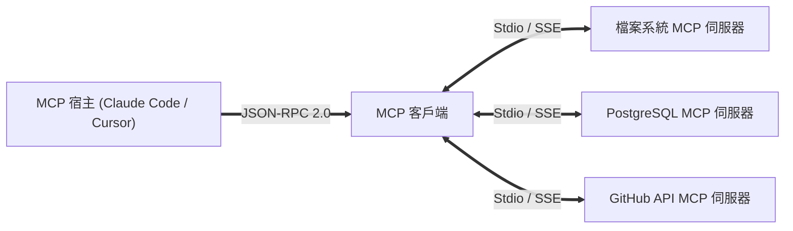

歡迎回到史丹佛大學尖端軟體工程課程 **CS146S：現代軟體開發者 (The Modern Software Developer)** 第3講的技術解析。

本講剖析 AI 軟體工程的核心瓶頸：如何讓大型語言模型安全且標準化地調用外部工具與企業資料庫？全面解析被稱為「AI 時代 LSP」的**模型上下文協定 (Model Context Protocol, MCP)**。

{/* truncate */}

---

### 1. AI 時代的 LSP：MCP 架構解析

正如微軟 Language Server Protocol (LSP) 統整了程式編輯器生態，MCP 藉由 JSON-RPC 2.0 將模型認知與外部工具徹底解耦，建立標準化擴充介面。

### 課程參考資料
- **官方 YouTube 影片播放清單**: [Stanford CS146S: The Modern Software Development (YouTube Playlist)](https://www.youtube.com/playlist?list=PLxpwjSdVZQ95OWe3QvkVEcU1f1X-6NDj9)
- **主要文獻**: Model Context Protocol Specification (modelcontextprotocol.io); Anthropic Claude Tool Use Architecture; Microsoft Language Server Protocol (LSP).
- **學術機構**: 史丹佛大學電腦科學系
