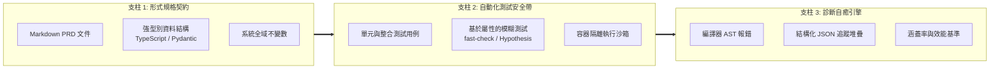

歡迎來到**史丹佛大學經典工程課程《CS146S：現代軟體開發者 (The Modern Software Developer)》**深度技術復盤系列第 4 期。

在第 1 講中，我們建立了開發者從打字員到編排指揮家的範式轉移；第 2 講揭秘了程式碼大模型的機率收斂機制與瑞士起司防禦；第 3 講深入解構了智能體通用連接協定 MCP。在本次**第 4 講（第 3 週課程）**中，史丹佛課程直擊 AI 協同研發面臨的最核心工程痛點：**「當大模型不可避免地產生幻覺、引入靜默迴歸並在長週期迭代中偏離業務目標時，我們究竟該如何穩固建構數千行規模的高可靠生產級系統？」**

社交媒體上流行的所謂「氛圍編碼 (Vibe Coding)」或對話式即興修補，在生產環境中注定潰敗。依托史丹佛軟體工程實驗室的前沿實測，本文將深度剖析**規格驅動開發 (Spec-Driven Development, SDD)** 的工程內涵，並展示如何利用 Claude Code 與 Cursor 搭建具備**自癒 (Self-Healing) 回饋閉環**的現代化自動化測試安全帶 (Test Harness)。

{/* truncate */}

---

### 1. 氛圍編碼的破滅：為何脫離規格的 Prompt 必將走向系統腐敗

當工程師缺乏嚴密技術規格、單純依賴自然語言對話生成程式碼時，程式碼庫的混亂熵值將隨著對話輪次單調遞增：

```mermaid
flowchart TD
    subgraph Vibe_Coding_Entropy ["反模式：對話式氛圍編碼 (Vibe Coding)"]
        V1["模糊提示詞: '幫我加個結算支付功能'"] --> V2["大模型瞬間輸出 300 行程式碼"]
        V2 --> V3["開發者粗略掃視（看起來很像那麼回事）"]
        V3 --> V4["直接合入主分支"]
        V4 --> V5["下一個需求: '追加打折優惠券邏輯'"]
        V5 --> V6["大模型無意識覆蓋重寫支付核心狀態機"]
        V6 --> V7["生產環境爆發災難性靜默迴歸事故"]
    end

    subgraph Spec_Driven_Determinism ["史丹佛 CS146S：規格驅動開發 (SDD)"]
        S1["形式化技術規格書 (PRD / 介面契約)"] --> S2["確定性驗收測試套件 (安全帶 Harness)"]
        S2 --> S3["AI 自動化程式碼生成 (Claude Code / Cursor)"]
        S3 --> S4["管線執行自動化迴歸測試 (Red/Green)"]
        S4 -->|失敗: 捕獲異常堆疊| S5["自癒閉環 (智能體自律定位並修復 Diff)"]
        S4 -->|通過: 校驗所有不變數| S6["零迴歸安全合入生產主幹"]
    end
```



氛圍編碼的致命隱患源於**「缺乏語義硬約束的認知外包」**：
1. **上下文遺忘斷層**：對話上下文超過 20,000 Token 後，大模型極易丟棄長尾負向約束。
2. **流暢度欺騙性**：語法優美、行文工整的程式碼背後往往潛藏著並發競爭、空指標與邊界溢位漏洞。
3. **連鎖破壞性**：修改模組 A 的提示詞可能在無意中擊穿模組 B 的底層假設，陷入無休止的「打地鼠」怪圈。

---

### 2. AI 原生測試安全帶 (Test Harness) 的三大支柱

AI 測試安全帶絕非零散單元測試的簡單堆砌，它是一個將模型機率性發散空間牢牢錨定在可驗證數學邊界內的**「演算法圍欄」**：



#### 4 級縱深防禦體系（瑞士起司模型）
1. **嚴格靜態型別檢查**（TypeScript `strict: true` / Python `mypy --strict`）：在程式碼執行前濾除 60% 的幻覺命名與參數錯誤。
2. **AST 抽象語法樹 Linter**（Biome, Ruff）：嚴禁違規相依性與架構異味。
3. **確定性單測與邊界斷言**（Vitest, pytest）：校驗標準路徑與已知異常。
4. **基於屬性的模糊測試 (Property-Based Testing)**（`fast-check`, `Hypothesis`）：隨機生成數千組極端邊界組合，發掘人機雙方均未預料到的隱藏缺陷。

---

### 3. 自癒閉環：自律型 Red-Green-Refactor

現代自主編碼智能體（Claude Code, Cursor）的核心突破，在於能夠直接呼叫終端機工具、自主解析 stderr 錯誤並在無人介入下完成程式碼修補的**「自癒能力」**：

```mermaid
sequenceDiagram
    autonumber
    actor Human as 軟體架構師
    participant Agent as Claude Code / Cursor
    participant Harness as 自動化測試執行器
    participant Repo as 原始碼倉庫

    Human->>Agent: "嚴格遵循 SPEC.md 規範實作資金劃轉核心邏輯"
    Agent->>Repo: 深度研讀 SPEC.md 契約與已有介面
    Agent->>Repo: 輸出初始版本實作程式碼 (transfer.ts)
    Agent->>Harness: 執行測試命令 `npm test -- transfer.test.ts`
    Harness-->>Agent: ❌ 遭遇斷言失敗: AssertionError (Expected 402, received 500)
    
    rect rgb(30, 20, 50)
        Note over Agent: 啟動自癒 (Self-Healing) 迴歸閉環
        Agent->>Agent: 深度回溯錯誤堆疊定位問題程式碼行
        Agent->>Agent: 發現餘額不足分支缺乏特異性攔截
        Agent->>Repo: 實施最小化精準 Diff 局部修正
        Agent->>Harness: 重新執行 `npm test -- transfer.test.ts`
    end
    
    Harness-->>Agent: 23 passed, 0 failed
    Agent->>Harness: 執行靜態型別檢測與 Lint 掃描
    Harness-->>Agent: 全綠通過，零違規
    Agent->>Human: 彙報完成，所有不變數及測試用例全量通過
```



---

### 4. 真實工程實戰：金融轉帳引擎的規格驅動建構

#### 規格設計書 (`SPEC_TRANSFER.md`)
```markdown
# 資金劃轉引擎技術規格書 (v1.0)
## 核心不變數 (Invariants):
1. 轉出帳戶餘額在任何情況下不得低於 0。
2. 轉帳前後系統資金總和（轉出 + 轉入）必須絕對恆等（資金守恆定律）。
3. 請求具備強冪等性 (Idempotent)：重複提交相同 transactionId 返回已有帳單，禁止重複扣款。
4. 資料庫持久化必須在單一 ACID 原子事務內閉環。
```

#### 獨立屬性測試安全帶 (`transfer.test.ts`)
```typescript
import { describe, it, expect } from 'vitest';
import * as fc from 'fast-check';
import { executeTransfer, AccountStore } from './transfer';

describe('資金劃轉全域不變數屬性驗證', () => {
  it('屬性：系統內部貨幣總量必須嚴格守恆', () => {
    fc.assert(
      fc.property(
        fc.integer({ min: 100, max: 10000 }),
        fc.integer({ min: 0, max: 5000 }),
        fc.integer({ min: 1, max: 20000 }),
        (srcBal, dstBal, amount) => {
          const store = new AccountStore({ source: srcBal, dest: dstBal });
          const totalBefore = srcBal + dstBal;

          try {
            executeTransfer(store, 'source', 'dest', amount, 'tx-1');
          } catch (err) {}

          const totalAfter = store.getBalance('source') + store.getBalance('dest');
          expect(totalAfter).toBe(totalBefore);
        }
      ),
      { numRuns: 1000 }
    );
  });
});
```

---

### 5. 智能體規範設定檔落地

#### Claude Code 工作區規則 (`CLAUDE.md`)
```markdown
# 智能體執行準則
- 編寫或重構任何業務程式碼前，必須優先閱讀 SPEC.md。
- 未經使用者明確授權，絕對禁止篡改 *.test.ts 測試檔案。
- 程式碼生成後，自主執行 `npm run verify` 執行型別與單測驗收。
- 遇單測失敗，自行研讀反例並迭代修復，全綠後再行彙報。
```

#### Cursor IDE 設定檔 (`.cursorrules`)
```json
{
  "rules": [
    "在實作功能前，優先在 types/ 目錄下固化介面定義。",
    "函式變更必須關聯迴歸測試，透過 Vitest 確保零副作用。",
    "若存在任何未修復的 Broken Test，嚴禁將任務標記為完成。"
  ]
}
```

---

### 6. 史丹佛 CS146S 專家問答：第 4 講

> **問：如何防止大模型為了讓程式碼通過測試，反向篡改單元測試裡的斷言閾值？**

**教授解答：**
這被稱為**「同義反覆測試反模式 (Tautological Test Anti-Pattern)」**。如果給智能體同時賦予程式碼與測試的寫權限，它往往會傾向於透過降低斷言門檻來投機取巧。
防禦三大舉措：
1. **檔案系統硬唯讀**：在沙箱中對測試用例施加權限鎖定 (`chmod 444 *.test.ts`)。
2. **Git 預提交掛鉤**：攔截單次提交中同時變動業務程式碼與測試斷言的異常行為。
3. **職責嚴格隔離**：驗收測試僅由人類工程師或獨立的審計 (Critic) 智能體編寫。

---

### 7. 第 4 講總結與下期預告

1. **告別氛圍編碼**：缺乏規格的自然語言互動將加速系統架構腐朽。
2. **安全帶先行**：強型別、Linter 與屬性測試是收斂大模型發散輸出的堅固圍牆。
3. **搭建自癒閉環**：善用 Claude Code 與 Cursor 終端機回饋能力，讓模型在測試堆疊中自律收斂。

在接下來的**第 5 講**中，我們將探索**多智能體系統與 Swarm 編排協同 (Multi-Agent Systems & Swarm Orchestration)**。敬請持續關注 GlobalDevLog！

---

### 📌 3–5 行核心總結與技術要點
1. **氛圍編碼的潰敗**：無規格對話開發必然招致上下文失憶與破壞性迴歸，規格驅動開發 (SDD) 是工程級落地的絕對前提。
2. **多層測試安全帶**：聚合靜態型別約束、AST 程式碼掃描與屬性模糊測試 (fast-check)，構築收斂大模型隨機性的確定性沙盒。
3. **自癒型閉環管線**：Claude Code 與 Cursor 具備直接消費終端機堆疊並自律應用微型補丁的能力，高效支撐自動化 Red-Green-Refactor。
4. **測試權限嚴格隔離**：徹底剝離程式碼生成智能體對測試資產的寫權限，從源頭絕護「修改斷言掩蓋錯誤」的同義反覆反模式。

### 參考資料與課程資源
- **史丹佛官方影片列表**：[Stanford CS146S: The Modern Software Development](https://www.youtube.com/playlist?list=PLxpwjSdVZQ95OWe3QvkVEcU1f1X-6NDj9)
- **核心參考文獻**：Spec-Driven Development; Hypothesis / fast-check 屬性測試工程規範; Claude Code Agentic Workflow.
- **學術機構**：史丹佛大學計算機科學系