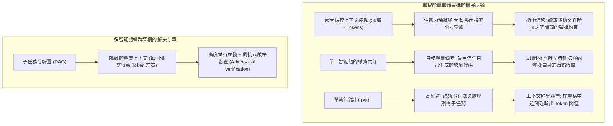
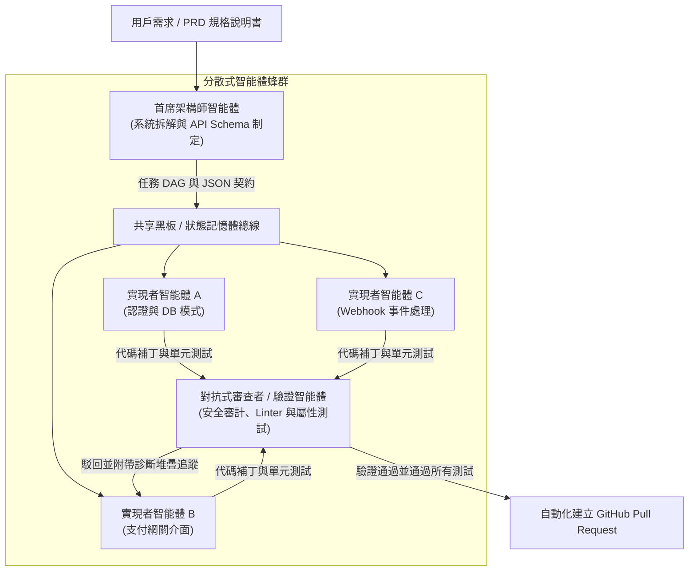

歡迎來到**史丹佛大學 CS146S（現代軟體開發者：The Modern Software Developer）**系列課程深度解析第5講。

在前面的課程中，我們系統探討了開發者提示詞工程、代碼大模型的內部注意力機制、利用模型上下文協議（MCP）實現自主工具調用，以及基於規格說明書的自癒測試裝配架（Test Harness）。到目前為止，所有探討的範式都基於一個共同的預設假設：由**單個主要 LLM 會話**在 IDE 或終端工作區中與開發者保持對話互動。

然而，當軟體工程規模擴展到數千行代碼以上，並涉及分散式微服務和數十萬行的龐大企業級代碼倉庫時，單智能體範式將迅速崩潰。單體智能體必然面臨**上下文視窗飽和、注意力稀釋（Attention Dilution）和認知抖動（Cognitive Thrashing）**三大致命困境。

在今天的課程中，史丹佛大學教學團隊揭示了 AI 原生工程演進的核心方向：**多智能體系統（MAS）與蜂群編排（Swarm Orchestration）**。通過嚴格分離**架構師（Architect）、實現者（Implementer）與審查者（Critic）**的職能，並在有向無環圖（DAG）與結構化消息總線的協同下，實現代碼生成精度與軟體工程規模的跨越式提升。

{/* truncate */}

---

### 1. 單上下文單體 LLM 的擴展極限

為什麼我們不能簡單地將一個 50 萬行代碼的大型企業倉庫直接塞進擁有 100 萬 Token 上下文的大模型中，然後直接吩咐它「重構支付結算流水線」？

史丹佛研究團隊指出了阻礙單智能體擴展的三個根本性架構瓶頸：



1. **注意力稀釋與「迷失於中間」（Lost in the Middle）**：當上下文超過 10 萬 Token 時，注意力機制的檢索精度出現不均勻下降。埋藏在中間文件中的複雜資料庫完整性約束或介面規範極易被忽略。
2. **職責共謀與確認偏差**：如果由同一個 LLM 同時扮演系統架構師、編碼員和品質驗收員，它會產生嚴重的自我確證偏見，幾乎不可能主動構造能夠擊穿自身邏輯漏洞的極端邊界測試。
3. **上下文抖動與污染**：在單個會話中連續修改 15 個文件，終端 diff、編譯器報錯以及被廢棄的假設會徹底污染上下文緩衝區，最終引發模型幻覺或胡言亂語。

---

### 2. 三權分立蜂群架構：架構師、實現者與審查者

為了達到工業級生產環境的魯棒性，史丹佛 CS146S 正式確立了**三權分立蜂群模式（Tripartite Agent Swarm Pattern）**：



#### 核心角色權責劃分：
1. **首席架構師智能體（Lead Architect Agent）**：
   - **輸入**：用戶需求 PRD、代碼倉庫依賴拓撲圖、業務目標。
   - **輸出**：解耦的子任務有向無環圖（DAG）、嚴格的 JSON Schema 介面定義及契約規範。
   - **核心約束**：架構師不編寫任何實現代碼，其全部推理算力專注於系統拆解與介面穩定。
2. **實現者蜂群（Implementer Swarm Workers）**：
   - **輸入**：DAG 分配的單個局部任務切片、介面規範契約、對應模組的文件子樹。
   - **輸出**：模組化原始碼、配套單元測試用例及依賴項。
   - **執行機制**：多個實現者在完全隔離的沙箱分支或臨時容器中實現 100% 並發編碼。
3. **對抗式審查與驗證智能體（Adversarial Critic & Verifier Agent）**：
   - **輸入**：候選代碼補丁、架構師的原始規格說明、自動化測試套件運行日誌。
   - **輸出**：靜態分析指標、安全性漏洞審計（AST 檢查、金鑰洩漏檢測）及最終通過/駁回判定。
   - **自癒反饋**：審查未通過時，審查者生成附帶調用堆疊的精確診斷 diff，直接回傳給對應的實現者以驅動閉環自癒修復。

---

### 3. 智能體間通信拓撲：規避無序混亂的確定性控制

放任智能體自由聊天會導致幻覺滾雪球效應並陷入無休止的消息死循環。CS146S 強調了兩種主導的確定性編排拓撲：

#### A. 集中式黑板（Blackboard）模式
智能體之間禁止直接進行私聊，而是統一讀寫經過 Schema 校驗的中央狀態儲存介質：

```json
{
  "task_id": "TASK-402-AUTH",
  "status": "in_review",
  "dependencies": ["TASK-401-DB-SCHEMA"],
  "assigned_agent": "worker-claude-code-01",
  "contract_schema_hash": "sha256:7f8a92...",
  "artifacts": {
    "patch_path": "/workspace/patches/auth_service.patch",
    "test_coverage": 94.2
  },
  "critic_feedback": null
}
```

#### B. 有向無環圖（DAG）執行工作流
將任務組織為 DAG 拓撲圖，邊代表嚴格的數據與狀態依賴關係。若模組 B 依賴於模組 A 的數據契約，在實現者 A 的代碼徹底通過審查者（Critic）的嚴苛測試之前，實現者 B 絕不會被喚醒。

---

### 4. 工程實戰：使用 Python 構建非同步蜂群編排器

以下是利用 Pydantic 結構化數據驗證實現架構師-實現者-審查者閉環的生產級非同步蜂群調度引擎：

```python
# swarm_orchestrator.py - 生產級多智能體蜂群編排引擎
import asyncio
from typing import List, Dict, Optional
from pydantic import BaseModel, Field

class SubTaskContract(BaseModel):
    task_id: str
    description: str
    file_targets: List[str]
    interface_schema: Dict[str, str]

class ArchitectPlan(BaseModel):
    plan_title: str
    subtasks: List[SubTaskContract]

class PatchResult(BaseModel):
    task_id: str
    code_diff: str
    unit_tests: str

class CriticAudit(BaseModel):
    passed: bool
    score: float = Field(ge=0.0, le=100.0)
    diagnostic_trace: Optional[str] = None

class SwarmOrchestrator:
    def __init__(self, architect_llm, coder_llm, critic_llm):
        self.architect = architect_llm
        self.coder = coder_llm
        self.critic = critic_llm

    async def execute_task(self, user_prd: str):
        print("[ORCHESTRATOR] 階段 1: 正在生成架構方案並分解子任務...")
        plan: ArchitectPlan = await self.architect.generate_plan(user_prd)
        
        print(f"[ORCHESTRATOR] 架構師已將 PRD 拆解為 {len(plan.subtasks)} 個 DAG 子任務。")
        
        # 將子任務並發分派給並行實現者工作智能體
        tasks = [self._worker_critic_loop(task) for task in plan.subtasks]
        results = await asyncio.gather(*tasks)
        
        print("[ORCHESTRATOR] 蜂群全部子任務均已通過獨立驗證並成功集成！")
        return results

    async def _worker_critic_loop(self, task: SubTaskContract, max_retries: int = 3) -> PatchResult:
        attempt = 0
        error_context = None

        while attempt < max_retries:
            attempt += 1
            print(f"[{task.task_id}] 實現者正在編碼實現 (嘗試 {attempt}/{max_retries})...")
            
            patch: PatchResult = await self.coder.implement_task(task, feedback=error_context)
            
            print(f"[{task.task_id}] 審查者正在對補丁進行嚴苛審計與測試...")
            audit: CriticAudit = await self.critic.verify(task, patch)
            
            if audit.passed:
                print(f"[{task.task_id}] 審查通過！(品質得分: {audit.score}/100)")
                return patch
            
            print(f"[{task.task_id}] 審查者駁回補丁: {audit.diagnostic_trace}")
            error_context = audit.diagnostic_trace

        raise RuntimeError(f"子任務 {task.task_id} 在重試 {max_retries} 次後仍未能通過審查者驗收。")
```

---

### 5. 第5講核心精要與後續課程

1. **超越單體智能體**：面對大型代碼庫，必須利用多智能體蜂群消除注意力稀釋與確認偏見。
2. **三權分立專業化**：架構師（頂層設計與介面契約）、實現者（沙箱並發編碼）、審查者（對抗審計與安全驗證）各司其職。
3. **確定性通信管控**：淘汰非結構化的聊天流，使用 Pydantic JSON 契約、中央黑板與 DAG 拓撲實現精準編排。

在**第6講**中，我們將全面探討 **AI 輔助調試與性能分析：深度結合 eBPF、動態追蹤與運行時故障排查大模型**！

---

### 📌 執行摘要（3–5 行總結）
1. **多智能體演進必然性**：通過將開發任務拆解為分散式智能體蜂群，徹底攻克單會話 LLM 的注意力稀釋、指令漂移和自我確證偏見。
2. **三權分立專業分工**：確立架構師（規劃與 API 契約）、實現者（沙箱隔離並發編碼）與審查者（對抗式審計與迴歸測試）三位一體的工程架構。
3. **確定性通信協議**：依託 Pydantic JSON 結構化契約、中央黑板記憶體與 DAG 工作流，有效阻斷智能體間的幻覺蔓延與無限死循環。
4. **非同步自癒反饋閉環**：審查者將具象化的錯誤堆疊精確回傳給實現者，驅動自主補丁迭代直到完全通過迴歸測試。

### 參考文獻與史丹佛 CS146S 課程資訊
- **課程全稱**：Stanford CS146S (The Modern Software Developer), 2026.
- **教學單位**：史丹佛大學計算機科學系 (Dept. of Computer Science, Stanford University).
- **關聯框架**：LangGraph, AutoGen, CrewAI, Anthropic Multi-Agent Orchestration Protocols.