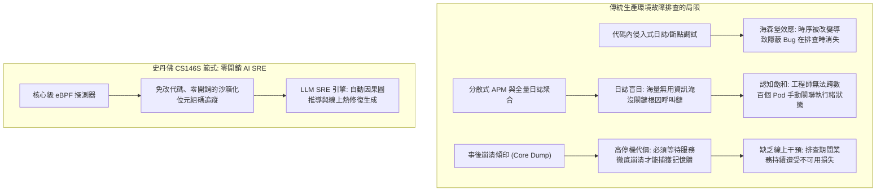
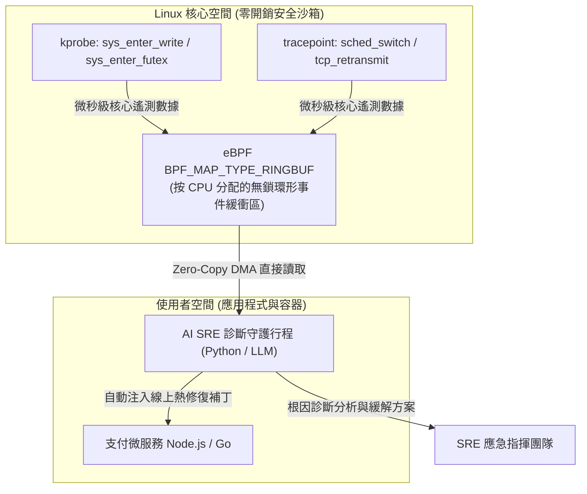

歡迎來到**史丹佛大學 CS146S（現代軟體開發者：The Modern Software Developer）**系列深度解析第6講。

在上一節課中，我們探討了多智能體蜂群編排——通過結構化的有向無環圖（DAG）協調架構師、實現者與審查者大模型協同構建龐大的代碼倉庫。然而，即使經過最嚴苛的自動化測試，軟體工程終究要在真實生產環境的極端負載下接受檢驗。

凌晨 3 點，當分散式支付叢集中突然爆發隱蔽的並發死鎖導致執行緒掛起，或是未建索引的資料庫查詢導致長尾延遲飆升至 12 秒時，傳統的開發排查手段將全面失靈。靜態分析無法預測動態的競態條件（Race Condition），在代碼中強行插樁列印日誌（`printf`）會引發**海森堡效應（Heisenbug）**（因改變時序而導致 Bug 詭異消失），而傳統的分散式 APM 工具則往往讓網站可靠性工程師（SRE）淹沒在每秒數百萬行的無意義日誌噪聲之中。

在今天的課程中，史丹佛大學教學團隊揭示了自主軟體韌性（Autonomous Resilience）的核心突破：**AI 輔助調試與執行時效能分析**。通過將**擴展伯克利數據包過濾器（eBPF）**的零開銷、非侵入式核心追蹤能力與**專職 LLM 診斷 SRE 智能體**相結合，現代工程團隊能夠在微秒級捕獲核心級真實執行狀態，並在數分鐘內定位根因、自主合成線上熱修復。

{/* truncate */}

---

### 1. 生產環境故障危機：傳統調試手段為何屢屢失效

當高吞吐微服務在高負載下發生故障時，軟體工程師通常會陷入三大可觀測性悖論：



1. **海森堡（Heisenbug）困境**：一旦在代碼中插入追蹤日誌或掛接互動式調試器（`gdb`），執行緒被暫停、鎖競爭順序被打亂、CPU 快取被刷新，導致難以復現的時序性並發 Bug 瞬間消失。
2. **數據氾濫與語義盲目**：現代監控系統每秒收集數以吉位元組的指標與追蹤數據。然而，當單點故障級聯觸發 45 個警報時，工程師往往耗費數小時才能理清哪個是主因，哪些是次生症狀。
3. **核心層與應用層之間的語義斷層**：高層的「HTTP 504 閘道逾時」無法揭示底層究竟是執行緒池耗盡、TCP 套接字緩衝區暴漲，還是 Linux VFS 層的髒頁回寫阻塞。

---

### 2. eBPF 技術革命：作業系統核心級的非侵入式觀測

為了徹底消除海森堡效應，史丹佛 CS146S 引入了 **eBPF（extended Berkeley Packet Filter）**。eBPF 是一項革命性的 Linux 核心技術，它允許開發者在不修改核心源碼、不加載高風險核心模組的前提下，直接在作業系統核心內部運行經過安全驗證的沙箱化位元組碼。



#### eBPF 在 AI 調試中的關鍵優勢：
- **微乎其微的系統開銷**：eBPF 位元組碼通過核心安全驗證器並由 JIT 編譯為原生機器碼，在全量網路吞吐下引入的 CPU 損耗通常低於 1.5%。
- **全方位全棧透視**：掛載在 `kprobes`（核心函數入口）、`kretprobes`（核心函數返回）、`uprobes`（使用者空間符號）及套接字上，無需修改任何一行業務代碼即可觀測所有系統調用與互斥鎖競爭。
- **無鎖環形緩衝區（Lockless Ring Buffer）**：以極高頻率產生的核心事件通過 `BPF_MAP_TYPE_RINGBUF` 無鎖流水線直接推送到使用者空間，避免觀測動作本身成為服務效能瓶頸。

---

### 3. 跨越語義鴻溝：將核心遙測餵給 LLM 診斷智能體

直接將未經處理的原始 eBPF 追蹤流（數百萬十六進位指針與納秒時間戳記）輸入大語言模型，將迅速耗盡上下文並引發嚴重幻覺。

史丹佛 CS146S 確立了**兩階段遙測數據蒸餾引擎（Two-Stage Distillation Engine）**：

1. **確定性聚合與火焰圖折疊（Flame-Graph Folding）**：
   - 使用者空間守護行程將海量調用堆疊聚合為帶權重的折疊格式（如 `process;thread;function_A;function_B;futex_wait 450ms`）。
   - 通過差分對比健康基準追蹤與故障視窗追蹤，精準剝離統計異常點。
2. **因果圖推導與假設生成**：
   - 大模型僅接收提純後的異常增量、相關微服務源碼片段以及當前 Kubernetes Pod 拓撲狀態。
   - 依託**思維鏈（Chain-of-Thought, CoT）診斷 Prompt**，大模型將底層核心阻塞精準映射回高層業務邏輯（例如定位到未關閉的資料庫連線池引發了互斥鎖飢餓）。

---

### 4. 工程實戰：使用 Python 與 C 構建 eBPF 延遲追蹤與 LLM 修復流水線

以下基於 BCC 框架構建的微秒級慢系統調用捕獲與非同步 AI SRE 響應引擎代碼：

```python
# ebpf_ai_debugger.py - eBPF 可觀測性與 AI SRE 智慧診斷流水線
import asyncio
import json
from bcc import BPF
from pydantic import BaseModel, Field
from typing import List, Optional

# 1. C 語言編寫的核心級 eBPF 探測程式
EBPF_PROGRAM = """
#include <uapi/linux/ptrace.h>
#include <linux/sched.h>

struct event_t {
    u32 pid;
    u64 latency_ns;
    char comm[TASK_COMM_LEN];
};

BPF_HASH(start_time, u32, u64);
BPF_PERF_OUTPUT(latency_events);

int trace_sys_enter_write(struct pt_regs *ctx) {
    u32 pid = bpf_get_current_pid_tgid() >> 32;
    u64 ts = bpf_ktime_get_ns();
    start_time.update(&pid, &ts);
    return 0;
}

int trace_sys_exit_write(struct pt_regs *ctx) {
    u32 pid = bpf_get_current_pid_tgid() >> 32;
    u64 *tsp = start_time.lookup(&pid);
    if (tsp == 0) return 0;

    u64 delta = bpf_ktime_get_ns() - *tsp;
    start_time.delete(&pid);

    // 僅過濾並回報延遲超過 50ms 的嚴重系統調用阻塞
    if (delta > 50000000) {
        struct event_t evt = {};
        evt.pid = pid;
        evt.latency_ns = delta;
        bpf_get_current_comm(&evt.comm, sizeof(evt.comm));
        latency_events.perf_submit(ctx, &evt, sizeof(evt));
    }
    return 0;
}
"""

class IncidentRemediationPlan(BaseModel):
    root_cause: str
    culprit_function: str
    confidence_score: float = Field(ge=0.0, le=1.0)
    remediation_script: str
    mitigation_strategy: str

class AIDiagnosticEngine:
    def __init__(self, llm_client):
        self.llm = llm_client

    async def diagnose_and_mitigate(self, event_data: dict, source_context: str) -> IncidentRemediationPlan:
        prompt = f"""
        [緊急故障診斷告警]
        核心級遙測事件: 行程 '{event_data['comm']}' (PID: {event_data['pid']}) 
        發生嚴重系統調用停頓，延遲高達 {event_data['latency_ms']:.2f} ms。
        
        應用程式源碼上下文:
        {source_context}
        
        請深入分析根本原因，並輸出包含受影響函數及線上熱修復補丁的結構化 JSON 方案。
        """
        response = await self.llm.generate_structured(prompt, schema=IncidentRemediationPlan)
        return response

class eBPFTelemetryMonitor:
    def __init__(self, ai_engine: AIDiagnosticEngine):
        self.bpf = BPF(text=EBPF_PROGRAM)
        self.bpf.attach_kprobe(event="__x64_sys_write", fn_name="trace_sys_enter_write")
        self.bpf.attach_kretprobe(event="__x64_sys_write", fn_name="trace_sys_exit_write")
        self.ai = ai_engine

    def handle_event(self, cpu, data, size):
        event = self.bpf["latency_events"].event(data)
        latency_ms = event.latency_ns / 1_000_000.0
        print(f"[告警] 捕獲行程 {event.comm} (PID: {event.pid}) write() 阻塞 {latency_ms:.2f}ms!")
        
        # 非同步調度大模型 SRE 診斷
        asyncio.create_task(self.ai.diagnose_and_mitigate(
            event_data={"comm": event.comm, "pid": event.pid, "latency_ms": latency_ms},
            source_context="// 相關業務控制器源碼..."
        ))

    def start_polling(self):
        self.bpf["latency_events"].open_perf_buffer(self.handle_event)
        print("[eBPF 監控器] 核心探測器已就緒，正在即時監聽系統調用延遲...")
        while True:
            self.bpf.perf_buffer_poll()
```

---

### 5. 第6講核心精要與後續課程

1. **非侵入式可觀測性原則**：生產調試嚴禁使用侵入式插樁或高開銷探針，Linux eBPF 零開銷技術是構建自治系統的基石。
2. **結構化數據蒸餾先於大模型推理**：必須將高頻原始遙測流正規化為火焰圖與統計異常，方能保障大模型診斷的嚴謹與無幻覺。
3. **閉環主動治理**：結合 AI 智能體，將傳統的被動復盤轉變為即時攔截、秒級溯源與線上熱修復。

在**第7講**中，我們將全面探討 **大規模代碼審查自動化：AST 語法樹感知、安全污點分析（Taint Analysis）與自主大模型 PR 審查員**！

---

### 📌 執行摘要（3–5 行總結）
1. **破解生產調試困境**：採用非侵入式 Linux 核心 eBPF 動態追蹤，徹底避免傳統插樁引發的海森堡效應及海量日誌噪聲困擾。
2. **零開銷核心級觀測**：將安全位元組碼掛載至 `kprobes` 並配合無鎖環形緩衝區，以不足 1.5% 的 CPU 損耗捕獲微秒級系統阻塞。
3. **遙測數據智慧蒸餾**：將系統調用流轉化為火焰圖異常與因果關係圖，有效填補作業系統底層與高層業務邏輯間的語義斷層。
4. **自主線上故障緩解**：建立 AI SRE 閉環，在捕獲延遲突增的瞬間完成根因溯源並生成線上熱補丁，實現自動化生產級韌性。

### 參考文獻與史丹佛 CS146S 課程資訊
- **課程全稱**：Stanford CS146S (The Modern Software Developer), Fall 2026.
- **教學單位**：史丹佛大學計算機科學系.
- **關聯框架與技術**：Linux eBPF/BCC, bpftrace, Cilium, Pixie, OpenTelemetry, LangChain SRE.