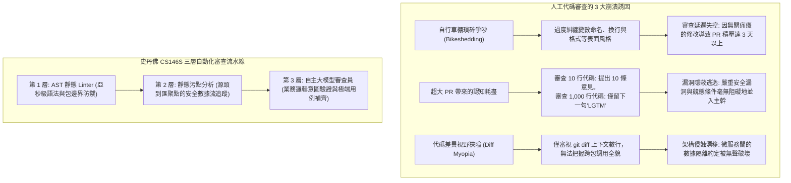
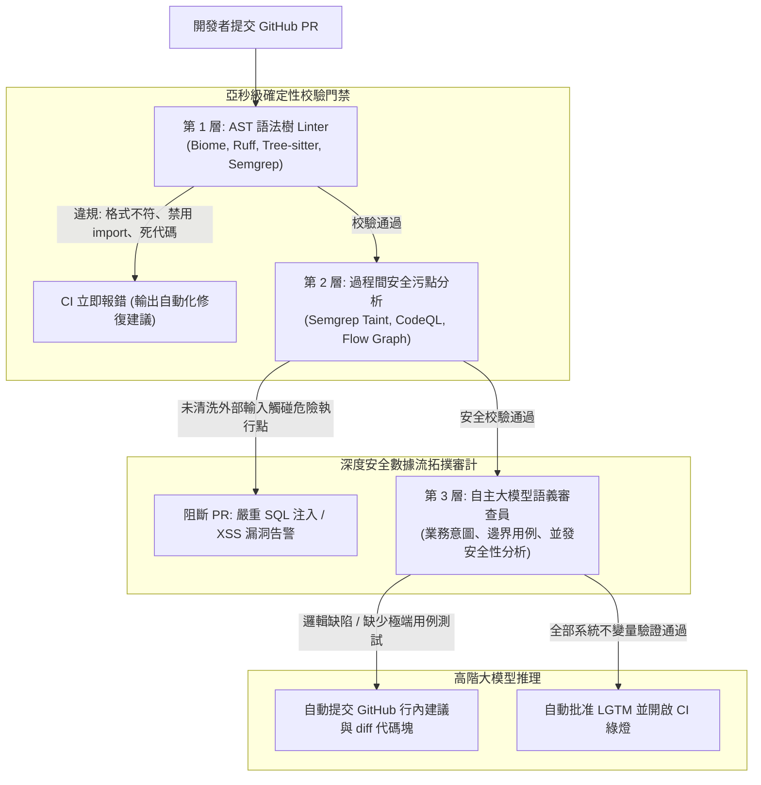

歡迎來到**史丹佛大學 CS146S（現代軟體開發者：The Modern Software Developer）**系列深度解析第7講。

在上一節課中，我們探討了基於 eBPF 核心動態追蹤與 AI SRE 智能體的生產環境即時故障自癒。然而正如資深技術工程專家所共識的那樣：**最具成本效益的 Bug，是從一開始就未曾被合併入主幹分支的代碼缺陷**。

在高速演進的技術組織中，Pull Request（PR）代碼審查是捍衛軟體品質、安全紅線與架構一致性的核心閘口。然而隨著團隊規模的擴張，完全依賴人工的人際代碼審查必然退化為嚴重的組織效能瓶頸。資深工程師每週被迫花費 15 至 20 小時審查代碼差異，將寶貴的認知精力消耗在縮進、命名規範、匯入順序等細枝末節的瑣碎爭論（Bikeshedding）上；而面對 1,000 行以上的超大 PR 時，又因**審查疲勞（Review Fatigue）**而不得不草草留下「LGTM（看起來不錯）」，從而將並發競態、SQL 注入及架構分層破壞等致命問題放行至生產環境。

在今天的課程中，史丹佛大學教學團隊揭示了**大規模自動化代碼審查（Automated Code Review at Scale）**的工程範式。通過構建融合 **抽象語法樹（AST）Linter**、**過程間安全污點分析（Taint Analysis）** 與 **自主大模型 PR 審查員** 的三層防禦體系，現代工程團隊能夠削減 90% 的機械審查負擔，同時大幅提升關鍵漏洞的攔截率。

{/* truncate */}

---

### 1. 代碼審查危機：人工審查在工程規模化下的必然崩潰

當數十個分散式團隊向龐大代碼庫持續提交變更時，純人工審查面臨三大結構性失效：



1. **瑣碎爭執（Bikeshedding）與心理內耗**：人類天生傾向於對直觀易懂的表面格式吹毛求疵，而非深入推導複雜的並發狀態不變量。這種審查模式引發開發者之間的對立情緒，嚴重拖慢迭代週期。
2. **審查疲勞與「400行法則」**：實證軟體工程研究表明，當 PR 超過 400 行時，人類缺陷檢出率呈現斷崖式下跌。面對 1,000 行的變更，審查者在認知超載下往往直接盲目合入。
3. **Diff 視野局限（Diff Myopia）**：GitHub 的 diff 視圖預設僅展示修改行周圍的數行上下文。審查者的腦袋無法在腦海中追蹤該改動是否會破壞五個調用層級之上的全域不變量。

---

### 2. 三層自動化代碼審查架構

為了將工程師從機械審查中解脫並構築無懈可擊的代碼防線，史丹佛 CS146S 確立了**三層審查階梯架構（Tri-Tier Review Hierarchy）**：



#### 各層職責與邊界清晰劃分：
1. **第 1 層：AST 語法樹 Linter（耗時：< 500ms）**
   - **工具鏈**：Tree-sitter, Biome, Ruff, Semgrep OSS。
   - **核心職責**：基於 AST 拓撲匹配執行格式化、死代碼清除、命名規範及架構邊界約束（如嚴格禁止 UI 視圖層直接 import 資料庫 ORM 實體）。
   - **史丹佛工程鐵律**：**凡是 Linter 能自動判定的規則，人類絕對不要在審查中做任何評論。** 若人工審查中出現了代碼格式建議，說明工程組織未能將該規則內化為第 1 層門禁。
2. **第 2 層：過程間安全污點分析（耗時：5s – 30s）**
   - **工具鏈**：Semgrep Pro, CodeQL, 靜態數據流分析引擎。
   - **核心職責**：追蹤不受信任的外部使用者輸入（「源點 / Sources」，如 HTTP 參數或請求頭）沿函數調用鏈傳播至高危執行點（「匯聚點 / Sinks」，如 `exec()` 或未經參數化的原始 SQL 語句）。
   - **強制原則**：若傳播鏈路上缺乏經數學驗證的清洗函數（Sanitizer），PR 將被立即掛起阻斷。
3. **第 3 層：自主大模型語義審查員（耗时：15s – 60s）**
   - **推理引擎**：Claude 3.5 Sonnet, GPT-4o, 專用微調模型。
   - **核心職責**：評估複雜的業務邏輯契約、多執行緒競態條件、向下相容性以及極端用例的測試覆蓋率。
   - **交付產物**：輸出包含完整替換代碼的 GitHub 行內修改建議塊（`suggestion`），開發者可一鍵套用合併。

---

### 3. 安全污點分析（Taint Analysis）的數學底座

在第 2 層中，靜態分析引擎如何通過數學模型形式化證明外部輸入不可能觸發漏洞？

史丹佛 CS146S 採用**有界格數據流分析（Bounded Lattice Dataflow Analysis）**：

```latex
S --(Dataflow Edge e)--> T
where Taint(T) = Clean   if f_sanitizer(x) in Path(S, T)
                 Tainted otherwise
```

```mermaid
flowchart LR
    Source["源點 (不受信輸入)<br/>req.body.searchQuery"] -->|數據傳遞| VarA["let query = searchQuery.trim()"]
    VarA -->|數據流| Sanitizer{"是否存在清洗函數?<br/>例如: db.escape()"}
    
    Sanitizer -->|否 (直接字串拼接)| Sink["匯聚點 (危險執行點)<br/>db.raw('SELECT * FROM users WHERE name = ' + query)"]
    Sink --> Alert["嚴重安全告警: 截獲 SQL 注入高危漏洞"]
    
    Sanitizer -->|是 (參數化預編譯綁定)| SafeSink["安全匯聚點<br/>db.query('SELECT * FROM users WHERE name = $1', [query])"]
```

#### 大模型在污點分析中的協同增強：
傳統靜態污點分析器在遇到開發者編寫的**自定義清洗邏輯**（如自研複雜正則替換）時往往產生大量誤報。在史丹佛架構中，當檢測到可疑路徑時，系統會將該清洗片段派發給大模型進行語義判定：「該自定義過濾函數能否在所有 Unicode 編碼形態下徹底中和 SQL 注入風險？」

---

### 4. 工程實戰：使用 Python 構建 GitHub PR 自動審查機器人

以下是基於 Python 實現的 PR 自動化審查調度腳本，集成了 AST 差異分析與大模型行內精準建議輸出：

```python
# pr_review_bot.py - 3層自動化 Pull Request 審查調度引擎
import asyncio
import os
from typing import List, Optional
from pydantic import BaseModel, Field

class InlineReviewComment(BaseModel):
    file_path: str
    line_number: int
    severity: str = Field(pattern="^(CRITICAL|WARNING|SUGGESTION)$")
    critique: str
    suggested_diff: Optional[str] = None

class PRReviewSummary(BaseModel):
    pr_id: int
    verdict: str = Field(pattern="^(APPROVE|REQUEST_CHANGES|COMMENT)$")
    architectural_summary: str
    inline_comments: List[InlineReviewComment]

class AutonomousPRReviewer:
    def __init__(self, llm_client, semgrep_runner):
        self.llm = llm_client
        self.semgrep = semgrep_runner

    async def review_pull_request(self, pr_id: int, pr_diff: str, repo_context: str) -> PRReviewSummary:
        print(f"[PR-BOT] 正在啟動 PR #{pr_id} 自動化審查流水線...")

        # 步驟 1: 調用 Semgrep 執行第 1、2 層的 AST 與污點審計
        print("[PR-BOT] 正在運行第 1 層 AST 語法檢查與第 2 層安全污點分析...")
        taint_findings = await self.semgrep.run_taint_audit(pr_diff)
        
        # 步驟 2: 構建第 3 層大模型結構化語義審查提示詞
        system_prompt = """
        你是一名要求極其嚴謹的首席軟體架構師，正在執行 GitHub PR 評審。
        嚴格遵從史丹佛 CS146S 審查教條：
        1. 嚴禁對排版格式、縮進、命名等低級風格指手畫腳（Linter 已全量覆蓋）。
        2. 重點審查並發競態、空指標邊界、O(N^2) 效能退化及架構跨層違規。
        3. 對發現的每一個實質缺陷，必須提供可一鍵套用的 GitHub 行內 diff 替換建議塊。
        """

        user_prompt = f"""
        [PULL REQUEST #{pr_id} 代碼變動 DIFF]
        {pr_diff}

        [靜態污點分析審計結論]
        {taint_findings}

        [代碼倉庫架構上下文]
        {repo_context}

        請嚴格評估並返回符合 PRReviewSummary 定義的結構化 JSON 審查報告。
        """

        print("[PR-BOT] 正在觸發第 3 層大模型深度語義推演...")
        review_result: PRReviewSummary = await self.llm.generate_structured(
            system_prompt=system_prompt,
            user_prompt=user_prompt,
            schema=PRReviewSummary
        )

        return review_result

    def post_to_github(self, review: PRReviewSummary):
        """通過 GitHub PR API 自動回寫行內建議與最終裁決"""
        print(f"\n================ [GITHUB PR #{review.pr_id} 審查裁決: {review.verdict}] ================")
        print(f"架構總結: {review.architectural_summary}\n")
        for comment in review.inline_comments:
            print(f"[{comment.severity}] {comment.file_path}:{comment.line_number}")
            print(f"審查意見: {comment.critique}")
            if comment.suggested_diff:
                print("替換代碼建議:")
                print(comment.suggested_diff)
            print("-" * 60)
```

---

### 5. 第7講核心精要與後續規劃

1. **機械檢查徹底交予系統門禁**：通過亞秒級 AST Linter 攔截全部格式與架構引用越界，避免人為消耗。
2. **污點分析嚴守安全紅線**：利用數學格模型建立端到端數據流審計，杜絕危險輸入觸碰系統執行點。
3. **大模型聚焦高階邏輯不變量**：將大模型定位於資深同行審查者，專注於死鎖、業務漏洞推導及代碼一鍵修復生成。

在**第8講**中，我們將全面探討 **AI 原生軟體架構與重構：單體服務解耦、語義技術債（Semantic Debt）治理與大規模自動化遷移**！

---

### 📌 執行摘要（3–5 行總結）
1. **破解代碼審查規模瓶頸**：通過三層自動化代碼審查流水線，徹底破除瑣碎風格爭辯（Bikeshedding）與大 PR 審查疲勞困局。
2. **AST 與污點分析自動化攔截**：利用亞秒級 AST 解析器固化語法規範，結合源點-匯聚點數據流追蹤在合併前數學阻斷注入漏洞。
3. **大模型賦能高階語義審查**：將大模型部署於業務邏輯推演、並發安全性核驗與可一鍵合併的代碼 diff 補丁生成。
4. **研發生產力指數級躍遷**：將機械審查工作全面移交 CI 門禁，將 PR 合併週期壓縮高達 70%，並顯著拔高缺陷攔截準確率。

### 參考文獻與史丹佛 CS146S 課程資訊
- **課程全稱**：Stanford CS146S (The Modern Software Developer), Fall 2026.
- **教學單位**：史丹佛大學計算機科學系.
- **關聯框架與技術**：Tree-sitter, Semgrep, CodeQL, Biome, GitHub Copilot PR Reviewer.