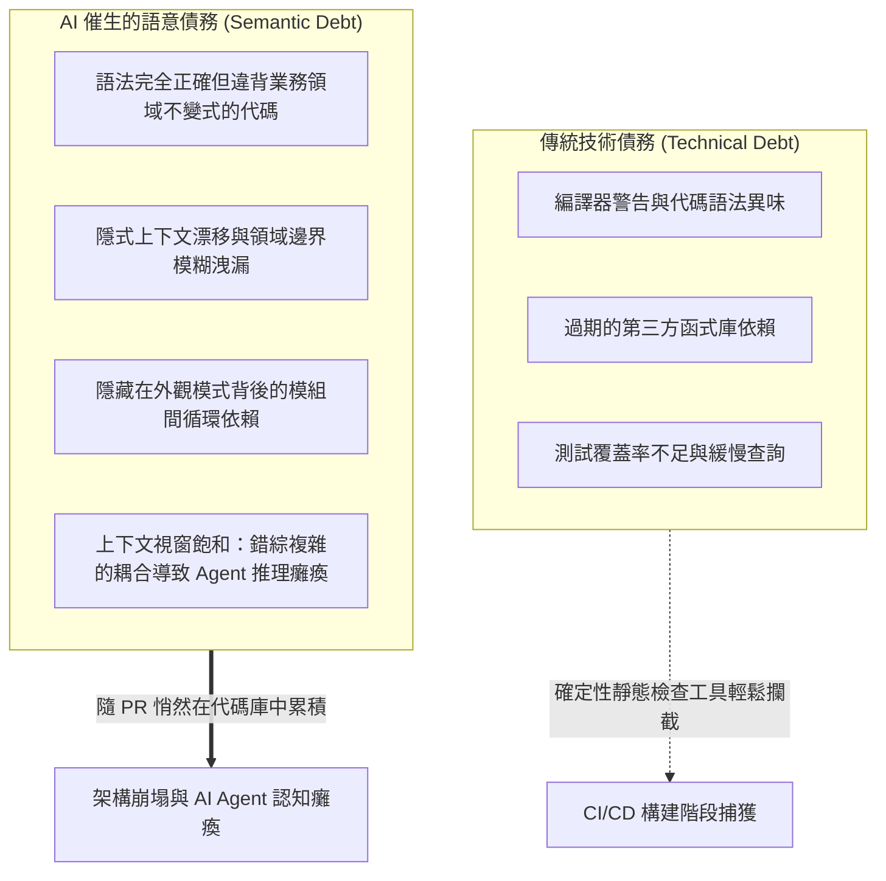

歡迎閱讀史丹佛大學最新前沿軟體工程課程 **CS146S: The Modern Software Developer（現代軟體開發者）** 技術解析系列第八篇。

在前七講中，我們深入剖析了程式碼大模型的 Prompt 工程（第 2 講）、Model Context Protocol（MCP）自主工具調用（第 3 講）、自癒式測試 Harness（第 4 講）、多 Agent 群體協作編排（第 5 講）、eBPF 運行時動態追蹤（第 6 講）以及結合 AST 靜態分析與污點分析的自動化審查（第 7 講）。

進入**第 8 講**，課程聚焦於生產代碼庫規模化引進 AI Agent 後的系統級挑戰：**「我們應如何構建能被 AI Agent 自主探索、理解與重構的軟體架構？又該如何利用 AI Agent 安全地拆解具有十年歷史的複雜遺留單體系統？」**

史丹佛研究團隊形式化定義了**語意債務（Semantic Debt）**的發生機理，提出了**AI 原生架構的四大不變原則**，並提供了一套基於 **AST 依賴圖分析的自動化單體解耦**實戰方案。

{/* truncate */}

---

### 1. 速度的悖論：技術債務 vs. 語意債務 (Semantic Debt)

傳統軟體工程透過**技術債務（Technical Debt）**來度量系統健康度：過期的第三方依賴、低效的 SQL 查詢、缺失的單元測試與代碼異味。

然而，當自主 AI Agent 全面接管編程工作後，極速的代碼產出催生了一種更隱蔽的系統性危機：**語意債務（Semantic Debt）**。



#### 何謂語意債務？
語意債務是指由 LLM 生成的代碼**在語法上完全正確、且能通過局部的單元測試，但在全局架構層面破壞了系統的核心業務不變式，導致隱式耦合急劇上升，模組邊界全面瓦解**：
1. **上下文視窗飽和**: 訂單取消邏輯因循環資料庫查詢與結算、庫存、通知三個模組緊密交織，導致 Agent 必須閱讀超過 10 萬 Token 的代碼，不可避免地產生幻覺。
2. **概念碎片化**: 不同開發者在不同提示詞下生成的代碼，使同一業務狀態（如使用者活躍狀態）在代碼庫中並存著多種割裂的實作。
3. **幽靈抽象**: AI Agent 為了快速滿足局部需求，頻繁引入與實際領域無關的空洞封裝層。

---

### 2. AI 原生軟體架構的四大不變原則

為了確保軟體系統在長週期內持續被人類與 AI Agent 協同維護，史丹佛 CS146S 提出了 **AI 原生架構（AI-Native Architecture）**：

1. **嚴格上下文預算制 (Strict Context Budgeting)**：每個模組或有界上下文（Bounded Context），必須能在 **32k Token** 預算內被完整理解。超出該預算即視為邊界失效，必須拆解。
2. **機器可讀的顯式模式契約 (Explicit Schema Contracts)**：採用 TypeScript/Zod、Python/Pydantic、Protobuf 或 OpenAPI 3.1 定義強型別介面，內置前置斷言與不變式。
3. **六角形架構隔離 (Ports & Adapters)**：將純粹的業務領域計算與產生副作用的 I/O（資料庫、外部 API、訊息佇列）嚴格解耦。
4. **金標準特徵測試 (Golden Master Characterization Tests)**：重構前捕獲生產環境數萬條真實請求入參與輸出快照，作為 Agent 重構時的絕對基準真理。

---

### 3. 基於 AST 的單體系統自動化解耦

面對龐大的遺留企業單體系統，史丹佛 CS146S 推薦**基於 AST 的自主解耦流水線**：
1. **AST 調用圖構建與強連通分量（SCC）解環**：利用 Tarjan 演算法分析依賴圖中的循環依賴（$A \to B \to A$），優先解開耦合。
2. **自動生成介面外觀層 (Interface Facade)**：AI Agent 自動提取外觀介面，重寫外部調用路徑。
3. **影子雙軌運行驗證 (Shadow Dual-Run)**：複製真實唯讀流量並發路由至舊單體與新解耦模組，經 10 萬次嚴格比對後實現零停機無縫切換。

---

### 4. 實戰腳本：AST 依賴圖分析與循環引用檢測器

```python
"""
ast_dependency_analyzer.py
史丹佛 CS146S - 自主架構重構工具包
基於 Python AST 解析依賴圖，採用 Tarjan 演算法檢測循環強連通分量，
並評估 AI Agent 的上下文 Token 預算。
"""

import ast
import os
import sys
from typing import Dict, Set, List
from collections import defaultdict


class DependencyVisitor(ast.NodeVisitor):
    def __init__(self, current_module: str):
        self.current_module = current_module
        self.dependencies: Set[str] = set()

    def visit_Import(self, node: ast.Import):
        for alias in node.names:
            self.dependencies.add(alias.name.split('.')[0])
        self.generic_visit(node)

    def visit_ImportFrom(self, node: ast.ImportFrom):
        if node.module:
            self.dependencies.add(node.module.split('.')[0])
        self.generic_visit(node)


class CodebaseGraphAnalyzer:
    def __init__(self, root_dir: str):
        self.root_dir = root_dir
        self.graph: Dict[str, Set[str]] = defaultdict(set)
        self.module_token_estimates: Dict[str, int] = {}

    def scan_codebase(self) -> None:
        for root, _, files in os.walk(self.root_dir):
            for file in files:
                if file.endswith('.py') and not file.startswith('__'):
                    filepath = os.path.join(root, file)
                    rel_path = os.path.relpath(filepath, self.root_dir)
                    module_name = rel_path.replace(os.path.sep, '.').replace('.py', '')

                    try:
                        with open(filepath, 'r', encoding='utf-8') as f:
                            content = f.read()
                            self.module_token_estimates[module_name] = len(content) // 4
                            tree = ast.parse(content, filename=filepath)

                        visitor = DependencyVisitor(module_name)
                        visitor.visit(tree)

                        for dep in visitor.dependencies:
                            if dep != module_name and os.path.exists(os.path.join(self.root_dir, dep + '.py')):
                                self.graph[module_name].add(dep)
                    except Exception as err:
                        print(f"Warning: 解析失敗 {filepath}: {err}", file=sys.stderr)

    def find_strongly_connected_components(self) -> List[List[str]]:
        index = 0
        indices: Dict[str, int] = {}
        lowlinks: Dict[str, int] = {}
        on_stack: Dict[str, bool] = defaultdict(bool)
        stack: List[str] = []
        sccs: List[List[str]] = []

        nodes = list(self.graph.keys())
        for node in self.graph:
            for dep in self.graph[node]:
                if dep not in nodes:
                    nodes.append(dep)

        def strongconnect(node: str):
            nonlocal index
            indices[node] = index
            lowlinks[node] = index
            index += 1
            stack.append(node)
            on_stack[node] = True

            for successor in self.graph.get(node, []):
                if successor not in indices:
                    strongconnect(successor)
                    lowlinks[node] = min(lowlinks[node], lowlinks[successor])
                elif on_stack[successor]:
                    lowlinks[node] = min(lowlinks[node], indices[successor])

            if lowlinks[node] == indices[node]:
                scc = []
                while True:
                    w = stack.pop()
                    on_stack[w] = False
                    scc.append(w)
                    if w == node:
                        break
                if len(scc) > 1:
                    sccs.append(scc)

        for node in nodes:
            if node not in indices:
                strongconnect(node)

        return sccs

    def evaluate_ai_native_readiness(self, max_context_tokens: int = 8000) -> None:
        print("=" * 70)
        print("史丹佛 CS146S - AI 原生架構就緒度評估報告")
        print("=" * 70)

        sccs = self.find_strongly_connected_components()
        if sccs:
            print(f"⚠️  警告: 檢測到 {len(sccs)} 個循環依賴強連通分量！")
            for idx, cycle in enumerate(sccs, 1):
                print(f"   集群 #{idx} (在 Agent 重構前必須解耦):")
                print(f"   --> {' <---> '.join(cycle)}")
        else:
            print("✅ 純淨架構: 未檢測到任何循環依賴。")

        print("\n📊 上下文預算評估 (目標: 單模組 < 8,000 Token):")
        oversized = []
        for mod, tokens in sorted(self.module_token_estimates.items(), key=lambda x: x[1], reverse=True):
            status = "✅ 合格" if tokens <= max_context_tokens else "❌ 超標 (語意債務風險)"
            print(f" - {mod:<35} : ~{tokens:>5} tokens [{status}]")
            if tokens > max_context_tokens:
                oversized.append((mod, tokens))

        if oversized:
            print(f"\n🚨 處置建議: {len(oversized)} 個模組超過單次 Prompt 上下文預算，建議利用絞殺者模式分解。")
        print("=" * 70)


if __name__ == "__main__":
    analyzer = CodebaseGraphAnalyzer(os.path.dirname(os.path.abspath(__file__)))
    analyzer.scan_codebase()
    analyzer.evaluate_ai_native_readiness()
```

---

### 5. 核心結論與下講預告

1. **避免速度陷阱**：單純追求代碼生成速度而不設立架構邊界，必然導致語意債務泛濫，終結於 LLM 上下文飽和。
2. **順應 Agent 認知規律設計**：確立嚴格上下文預算（< 32k Token）、顯式模式契約與六角形純淨領域核心。
3. **借助 AST 依賴圖科學解耦**：採用 Tarjan 演算法排除循環強連通分量，借助影子運行實現遺留單體的零停機解構。

在**第 9 講**中，我們將探索**自主測試驅動開發（ATDD）與形式化驗證：結合 Z3 SMT 約束求解器與基於屬性測試（PBT）證明 LLM 生成代碼的數學完備性**。

---

### 📌 3–5 行要點速覽
1. **形式化定義語意債務**：揭示了 AI 高速生成代碼導致全局不變量瓦解、隱式耦合激增及 Agent 推理癱瘓的機理。
2. **確立 AI 原生架構四大準則**：提出上下文預算制（< 32k Token）、強型別契約、六角形副作用隔離與金標準測試。
3. **創立 AST 驅動自主解耦路徑**：借助 AST 調用圖分析、Tarjan 強連通分量消解與影子雙軌無縫割接單體系統。
4. **提供全功能 Python 診斷套件**：實現了自動掃描依賴網路、捕獲循環依賴及測算上下文預算的開箱即用腳本。

### 參考文獻與史丹佛資料
- **課程**: Stanford CS146S (The Modern Software Developer), Fall 2026.
- **院系**: 史丹佛大學資訊工程學系 (Department of Computer Science).