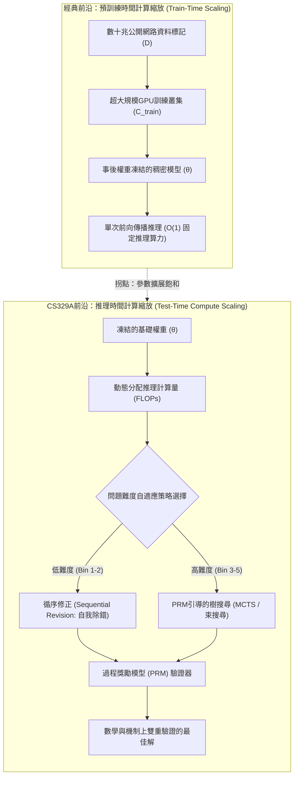
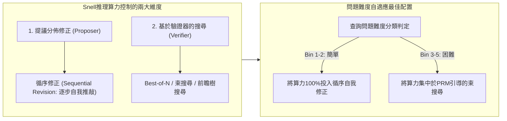

歡迎閱讀史丹佛大學2025年秋季最新頂尖研究所課程**CS329A: Self-Improving AI Agents（自我演進AI代理人）**的第二篇專業工程解析。

在第一講中，我們綜述了從靜態自迴歸次詞預測器邁向具備環境反饋閉環的自主代理人之宏觀範式躍遷。今天第二講所探討的，正是支撐此自主演進能力的最核心計算支柱：**推理時間計算縮放（Test-Time Compute Scaling / Inference-Time Scaling）**。

過去五年間，整個AI產業界信奉的唯一教條是預訓練階段的縮放定律（Kaplan等人，Chinchilla定律）：*建造超大規模GPU叢集，將模型參數規模N推升至數千億級，並灌注數十兆標記（Tokens）的網路資料*。然而，在模型權重θ預訓練完成後，如果我們拒絕讓模型在50毫秒內草率給出貪婪預測（Greedy decoding），而是讓代理人**投入10秒、1分鐘甚至10分鐘深入推敲、檢驗中間步驟、並自主反覆修正假設**，會發生什麼顛覆性的轉變？

依託*Large Language Monkeys*（Brown等人，2024）、史丹佛-柏克萊Charlie Snell研究團隊的*Compute-Optimal Scaling*（Snell等人，2024）以及*Archon*模組化架構搜尋框架，我們將從數學理論與系統工程雙重視角，徹底解析**「如何透過投入推理算力（FLOPs）打破參數規模壟斷，實現智慧躍遷」**。



{/* truncate */}

---

### 1. 經典縮放定律 vs 推理算力：範式的重大轉移

現代深度學習的基石奠定於一項經驗性發現：驗證損失（Validation Loss）隨訓練計算量的增加呈冪律（Power-law）遞減：

```text
L(N, D) = E + A / N^α + B / D^β
```

其中N為非嵌入參數規模，D為訓練資料集標記量。然而，這一定律將推理計算視為極簡的靜態常數：在自迴歸解碼中，每生成一個標記恰好消耗2 FLOPs × 參數規模。

#### 預訓練縮放遭遇的物理實體限制
隨著產業界將預訓練算力推進至10^26 FLOPs（GPT-4量級），預訓練遭遇了三重難以逾越的瓶頸：
1. **公開語料枯竭邊界：** 網路上高品質人類原生文字存在上限（約10^14 Tokens）。缺乏可靠外部驗證器而單純遞迴灌注合成資料，會導致模型崩潰（Model Collapse）與資訊熵衰退。
2. **指數級劇增的資本支出：** 在冪律曲線平坦的尾端，將基準準確率提升1%需要額外投入10倍的預訓練算力，折合為數億美元計的龐大資本開支（CAPEX）。
3. **靜態前向傳播的本質缺陷：** 無論模型是7B還是1T參數，標準解碼過程僅透過固定次數的矩陣乘法輸出下一個標記t_i：

```text
t_i ~ Softmax( W_u · LayerNorm( h_L(t_{1:i-1}) ) )
```

對於NP完全數學定理證明、跨多原始碼檔案的軟體缺陷排查等複雜任務，缺乏回溯（Backtracking）、假設探索與分步檢驗機制的單向前向傳播無法在結構上求解。

---

### 2. 無限猴子定理的現代回歸：Large Language Monkeys

古典機率論中有一個著名的思想實驗——埃米爾·博雷爾的「無限猴子定理」：如果讓無數隻猴子在打字機前隨機敲鍵，歷經無限時間，它們終將打出莎士比亞的《哈姆雷特》全集。

2024年底，加州大學柏克萊分校與Google研究院的研究團隊針對前沿LLM實證測試了這項假設：**《Large Language Monkeys: Scaling Inference Compute with Repeated Sampling》**（Brown等人，2024）。

```
覆蓋率 (Pass@k %)
 ▲
100│                                     ┌────────────── Pass@k 覆蓋率理論上限
 90│                                ┌────┘ (在MATH與CodeContests中達到99%)
 80│                           ┌────┘
 70│                      ┌────┘
 60│                 ┌────┘ ◄── SWE-bench Lite: DeepSeek-Coder-V2 (k=250 -> 56.0%)
 50│            ┌────┘
 40│       ┌────┘   ◄── Claude 3.5 Sonnet 單次執行 (43.0%)
 30│  ┌────┘
 20│ ┌┘
 10│┌┘  ◄── Gemma-2B Pass@1 (0.02%)
  0└┴──────┬──────────┬──────────┬──────────┬──────────►
    k=1    k=10       k=100      k=1,000    k=10,000   (採樣候選次數 k)
```

#### pass@k 不偏估計量的數學表述
當從模型中獨立採樣N個候選答案，且其中恰有C個答案完全通過自動化驗證工具（如單元測試）時，隨機抽取k個樣本中至少包含一個正確答案的最小變異數不偏估計量（MVUE）定義為：

```text
Pass@k = (1 / P) · ∑_{i=1}^P [ 1 - C(N - C_i, k) / C(N, k) ]
```

其中P為評估測試集總題數，C_i為第i題的正確樣本數，C(n, r)為二項式組合數。為防止在擴展到N = 10,000時階乘運算發生浮點數溢位，生產環境採用以下數值穩定的連乘迴圈進行計算：

```text
Pass@k = 1 - ∏_{j=0}^{k-1} ( 1 - C_i / (N - j) )
```

#### 實證突破：小型模型實現對前沿巨無霸的級距逆襲
透過重複採樣擴展推理算力帶來了震撼的實證發現：
* **SWE-bench Lite（真實GitHub軟體缺陷修復評測）：**
  * 開源模型`DeepSeek-Coder-V2-Instruct`單次執行（k=1）成功率僅為**15.9%**。
  * 當採樣次數擴展至k=250時，pass@250暴增至**56.0%**。
  * 這一成績不僅大幅領先GPT-4o與Claude 3.5 Sonnet的單次執行整合（43.0%），領先幅度高達**13個百分點**。
* **CodeContests（超高難度演算法競賽基準）：**
  * 超輕量級模型`Gemma-2B`單次解題率（pass@1）僅為**0.02%**（幾乎為0）。
  * 但當擴展至k=10,000時，其通過率躍升至**7.1%**，效能暴增**355倍**。
* **經濟效益反轉：**
  * 在SWE-bench上，DeepSeek-Coder-V2採樣5次達成29.62%成功率的API成本為**$10.80**。
  * 相比之下，單次執行GPT-4o（24.0%）花費**$39.00（貴3.6倍）**，Claude 3.5 Sonnet（26.7%）花費**$51.00（貴4.7倍）**。

```text
┌───────────────────────────────┬──────────┬────────────┬─────────────┐
│ 模型與推理策略                │ SWE-bench│ 調用成本   │ 成本倍數    │
├───────────────────────────────┼──────────┼────────────┼─────────────┤
│ DeepSeek-Coder-V2 (k=5)       │ 29.62%   │ $10.80     │ 1.0x (基準) │
│ GPT-4o (k=1 貪婪單次執行)     │ 24.00%   │ $39.00     │ 3.6倍 高成本│
│ Claude 3.5 Sonnet (k=1)       │ 26.70%   │ $51.00     │ 4.7倍 高成本│
│ DeepSeek-Coder-V2 (k=250)     │ 56.00%   │ $540.00    │ 頂尖效能    │
└───────────────────────────────┴──────────┴────────────┴─────────────┘
```

#### 覆蓋率-精確率差距 (Coverage-Precision Gap)：驗證器之壁
然而，無節制地增加採樣數量必然面臨**覆蓋率-精確率差距**這項結構性障礙。

在配備決定性判定機制（編譯器或單元測試）的封閉形式化領域，**覆蓋率等同於最終成功率**：250個樣本中只要有1個通過全量測試，就能被精準提取。

但在缺乏外部決定性驗證工具的開放領域或主觀題中：
* 在MATH數學競賽資料集上，`Llama-3-8B-Instruct`在k=10,000時的覆蓋率高達**98.44%**（代表答案池中98%含有正確解答）。
* 然而，若採用**多數投票法（Majority Voting）**，準確率僅從40.5%微升至**41.41%**（微幅提升0.9%）。
* 利用結果獎勵模型（ORM）進行**Best-of-N優選**在k=100附近即達到停滯平台，由於偽陽性與獎勵作弊（Reward Hacking）無法篩選出剩餘57%的正確答案。

> **工程鐵律：** 在缺乏高精確率驗證器的情況下盲目擴充採樣，僅僅是將乾草堆擴大。即使一根繡花針（正確答案）落在乾草堆裡的機率無限接近100%，沒有高精度的磁鐵（驗證器），你依然無法將其找出。

---

### 3. Snell的計算最佳縮放定律 (Compute-Optimal Scaling)

在給定的固定推理預算（FLOPs）下，如何運用最精巧的數學策略消耗算力？

2024年秋，史丹佛大學與加州大學柏克萊分校的Charlie Snell、Jaehoon Seo、Hao Liu等人發表了劃時代的論文：**《Scaling LLM Test-Time Compute Optimally can be More Effective than Scaling Model Parameters》**。



#### 調控推理算力的兩大核心旋鈕
Snell等人將所有的測試時推理技術抽象為**提議者（Proposer）**與**驗證者（Verifier）**兩個正交維度：
1. **修正提議分佈（修改Proposer）：** 提示模型反思先前的草稿，產生品質更高的解題路徑：
   ```text
   y_{t+1} ~ P_θ( y | x, y_1, ..., y_t, Critique_t )
   ```
2. **基於驗證器的狀態搜尋（依賴Verifier）：** 利用過程獎勵模型（PRM）對中間思考節點進行價值評估與剪枝：
   ```text
   Score(Node_t) = PRM_ψ( x, y_{1:t} )
   ```

#### 難易度驅動的最佳配置反轉原理
Snell研究團隊最核心的洞見是：**最佳策略會隨著問題的難易度發生根本性的徹底反轉**：

```text
難度 Bin 1-2 (簡單問題)   ───>  循序自我修正 (Sequential Revision) 佔據絕對優勢
難度 Bin 3-5 (困難問題)   ───>  PRM引導束搜尋 (Beam Search) 佔據絕對優勢
```

1. **簡單問題（Bins 1–2）：** 
   * 簡單問題的基座模型初次嘗試已經非常接近正解。
   * 此時強行套用複雜的樹搜尋反而會引入驗證器的微小雜訊，導致模型把算力越花越差（Over-optimization）。
   * **最佳解：** 循序修正（讓模型自主檢查並修正上一輪的微小運算錯誤）以極低算力達成極高收益。
2. **困難問題（Bins 3–5）：**
   * 在奧數等級的高難題目中，一旦邏輯開端走入歧途，線性的自我修正完全無法挽救。
   * **最佳解：** 基於PRM步級獎勵的束搜尋能夠及早修剪無前途的思維分支，相較於盲目Best-of-N呈現出輾壓級的優勢。
3. **計算最佳配置的紅利：**
   * 簡單題配置Revision，難題配置PRM束搜尋的動態自適應策略，在達成同等準確率的前提下，相較於純粹Best-of-N**節省了整整4倍（4x）的計算量**。

#### 14倍參數等價性 (The 14x Parameter Equivalence)
論文最具震撼力的實驗，是將**「預訓練模型參數擴增14倍」與「給小模型賦予14倍推理算力」進行正面對決**：

```text
14倍參數大模型 (貪婪單次解碼)   vs   1倍基準小模型 + 14倍推理算力
```

* 在MATH與GSM8K的簡單及中等題目中，配備最佳推理算力的小模型在準確率上完全追平甚至反超了14倍體量的大模型。
* 但在終極難題（Bin 5）上，預訓練大模型的參數內生能力仍無可替代：如果基座模型對問題缺乏基礎的語意表徵，推理階段的任何搜尋都將退化為毫無根據的幻覺空轉。

---

### 4. 系統工程實現：Archon模組化複合代理人架構

如何將理論上的推理縮放定律落地為工業級軟體？避免在應用程式碼中充斥硬編碼的Prompt？

**Archon**框架（arxiv:2409.15254）透過將LLM功能單元抽象為**分層式軟體管線**徹底解決了這項工程難題：

```mermaid
flowchart TD
    Q[使用者需求 / 規範說明書] --> G[Layer 1: 生成器整合 (Generator)]
    G -->|候選解空間| C[Layer 2: 多視角批判器 (Critic)]
    C -->|批判與缺陷定位| R[Layer 3: 循環淘汰排序器 (Ranker)]
    R -->|高潛力候選解| F[Layer 4: 融合重構器 (Fuser)]
    F -->|共識最佳化解| V[Layer 5: 自動化驗證器與單元測試沙盒]
    V -->|執行反饋| Dec{通過全量測試?}
    Dec -- 是 --> Final[驗證通過的生產交付物]
    Dec -- 否 (回溯重構) --> G
```

#### Archon的五層系統架構
1. **生成器層 (Generator)：** 透過調整溫度採樣參數（T=0.2 ~ 0.8）或調度異質模型（Claude 3.5 Sonnet + DeepSeek-V2），平行生成多樣化候選解。
2. **批判器層 (Critic)：** 逐條剖析各個候選解在邊界條件、數學邏輯或工程規範上的潛在瑕疵。
3. **排序器層 (Ranker)：** 依據批判反饋對候選方案進行1對1淘汰制比較，建立穩健排名。
4. **融合層 (Fuser)：** 提取高位排名候選解的核心思維亮點，二次融合成單一完美答卷（+8.9% 基準提升）。
5. **驗證層 (Verifier)：** 在程式碼場景下利用LLM自生成5至10個邊界單元測試案例，並在隔離沙盒（Docker / gVisor）中實際執行（+56% 效能提升）。

Archon構建了包含**9,576種潛在拓撲組合**的架構設計空間，並透過**貝氏最佳化（Bayesian Optimization）**在限定的延遲與調用成本預算內，自動尋得帕雷托最佳（Pareto-optimal）的代理人架構。

---

### 5. 架構案例剖析：透視 OpenAI o1 推理模型的內幕

史丹佛CS329A第二講的理論，為我們徹底揭開了以OpenAI o1與DeepSeek-R1為代表的推理大模型的底層設計：

```
┌────────────────────────────────────────────────────────────────────────┐
│                   o1 內部「思考（Thinking）」軌跡的本質                 │
├────────────────────────────────────────────────────────────────────────┤
│ 1. 隱蔽推敲階段 (Test-Time Tokens):                                    │
│    在向使用者輸出第一個可見文字前，模型自主生成數千個思維鏈Token，      │
│    在推理端預先消耗海量算力。                                          │
│                                                                        │
│ 2. 內嵌的過程獎勵評估 (PRM):                                           │
│    經由強化學習（RL）步級對齊，模型在遇到推導瓶頸時具備自動回溯        │
│    （Backtracking）至先前分叉點的內生能力。                            │
│                                                                        │
│ 3. 循序糾錯循環 (Snell Revision):                                      │
│    諸如「等等，這裡似乎算錯了，讓我換個角度」這類提示，實質上是由        │
│    內在一致性檢驗所激發的循序修正策略。                                │
└────────────────────────────────────────────────────────────────────────┘
```

o1展現出的長鏈思考絕非不可捉摸的黑盒魔法，而是**推理時間計算縮放、循序修正與過程檢驗在單一神經網絡中實現內嵌式整合的工業典範**。

---

### 6. 核心總結與技術啟示

1. **智慧擴增的雙輪驅動：** AI能力的提升不再完全被預訓練所局限。推理時間計算縮放開闢了平行的擴展維度，讓緊湊型模型擁有逆襲工業巨無霸的可能。
2. **覆蓋率-精確率原則：** 重複採樣（pass@k）能夠指數級擴大覆蓋面（DeepSeek-Coder-V2 15.9% -> 56.0%），但唯有配合高精度的過程驗證器（PRM）才能真正將潛力轉化為確定性的產出。
3. **Snell最佳配比定律：** 自適應算力分配比盲目暴力採樣效率高4倍：簡單問題走循序自我修正，複雜問題走PRM樹搜尋。
4. **模組化代理人系統：** 正如Archon所證實的，結合生成、批判、重構與沙盒驗證的軟體架構，對最終系統精度的貢獻不亞於模型底層權重本身。

---

### 史丹佛CS329A 下講預告:
在接下來的**第三講**中，我們將深入代理人系統的「心臟」：**《Robust Verification: 過程獎勵模型 (PRM)、模型整合與可擴展監督 (Scalable Oversight)》**。我們將系統探討如何構建能夠抵禦獎勵作弊（Reward Hacking）、在無需人工介入下確立真實正解的高可靠驗證器。敬請關注！