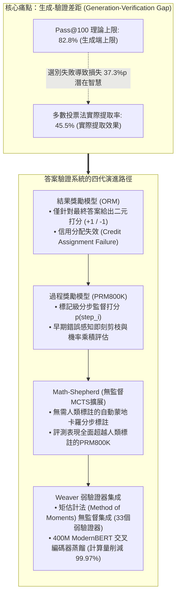
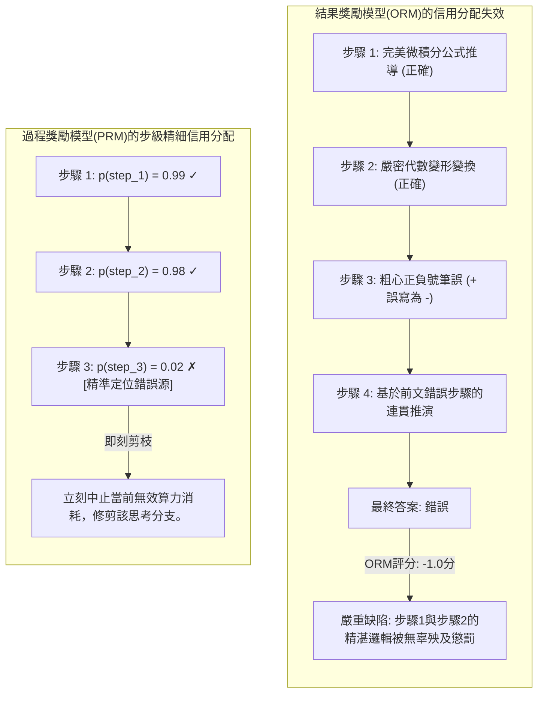
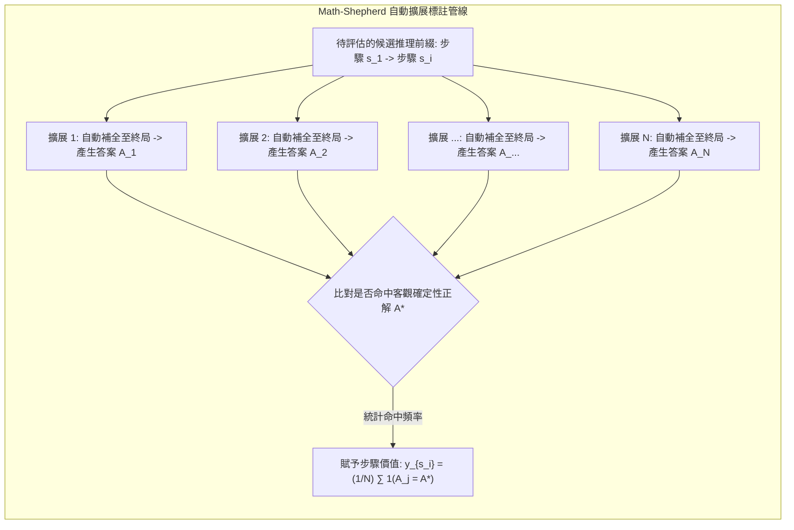
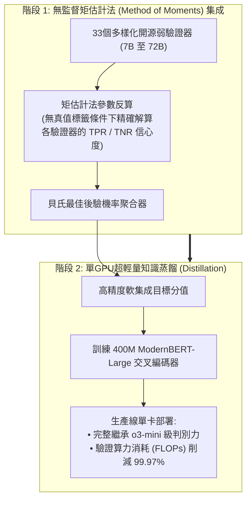

歡迎閱讀史丹佛大學2025年秋季前沿研究所課程**CS329A: Self-Improving AI Agents（自我演進AI代理人）**的第三篇專業工程深度解析。

在上一講（第二講）中，我們系統剖析了推理時間計算縮放（Test-time Compute Scaling），並得出了一個深刻的結論：單純讓模型產生數千個候選答案（$pass@k$）能夠將理論上的覆蓋率推向99%以上，但**「如果沒有高精度的驗證器（Verifier）從浩瀚的錯誤草堆中挑出唯一正確的繡花針，無論是多數投票還是盲目重抽樣，模型效能都會迅速撞牆停滯」**。

今天第三講所探討的，正是解決這一致命瓶頸的核心系統級工程：**穩健答案驗證（Robust Verification）**。

人類數學家或軟體工程師在解決複雜課題時，絕不會憑空一筆劃出完美推導；他們寫下一行演算，複核代數合理性，捕捉正負號的筆誤，並在誤入歧途前及時回溯（Backtracking）。相反，標準的自迴歸語言模型只能向未來單向輸出標記。一旦初始推理發生輕微偏差，模型為了自我圓謊，便會在此基礎上炮製出越來越荒謬的幻覺（Hallucination）。

那麼，**「我們能否訓練獨立的驗證模型，對生成模型每一步的中間推理進行逐行嚴格質檢，提前修剪死胡同？」**

從OpenAI的奠基之作Cobbe GSM8K驗證器，到Lightman的分步過程監督（PRM800K），再到無需人類標註、基於蒙地卡羅自動擴展打分的Math-Shepherd，以及最新透過統計物理矩估計法集成33個弱驗證器達到o3-mini水準的Weaver（NeurIPS 2025），我們將系統拆解並掌握**驗證器工程（Verifier Engineering）的最前沿技術**。



{/* truncate */}

---

### 1. 生成-驗證差距 (Generation-Verification Gap)：瓶頸的數學定義

在深入具體驗證器拓撲之前，必須將模型潛在生成能力與實際可抽取表現之間的鴻溝進行形式化定義：

```text
Gap(K) = Pass@K - Actual_Success_Rate
```

在前沿高難度評測GPQA Diamond中，開源頂尖模型`Llama-3.3-70B-Instruct`的$Pass@100$高達**82.8%**。這意味著在10道難題中，有超過8道題的100個候選集合內已蘊含了至少一條完全正確的解法。

然而，若對這100個候選應用產業界最普遍的**多數投票法（Majority Voting）**，最終測得的實際準確率暴跌至**45.5%**。

```
準確率 (%)
 ▲
100│                                     ┌────────────── Pass@100 理論上限 (82.8%)
 90│                                ┌────┘
 80│                           ┌────┘
 70│                      ┌────┘
 60│                 ┌────┘
 50│            ┌────┘ ◄── 遴選失效蒸發的 37.3%p 智慧
 40│  ──────────┴──────────────────────── 多數投票法停滯平台 (45.5%)
 30│
 20│
 10│
  0└┴────────────────────────────────────────────────► 採樣預算 K
```

高達**37.3個百分點的潛在智慧**僅僅因為「無法正確挑選正解」而化為烏有。當多條邏輯混亂的解題路徑偶然匯聚到同一個看似合理的干擾項（Plausible Distractor）時，單純依賴頻次的統計策略必然會把偽陽性（False Positive）選為最終答案。

#### 獨立驗證器的起源：Cobbe et al. (GSM8K, 2021)
為彌合這一鴻溝，OpenAI的Karl Cobbe團隊發布了經典數學基準**GSM8K**，並首次提出了與生成器權重解耦的**獨立驗證器（Verifier）**架構：

1. **權重解耦 (Decoupled Architecture)：** 生成器與驗證器在推理時不共享前向權重。生成器僅微調2輪（Epoch）以保留採樣多樣性，驗證器則針對生成器產生的解法集進行針對性訓練。
2. **標記級價值頭 (Token-Level Value Heads)：** 驗證器不只在序列末尾輸出單一標量，而是在Transformer每一個標記位置接入線性頭，預估該標記處的正解機率：
   ```text
   V(t_i) = W_v · h_L(t_i) + b_v
   ```
   網絡透過聯合損失函數進行最佳化，融合了語言模型交叉熵與驗證均方誤差（MSE）：
   ```text
   L_total = L_LM(θ) + λ · || V(t_end) - y_true ||^2
   ```
3. **30倍參數紅利：**
   * 實驗表明，為生成器掛載一個僅**6B參數的輕量驗證器**，從100個候選中選拔出的答案精度，足以匹敵單次執行的**175B超大稠密模型**。
   * 單純將生成與驗證解耦，就換來了**約30倍的參數利用效率提升**。

---

### 2. 結果監督 vs 過程監督：Lightman團隊的PRM800K

儘管Cobbe的驗證器取得了突破，但其本質仍局限於**結果監督（Outcome Reward Models, ORMs）**。

2023年5月，Hunter Lightman帶領的OpenAI研究團隊發表了里程碑論文：**《Let's Verify Step by Step》**（Lightman等人，2023）。



#### 推理中的信用分配難題 (Credit Assignment Problem)
思考一道包含10個步驟的複雜證明題：
* **偽陰性困境：** 模型在步驟1到6展現了驚人的數學嚴密性。但在步驟7因粗心算錯符號，導致最終數值錯誤。
  * *ORM的裁決：* 扣除全部分數（-1分）。步驟1至6的高價值邏輯推理被全盤否定，污染了訓練梯度。
* **偽陽性困境（僥倖正解，Lucky Error）：** 模型在步驟3犯下了荒謬的邏輯錯誤，但巧合的是在步驟8又犯了一個抵消性的計算錯誤，竟然歪打正著得出了正確答案。
  * *ORM的裁決：* 給出滿分（+1分）。模型的不良邏輯得到正向強化，加劇了獎勵作弊（Reward Hacking）。

這種時序信用分配的錯配，構成了基於結果的驗證器進一步擴展的根本障礙。

#### 過程獎勵模型 (PRM) 的數學設計
Lightman團隊動員人類專家，對MATH資料集中75,000個解答的80萬個中間推理步驟（以雙換行符分隔）進行了正向/負向/中立的三分類標註，構建了**PRM800K**。

他們引入的降本核心法寶是**「首次錯誤中止規則（First-Error Termination Rule）」**：由於無效推演後續產生的分支沒有認知價值，標註員在發現第一個邏輯漏洞時便即刻停止標註。

PRM在每個推理步驟末尾的換行標記處，預測該步驟邏輯成立的機率：

```text
p(s_i) = σ( W_p · h_L( Token_{\text{newline}, i} ) )
```

整條候選路徑$S = (s_1, s_2, ..., s_M)$的綜合品質評分由**機率乘積法則（Product Rule）**得出：

```text
Score_PRM(S) = ∏_{i=1}^M p(s_i \text{ is correct})
```

#### PRM的輾壓級實證表現
在MATH基準上開展高達$N = 1,860$的Best-of-N搜尋時：

```text
┌───────────────────────────────┬──────────────┬──────────────┬─────────────┐
│ 方案選擇策略                  │ Best-of-1    │ Best-of-100  │ Best-of-1860│
├───────────────────────────────┼──────────────┼──────────────┼─────────────┤
│ 多數投票法 (Majority Vote)    │ 52.4%        │ 68.3%        │ 69.6%       │
│ 結果獎勵模型 (ORM)            │ 52.4%        │ 70.1%        │ 72.4%       │
│ 過程獎勵模型 (PRM)            │ 52.4%        │ 74.8%        │ 78.2%       │
└───────────────────────────────┴──────────────┴──────────────┴─────────────┘
```

1. **持續擴展曲線：** 多數投票法與ORM在$N = 100$附近便陷入早熟停滯，而PRM的準確率曲線在擴展至數千個樣本時依然保持單調上揚。
2. **負對齊稅 (Negative Alignment Tax)：** 傳統安全對齊（RLHF）往往以犧牲原始數學推導能力為代價（所謂的「對齊稅」），但過程監督在大幅提升推導可解釋性與安全性的同時，反而推動推理精準度同步爆發。

---

### 3. 無人化自動過程監督：Math-Shepherd蒙地卡羅擴展

雖然PRM性能卓越，但阻礙其規模化工業落地的唯一痛點在於：**「80萬步的人類專家級標註成本過於昂貴」**。

2023年底，Yu、Shen、Zhou等人發表了**Math-Shepherd**框架，從蒙地卡羅樹搜尋（MCTS）中汲取靈感，攻克了這一難題。



#### 演算法直覺：以機驗機
正如AlphaGo評估局部棋步的勝率：
> 「若要驗證某一步推理$s_i$是否成立，只需讓語言模型從該步驟出發，將推導隨機補全$N$次（Rollout）。如果生成的大量終局答案頻繁命中客觀真理$A^*$，便足以倒推證明該中間步驟是堅實的邏輯基石！」

#### 硬估計 vs 軟估計
Math-Shepherd定義了兩種步級價值標籤：

1. **硬估計 (Hard Estimation, HE)：** $N$次擴展中只要有至少一次成功擊中正解，該步即打為$+1$，否則為$0$：
   ```text
   y^{HE}_{s_i} = 1( ∃ j \in {1, ..., N} : A_j = A^* )
   ```
2. **軟估計 (Soft Estimation, SE)：** 計算$N$次擴展中擊中正解的實際頻率，賦予連續型的機率分數：
   ```text
   y^{SE}_{s_i} = (1 / N) · ∑_{j=1}^N 1( A_j = A^* )
   ```

#### 顛覆性實驗發現：機器標籤超越人類專家
研究團隊在未標註的問題庫上執行全自動擴展，以零人工成本合成了**170萬步帶標註的高品質資料集**（規模達PRM800K的兩倍以上）。

* **人類標籤 vs 機器標籤：** 在開源LLaMA架構上評測，由Math-Shepherd合成資料訓練出的PRM，在MATH基準上**擊敗了完全由人類標註的PRM800K**。
* **超越的原因剖析：** PRM800K的人工標註員審核的是GPT-4生成的解答，無法適配開源模型的獨特盲區。而Math-Shepherd直接從目標模型自身的原生分佈中採樣，免費獲得了高度量身定制的判別能力。
* **步級強化學習 (PPO)：** 利用Math-Shepherd的過程獎勵實施強化學習微調後，`Mistral-7B`在MATH上的得分從28.6%**飛躍至43.5%**。

---

### 4. 集成理論突破：Weaver框架 (NeurIPS 2025)

即使擁有Math-Shepherd，單一的7B或13B輕量驗證器仍存在偶發性誤判；而在生產線上堆疊多個70B大模型作為驗證器，延遲與調用成本又不可承受。

史丹佛大學與威斯康辛大學麥迪遜分校的研究團隊在NeurIPS 2025上發表了優雅的數理破局方案：**《Weaver: Shrinking the Generation-Verification Gap with Weak Verifiers》**（Zhang等人，2025）。



#### 無需真值標籤反算驗證器實力的「矩估計法 (Method of Moments)」
Weaver匯聚了從7B到72B的33個異質開源弱驗證器（Weak Verifier）。在沒有任何正解標籤的線上測試場景中，**我們究竟該信任誰的話？**

Weaver將該挑戰建模為**隱變數單純貝氏模型（Latent Variable Naive Bayes）**：
* 候選解答的客觀真實正誤`Y in {0, 1}`屬於未知的隱變數。
* 每個驗證器`k`具備未知的真陽性率（靈敏度，``w_{k,1}``）與真陰性率（特異度，``w_{k,0}``）：
  ```text
  `w_{k,1}` = P(S_k = 1 | Y = 1), \quad `w_{k,0}` = P(S_k = 0 | Y = 0)
  ```
* 在給定$Y$的條件獨立假設下，兩兩驗證器同時判定為正確的聯合機率可以展開為顯式代數方程式。

Weaver利用統計學中的**矩估計法（Method of Moments）**，解析反演觀測量間的二階與三階共變異數張量，**在不需要任何人工真值標籤的前提下，精確解算出了全部33個驗證器各自的精度權重``(`w_{k,1}`, `w_{k,0}`)``**。

據此推導出的貝氏最佳後驗共識機率為：

```text
P( Y=1 | S_1, ..., S_K ) = 1 / ( 1 + exp( - ( l_0 + ∑_{k=1}^K l_k(S_k) ) ) )
```

#### Weaver的實證成就
1. **全面超越 OpenAI o3-mini：**
   * 將普通的文字生成器`Llama-3.3-70B-Instruct`與Weaver弱驗證器集成結合，在頂尖STEM競賽基準上取得了**87.7%**的高分。
   * 這一表現徹底超越了當時的單一推理巔峰**OpenAI o3-mini (86.7%)與GPT-4o (69.0%)**。
2. **400M超輕量交叉編碼器蒸餾：**
   * 線上即時平行運行33個大模型極其昂貴。研究團隊將Weaver算出的集成信心度作為軟目標，蒸餾到了僅**400M參數的`ModernBERT-Large`交叉編碼器**中。
   * 該小模型不僅**保留了完整集成模型98.7%的精準度，還將驗證推理開銷（FLOPs）降低了驚人的99.97%**，使單張消費級GPU實現毫秒級o3-mini水準的篩選成為可能。

---

### 5. 架構實踐指南：企業級生產驗證器設計清單

基於史丹佛CS329A第三講的理論體系，以下是構建工業級金融、法律、程式碼AI代理人驗證管線的核心指引：

```text
┌────────────────────────────────────────────────────────────────────────┐
│             企業級生產驗證器系統架構核心審查清單                       │
├────────────────────────────────────────────────────────────────────────┤
│ 1. 結構化封閉形式化領域 (程式碼工程、形式數學證明):                    │
│    • 部署編譯器、型別檢查器與單元測試沙盒作為絕對確定性判據。          │
│    • 依託 Docker / gVisor 沙盒構建執行反饋型 ORM。                     │
│                                                                        │
│ 2. 半形式化 / 多步邏輯推演領域 (金融盡調、合約審計、架構設計):         │
│    • 採用機器自動擴展 (Math-Shepherd) 方式訓練專用過程獎勵模型 (PRM)。  │
│    • 依照機率乘積法則 (Product Rule) 對多步思考路徑精細打分。          │
│    • 對分步機率 p < 0.2 的思考枝葉實施早期剪枝淘汰。                   │
│                                                                        │
│ 3. 生產線延遲與算力預算最佳化:                                         │
│    • 離線環境下運用矩估計法 (Weaver) 構建多源弱驗證器無監督集成。      │
│    • 將集成判別知識蒸餾到 1B 以下的微型交叉編碼器中。                  │
│    • 在邊緣單卡 GPU 上實現低於 10ms 的極速信心度過濾。                 │
└────────────────────────────────────────────────────────────────────────┘
```

---

### 6. 核心總結與架構啟示

1. **驗證決定上限的法則：** AI演進的瓶頸正由「生成」轉變為「遴選」。彌合30%以上的生成-驗證差距，必須依賴權重解耦的獨立驗證器。
2. **信用分配的代差優勢：** 結果獎勵模型（ORM）在長鏈條推理中必然遭遇嚴重的信用分配失效。唯有分步評估的過程獎勵模型（PRM）才能支撐數千樣本級別的Best-of-N有效擴展。
3. **機器自監督的勝利：** 人類手工標註是昂貴的過去式。蒙地卡羅隨機擴展（Math-Shepherd）能夠零成本、無限量地提煉出最適配模型原生分佈的過程標籤。
4. **集成與蒸餾的閉環：** 無監督矩估計集成（Weaver）可擊敗壟斷巨無霸模型，而蒸餾至400M參數後更可節省99.97%的算力開銷。

---

### 史丹佛CS329A 下講預告:
在接下來的**第四講**中，我們將從純文字機率跨入物理世界與數位環境的真實反饋：**《Tool Use & Code Feedback: 編譯器、執行沙盒與自主糾錯閉環》**。我們將深入探究代理人如何與Python終端、Bash命令列及單元測試即時互動，在試錯中自我修復程式碼。敬請期待！