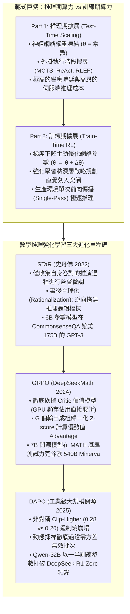
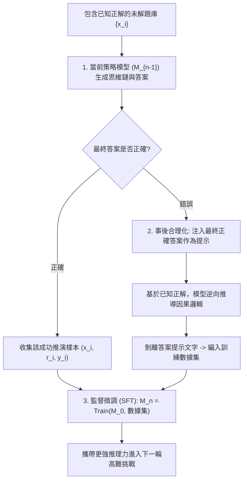
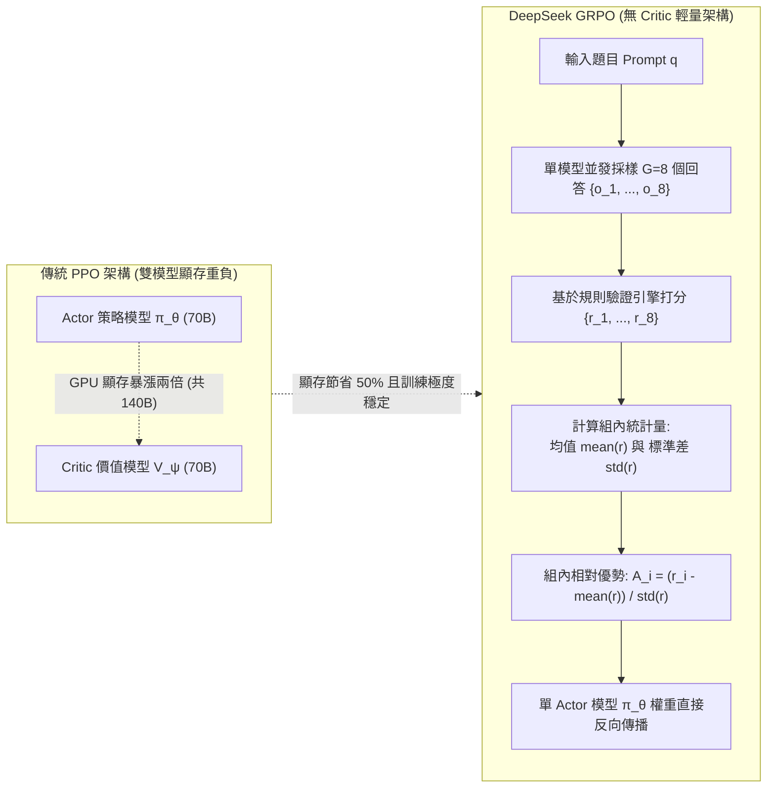

歡迎來到史丹佛大學2025秋季最新研究生課程——**CS329A: Self-Improving AI Agents（自主進化AI智能體）**的第六篇深度工程解析。

在第1講至第5講（Part 1: 基礎理論篇）中，我們全面剖析了如何對已經預訓練完成並處於凍結狀態的模型，通過注入測試期算力（Test-time Compute）來榨取性能極限：構建 MCTS 搜尋樹、結合編譯器報錯自糾錯，以及使用弱驗證器集成過濾最優答案。

然而，我們必須直面殘酷的數學現實：
給一個小學生在考場上多留十分鐘思考，他能夠證明大學高等微積分中的定理嗎？如果模型本身的神經網絡突觸（權重參數，$\theta$）內部從未編碼過該概念與推理邏輯，那麼無論是採樣一萬次還是展開龐大的波束搜尋，產出的都不是真正的智能，而僅僅是隨機機率下的僥倖。

今天正式開啟的 **Part 2: Training & Evolution（訓練與自主進化篇，第6講~第9講）**，正是直擊這一核心命題：
> **「與其在每次推理時耗費昂貴算力進行外掛搜尋，為什麼不在訓練期（Train-time）傾注海量算力，將模型的神經突觸與參數權重永久性地淬煉為頂尖推理專家？」**

在**第6講**中，我們將深度解構破除人工標註枷鎖、催生現代頂尖推理模型的**後訓練強化學習（Post-Training RL）**三大核心支柱：
1. **用自我生成的推演過程教會自己的自舉範式：** **STaR**（Self-Taught Reasoner, Zelikman et al., Stanford 2022）
2. **徹底消滅 Critic 價值網絡的強化學習革命：** **DeepSeekMath 與 GRPO**（Group Relative Policy Optimization, 2024）
3. **千卡 GPU 集群實戰工程秘訣：** **DAPO**（Decoupled Clip & Dynamic Sampling, 2025）



{/* truncate */}

---

### 1. 訓練期擴展 vs 推理期擴展：算力前沿的戰略重構

理解全球前沿實驗室為何全面轉向後訓練強化學習（Post-Training RL），關鍵在於剖析總算力（FLOPs）的配置方程式：

```text
Compute_Total = Compute_Train + Compute_Inference
```

1. **推理期擴展（Inference-Time Scaling）：** 參數向量 $\theta$ 保持恆定。算力消耗在重複採樣、束搜尋與 MCTS 樹展開上。雖然對特定複雜問題有效，但這將漫長的高延遲與巨額算力帳單全盤轉嫁給了生產環境的每一個終端使用者。
2. **訓練期擴展（Train-Time Scaling）：** 在訓練階段集中消耗海量算力，通過強化學習徹底更新參數 $\theta$：

```text
θ* = argmax_θ E_{x ~ D, y ~ π_θ(·|x)} [ R(x, y) ]
```

當智能體在強化學習過程中探索出高明的演繹推導範式時，反向傳播會將該思維本能直接寫入自注意力與前饋層的權重矩陣中。最終，在部署上線後，**模型無需任何沉重外掛搜尋，在單次前向傳播（Single Forward Pass）中即可展現出特級大師般的宏觀布局直覺**。

---

### 2. 推理能力的自主進階：STaR (Zelikman et al., Stanford 2022)

對大語言模型進行監督微調（SFT）需要數以萬計由人類專家手寫的「題目 ＋ 詳細推演過程（Rationale） ＋ 最終答案」數據集。然而，僱傭數學博士或資深架構師編寫海量高難解題過程，在成本上是不可承受的。

2022 年，史丹佛大學 Eric Zelikman 團隊提出了一個極富洞察力的設想：
> **「只要我們能夠機械化、確定性地驗證最終答案的對錯，為什麼不讓模型自己天馬行空地構思中間推導步驟，篩選出那些碰巧得出正確答案的優秀邏輯鏈，回過頭來重新訓練自己？」**

這就是自主學習推演器 **STaR** 的誕生契機。



#### 數學嚴密性：對策略梯度的離散逼近

STaR 並非簡單的工程小伎倆。從數學角度分析，它是**基於指示函數獎勵 $`1(y_hat = y*)`$ 的策略梯度（Policy Gradient）離散逼近**：

```text
∇_θ J(θ) = ∑_i E_{r_hat, y_hat ~ π_θ(·|x_i)} [ 1(y_hat = y_i*) * ∇_θ log π_θ(r_hat, y_hat | x_i) ]
```

對於推導錯誤的樣本，指示函數為 $\mathbb{1} = 0$，其梯度完全歸零並被丟棄；僅對答對的樣本執行對數似然極大化（MLE）梯度上升，從而牽引模型的機率分佈穩步向經驗證的嚴密邏輯鏈收斂。

#### 事後合理化（Rationalization）的妙招

這裡面臨一個致命痛點：「如果遇到模型原本能力絕對無法企及的高難題目，模型會持續輸出錯誤，它該如何學到新知識？」

Zelikman 教授創新性地引入了**事後合理化（Rationalization）**：
1. 當模型給出錯誤答案時，系統在提示詞末尾悄悄注入真正的答案作為提示：*「提示：本題正確答案為 42。請反向闡述為何結果必定是 42 的完整推導邏輯。」*
2. 獲知結論後，模型便擁有了搭建逆向演繹邏輯橋樑的能力。
3. **最關鍵的魔法：** 在將這套自圓其說的推導過程存入訓練集前，**系統將提示文字徹底剝除**：

```text
數據集條目: 輸入 [ x_i ] ──► 目標思維鏈 [ r_逆向推演 ] + 最終答案 [ y_i* ]
```

模型在梯度下降階段會「誤以為」是自己在無提示狀態下獨立攻克了該難題，從而在神經網絡中沉澱出攻克未知複雜問題的直覺模式。

#### 評測突破：6B 參數輕量模型逼平 175B 龐然大物
* 在常識推理評測（CommonsenseQA）中，僅有 **6B 參數的 GPT-J** 引入 STaR 迭代後，解題準確率從 60.0% 暴增至 **72.5%**。
* 這一成績直接逼平了參數量高達近 30 倍的 **GPT-3 175B 定制微調版（73.0%）**。

---

### 3. Critic 價值模型的終結：DeepSeekMath 與 GRPO (2024)

如果說 STaR 是借用監督微調外殼實現的自舉，那麼真正拉開大規模線上強化學習帷幕的，是 2024 年春 DeepSeek 團隊發布的 **DeepSeekMath 與 GRPO（Group Relative Policy Optimization，組相對策略優化）**。

#### 傳統 PPO 架構的阿基里斯之踵

OpenAI 早期訓練 ChatGPT 所使用的標準 PPO 演算法，必須在 GPU 顯存中並行掛載兩個超大規模模型：
1. 生成動作 Token 的**策略網絡（Actor, $\pi_\theta$）**；
2. 預測每一時刻狀態預期收益的**價值網絡（Critic, $V_\psi$）**。

如果要訓練一個 70B 的 Actor，就必須配備一個 70B 的 Critic，導致顯存直接翻倍。
更為致命的是，在數學與編程等長程推理任務中，往往經過數千 Token 的推導後才能在末尾得到一個對或錯的純量（$+1$ 或 $-1$）。**在如此稀疏的信號下，想讓 Critic 模型準確預估中間某一個 Token 的精確分值，在數學上極度不穩定，極易導致策略崩塌**。

#### GRPO 的破局構想：「徹底移除 Critic」

DeepSeek 團隊提出了化繁為簡的顛覆性設計：
> **「為什麼非要耗費數十億參數維護一個價值模型？針對一個提問 `q`，讓當前模型直接並發採樣 `G` 個候選回答 $`{o_1, ..., o_G}`$。直接計算這 `G` 個輸出得分的組內均值和標準差，通過 Z-score 標準化，這組相對排名不就是最純粹、最無偏的優勢值（Advantage）嗎！」**



#### GRPO 的嚴謹數學目標函數

GRPO 在沒有額外價值模型輔助的情況下，通過參考基準模型 $`pi_ref`$ 施加 KL 散度約束，優化策略模型 $\pi_\theta$：

```text
J_GRPO(θ) = E_{q, {o_i}_{i=1}^G} [ 
    (1 / G) * ∑_{i=1}^G (1 / |o_i|) * ∑_{t=1}^{|o_i|} {
        min(
            ( π_θ(o_{i,t}) / π_old(o_{i,t}) ) * A_hat_{i,t},
            clip( π_θ(o_{i,t}) / π_old(o_{i,t}), 1 - ε, 1 + ε ) * A_hat_{i,t}
        )
    } - β * D_KL( π_θ || π_ref )
]
```

每一個候選回答 `o_i` 中各 Token 的優勢值 `A_hat_{i,t}`，僅由**組內統計量**簡潔導出：

```text
A_hat_{i,t} = r_tilde_i = ( r_i - mean({r_1, ..., r_G}) ) / ( std({r_1, ..., r_G}) + δ )
```

#### 信用分配方式：結果監督 vs 過程監督
1. **結果監督（Outcome Supervision）：** 若最終答案正確，賦予 $r_i = +1$，反之賦予 $-1$。組內歸一化得到的純量優勢值 `r_tilde_i` 被均等地賦值給該回答內的每一個 Token。
2. **過程監督（Process Supervision）：** 針對每個推導步驟給予局部獎勵，將特定 Token 之後未來所有步驟的加權獎勵和作為該 Token 的優勢值進行回傳。

#### 戰績：7B 開源小模型超越 540B 巨獸
* `DeepSeekMath-Base 7B` 僅憑 120B 數學語料預訓練，**便超越了谷歌 540B 的超大模型 Minerva**。
* 疊加上 GRPO 強化學習後，MATH 評測成績從 46.8% 躍遷至 **51.7%**，成為開源界首個無需任何外掛計算器即可突破 MATH 50% 大關的純 7B 模型。
* 在 64 路自我一致性（Self-Consistency）加持下，正確率更是飛躍至 **60.9%**。

---

### 4. 走向千卡 GPU 工業實戰：DAPO (2025)

然而，當學術界嘗試將論文公式原封不動地搬進 AIME 2024 等高難競賽時，卻遭遇了普遍的挫敗：
* DeepSeek-R1-Zero 在 AIME 2024 上拿下 47 分，而開源社區用樸素 GRPO 訓練的 Qwen2.5-32B 卻**長期被鎖死在 30 分出頭**。

2025 年 3 月發布的 **DAPO（解耦截斷與動態採樣策略優化）** 徹底揭示了大規模強化學習的四大工程定海神針：

```text
樸素 GRPO (30分) 
  ──► + 長度過濾 (36分) 
  ──► + Clip-Higher (38分) 
  ──► + Token 級損失歸一化 (42分) 
  ──► 完整版 DAPO (50分, 全面超越 DeepSeek-R1-Zero!)
```

#### 秘訣 1：非對稱截斷 Clip-Higher ($`eps_low = 0.20, eps_high = 0.28`$)
* **癥結：** PPO 對稱的 $\pm 0.2$ 截斷極大挫傷了探索欲。若模型探索出了一個先驗機率僅有 0.01 的罕見創新推理詞，由於上限被鎖死在 $1 + 0.2 = 1.2$ 倍，其提升後機率僅為 0.012；而原機率為 0.9 的平庸詞彙卻能輕鬆攀升。
* **後果：** 模型徹底放棄深思熟慮，陷入**熵崩塌（Entropy Collapse）**，只敢輸出毫無建設性的短平快套話。
* **DAPO 解法：** 下限保持 $`eps_low = 0.20`$ 堅決懲罰劣質推演，但將上限大幅上調至 **$`eps_high = 0.28`$**（提升 40%），給予高價值創新探索 Token 爆發性增長的通道。

#### 秘訣 2：動態採樣（Dynamic Sampling）
* **癥結：** 題目過於簡單導致 $G$ 個候選**全數做對**，或題目過於刁鑽導致 $G$ 個候選**全軍覆沒**。
* 兩種情況下，組內標準差 `formula`，導致優勢值全為 0。**數千塊頂級 GPU 瘋狂推演，最終算出的梯度卻是一堆無意義的 0，訓練陷入空轉**。
* **DAPO 解法：** 動態過濾批次，嚴密鎖定滿足 `0 < Correct Rollouts < G` 的題目，即**僅保留那些「既有成功經驗又有失敗教訓、具備最高資訊熵」的試題**，確保每一步反向傳播都帶有 100% 高純度有效梯度。

#### 秘訣 3：Token 級損失歸一化（Token-Level Loss）
傳統 GRPO 採用樣本級平均，這導致 2000 Token 長文裡的單個錯誤，與 50 Token 短文裡的單個錯誤被極其不公地稀釋。DAPO 將損失按全批次實際 Token 總數（$\sum_i |o_i|$）進行嚴格歸一化，斷絕了模型靠注水擴寫來逃避懲罰的可能。

#### 秘訣 4：超長文字軟平滑懲罰（Overlong Reward Shaping）
當模型深入思考時，偶發性觸碰到上下文上限（如 16,384 Token）發生截斷（Truncation）。若機械地判為 $-1$ 負分，將毀滅模型正在萌發的深度長程推理力。DAPO 在極限前 4096 Token 區間施加**線性軟衰減**，引導模型自主拿捏篇幅並優雅結題。

---

### 5. 企業級架構設計：大規模分散式 GRPO/DAPO 訓練流水線

在工業生產環境中調度千卡集群進行推理強化學習，必須採用推訓解耦的高並發拓撲架構：

```text
┌────────────────────────────────────────────────────────────────────────┐
│             企業級分散式 GRPO/DAPO 強化學習基礎設施                    │
├────────────────────────────────────────────────────────────────────────┤
│                                                                        │
│  [ 嚴密教研題庫 (符號數學 / 程式碼編譯器 / 確定性測試腳手架) ]           │
│          │                                                             │
│          ▼                                                             │
│  ┌──────────────────────────────────────────────────────────────────┐  │
│  │                    動態打包與高純度採樣引擎                      │  │
│  │  • 難度動態調度器: 即時過濾全對/全錯的零方差廢棄批次             │  │
│  │  • 依據上下文長度實施多桶箱打包 (Bin-Packing)                   │  │
│  └───────────────────┬──────────────────────────────────────────────┘  │
│                      │ 純淨訓練批次                                    │
│                      ▼                                                 │
│  ┌──────────────────────────────────────────────────────────────────┐  │
│  │                   vLLM / TensorRT-LLM 獨立推理集群               │  │
│  │  • 高並發分散式採樣節點 (G=8 組內異步展開)                       │  │
│  │  • 依託 PagedAttention 顯存優化技術實現海量 KV 快取調度          │  │
│  └───────────────────┬──────────────────────────────▲───────────────┘  │
│                      │ 採樣生成軌跡 {o_1..o_G}      │ 定期同步         │
│                      ▼                              │ 權重參數 θ       │
│  ┌──────────────────────────────────────────────────┴───────────────┐  │
│  │                   確定性規則驗證與評估沙箱                       │  │
│  │  • Docker/gVisor 隔離環境運行 Python REPL 及 SymPy 符號代數驗證 │  │
│  │  • 嚴格校驗思考格式 `<think> ... </think>` 標籤完整性            │  │
│  │  • 基於組內統計學實施優勢值標準化: A_i = (r - μ) / σ             │  │
│  └───────────────────┬──────────────────────────────────────────────┘  │
│                      │ Token 優勢值流                                  │
│                      ▼                                                 │
│  ┌──────────────────────────────────────────────────────────────────┐  │
│  │                   Megatron-LM / DeepSpeed 梯度訓練集群           │  │
│  │  • 純粹 Actor 策略網絡反向傳播 (無 Critic 節約 50% 顯存)          │  │
│  │  • 非對稱 Clip-Higher 梯度優化引擎 (ε_high = 0.28, ε_low = 0.20) │  │
│  │  • 結合 FlashAttention-3 執行 Token 級歸一化損失優化             │  │
│  └──────────────────────────────────────────────────────────────────┘  │
│                                                                        │
└────────────────────────────────────────────────────────────────────────┘
```

#### 工業生產核心三大法則
1. **徹底將人類主觀評分移出強化學習循環：** 僅在具備確定性判據的任務（編譯器、數學符號證明、單元測試）上使用強化學習，切忌將模糊的人類主觀偏好用於邏輯推理強化。
2. **推理推斷與梯度訓練物理集群強行解耦：** 杜絕在同一組顯存中混用生成推理（vLLM）與反向傳播（Megatron-LM），通過專用 RDMA 網絡傳輸互動軌跡，最大化吞吐性能。
3. **格式硬約束機制：** 將思維標籤 `<think>` 的合規性作為前置獎勵規則，徹底杜絕模型投機取巧跳過推導直接蒙猜答案。

---

### 6. 資深架構師核心 Q&A

**Q: GRPO 既然去掉了 Critic，為什麼目標函數中依然需要 KL 散度約束項？**
**A:** KL 散度項（$\beta `D_KL`(\pi_\theta \parallel `pi_ref`)$）是防止**獎勵作弊（Reward Hacking）**與災難性遺忘的護欄。沒有這個針錨，強化學習策略會在短期內鑽營判題規則的漏洞，例如狂吐重複標點或無意義語法來欺騙解析器。不過，在想要激發湧現長程思考的冷啟動初期（如 DeepSeek-R1-Zero），研究者往往有意將 $\beta \to 0$ 徹底放開限制，待其摸索出深思熟慮形態後再重新收緊。

**Q: STaR 在事後合理化（Rationalization）中給模型提供了正確答案，不會導致模型學會作弊依賴嗎？**
**A:** 關鍵在於**數據生成環節與權重反向傳播環節的物理割裂**。答案提示僅在模型逆向構建因果邏輯的瞬間存在。在將該推演樣本編入 SFT 訓練集前，**提示詞內的答案早已被物理剔除**。在反向傳播看來，模型是在無任何外力下獨立完成了這一精妙推演，因此學到的是真正能夠在未知環境下通用的逆向演繹直覺。

---

### 7. 核心總結與技術要點

1. **訓練期擴展的必然性：** 執行階段搜尋無法憑空創造突觸中本不存在的認知。訓練期擴展利用強化學習將戰略推導本能永久性沉澱在權重之中。
2. **自我進化的閉環：** STaR 證明模型無需人類撰寫複雜過程，通過正確軌跡過濾與事後合理化，6B 小模型即可比肩 175B 旗艦大模型。
3. **砍掉 Critic 的工業突破：** DeepSeek GRPO 移除了數十億參數的價值網絡，節約了 50% 顯存，依託組內相對 Z-score 確立了穩定的優勢值估計。
4. **大規模工程定海神針：** DAPO 借助非對稱 Clip-Higher（$\epsilon=0.28$）、動態採樣與 Token 級損失，消解了熵崩塌難題，僅用一半算力步數即超越 DeepSeek-R1-Zero。

---

### 史丹佛 CS329A 下期預告：
在接下來的**第7講**中，我們將由解決既定人類試卷，邁向自主從事科學發現與技術探索的無界新大陸：
**《Lecture 7: Open-Ended Evolution: ADAS, The AI Scientist, AlphaEvolve 與自我進化的開放式演進》**
我們將探究 AI 如何自主提出科研假說、自主發明全新機器學習架構，並撰寫投遞頂級學術論文。敬請期待！