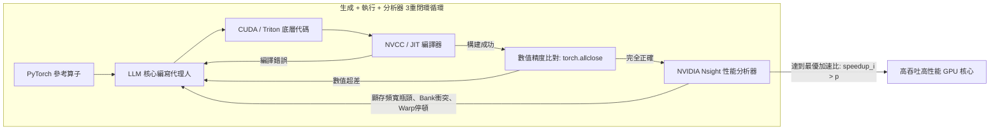

# 史丹佛 CS329A (第10講): SWE-Agents — 軟體工程代理人、CodeMonkeys、KernelBench 與代理人系統介面 (ASI)

工業級真實世界的軟體工程現場，與孤立編寫單一函數的演算法測驗或玩具基準有著天壤之別。GitHub 上報告的真實軟體缺陷絕不僅局限於單個檔案，而是深度盤根錯節於數百個模組、複雜的歷史依賴以及數百萬行跨程序的分布式代碼庫中。更為苛刻的是，生產環境中的軟體系統不僅要求在功能邏輯上「正確（Correct）」，更要求在計算效率上「足夠快（Fast）」，並且與底層的物理並行硬體架構「高度對齊（Aligned）」。

從今天開始，我們將正式邁入**史丹佛 CS329A: Self-Improving AI Agents（自我提升型 AI 代理人）**的第三大板塊——**Part 3 · Agent Engineering (第10講至第12講)**。我們將走出純理論的模型訓練，全方位直面工業級實戰軟體工程的最前線：
> **「代理人如何深入數百萬詞元的超大型代碼倉庫，自動定位隱蔽的迴歸缺陷，自主編寫可復現的驗證測試腳本，甚至寫出在物理執行速度上超越人類專家標準庫的高性能 GPU 客製化核心？」**

本文將聚焦 **SWE-Agent Autonomous Coding（軟體工程代理人自主編程）** 的技術前沿，全面拆解三大關鍵突破：在 **SWE-bench Benchmark GitHub** 斬獲頂尖戰績的 **CodeMonkeys Automated Refactoring（CodeMonkeys 自動化重構）**、結合硬體性能分析器閉環優化的 **KernelBench GPU Performance Tuning（KernelBench GPU 性能調優）**，以及由史丹佛大學提出的 **Agent-Computer Interface ACI（代理人-電腦介面 / Agent-System Interface ASI）** 架構。

{/* truncate */}


---

## 1. 工業級軟體工程代理人的核心現實挑戰

要實現自主修復 GitHub 真實開源代碼庫的 Bug，必須突破三道巨大的系統工程壁壘：
1. **上下文爆炸危機 (Context Explosion):** 工業級代碼倉庫規模動輒突破 300 萬詞元。將整個代碼庫盲目灌入大模型，不僅 API 成本極度高昂，更會導致嚴重的注意力渙散（大海撈針失效）。
2. **測試驗證的自我欺騙 (Self-Deceptive Verification):** 若讓代理人先動手修改代碼，代理人往往會根據自己修壞的代碼反向編寫「放水測試」，造成偽通過（False Positive）。
3. **硬體級性能優化壁壘:** 跨出高階語言膠水代碼、進入底層 CUDA/Triton 並行計算時，記憶體對齊、執行緒束分化等物理細節使得單次直接生成（One-shot）的失敗率接近 100%。

```
┌─────────────────────────────────────────────────────────────────────────┐
│              工業級軟體工程代理人 (SWE-Agents) 的三大支柱               │
└────────────────────────────────────┬────────────────────────────────────┘
                                     │
       ┌─────────────────────────────┼─────────────────────────────┐
       ▼                             ▼                             ▼
┌──────────────────────────┐  ┌──────────────────────────┐  ┌──────────────────────────┐
│  CodeMonkeys SWE-bench   │  │   KernelBench 性能分析   │  │    史丹佛 ASI 系統介面   │
├──────────────────────────┤  ├──────────────────────────┤  ├──────────────────────────┤
│ • 50.5倍上下文深度壓縮   │  │ • fast_p 物理牆鐘加速比  │  │ • 14倍 DSL 代碼複雜性壓縮│
│ • 雙向互相調試狀態機     │  │ • 編譯+分析器性能反饋環  │  │ • AutoGuide 底層錯誤轉譯 │
│ • 判別式差分測試選擇器   │  │ • 算子融合與共享記憶體優化│  │ • 高階意圖與物理實現對齊 │
│ • SWE-bench Verif. 57.4% │  │ • 最高實現 13倍 GPU 加速 │  │ • 性能超越調優工具 3.8倍│
└──────────────────────────┘  └──────────────────────────┘  └──────────────────────────┘
```

---

## 2. 攻克 GitHub 真實缺陷的完整架構: CodeMonkeys (2025)

在匯聚了 Django、SymPy、scikit-learn 等頂級開源庫真實 Bug 的 **SWE-bench Verified** 評測中，2025年初面世的 **CodeMonkeys** 創下了 **57.4%** 的行業頂尖解決率紀錄。

CodeMonkeys 的破局核心在於將混亂的軟體修復拆解為高度自律的三階段流水線：

```
                  [真實 GitHub Issue 報告與 300萬詞元代碼庫]
                                     │
                                     ▼
           1. 上下文篩選流水線 (Context Pipeline, 50.5倍大幅壓縮)
              (本地運行輕量 Qwen2.5-Coder 全局檢索 -> 摘要 -> 排序 -> 128k)
                                     │
                                     ▼
           2. 生成階段雙向狀態機 (Two-Sided Debugging State Machines)
              ┌────────────────────────────────────────────────────────┐
              │ 測試狀態機 (Testing Machine): 編寫復現腳本 (Exit 2 報錯)│
              │                       │                                │
              │                       ▼                                │
              │ 編輯狀態機 (Editing Machine): 編寫代碼補丁 -> (Exit 0) │
              └────────────────────────────────────────────────────────┘
                                     │
                                     ▼
           3. 判別選擇狀態機 (Selection State Machine, 差分測試)
              (自主合成專門區分不同候選補丁輸出的判別式測試案例)
                                     │
                                     ▼
                        [提交最終驗證的 Pull Request]
                     (在 SWE-bench Verified 達成 57.4% 解決率)
```

### 第一階段：上下文流水線（50.5倍壓縮）
- 直接使用 Claude 3.5 Sonnet 等昂貴的商業模型全盤通讀數百萬詞元代碼庫不僅成本極高，而且回應極慢。
- CodeMonkeys 採用可在本地高效運行的開源 `Qwen2.5-Coder-32B`，對專案所有檔案進行靜態掃描與語法提取。
- 僅保留核心的類別宣告與函數簽名進行摘要和優先級排序，**將原本 300 萬詞元的龐大工程精準壓縮為 128,000 詞元（50.5倍壓縮）**。
- 這份上下文元數據由後續 10 條並行代碼生成軌跡平攤（Amortized），使搜尋階段成本被嚴格控制在**總預算的 15% 以內**。

### 第二階段：生成階段 — 雙向互相調試機制（Two-Sided Debugging）
修復代碼時最忌諱的是「以為修復了，實則毫無作用」。CodeMonkeys 採用了兩個緊密咬合的狀態機：
1. **測試狀態機 (Testing State Machine):** 研讀 Issue，編寫獨立的**問題復現測試腳本（`reproduce_issue.py`）**。這一測試腳本在未經修改的代碼庫上運行必須明確報錯，返回 **Exit Code 2 (確認復現失敗)**。如果直接通過，則判定測試無效並重寫。
2. **編輯狀態機 (Editing State Machine):** 依託確鑿報錯的復現腳本，模型開始修改原始碼，並在沙箱中反覆運行測試，直到測試順利翻轉為 **Exit Code 0 (成功通過)** 為止，期間最多進行 8 輪錯誤日誌驅動的迭代修復。

### 第三階段：選擇階段 — 走向真實正解（Selection State Machine）
並行採樣 10 條修復軌跡後，包含至少一個正確補丁的覆蓋率達到 **69.8%**。然而如果只是隨機選取一個補丁提交，準確率會驟降至 **45.8%**。

CodeMonkeys 的精髓在於**判別式測試選擇器 (Discriminator Selection)**：
- 它不直接讓大模型主觀猜測哪個補丁寫得好。
- 而是要求模型**「專門針對候選補丁 A 與 B 的邏輯差異，編寫一段能讓兩者產生不同輸出的全新邊緣測試案例」**。
- 藉由運行這些判別測試，逐一剔除存在潛在迴歸缺陷的錯誤補丁，將最終的實際解決率拉升至 **57.4%**。

---

## 3. 從功能正確邁向極致性能: KernelBench (2025)

在現代 AI 計算基建中，GPU 核心的效率直接決定了萬卡叢集的吞吐量與成本。五年前 Transformer 論文提出後，業界專家花費了數年才手工打磨出 FlashAttention 這樣極致優化的 CUDA 實現。AI 能否自主編寫出性能超越 PyTorch 原生標準實現的客製化核心？

2025年2月發布的 **KernelBench** 構建了包含 250 個 PyTorch 算子的嚴苛評測集，對代碼的數學精度和實際硬體執行耗時進行聯合考核。

```text
結合準確率與物理加速比的 fast_p 評價指標:
========================================================================================
fast_p = (1 / N) * Σ_{i=1}^N  1[ correct_i  AND  speedup_i > p ]

核心維度含義:
  • fast_0 : 功能數學正確率 (輸出張量數值與 PyTorch 完全一致: torch.allclose)
  • fast_1 : 正確且執行耗時實際優於原生 PyTorch 的比例 (Speedup > 1.0x)
  • fast_2 : 正確且耗時領先 PyTorch 2倍以上的比例 (Speedup > 2.0x)
========================================================================================
```



### 硬體分析器（Profiler）反饋環的質變飛躍
在單次無反饋生成（One-shot）中，哪怕如 o1 或 DeepSeek-R1 這樣的頂級模型，**能夠寫出快於 PyTorch 代碼的比例（$fast_1$）也低於 20%**，經常因執行緒索引越界導致段錯誤（Segfault）或因顯存存取衝突導致性能暴跌。

而當將**代碼生成（Generation） + 編譯運行（Execution） + Nsight 分析器遙測（Profiler）**三者結為閉環時：
- DeepSeek-R1 在複合算子優化（Level 2）上的成功率從 36% **翻倍躍升至 72%**。
- 模型根據分析器反饋的顯存頻寬瓶頸，自主引入算子融合（Operator Fusion）、塊級平鋪（Tiling）與共享記憶體（Shared Memory）規約，合成了**相較原生 PyTorch 速度提升高達 13 倍**的高性能核心。

---

## 4. 意圖與實現的精準對齊: 代理人系統介面 (ASI, Stanford 2025)

如果強行要求大模型直接編寫數千行充斥著指標操作與模板展開的底層 C++ 並行代碼，必然會引發嚴重的認知失調。史丹佛大學 Alex Aiken 教授團隊（ICML 2025）提出的 **Agent-System Interface (ASI)** 從根本上化解了這一阻抗：
> **「讓大模型直接處理裸 C++ 指標與底層硬體斷言，就像讓高階演算法架構師去手動調試機器微碼一樣低效。必須在模型與硬體之間建立一座專用介面：透過領域特定語言（DSL）約束搜尋空間，並由 AutoGuide 將硬體報錯自動翻譯為自然語言操作指令！」**

```text
┌─────────────────────────────────────────────────────────────────────────┐
│                           LLM 深度推理代理人                            │
│                 (確立高階宣告式計算意圖與頂層演算法優化策略)              │
└────────────────────────────────────▲────────────────────────────────────┘
                                     │
          ┌──────────────────────────┴──────────────────────────┐
          │ 高階宣告式 DSL           ▲ 操作性自然語言           │
          │ 並行優化指令             │ 診斷指導 (AutoGuide)     │
          ▼                          │                          │
┌────────────────────────────────────┴────────────────────────────────────┐
│                    Agent-System Interface (ASI 抽象層)                  │
│  • 領域特定語言 (DSL): 代碼複雜度大幅壓縮 14倍 (宣告式表達)             │
│  • AutoGuide 診斷轉譯器: 將晦澀的底層硬體斷言轉化為具體操作建議         │
└────────────────────────────────────▲────────────────────────────────────┘
                                     │
          │ 底層 C++ 系統代碼        ▲ 物理硬體報錯日誌及       │
          │ 與底層記憶體分配指令     │ 編譯器底層斷言           │
          ▼                          │                          │
┌────────────────────────────────────┴────────────────────────────────────┐
│                       物理級並行硬體執行系統                            │
│                  (分布式顯存、GPU流處理器、共享快取)                    │
└─────────────────────────────────────────────────────────────────────────┘
```

### ASI 的兩大核心構件
1. **領域特定語言 (DSL):** 摒棄繁瑣的底層模板代碼，僅將數據切分與記憶體映射決策抽象為十餘行高階宣告式 DSL，**將代碼複雜度壓縮 14 倍**，完全根除了低級語法錯誤。
2. **AutoGuide 自動轉譯器:** 當硬體底層拋出諸如 `"Assertion failed: stride mismatch at dim 1"` 等機器斷言時，AutoGuide 攔截並重組為具備指導意義的行動建議：
   > *「硬體診斷提示：張量第1維未按32位元組對齊，造成顯存跨步衝突。請調整 Row-major 排布指令，為其添加32位元組的記憶體 Padding。」*

### 實測成效：10次迭代超越1000次調優
搭載 ASI 介面的代理人僅歷經 **10 次迭代優化**，所合成出的並行計算調度方案便比工業界頂尖調優工具 OpenTuner 經過 **1000 次搜尋的結果還要快 3.8 倍**。原本需要人類專家耗費數天調優的複雜計算仿真，代理人在 **10 分鐘內** 便圓滿完成。

---

## 5. 軟體工程技術範式全面橫向對比

```text
=========================================================================================================
對比維度              基礎代碼輔助工具 (Copilot)     CodeMonkeys (SWE-bench)   KernelBench + ASI
---------------------------------------------------------------------------------------------------------
處理代碼尺度          單個函數及局部補全代碼塊       涉及跨檔案數百萬詞元工程  極致優化的高性能客製化核心
上下文管理            活動編輯視窗 (4k~8k 詞元)      50.5倍無損壓縮至 128k     宣告式高階 DSL (14倍壓縮)
驗證閉環              單次簡單語法編譯測試           雙向互相調試狀態機        Nsight 物理性能分析 (fast_p)
反饋訊號形態          基礎堆疊異常追蹤文本           Exit 2 至 Exit 0 狀態躍遷 AutoGuide 硬體行動建議
最終追求目標          詞元級語法補全正確             生產級迴歸缺陷徹底修復    真實物理硬體牆鐘時間加速
=========================================================================================================
```

---

## 6. 核心技術深度問答

### Q1: CodeMonkeys 為何必須強制在修改代碼前先生成「復現測試腳本」？
如果允許代理人先改原始碼再寫測試，模型必然會陷入「自我欺騙」：它會依據自己剛寫出的缺陷代碼邏輯，反向編寫一段順應該錯誤的「放水測試」，自吹自擂地判定測試通過。

只有先在未修改的真實代碼庫上跑通一段確鑿報錯、返回 **Exit Code 2 (復現失敗)** 的獨立測試腳本，才等於確立了不可動搖的客觀裁判準繩。後續修改原始碼只有將這一錯誤狀態徹底翻轉為 **Exit Code 0 (測試通過)**，才能從數學上確鑿證明 Bug 已被根除。

### Q2: 大模型直接寫 CUDA 核心為何極易潰敗？分析器閉環是如何破局的？
語言模型能準確推導張量公式，但對數千執行緒並發存取顯存的底層時空開銷缺乏直觀體感：
- **越界訪存 (Out-of-Bounds):** 執行緒塊座標公式中只要漏掉邊緣判定，就會引發不可挽回的段錯誤崩潰。
- **共享記憶體 Bank 衝突:** 多個執行緒並發讀取同一顯存 Bank 導致計算直接退化為串行排隊。

普通的編譯器報錯無法揭示運行時的性能瓶頸。**硬體分析器反饋環（E+P）**直接把硬體利用率、顯存停頓週期與 Warp 分化數據灌入上下文，使代理人能夠精準施展共享記憶體填充與暫存器複用等專家級硬體優化技巧。

---

## 總結與下期預告

軟體工程代理人已徹底跨越了代碼自動補全的初級階段。**CodeMonkeys** 憑藉 50.5 倍上下文精煉與雙向互相調試狀態機，成功破解了 SWE-bench 工業級軟體缺陷修復；**KernelBench** 與 **ASI** 則透過硬體分析器與領域抽象介面，打開了 AI 優化算力基礎設施的大門。

下一講 **第11講**，我們將正面迎擊長期多日複雜工程研發中的終極障礙：**Agent Memory — 代理人記憶系統、Cartridges、CacheBlend 與終生學習代理人 (MemGPT)**！

---

### 本講核心提煉
- **平攤式上下文探索法：** 用低成本模型進行全庫掃描與 50.5 倍壓縮，讓全工程級代碼理解在經濟上切實可行。
- **雙向互相調試消除偽修復：** 唯有從未改時的 Exit 2 翻轉為修復後的 Exit 0，才是軟體修復的唯一真理。
- **極致性能是閉環迭代的產物：** 高性能代碼無法單次直接生成，必須接入運行與硬體性能分析器（fast_p）的閉環反饋。