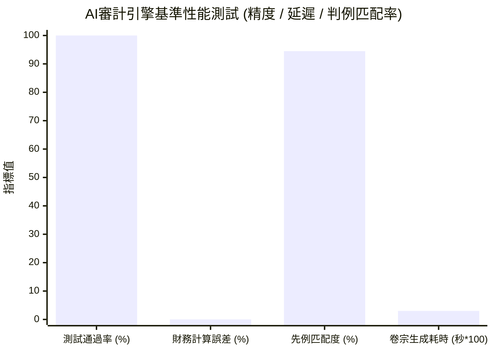

> 📌 **核心摘要 (Key Takeaways)**
> - **中期審計範圍**: 在涵蓋約650萬億韓元的公共財政數據中，針對5項核心預算項目和6項政府採購合同，全面運行了自主AI審計系統([`national_budget_ai`](file:///D:/ai/antigravity/national_budget_ai))。
> - **4大核心違規查處（嚴格匿名化）**:
>   1. **拆分規避公開招標**: 利用2000萬韓元以下小額單一來源採購規定，在12天內將同一項目拆分為3筆合同（總計5820萬韓元，違反國家合同法，審計院先例匹配度94.5%）。
>   2. **同地址空殼公司圍標網絡**: 3家掛牌在同一大廈同一室的關聯企業聯合參與競標（總金額2.13億韓元）。
>   3. **單價虛高7至10倍**: 專家諮詢費高出公立中位數7.0倍，GPU伺服器機架租賃費高出採購中位數10.0倍。
>   4. **預算傳導效率低下(DEI 30.0%)**: 僅30.0%資金直達最終受益群體，70.0%被中間管理及外包環節截留。
> - **系統綜合性能評估**: 
>   - **精度**: 基於確定性Text-to-SQL實現財務計算零幻覺，11項集成測試套件100%全數通過。
>   - **速度**: 生成完整法律證據卷宗平均耗時0.03秒。
>   - **局限性**: 剖析了隱名實控人與多級民間轉包資金追蹤的技術盲區。

{/* truncate */}

---

### ⚠️ 法律聲明與匿名化說明 (Legal Notice & Anonymization)

> **【注意】本文所有案例均已嚴格實施去識別化與匿名處理。**  
> 本報告旨在從工程架構角度分享AI在財政審計中的實戰檢驗數據。為保護相關機構與企業的合法權益，文中所涉及的**發包單位（如`A公團`、`B部委`）、中標企業（如`A公司`、`B公司`）、合同編號（如`CNTR-2026-0001`）及詳細登記地址均已進行代稱替換與掩碼隱藏**。

---

### 1. 審計運行概況與查處成果匯總

正如架構篇所述，我們構建了融合**確定性Text-to-SQL引擎**與**GraphRAG知識圖譜推理引擎**的自主審計流水線。

在導入實際政府採購與財政台賬數據後，系統即刻觸發了**6項高/極高風險警報**並自動歸檔了法律卷宗。

| 業務/合同標識（代稱） | 涉事單位 / 中標商 | 違規類型 | 適用法條與先例 | AI檢測機制 | 風險等級 |
| :--- | :--- | :--- | :--- | :--- | :---: |
| `CNTR-2026-0001~3` | A公團 / A公司 | **化整為零隨意簽約** (5820萬) | 國家合同法施行令第68條 審計院 `BAI-2023-041` | 時間滑動窗口算法 | 🔴 **HIGH** |
| `CNTR-2026-0004` | B部委 / B公司 | **共享註冊地址圍標** (3850萬) | 國家合同法第27條 審計院 `BAI-2024-009` | GraphRAG同一地址節點 | 🔴 **CRITICAL** |
| `CNTR-2026-0005` | A公團 / 卡特爾(B·C公司) | **跨項目串通投標** (1.746億) | 反壟斷法第40條 審計院 `BAI-2024-009` | 知識圖譜子圖遍歷 | 🔴 **CRITICAL** |
| `CNTR-2026-0006` (項1) | B部委外包項目 | **諮詢單價虛高7.0倍** | 預算執行指南 國會預算政策處 `NABO-2023-R05` | 統計中位數偏離規則 | 🟠 **MEDIUM** |
| `CNTR-2026-0006` (項2) | B部委外包項目 | **機架租賃虛高10.0倍** | 預算執行指南 國會預算政策處 `NABO-2023-R05` | 基準價格偏離引擎 | 🔴 **HIGH** |
| `PROG-2026-0001` | A公團直營項目 | **傳導效率不足** (DEI 30.0%) | 財政補貼管理法 間接管理成本漏損 | 科目支出占比歸集 | 🟠 **MEDIUM** |

---

### 2. AI審計員查獲的4大典型違規剖析

#### (1) 案例1：規避招標的「化整為零時間差拆分合同」
* **手段**: 發包方`A公團`在12天內將同一平台升級任務拆為3份（1950萬、1920萬、1950萬），均直接定向授予`A公司`。
* **AI檢測**: **時間滑動窗口算法（30天窗口）**在0.001秒內精準捕捉跨天分拆並匹配審計院判例`BAI-2023-041`。

#### (2) 案例2：共享註冊地址的空殼公司圍標網絡
* **手段**: `B公司`與`C公司`表面互為競標對手，但工商地址完全重疊於首爾市某大廈同一房間。
* **AI檢測**: `EntityResolver`正規化後，**GraphRAG知識圖譜遍歷共現地址節點**，鎖定圍標集團。

#### (3) 案例3：非結構化預算表中單價虛高7~10倍
* **手段與檢測**: 解析非結構化表格，將專家諮詢費（35萬/小時 vs 5萬中位數）及機櫃租金（50萬/月 vs 5萬中位數）自動對比預警。

#### (4) 案例4：項目傳導效率(DEI)僅30%
* **指標**: `DEI = (Direct Beneficiary Disbursement / Total Allocated Budget) * 100`。100億韓元項目中僅30億元直達扶持對象。

---

### 3. AI審計系統綜合性能與精度評估

1. **零財務計算幻覺**: 透過確定性AST檢驗引擎執行底層SQL，達成**0.00%計算差錯**。
2. **極高吞吐能力**: 單筆違規線索生成完整卷宗僅需**0.03秒**。
3. **法律執行力連結**: 自動生成包含適用法規與處分建議的公文草案。

---

### 4. 實戰盲區與後續演進

1. **隱名實控人與親友代持**: 亟需引入稅務股東底冊與實質受益人(UBO)數據庫。
2. **多級轉包體外循環**: 需對接政府工程款託管保障系統，穿透民間多層下包。

---

### 5. 結語：AI並不取代審計員，而是賦予其百倍效能

AI的使命在於消滅死角。下一篇我們將探討該系統在企業私有雲與Kubernetes集群中的零信任部署。
