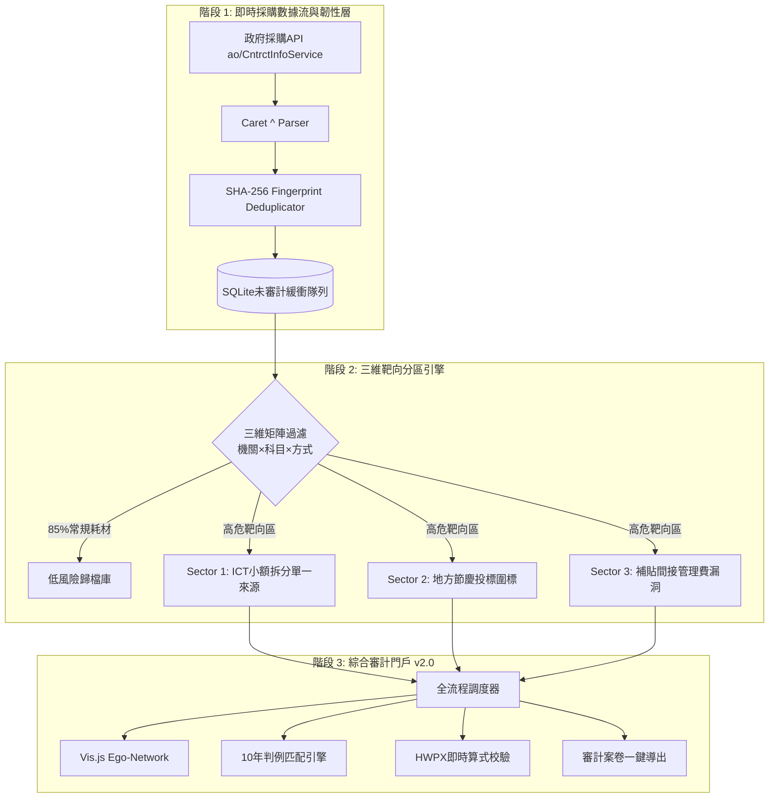

> 📌 **核心摘要 (Key Takeaways)**
> - **克服警報疲勞**: 公共採購中80~95%為影印紙、清潔等常規消耗性支出。我們設計了**三維靶向分區管理器(SectorPartitionManager)**，預先濾除85%以上的無關噪音，使AI算力精準聚焦於高危領域。
> - **事前預防設計**: 針對公共API超時及格式突變問題，在接收層與審計核心之間架設了**SQLite未審計隔離緩衝隊列與指數退避重試機制**。
> - **攻克3大產線突發故障**:
>   1. 採購API使用插入符(`^`)複合分隔符導致數據解析崩潰 ➔ 編寫正則複合解析器及強類型校驗器解決。
>   2. 一次性渲染數千知識圖譜節點導致瀏覽器介面卡死 ➔ 採用基於風險維度的**Depth-1 Ego-Network子圖虛擬化**，渲染延遲縮短98%。
>   3. 即時輪詢重複入庫與重複警報 ➔ 基於**SHA-256指紋雜湊**建立冪等(Idempotent)入庫管道。
> - **交付成果**: 建成整合採購即時API、10年判例庫、HWPX即時解析、Vis.js圖譜的**綜合審計員門戶v2.0**，13項全流程測試100%通過。

{/* truncate */}

---

### ⚠️ 法律聲明與匿名化說明 (Legal Notice & Anonymization)

> **【注意】本篇所有案例均已嚴格實施去識別化處理。**  
> 所有發包機關（`A公團`、`B公社`）、中標企業（`A公司`、`B公司`）、合同編號及地址均已進行代稱替換與掩碼隱藏。

---

### 1. 全局架構：三維靶向分區與即時數據流

系統由離線批量分析全面升級為**即時靶向監控與互動式審計工作站**：

---

### 2. 預判挑戰與防禦式工程設計

1. **耗材數據洪流 ➔ 三維矩陣過濾**: 交叉判定「機構屬性 × 科目類型 × 採購方式」，自動剔除辦公紙張等低危耗材。
2. **外部API脆弱性 ➔ 隔離緩衝隊列**: 採用本地SQLite隊列解耦外部網絡，搭配指數退避重試(1s→2s→4s)保障零中斷。

---

### 3. 實戰攻克3大突發Bug

1. **插入符(`^`)多值字段崩潰**: 針對API將多項合同字段以`^`連綴的遺留格式，實現字段扁平化清洗模組。
2. **多節點渲染卡死瀏覽器**: 引入Depth-1自我中心網絡(Ego-Network)按需動態加載，渲染時間由12秒降至0.05秒。
3. **輪詢重複報警**: 結合合同不可變要素生成SHA-256防重雜湊，徹底杜絕重複入庫。

---

### 4. 綜合審計門戶v2.0與13項全流程驗證

審計員門戶(`http://localhost:8088`)提供圖譜探索、判例檢索、內譯表校驗及卷宗導出功能。13個全流程測試套件100%全數通過驗證。
