> 📌 **核心摘要 (Key Takeaways)**
> - **技術攻克第2篇行業盲區**: 針對「僅憑採購台賬無法查出借名代持傀儡法人（人頭公司）」的痛點，全新構建了融合工商登記與DART監管披露的**股權穿透分析引擎([`CorporateRegistryClient`](file:///D:/ai/antigravity/national_budget_ai/src/pipeline/corporate_registry_client.py))**。
> - **架構預判並解決2大難點**:
>   1. 建立**三角雜湊索引橋**，化解稅號、企業登記號與DART代碼間的格式割裂。
>   2. 設定**控制力顯著性閾值（高管任職 + 50%以上持股）**，杜絕海量無意義人際關係引發圖爆炸。
> - **實戰解決3大線上突發Bug**:
>   1. 交叉持股引發的**遞迴循環死鎖崩潰** ➔ 採用NetworkX強連通分量(SCC)環路縮減演算法消除。
>   2. 招投標前夕突擊註冊空殼公司漏檢 ➔ 增加**合同日溯源180天新設預警**。
>   3. 夫妻代持51:49規避監管套利 ➔ 引入直系親屬一致行動人複合判定引擎。
> - **實戰戰果**: 成功揭露幕後人K某持股80%兼任高管、同時操縱兩家虛假競標企業的1.7億韓元圍標大案，17項全流程測試100%全數通過。

{/* truncate */}

---

### ⚠️ 法律聲明與匿名化說明 (Legal Notice & Anonymization)

> **【注意】本篇所有案例均已嚴格實施去識別化處理。**  
> 涉事機關（`A公團`）、中標商（`B公司`、`C公司`）、當事人（`K某`、`P某`）及合同編號均已做掩碼隱藏。

---

### 1. DART公司治理與股權穿透架構

我們將財政採購圖譜升級為涵蓋**自然人節點、高管兼職邊與股東持股邊**的多維關係圖譜：

```mermaid
flowchart TD
    subgraph ProcurementData ["政府採購基礎數據"]
        A[KONEPS招標合同] --> B[中標企業節點]
    end

    subgraph CorporateRegistry ["工商登記與DART披露聯動"]
        C[司法工商登記底冊] --> D[CorporateRegistryClient]
        E[金融監管DART披露] --> D
        D --> F[高管名冊<br/>法人/執行董事]
        D --> G[股東名冊<br/>持股比例/一致行動人]
    end

    subgraph GovernanceGraph ["GraphRAG股權穿透圖譜"]
        B --> H[企業-自然人子圖]
        F -->|DIRECTOR_OF| H
        G -->|OWNS_SHARE_OF| H
        H --> I{治理結構推理}
        I -->|同一人持股80%兼任高管| J[🔴 一人實際控制影子圍標判定]
    end
```

---

### 2. 預判挑戰與架構防護

1. **多重企業識別碼割裂 ➔ 三角索引橋**: 針對稅務號、工商號與DART碼，建立O(1)常數級雙向映射雜湊表。
2. **圖節點爆炸風險 ➔ 治理顯著性閾值**: 嚴格限定僅抽取執行董事及持股50%以上控股股東。

---

### 3. 實戰攻克3大產線突發故障

1. **循環持股引發死循環**: 引入強連通分量(SCC)檢測，遇交叉持股環路自動縮聚為單一實體集群。
2. **入夥3週空殼公司漏報**: 增設`check_newly_established`，對成立不足半年的競標商直接標紅(96分)。
3. **51:49夫妻股權粉飾**: 結合親屬關係圖譜，識別「名義女代表51%、丈夫持股49%兼董事」的偽裝套利。

---

### 4. 查處戰果與17項全測試驗證

成功查明B公司與C公司表面對手實為K某一人掌控的虛假競標網絡。17項整合測試套件全數通過驗證。
