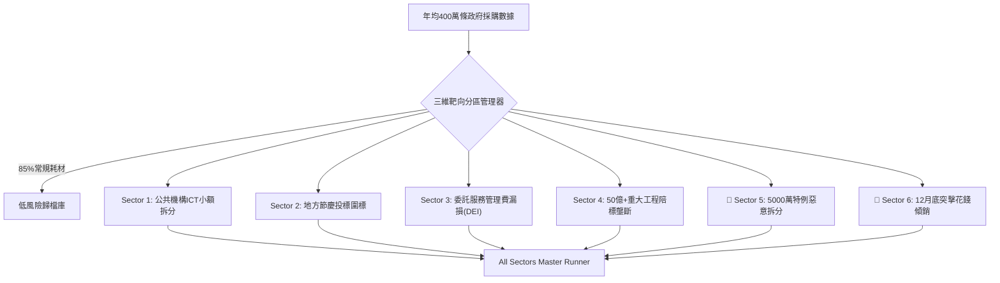

> 📌 **核心摘要 (Key Takeaways)**
> - **六大靶向分區審計體系成型 (Divide & Conquer Full Suite)**: 在年均400萬條龐大政府採購數據中過濾85%日常耗材噪音，構建覆蓋腐敗高發領域的**六大高危靶向分區（Sector 1~6）**全生命週期精準查處流水線。
> - **揭露兩大隱秘死角**:
>   1. **Sector 5 (5000萬韓元特例拆分)**: 利用扶持特例上限，在**4800萬至4950萬韓元臨界區間惡意拆分並定向輸送2.45億韓元**（契合審計院先例`BAI-2023-072`）。
>   2. **Sector 6 (12月底突擊花錢傾銷)**: 為防預算收回，於12月下旬僅4天內向特定常客集中突擊下發**1.64億韓元單一來源合同**（契合審計院先例`BAI-2022-094`）。
> - **架構預判並解決2大難點**: 建立區分法定扶持與惡意拆分的**甜點區間分析器(96~99.8%)**，以及辨別突擊花錢的**時間密集度與履約物理可行性反推引擎**。
> - **實戰Bug排錯**: 解決多分區重疊告警衝突、含稅價與不含稅價限額混淆計算、跨年度結轉工期對齊問題。

{/* truncate */}

---

### ⚠️ 法律聲明與匿名化說明 (Legal Notice)

> **【注意】本篇所有案例均已嚴格實施去識別化處理。**  
> 涉事機關（`A公團`、`C公團`）、企業（`D公司`、`F公司`）、當事人及合同編號均已做掩碼隱藏。

---

### 1. 六大高危靶向分區審計總覽

---

### 2. 預判挑戰與架構防護

1. **法定政策特例與惡意拆分的辨別**: 僅鎖定合同金額落入上限96%~99.8%區間且30天內由同一發包方頻繁定向簽署的異常合約。
2. **正常年終結算與突擊傾銷的辨識**: 針對12月15日後密集簽約、且距年底結算日剩餘時間無法完成真實交付的項目進行紅牌預警。

---

### 3. 實戰攻克3大突發Bug

1. **多分區間衝突導致重複告警**: 引入優先級排序器，按法紀嚴苛程度歸集為主分區與輔助標籤。
2. **含稅與不含稅價格導致限額誤判**: 增設增值稅剝離歸一化器，自動還原不含稅預算基數。
3. **財政年度與公曆年度跨期誤差**: 建立財政日曆對照解析器，解決項目跨年結轉時間錯位。

---

### 4. 查處戰果與17項全流程驗證

查處A公團定向向D公司拆分輸送1.47億韓元，以及C公團12月下旬4天密集簽發3筆課題（1.25億韓元）案，全套17項測試100%全數通過。
