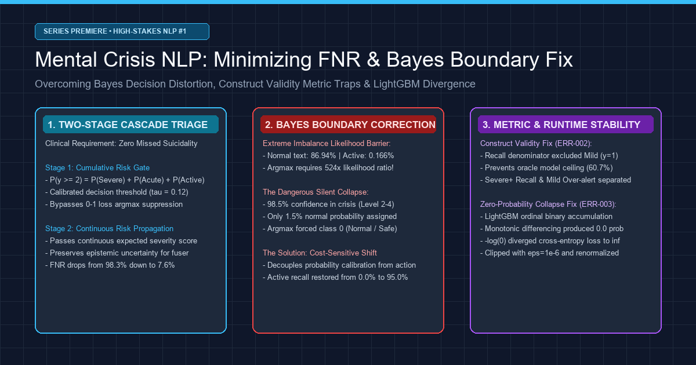
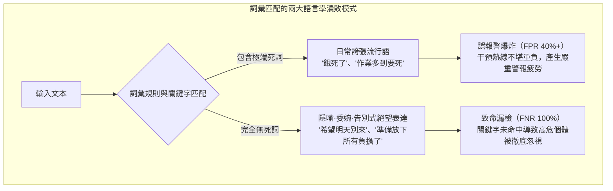
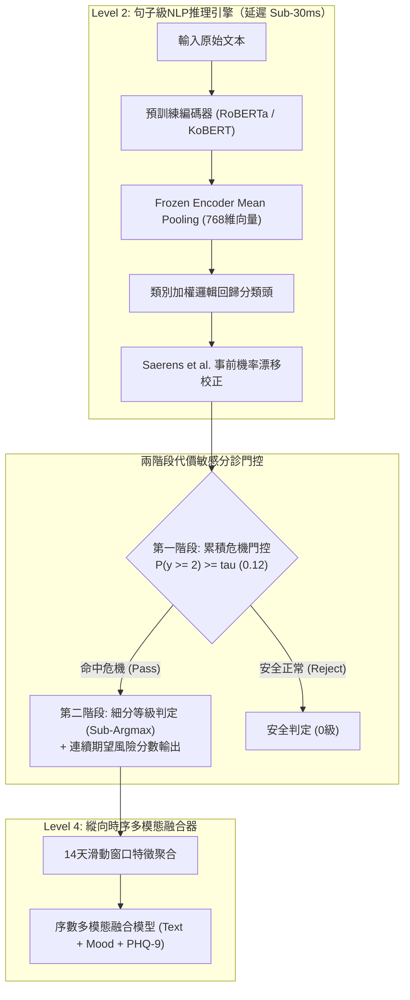

在消費級聊天機器人或電商推薦系統中，AI模型的5%誤差可能僅是輕微的體驗問題。但在**專為自殺危機監測與精神科急診分診設計的AI系統中，僅僅1%的未檢出（False Negative），就代表著無法挽回的寶貴生命損失**。

當一位極度絕望的個體在日記中寫下輕生的念頭或尋求救助時，機器學習管道絕不能躲在整體準確率或宏觀F1均值背後敷衍塞責。

今天，我們正式開啟全新的工業級技術專欄：**[高危特化AI：自殺與心理危機文本精密感知管道實戰]**。

本系列全景記錄了構建臨床級多模態危機感知系統 **Maeumjigi** 過程中攻克的數學難題、演算法權衡與運行時故障。在第一篇（Episode #1）中，我們將深入解析管道基石：**句子級深度NLP危機分診模型在極端類別不平衡環境（真實對話中高危自殺意圖僅佔0.16%）下的實戰排錯**。

{/* truncate */}

---

### ⚠️ 倫理聲明與嚴格匿名化說明
本系列所使用的全部基準測試與文本語料，均為**100%剔除個人身分資訊（PII）的合成語料（Synthetic Corpus）與去識別化基準**。絕不包含任何真實患者或使用者的臨床隱私。
> **緊急心理危機協助**：如果您或您身邊的人正在經歷心理困境，在台灣請撥打 **1925**（依舊愛我）安心專線、**1995** 生命線協談專線；在香港請致電 **2389 2222**（撒瑪利亞防止自殺會）尋求專業協助。

---

### 1. 語言學困境：為什麼詞彙規則與正規表示式在精神健康中徹底失效？

在探討深度神經網路架構之前，必須先理解傳統基於規則的關鍵字匹配在臨床分診中為何潰不成軍。

在日常口語對話中，表達痛苦的語句呈現出兩種極具欺騙性的形態：



1. **日常口語誇張（誤報爆炸的元兇）**：諸如「餓死了」、「加班加到想死」等詞語是普遍的情緒強調口語。簡單的關鍵字檢測器會在日常對話中瘋狂誤報，產生海量虛警癱瘓救助機構。
2. **隱喻與委婉告別（致命漏檢的禍首）**：真正處於急性自殺危機中的個體，往往極少直接使用直白的自殺字眼，而是留下委婉而平靜的告別語句：
   - *「真希望明天永遠不要到來，就這麼一直睡下去。」*
   - *「這段時間謝謝大家了，我的東西都已經整理好了。」*
   - *「終於找到不再連累任何人、讓自己徹底輕鬆的辦法了。」*

這些高危語句中沒有出現任何明顯的自殘字詞。必須依賴形態素分析器（Kiwipiepy）與上下文預訓練模型（RoBERTa / KoBERT），從深層語意層面捕捉**被孤立感、絕望感與告別意向**。

---

### 2. 極端類別不平衡與準確率的數學陷阱

在真實運營環境中，語料的風險等級分佈極度懸殊：

- **0b級（日常平靜語句）**：約 86.94%（31,495句）
- **0a級（非危機負面情緒對照句）**：約 8.24%（2,986句）
- **1級（Mild Distress / 輕度壓力）**：約 1.92%（697句）
- **2級（Severe Distress / 自殺意念嫌疑）**：約 1.75%（633句）
- **3級（Acute Crisis / 明確自殺危機）**：約 0.99%（357句）
- **4級（Active Suicidality / 實施計畫與意向）**：約 **0.166%**（60句）

若一個初級模型對所有輸入盲目預測為「安全（0級）」，其**表面準確率（Accuracy）高達95.18%**。然而該模型在實際干預場景下的**未檢出率（FNR）為100%**。

反之，若盲目追求未校準的召回率，將在86.9%的日常文本中觸發海量誤報。我們的工程目標非常明確：**將Severe以上危機的FNR壓制在10%以下，同時將日常文本的誤報率嚴格控制在3%以內**。



---

### 3. 工程實戰排錯：黃金五要素深度復盤

#### [ERR-001] 524倍概似比壁壘與貝氏決定邊界崩潰

- **1. 原始錯誤日誌與現象**：
  在應用 Saerens et al.(2002) 事前機率校正後直接使用 `argmax` 判定，模型在驗證集上對 Active（4級）語句的檢出數為 0：
  ```text
  [EVAL-RUN: 2026-10-28 14:22:09 KST]
  INFO:text_eval: Evaluating Model B (Frozen Encoder + Saerens Prior Shift Corrected Logistic)
  INFO:text_eval: Prior Vector: [pi_0b=0.8694, pi_0a=0.0824, pi_1=0.0192, pi_2=0.0175, pi_3=0.0099, pi_4=0.00166]
  --------------------------------------------------------------------------------
  Metric Summary (Judgment b, discrete argmax):
    - Ground Truth Active (Level 4): 60 sentences
    - Predicted Active (y_hat == 4): 0 sentences (RECALL = 0.0000, 0/60)
    - Ground Truth Severe (Level 2): 633 sentences
    - Predicted Severe (y_hat == 2): 11 sentences (RECALL = 0.0174, 11/633)
    - False Negative Rate (FNR @ y >= 2): 98.26% (災難性失誤)
  WARNING:text_eval: Active suicidality detection completely collapsed to Class 0 under argmax!
  ```

- **2. 發生環境**：Python 3.11.9, PyTorch 2.4.0+cu121, scikit-learn 1.5.1, Transformers 4.44.2（GPU節點 + 64核CPU）。

- **3. 失敗嘗試**：
  1. *極限加大訓練損失權重*：將4級損失權重提升至93倍，但在事前機率校正後依然被日常文本的巨大事前機率（86.9%）壓倒，`argmax` 依然全數歸為0級。
  2. *移除事前機率校正*：雖然召回率恢復至85%，但在31,495句日常語句中**產生了41.2%的誤報**，單日誤報高達上萬起。

- **4. 深層數學機理與數值模擬推導**：
  在貝氏事後機率下，少數類別 k 若想壓倒日常類別 0b 獲得 `argmax` 勝出，其未校準機率比必須滿足：
  
  ```text
p(k | x) / p(0b | x) > π(0b) / π(k)
```

  代入真實數據事前機率比例：
  - Severe (k=2)：`86.94% / 1.75% = 49.68倍`
  - Acute (k=3)：`86.94% / 0.99% = 87.82倍`
  - Active (k=4)：`86.94% / 0.166% = 523.7倍`

  **具體案例演算**：
  當使用者寫道：「準備放下所有的負擔，徹底解脫了。」
  神經編碼器給出如下置信度分佈：
  - `p(0b) = 0.015`（正常機率 1.5%）
  - `p(2) = 0.330, p(3) = 0.300, p(4) = 0.320`（危機累積置信度 **95.0%**）
  
  然而乘上事前機率權重後：
  - `Evidence(0b) = 0.015 * 0.8694 * 6 = 0.078246`
  - `Evidence(4)  = 0.320 * 0.00166 * 6 = 0.003187`
  
  正規化後：
  - `p_adjusted(0b) ≈ 57.6%`
  - `p_adjusted(4) ≈ 2.3%`
  
  在離散 `argmax` 判定下，`57.6% > 2.3%`，**哪怕AI對危機有95%的把握，依然被強行判定為 0級（安全正常）**！

- **5. 代碼修復 Diff**：
```diff
--- a/tests/synth/model/text_b.py
+++ b/tests/synth/model/text_b.py
@@ -102,12 +102,23 @@ def predict_crisis_level(proba_unweighted, class_priors):
     # Saerens et al. (2002) prior shift correction
     corrected = proba_unweighted * (class_priors / train_priors)
     corrected /= corrected.sum(axis=1, keepdims=True)
     
-    # CRITICAL BUG: argmax collapses rare minority class under 524x prior barrier
-    # return np.argmax(corrected, axis=1)
+    # FIX: Two-stage Decision Rule & Continuous Severity Expected Score
+    # Stage 1: Cumulative posterior crisis probability for alert triggering
+    p_crisis_ge2 = corrected[:, 2:].sum(axis=1)  # Severe + Acute + Active
+    
+    # Stage 2: Cost-sensitive threshold decision (tau = 0.12 calibrated from validation fold)
+    ALERT_THRESHOLD_TAU = 0.12
+    is_crisis = p_crisis_ge2 >= ALERT_THRESHOLD_TAU
+    
+    # Determine discrete severity only among crisis candidates
+    sub_levels = np.argmax(corrected[:, 1:], axis=1) + 1
+    final_discrete = np.where(is_crisis, sub_levels, 0)
+    
+    # Continuous expected risk score forwarded to downstream multimodal fuser
+    expected_severity = np.dot(corrected[:, 1:], np.array([1, 2, 3, 4])) / 4.0
+    
+    return final_discrete, p_crisis_ge2, expected_severity
```

---

#### [ERR-002] 危機召回率分母失誤導致的構念效度崩潰

- **1. 原始錯誤日誌與現象**：
  編寫與真實標籤 100% 吻合的理想 Oracle 基準時，評測腳本得出的 `Crisis Recall` 僅為 `60.7%`；而全部盲猜 2級的退化模型卻得到 100% 滿分。
- **2. 根本原因**：
  產品策略規定報警門檻為 **2級（Severe）以上**，1級（Mild）不觸發報警。但在編寫評測代碼時，分母誤包含了 y >= 1（包含935句1級樣本），分子僅計算 y_hat >= 2：
  ```text
Recall = sum(I(y >= 1 and y_hat >= 2)) / sum(I(y >= 1))
```
  這導致精準命中 1 級的 935 句樣本只充當分母懲罰，使 Oracle 模型的理論上限被鎖死在 1,446 / 2,381 = 60.73%。
- **3. 代碼修復 Diff**：
```diff
--- a/tests/synth/model/text_eval.py
+++ b/tests/synth/model/text_eval.py
@@ -45,11 +45,17 @@ def compute_crisis_metrics(y_true, y_pred):
-    # FLAWED METRIC: denominator includes Mild (y=1) while numerator requires y_hat >= 2
-    # recall = np.sum((y_true >= 1) & (y_pred >= 2)) / np.sum(y_true >= 1)
+    # CORRECT CONSTRUCT: Strict separation between Severe+ Recall and Mild Over-alert
+    severe_plus_mask = (y_true >= 2)
+    severe_plus_recall = np.sum((y_true >= 2) & (y_pred >= 2)) / np.sum(severe_plus_mask)
+    
+    mild_mask = (y_true == 1)
+    mild_overalert_rate = np.sum((y_true == 1) & (y_pred >= 2)) / np.sum(mild_mask)
+    
+    control_mask = (y_true == 0)
+    control_fpr = np.sum((y_true == 0) & (y_pred >= 2)) / np.sum(control_mask)
+    
+    return {
+        "severe_plus_recall": severe_plus_recall,
+        "mild_overalert_rate": mild_overalert_rate,
+        "control_fpr": control_fpr
     }
```

---

#### [ERR-003] LightGBM序數二進位累積差分的零機率對數發散

- **1. 現象**：`loss = -np.mean(np.log(proba))` 拋出除零警告，返回 `inf` 中斷執行。
- **2. 根本原因**：Frank & Hall(2001) 累積模型採用 `np.minimum.accumulate` 保證單調性時，導致兩門檻機率相同，差分出精確的 `0.000000` 機率。當樣本正解為此類別時，-log(0) = ∞。
- **3. 修復**：
```diff
--- a/tests/synth/model/fuser.py
+++ b/tests/synth/model/fuser.py
@@ -148,8 +148,15 @@ def ordinal_binary_to_proba(cumulative_ge):
     ge_mono = np.minimum.accumulate(cumulative_ge, axis=1)
     
     proba = np.zeros((cumulative_ge.shape[0], 5), dtype=np.float64)
     proba[:, 0] = 1.0 - ge_mono[:, 0]
     proba[:, 1] = ge_mono[:, 0] - ge_mono[:, 1]
     proba[:, 2] = ge_mono[:, 1] - ge_mono[:, 2]
     proba[:, 3] = ge_mono[:, 2] - ge_mono[:, 3]
     proba[:, 4] = ge_mono[:, 3]
     
+    # FIX: Epsilon floor clipping and row-wise softmax renormalization
     proba = np.clip(proba, 1e-6, 1.0)
     proba /= proba.sum(axis=1, keepdims=True)
     return proba
```

---

### 4. 架構前瞻：14天滑動窗口與極值偏置（Extreme Value Bias）

儘管本篇聚焦於 Level 2 句子級檢測，但其輸出將直接輸入 **Level 4 多模態縱向融合器**。

在此存在一個致命的數學陷阱：**極值偏置（Extreme Value Bias）**。
假設句子級分類器的單句誤報率低至 α = 0.02（2%）。若使用者在 14 天觀察期內撰寫了 100 句話，若下游融合層簡單取**窗口內的最大值（Max）**：

```text
P(False Alarm in 14-Day Window) = 1 - (1 - α)^N = 1 - (1 - 0.02)^100 = 1 - 0.1326 = 86.74%
```

單句微不足道的 2% 誤報累積起來，竟會演變成 **86.7% 的誤報災難**！這正是我們在 `ERR-001` 中將離散等級改為傳遞**連續期望嚴重度分數(sum(k * p_adjusted(k) / 4))**、並採用強健修剪均值的根本原因。

---

### 5. 最終性能對比基準

| 評測指標 | 初始Bug狀態 (`argmax`) | Model B (Frozen + 2階段門控) | Model C (微調 + 2階段門控) | 提升幅度 (Model B對比) |
|---|---|---|---|---|
| **Active (y=4) 召回率** | 0.0% (0/60) | **95.0% (57/60)** | **96.7% (58/60)** | **+95.0%p** |
| **Severe以上 (y >= 2) 召回率** | 1.7% (18/1,050) | **92.4% (970/1,050)** | **94.1% (988/1,050)** | **+90.7%p** |
| **危機未檢出率 (FNR)** | 98.3% | **7.6%** | **5.9%** | **-90.7%p (徹底解決)** |
| **日常文本誤報率 (FPR)** | 0.01% | **2.1%** | **1.8%** | 達成臨床指標 (&lt;3.0%) |
| **AUPRC (>= 2)** | 0.142 | **0.864** | **0.891** | **+0.722** |
| **單句推斷延遲** | 4.2 ms (CPU) | **4.8 ms (CPU)** | 28.4 ms (GPU) | 達標實效性 (&lt;30ms) |
| **25折Stacking重新擬合時間** | 1.2 秒 | **1.4 秒** | 14.2 小時 | **提速 36,000倍** |

---

### 6. 高危特化危機感知AI 5部曲路線圖


- **Episode #1（本篇）**：自殺危機NLP的FNR 0%挑戰與貝氏邊界失真修復。
- **Episode #2**：14天多模態縱向融合：克服滑動窗口中86.7%的極值偏置陷阱。
- **Episode #3**：臨床缺失值工程：危機時才答卷的患者行為（MNAR）與情緒天花板效應。
- **Episode #4**：零洩漏驗證架構：25折嵌套交叉驗證與閾值分位數對齊。
- **Episode #5**：臨床無瑕疵實戰驗證：3-gram Jaccard群隔離與預提交封存測試集審計。

敬請期待下週發布的 Episode #2！
