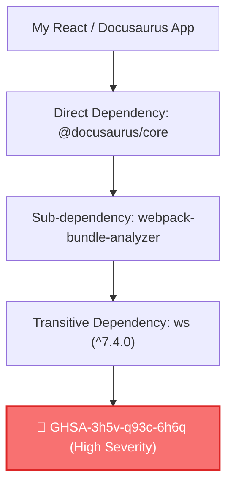

> 📌 **核心摘要 (TL;DR)**  
> - **問題本質**：當漏洞出現在深層巢狀傳遞依賴（Transitive Dependency）時，執行 `npm audit fix --force` 會強制將頂層框架降級至過時版本，導致現代 React 19 與打包工具鏈直接崩潰。  
> - **精準解決方案**：利用 npm v8.3+ 內建的 **`overrides`** 設定，精準鎖定並升級深層子依賴至安全補丁版本，無需等待上游直接依賴項發布更新。  
> - **CI/CD 構建防護**：利用 `npm audit --omit=dev --audit-level=high` 排除純開發期工具的雜訊，專注防禦真正運行在生產環境中的核心依賴。

{/* truncate */}

---

### 1. 傳遞依賴（Transitive Dependency）的困境

在現代前端與靜態網站開發中，專案 `package.json` 中的直接依賴通常只有數十個，但透過依賴樹自動引入的深層子依賴往往超過 1,000 個。



當安全性掃描器在深層套件中發現漏洞時，盲目執行 `npm audit fix --force` 會引發災難性後果：
1. npm 為了解決版本約束衝突，會將整個根框架（如 Docusaurus 或 React）降級到舊版本。
2. 這會直接破壞 TypeScript 定義、現代打包配置，導致生產構建失敗。

---

### 2. 精準手術：使用 `package.json` 中的 `overrides`

從 npm v8.3.0 開始，我們可以使用 **`overrides`** 欄位強制覆寫整個專案或特定套件下的依賴版本：

```json
{
  "name": "my-production-app",
  "version": "1.0.0",
  "dependencies": {
    "@docusaurus/core": "3.10.2"
  },
  "overrides": {
    "ws": "^8.17.1"
  }
}
```

#### 特定依賴項範圍覆寫（Scoped Override）
若只想覆寫特定套件旗下的子依賴：

```json
{
  "overrides": {
    "webpack-bundle-analyzer": {
      "ws": "^8.17.1"
    }
  }
}
```

---

### 3. CI/CD 與生產安全實踐：`--omit=dev`

在 GitHub Actions CI/CD 流程中，使用 `--omit=dev` 排除不會部署到生產環境的本地開發工具：

```yaml
- name: Production Security Audit
  run: npm audit --omit=dev --audit-level=high
```

如此即可確保構建流水線在維持 100% 穩定性的同時，精準消除生產環境中的供應鏈安全風險。
