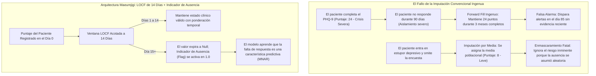
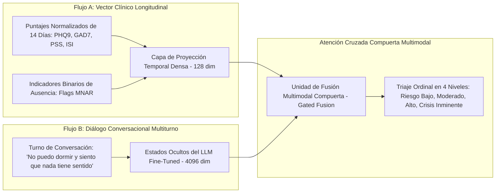

Bienvenidos a la 24ª entrega del **Dev Log del Proyecto Capstone Maeumjigi**.

Tras la exitosa defensa final del primer semestre y el despliegue de nuestra envoltura de seguridad de doble capa en junio, nuestro equipo inició oficialmente el **Segundo Semestre (Otoño de 2026)**. Durante el primer semestre, nuestro enfoque de ingeniería se centró principalmente en el ajuste fino (fine-tuning) de modelos de lenguaje grande (LLM como Llama 3.1 8B y Qwen 2.5 32B/7B), la generación de diálogos sintéticos y las barreras de protección (guardrails) de seguridad.

Sin embargo, en psicología clínica y triaje psiquiátrico, el lenguaje conversacional representa solo la mitad del rompecabezas diagnóstico. El riesgo del paciente escala con el tiempo a través de **marcadores numéricos longitudinales**: gravedad de depresión autorreportada (PHQ-9), ansiedad generalizada (GAD-7), estrés percibido (PSS) e insomnio (ISI).

El registro de desarrollo de hoy documenta nuestro avance arquitectónico en ingeniería de datos clínicos: superando las imputaciones estadísticas ingenuas e implementando un robusto pipeline de **Última Observación Llevada Hacia Adelante (LOCF, Last Observation Carried Forward) limitado a 14 días**, complementado con **Indicadores de Ausencia Informativa (Missing Not at Random / MNAR)**.

{/* truncate */}

---

### 1. El Problema Clínico: Por Qué la Imputación Convencional Falla en Psiquiatría

En los pipelines estándar de machine learning para datos tabulares, los ingenieros rellenan frecuentemente las encuestas faltantes usando la media global, K-vecinos más cercanos (KNN) o arrastre indefinido hacia adelante (infinite forward-fill).

En la detección de crisis de salud mental y riesgo de suicidio, estas suposiciones simplistas provocan distorsiones catastróficas:



En cohortes psiquiátricas, los datos faltantes casi nunca son **Completamente al Azar (MCAR, Missing Completely at Random)**. Cuando un paciente deja de enviar su evaluación diaria o semanal, esto suele reflejar **evitación conductual, retardo psicomotor severo o anhedonia**, síntomas característicos de un empeoramiento depresivo crítico. La ausencia misma constituye una señal diagnóstica informativa (**Ausencia No al Azar / MNAR**).

---

### 2. Arquitectura de Normalización Multiescala

Nuestro conjunto de datos agrega cuatro escalas psicométricas heterogéneas, cada una con distintos rangos de puntuación y puntos de corte clínicos:

| Escala Clínica | Rango Crudo | Corte Clínico Clave | Dominio Clínico Objetivo | Estrategia de Normalización |
| :--- | :---: | :---: | :--- | :--- |
| **PHQ-9** (Cuestionario de Salud del Paciente) | 0 – 27 | 10+ (Moderado), 20+ (Severo) | Trastorno Depresivo Mayor (TDM) | Min-Max scaling individual a [0, 1] |
| **GAD-7** (Trastorno de Ansiedad Generalizada) | 0 – 21 | 10+ (Moderado), 15+ (Severo) | Pánico y Ansiedad Generalizada | Min-Max scaling individual a [0, 1] |
| **PSS** (Escala de Estrés Percibido) | 0 – 40 | 27+ (Estrés Alto) | Estrés Psicosocial Crónico | Min-Max scaling individual a [0, 1] |
| **ISI** (Índice de Gravedad del Insomnio) | 0 – 28 | 15+ (Insomnio Clínico) | Trastorno del Sueño y Ritmo Circadiano | Min-Max scaling individual a [0, 1] |

#### La Falacia de la Compresión en un Índice Único
Los prototipos iniciales intentaron sumar los cuatro puntajes crudos en un único índice agregado entre 0 y 1.

La revisión clínica determinó que esto destruye el poder diagnóstico: **un paciente con pánico extremo agudo (GAD-7: 21, PHQ-9: 2) obtendría exactamente el mismo puntaje promedio que un paciente con depresión vegetativa crónica sin ansiedad (GAD-7: 0, PHQ-9: 23)**. Las intervenciones psiquiátricas para el pánico difieren radicalmente de las de la depresión melancólica. Por ello, nuestro pipeline preserva estrictamente **cuatro canales de entrada independientes**.

---

### 3. Implementación del LOCF de 14 Días e Indicador MNAR

Para balancear la validez de recencia con la información de no respuesta, desarrollamos el siguiente motor en Python:

```python
# clinical_preprocessor.py - Motor de Preprocesamiento Clínico Longitudinal
import pandas as pd
import numpy as np

SCALE_BOUNDS = {
    "phq9": (0, 27),
    "gad7": (0, 21),
    "pss": (0, 40),
    "isi": (0, 28)
}

def process_patient_timeline(df: pd.DataFrame, max_locf_days: int = 14) -> pd.DataFrame:
    """
    Aplica imputación LOCF acotada a 14 días mientras genera
    indicadores binarios explícitos de ausencia (MNAR) para las capas neuronales.
    """
    df = df.sort_values("timestamp").copy()
    processed_cols = {}

    for scale, (min_val, max_val) in SCALE_BOUNDS.items():
        val_col = f"{scale}_score"
        
        # 1. Normalización Min-Max preservando el cero clínico
        norm_series = (df[val_col] - min_val) / (max_val - min_val)
        
        # 2. LOCF acotado a un máximo de 14 días
        locf_series = norm_series.ffill(limit=max_locf_days)
        
        # 3. Indicador de ausencia: 1.0 si no se observó o expiró; 0.0 si es observación válida
        missing_indicator = locf_series.isna().astype(np.float32)
        
        # 4. Rellenar nulos residuales con 0.0 (seguro porque missing_indicator informa al modelo)
        final_scores = locf_series.fillna(0.0)
        
        processed_cols[f"{scale}_norm"] = final_scores
        processed_cols[f"{scale}_missing"] = missing_indicator

    return pd.DataFrame(processed_cols, index=df.index)
```

Mediante esta formulación:
1. Si un paciente envió su encuesta hace 5 días, el modelo recibe su puntaje normalizado con `missing_indicator = 0.0`.
2. Si transcurren más de 14 días sin respuesta, la característica expira y `missing_indicator = 1.0`, indicando al clasificador que la no respuesta prolongada es una señal de riesgo activo.

---

### 4. Fusión Multimodal de Características Numéricas con LLMs

En nuestra arquitectura final para el segundo semestre, estos vectores numéricos preprocesados no actúan de manera aislada. Se integran mediante un **Puente de Fusión Multimodal por Atención Cruzada (Cross-Attention Fusion Bridge)** con los estados ocultos emitidos por nuestro modelo Qwen 2.5:



Al evaluar tanto el malestar verbal inmediato como la trayectoria psicométrica de los últimos 14 días, el sistema elimina tanto falsos positivos (exageración verbal sin patología subyacente) como falsos negativos (depresión sonriente donde el tono calmado oculta puntajes psicométricos críticos).

---

### 5. Logros Principales del Día 24 y Próximos Pasos

1. **Resolución de Ausencia Informativa (MNAR)**: Establecimiento de un pipeline de imputación LOCF acotado a 14 días que modela la omisión de encuestas como una variable predictiva activa.
2. **Preservación Multicanal Independiente**: Eliminación de la compresión en un solo índice, garantizando la discriminación diagnóstica entre depresión, ansiedad, estrés e insomnio.
3. **Validación Académica y Clínica**: Aprobación unánime del documento de diseño técnico (`문의_위기감지모델_숫자입력_전처리.docx`) por parte de los profesores consejeros.

¡En el **Dev Log #25**, abordaremos el entrenamiento del **Clasificador Multimodal y Regresión Logística Ordinal** para evaluar el rendimiento frente a conjuntos de validación psiquiátrica estándar!

---

### 📌 Resumen Ejecutivo (3 a 5 Líneas)
1. **Salto en Ingeniería de Datos Clínicos**: Evolución en el segundo semestre del proyecto capstone desde el PLN conversacional hacia el triaje psiquiátrico multimodal mediante 4 escalas psicométricas (PHQ-9, GAD-7, PSS, ISI).
2. **Tratamiento de Ausencia Informativa (MNAR)**: Modelado de la falta de respuesta del paciente como señal predictiva clínica en lugar de ruido estadístico aleatorio, aplicando LOCF acotado a 14 días y banderas binarias.
3. **Independencia Multicanal**: Preservación de 4 canales de entrada independientes bajo normalización Min-Max, evitando la pérdida de poder diagnóstico causada por agregaciones promedio.
4. **Fusión Multimodal por Atención Cruzada**: Integración de trayectorias numéricas longitudinales con representaciones conversacionales de LLM, minimizando sustancialmente falsas alarmas y crisis pasadas por alto.

### Referencias y Recursos Técnicos
- **Repositorio del Proyecto**: `D:\ai\antigravity\capde\` & `mental-health-backend`
- **Literatura Clínica**: Protocolos de Evaluación del NIMH; Informative Missingness in Longitudinal Clinical Trials (Little & Rubin, 2019).
- **Institución Académica**: Universidad Nacional de Ciencia y Tecnología de Seúl (SeoulTech), Dept. de Ciencia e Ingeniería Informática.
