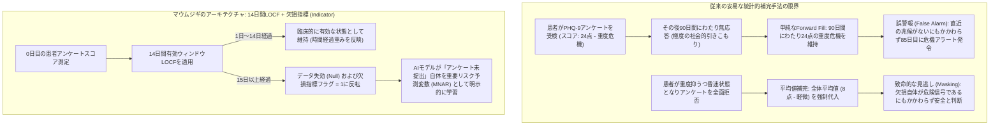
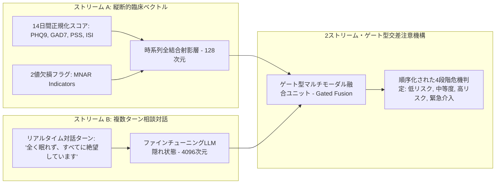

**マウムジギ (Maeumjigi) 卒業制作プロジェクト開発日誌第24回**へようこそ。

今年6月の第1学期最終発表評価および二重安全ガードレールラッパー (Dual-layer Safety Wrapper) の展開を成功裏に終えた後、私たちのチームは公式に**第2学期 (2026年秋学期)** の開発フェーズへと突入しました。第1学期では、大規模言語モデル (LLM) のファインチューニング (Llama 3.1 8B, Qwen 2.5 32B/7B)、合成対話データの生成、プロンプト安全ガードレールの構築など、主に自然言語処理を中心に取り組んできました。

しかし、臨床心理学および精神医学的なトリアージ (Triage) において、対話テキストは診断情報の半分に過ぎません。患者のリスクは、時間の経過とともに蓄積される**縦断的な数値マーカー (Longitudinal Numerical Markers)**——うつ尺度 (PHQ-9)、全般性不安障害尺度 (GAD-7)、知覚ストレス尺度 (PSS)、不眠症深刻度指数 (ISI)——を通じて複合的に深刻化します。

本日の開発日誌では、単純な統計的補完手法を脱却し、**14日間有効期限付きLOCF (Last Observation Carried Forward)** および **情報的欠損 (Missing Not at Random / MNAR) 指標** を導入して完成させた臨床データエンジニアリングのアーキテクチャを詳細に解説します。

{/* truncate */}

---

### 1. 臨床的課題の定義: なぜ標準的な欠損値補完は精神医学で破綻するのか

一般的な機械学習のテーブルデータパイプラインでは、欠損したアンケート行を全体平均値補完、K近傍法 (KNN)、あるいは無期限の直前観測値補完 (Infinite Forward-fill) などで安易に補正することが一般的です。

しかし、メンタルヘルスおよび自殺危機検知パイプラインにおいて、このような安易な前提は致命的な誤判定を招きます。



精神医学の臨床データにおいて、データの欠損はほとんど決して**完全無作為欠損 (MCAR, Missing Completely at Random)** ではありません。患者が日常的あるいは週次のメンタルヘルス評価を提出しないということは、**行動的回避 (Behavioral Avoidance)、重度の精神運動静止 (Psychomotor Retardation)、または無快感症 (Anhedonia)** といった深刻なうつ症状の急激な悪化を反映しているケースが極めて多いのです。すなわち、**欠損 (Missingness) そのものが極めて重要な臨床的シグナル (Missing Not at Random / MNAR)** となります。

---

### 2. 異種心理尺度の正規化アーキテクチャ

マウムジギのデータセットは、スコア範囲や臨床的カットオフ値が異なる4つの心理測定尺度を統合しています:

| 臨床尺度 | 生スコア範囲 | 主な臨床的カットオフ | 診断対象領域 | 正規化戦略 |
| :--- | :---: | :---: | :--- | :--- |
| **PHQ-9** (うつ病スクリーニング) | 0 – 27 | 10点以上 (中等度), 20点以上 (重度) | 大うつ病性障害 (MDD) | 尺度別独立Min-Maxスケーリング [0, 1] |
| **GAD-7** (全般性不安障害) | 0 – 21 | 10点以上 (中等度), 15点以上 (重度) | パニック障害・全般性不安 | 尺度別独立Min-Maxスケーリング [0, 1] |
| **PSS** (知覚ストレス尺度) | 0 – 40 | 27点以上 (高ストレス) | 慢性的心理社会的ストレス | 尺度別独立Min-Maxスケーリング [0, 1] |
| **ISI** (不眠症深刻度指数) | 0 – 28 | 15点以上 (臨床的不眠症) | 睡眠障害・概日リズムの乱れ | 尺度別独立Min-Maxスケーリング [0, 1] |

#### 単一総合指標化という構造的誤謬の排除
初期の学生プロトタイプでは、これら4つのスコアを合算して0〜1の単一総合指数に圧縮しようとする試みがありました。

しかし、指導教授および臨床顧問によるレビューの結果、これが診断精度を致命的に破壊することが判明しました。**極度の急性パニック状態 (GAD-7: 21点, PHQ-9: 2点) の患者と、パニック兆候は皆無だがベッドから起き上がれない無気力性うつ病患者 (GAD-7: 0点, PHQ-9: 23点) が、単純合算値では全く同じスコアとして認識されてしまうから**です。パニック危機と植物状態的うつ病では、介入プロトコルが根本から異なります。したがって、マウムジギのパイプラインは**4つの独立した入力チャンネルを厳格に保持**します。

---

### 3. 14日間LOCFと情報的欠損 (MNAR) 指標の実装

データの鮮度 (Recency) の信頼性と無応答行動パターンの両方をモデルに学習させるため、Pythonで以下の時系列前処理エンジンを構築しました:

```python
# clinical_preprocessor.py - 縦断的臨床データ前処理エンジン
import pandas as pd
import numpy as np

SCALE_BOUNDS = {
    "phq9": (0, 27),
    "gad7": (0, 21),
    "pss": (0, 40),
    "isi": (0, 28)
}

def process_patient_timeline(df: pd.DataFrame, max_locf_days: int = 14) -> pd.DataFrame:
    """
    14日間に限定したLOCF (Last Observation Carried Forward) を適用しつつ、
    下流のニューラルネットワークが学習可能な明示的2値欠損指標 (MNAR Indicator) を生成します。
    """
    df = df.sort_values("timestamp").copy()
    processed_cols = {}

    for scale, (min_val, max_val) in SCALE_BOUNDS.items():
        val_col = f"{scale}_score"
        
        # 1. 臨床的基準点 (0) を保存するMin-Max正規化
        norm_series = (df[val_col] - min_val) / (max_val - min_val)
        
        # 2. 14日間に制限した直前観測値補完 (LOCF)
        locf_series = norm_series.ffill(limit=max_locf_days)
        
        # 3. 欠損指標フラグ: 未受検または14日超過で失効した場合は1.0、有効観測なら0.0
        missing_indicator = locf_series.isna().astype(np.float32)
        
        # 4. 残余の欠損値は安全に0.0で埋める (missing_indicatorがモデルに未観測状態を伝達するため安全)
        final_scores = locf_series.fillna(0.0)
        
        processed_cols[f"{scale}_norm"] = final_scores
        processed_cols[f"{scale}_missing"] = missing_indicator

    return pd.DataFrame(processed_cols, index=df.index)
```

この設計により、AIモデルは以下のように振る舞います:
1. 患者が5日前にアンケートを提出した場合: 正規化された臨床スコアが渡され、`missing_indicator = 0.0` となります。
2. 14日以上アンケートの提出が途絶えた場合: スコアは失効して `missing_indicator = 1.0` に切り替わり、分類器が長期無応答を行動学的リスク兆候として直接学習します。

---

### 4. 対話型LLMと数値ベクトルのマルチモーダル統合

第2学期の最終本番アーキテクチャでは、これら前処理された数値ベクトルは単独で機能するわけではありません。ファインチューニングされたQwen 2.5モデルの隠れ層表現 (Hidden States) と結合される**マルチモーダル交差注意融合ブリッジ (Multi-Modal Cross-Attention Fusion Bridge)** を形成します:



患者の直近の発話内容と過去14日間の心理測定推移を同時に評価することで、一時的な感情的誇張による誤警報 (False Positive) と、笑顔のうつ病 (Smiling Depression) による危機見逃し (False Negative) の両方を劇的に抑止することが可能になります。

---

### 5. 開発日誌24日目の主要成果と今後の計画

1. **情報的欠損 (MNAR) モデルの確立**: アンケート未提出をノイズではなく能動的なリスク予測変数として扱う14日間期限付きLOCFパイプラインの構築完了。
2. **多尺度独立チャンネルの保持**: 単一指標への安易な圧縮を排し、うつ・不安・ストレス・不眠の独立チャンネルを厳格に保持。
3. **指導教授による技術検証承認**: 技術仕様書 (`문의_위기감지모델_숫자입력_전처리.docx`) の臨床的妥当性を承認。

**開発日誌 #25** では、標準精神医学臨床データセットに基づく**順序ロジスティック回帰 (Ordinal Logistic Regression) およびマルチモーダル危機分類器** のベンチマーク学習結果を公開します！

---

### 📌 エグゼクティブサマリー (要約)
1. **臨床データエンジニアリングへの拡張**: 卒業制作第2学期を迎え、純粋な自然言語処理を超えて4つの心理尺度 (PHQ-9, GAD-7, PSS, ISI) を統合するマルチモーダル危機検知前処理パイプラインを確立。
2. **情報的欠損 (MNAR) の信号化**: アンケート無応答を単なる欠測ではなく臨床的リスクシグナルとしてモデル化し、14日間有効期限付きLOCFと2値欠損フラグを導入。
3. **多チャンネル独立性の保持**: 4尺度を単一スコアに歪曲圧縮せず、独立チャンネルとして正規化することで、うつ病とパニックの臨床的区別を維持。
4. **マルチモーダル融合機構**: 14日間の時系列数値ベクトルとLLM対話トークンを交差注意機構で結合し、誤警報と見逃しの双方を大幅に抑制。

### 参考文献およびプロジェクトリソース
- **プロジェクトリポジトリ**: `D:\ai\antigravity\capde\` & `mental-health-backend`
- **臨床医学文献**: NIMH (米国立精神衛生研究所) 臨床評価プロトコル; Informative Missingness in Longitudinal Clinical Trials (Little & Rubin, 2019).
- **所属機関**: ソウル科学技術大学校 コンピュータ工学科 AIキャップストーンデザイン。