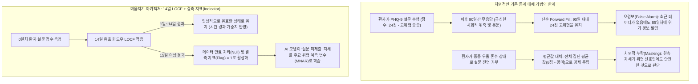
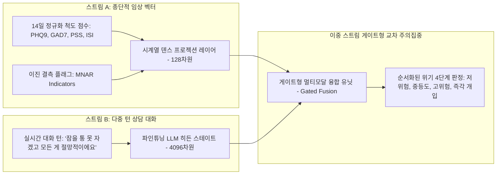

**마음지기(Maeumjigi) 캡스톤 프로젝트 개발일지 24번째 편**에 오신 것을 환영합니다.

지난 6월 1학기 최종 발표 평가와 이중 안전 가드레일 래퍼(Dual-layer Safety Wrapper) 배포를 성공적으로 마친 후, 저희 팀은 공식적으로 **2학기(2026년 2학기)** 개발 일정에 돌입했습니다. 1학기에는 대형 언어 모델(LLM) 파인튜닝(Llama 3.1 8B, Qwen 2.5 32B/7B), 합성 대화 데이터 생성, 프롬프트 안전성 가드레일 구축 등 주로 자연어 처리에 집중했습니다.

그러나 임상 심리학 및 정신과적 위기 분류(Triage)에서 언어 텍스트는 진단의 절반에 불과합니다. 환자의 위기 상태는 시간에 따라 누적되는 **종단적 수치 지표(Longitudinal Numerical Markers)**—우울 척도(PHQ-9), 범불안 척도(GAD-7), 지각된 스트레스(PSS), 불면증 지수(ISI)—를 통해 복합적으로 발전합니다.

오늘 개발일지에서는 단순 통계적 대체 기법을 탈피하고, **14일 유효 기간 제한 LOCF(Last Observation Carried Forward)** 및 **정보성 결측(Missing Not at Random, MNAR) 지표**를 도입하여 완성한 임상 데이터 엔지니어링 아키텍처를 상세히 공유합니다.

{/* truncate */}

---

### 1. 임상적 문제 정의: 통상적인 결측치 대체가 정신의학에서 실패하는 이유

일반적인 머신러닝 정형 데이터 파이프라인에서는 결측된 설문 행을 전체 평균값 대체, K-최근접 이웃(KNN), 혹은 무제한 직전 관측치 대체(Infinite Forward-fill)로 손쉽게 채우곤 합니다.

하지만 정신 건강 및 자살 위기 감지 파이프라인에서 이러한 단순 가정은 치명적인 오작동을 유발합니다:



정신의학 임상 데이터에서 결측은 거의 결코 **완전 무작위 결측(MCAR, Missing Completely at Random)**이 아닙니다. 환자가 매일 혹은 매주 진행되는 정신 건강 평가를 제출하지 않는다는 것은, **행동적 회피(Behavioral Avoidance), 심한 정신운동 지체(Psychomotor Retardation), 또는 무감동증(Anhedonia)**과 같은 심각한 우울 증상의 급격한 악화를 반영하는 경우가 많습니다. 즉, **결측(Missingness) 자체가 매우 강력한 임상적 진단 신호(Missing Not at Random / MNAR)**입니다.

---

### 2. 이종 척도 정규화 아키텍처

마음지기 데이터셋은 점수 범위와 임상적 절단점(Cutoff)이 서로 다른 4가지 심리 척도를 결합합니다:

| 임상 척도 | 원점수 범위 | 주요 임상 컷오프 | 진단 대상 영역 | 정규화 전략 |
| :--- | :---: | :---: | :--- | :--- |
| **PHQ-9** (우울증 선별도구) | 0 – 27 | 10점 이상(중등도), 20점 이상(중증) | 주요 우울 장애 (MDD) | 척도별 독립 Min-Max 스케일링 [0, 1] |
| **GAD-7** (범불안장애 척도) | 0 – 21 | 10점 이상(중등도), 15점 이상(중증) | 공황 및 범불안 장애 | 척도별 독립 Min-Max 스케일링 [0, 1] |
| **PSS** (지각된 스트레스 척도) | 0 – 40 | 27점 이상(고위험 스트레스) | 만성 심리사회적 스트레스 | 척도별 독립 Min-Max 스케일링 [0, 1] |
| **ISI** (불면증 심각도 척도) | 0 – 28 | 15점 이상(임상적 불면증) | 수면 장애 및 생체 리듬 교란 | 척도별 독립 Min-Max 스케일링 [0, 1] |

#### 단일 지표 통합의 치명적 오류 배제
초기 프로토타입 연구에서는 4개 점수를 단순 가산하여 0~1 사이의 단일 지표로 압축하려는 시도가 있었습니다.

그러나 지도교수님 자문 및 임상 검토 결과 이는 모델의 진단력을 심각하게 왜곡시키는 것으로 확인되었습니다. **극심한 급성 공황 상태(GAD-7: 21점, PHQ-9: 2점) 환자와, 공황은 전혀 없으나 침대에서 일어나지 못하는 만성 우울 환자(GAD-7: 0점, PHQ-9: 23점)가 단일 평균값에서는 똑같은 점수로 처리되기 때문**입니다. 공황 위기와 무기력성 우울증은 치료 및 개입 프로토콜이 완전히 다릅니다. 따라서 마음지기 파이프라인은 **4개의 독립된 채널을 엄격히 보존**합니다.

---

### 3. 14일 LOCF 및 정보성 결측(MNAR) 지표 엔지니어링

데이터의 최신성(Recency) 신뢰도와 무응답 행동 패턴을 모두 학습할 수 있도록 다음의 시계열 전처리 엔진을 Python으로 구현했습니다:

```python
# clinical_preprocessor.py - 종단적 임상 데이터 전처리 엔진
import pandas as pd
import numpy as np

SCALE_BOUNDS = {
    "phq9": (0, 27),
    "gad7": (0, 21),
    "pss": (0, 40),
    "isi": (0, 28)
}

def process_patient_timeline(df: pd.DataFrame, max_locf_days: int = 14) -> pd.DataFrame:
    """
    14일 제한 LOCF(Last Observation Carried Forward)를 적용하는 동시에
    하류 신경망 레이어가 학습할 수 있는 명시적 이진 결측 지표(MNAR Indicator)를 생성합니다.
    """
    df = df.sort_values("timestamp").copy()
    processed_cols = {}

    for scale, (min_val, max_val) in SCALE_BOUNDS.items():
        val_col = f"{scale}_score"
        
        # 1. 임상적 원점 기준점(0)을 보존하는 Min-Max 정규화
        norm_series = (df[val_col] - min_val) / (max_val - min_val)
        
        # 2. 14일 유효 기간 제한 LOCF 수행
        locf_series = norm_series.ffill(limit=max_locf_days)
        
        # 3. 결측 지표 플래그: 데이터가 없거나 14일이 초과되어 만료되었으면 1.0, 유효 관측이면 0.0
        missing_indicator = locf_series.isna().astype(np.float32)
        
        # 4. 잔여 결측치는 안전하게 0.0으로 채움 (missing_indicator 플래그가 비관측 상태임을 모델에 전달함)
        final_scores = locf_series.fillna(0.0)
        
        processed_cols[f"{scale}_norm"] = final_scores
        processed_cols[f"{scale}_missing"] = missing_indicator

    return pd.DataFrame(processed_cols, index=df.index)
```

이 설계를 통해 얻는 모델의 행동 양식:
1. 환자가 5일 전에 설문을 제출한 경우: 정규화된 점수가 모델에 전달되며, `missing_indicator = 0.0`입니다.
2. 14일 이상 설문 제출이 끊긴 경우: 점수는 만료되고 `missing_indicator = 1.0`으로 전환되어, 분류기가 장기 미응답 상태를 잠재적 고위험 행동 신호로 직접 학습합니다.

---

### 4. 대화형 LLM과 수치 벡터의 멀티모달 융합

2학기 최종 운영 아키텍처에서 이러한 종단적 수치 벡터는 독립적으로 동작하지 않습니다. 파인튜닝된 Qwen 2.5 대화 모델의 히든 스테이트(Hidden States)와 결합되는 **멀티모달 교차 주의집중 융합 브릿지(Multi-Modal Cross-Attention Fusion Bridge)**를 형성합니다:



환자의 즉각적인 언어적 호소와 지난 14일간의 임상 심리 추세를 함께 고려함으로써, 과장된 언어 표현에 의한 오경보(False Positive)와 웃는 우울증(Smiling Depression)에 의한 위기 간과(False Negative)를 획기적으로 줄일 수 있습니다.

---

### 5. 개발 24일차 핵심 성과 및 향후 계획

1. **정보성 결측(MNAR) 모델링 정립**: 환자의 설문 미제출을 결측 노이즈가 아닌 예측 피처로 다루는 14일 유효 기간 제한 LOCF 파이프라인 구축 완료.
2. **이종 척도 독립 채널 보존**: 단일 점수 축약의 진단력 상실 문제를 해결하고 4개 독립 척도 입력 파이프라인 완성.
3. **교수님 기술 검토 승인 완료**: 기술 기획 문서(`문의_위기감지모델_숫자입력_전처리.docx`)를 지도교수님께 제출하고 임상적 엄밀성을 인정받음.

**개발일지 #25**에서는 표준 정신과 임상 평가셋을 기반으로 **순서형 로지스틱 회귀(Ordinal Logistic Regression) 및 멀티모달 위기 분류 모델**의 벤치마크 학습 결과를 공유하겠습니다!

---

### 📌 요약 (Executive Summary)
1. **임상 데이터 엔지니어링 도약**: 캡스톤 2학기를 맞아 순수 자연어 처리를 넘어 4대 심리 척도(PHQ-9, GAD-7, PSS, ISI)를 통합하는 멀티모달 위기 감지 전처리 파이프라인을 구축함.
2. **정보성 결측(MNAR) 신호화**: 환자의 설문 미응답을 단순 결측이 아닌 임상적 위험 징후로 모델링하고 14일 제한 LOCF 및 이진 결측 플래그를 정립함.
3. **다채널 독립성 보존**: 4대 척도를 단일 점수로 왜곡 압축하지 않고 개별 채널로 정규화하여 우울과 공황의 임상적 구분을 완벽히 유지함.
4. **멀티모달 융합 아키텍처**: 14일 종단 수치 벡터와 LLM 대화 토큰을 교차 주의집중으로 결합하여 오경보 및 위기 간과를 동시에 해결함.

### 참고 문헌 및 프로젝트 자원
- **프로젝트 저장소**: `D:\ai\antigravity\capde\` & `mental-health-backend`
- **임상 참고 문헌**: NIMH 표준 심리평가 지침; Informative Missingness in Longitudinal Clinical Trials (Little & Rubin, 2019).
- **소속 학과**: 서울과학기술대학교 컴퓨터공학과 인공지능 캡스톤 디자인.