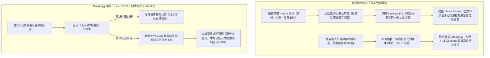
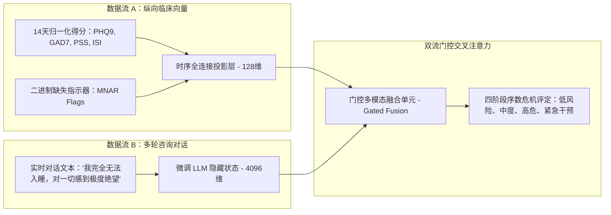

欢迎阅读 **Maeumjigi 毕业设计项目开发日志第24篇**。

继今年6月顺利完成第1学期毕业答辩评审并部署双层安全护栏包装器（Dual-layer Safety Wrapper）之后，我们团队正式进入了 **第2学期（2026秋季学期）** 的工程开发阶段。在第1学期中，我们的工程核心主要集中在大语言模型（LLM）微调（Llama 3.1 8B、Qwen 2.5 32B/7B）、合成对话数据生成以及 Prompt 安全护栏的构建上。

然而，在临床心理学和精神科分诊（Triage）中，对话文本仅仅是诊断线索的一半。患者的危机风险随着时间推移，通过**纵向数值标记物（Longitudinal Numerical Markers）**不断演进——包括患者自评抑郁量表（PHQ-9）、广泛性焦虑量表（GAD-7）、知觉压力量表（PSS）以及失眠严重程度指数（ISI）。

今天的开发日志将详细介绍我们在临床数据工程上的架构突破：摒弃幼稚的常规统计插补方法，构建了一套严格限制在 **14天有效窗口内的末次观测值前移法（LOCF, Last Observation Carried Forward）**，并引入 **信息性缺失（Missing Not at Random / MNAR）指标**。

{/* truncate */}

---

### 1. 临床问题定义：为什么常规统计插补在精神医学中必然失效

在常规机器学习的表格数据处理中，工程师通常习惯采用全局均值填充、K近邻算法（KNN）或无限前向填充（Infinite Forward-fill）来填补缺失的问卷行。

但在心理健康与自杀危机检测流水线中，这种简单假设会导致致命的系统性误判：



在精神医学临床队列中，数据缺失极少属于**完全随机缺失（MCAR, Missing Completely at Random）**。患者未能按时提交每日或每周的心理健康自评，往往直接反映了**行为回避（Behavioral Avoidance）、严重精神运动迟滞（Psychomotor Retardation）或快感缺乏（Anhedonia）**等重度抑郁恶化的核心临床症状。换言之，**数据缺失本身就是极具诊断价值的信号（非随机缺失 / MNAR）**。

---

### 2. 异质心理量表的多通道归一化架构

Maeumjigi 数据集整合了4种评分区间与临床截断值（Cutoff）各不相同的异质心理量表：

| 临床量表 | 原始得分区间 | 核心临床截断值 | 目标诊断领域 | 归一化策略 |
| :--- | :---: | :---: | :--- | :--- |
| **PHQ-9**（患者健康问卷抑郁量表） | 0 – 27 | 10分以上（中度），20分以上（重度） | 重性抑郁障碍 (MDD) | 针对单量表独立 Min-Max 映射至 [0, 1] |
| **GAD-7**（广泛性焦虑障碍量表） | 0 – 21 | 10分以上（中度），15分以上（重度） | 惊恐与广泛性焦虑 | 针对单量表独立 Min-Max 映射至 [0, 1] |
| **PSS**（知觉压力量表） | 0 – 40 | 27分以上（高压力状态） | 慢性心理社会压力 | 针对单量表独立 Min-Max 映射至 [0, 1] |
| **ISI**（失眠严重程度指数） | 0 – 28 | 15分以上（临床失眠症） | 睡眠障碍与生物钟失调 | 针对单量表独立 Min-Max 映射至 [0, 1] |

#### 规避单一合成指标的架构谬误
在早期的学生原型设计中，曾有尝试将4个量表得分简单相加并压缩为 0~1 的单一综合指数。

然而经临床导师评审确认，这彻底摧毁了模型的鉴别诊断能力：**一名处于急性极度惊恐状态（GAD-7: 21分，PHQ-9: 2分）的患者，与一名毫无焦虑但卧床不起的重度迟滞抑郁患者（GAD-7: 0分，PHQ-9: 23分），在简单加权平均值下会得到完全相同的综合评分**。然而惊恐发作与木僵型抑郁在临床危机干预方案上完全不同。因此，Maeumjigi 架构**严格保留了4个独立的输入通道**。

---

### 3. 实现 14天 LOCF 与 MNAR 缺失指标

为了在数据的时效有效性与无响应行为信号之间取得严格平衡，我们使用 Python 实现了以下时序预处理引擎：

```python
# clinical_preprocessor.py - 纵向临床数据预处理引擎
import pandas as pd
import numpy as np

SCALE_BOUNDS = {
    "phq9": (0, 27),
    "gad7": (0, 21),
    "pss": (0, 40),
    "isi": (0, 28)
}

def process_patient_timeline(df: pd.DataFrame, max_locf_days: int = 14) -> pd.DataFrame:
    """
    应用14天有效窗口限制的 LOCF 插补，
    同时为下游神经网络层生成显式的二进制缺失指示器 (MNAR Indicator)。
    """
    df = df.sort_values("timestamp").copy()
    processed_cols = {}

    for scale, (min_val, max_val) in SCALE_BOUNDS.items():
        val_col = f"{scale}_score"
        
        # 1. 保留临床零点基准的 Min-Max 归一化
        norm_series = (df[val_col] - min_val) / (max_val - min_val)
        
        # 2. 限制在14天内的末次观测值前移 (LOCF)
        locf_series = norm_series.ffill(limit=max_locf_days)
        
        # 3. 缺失指标标志：若从未填写或已超过14天失效则为 1.0，有效观测为 0.0
        missing_indicator = locf_series.isna().astype(np.float32)
        
        # 4. 残留缺失值安全填充为 0.0（由于 missing_indicator 存在，模型已知其属于未观测状态）
        final_scores = locf_series.fillna(0.0)
        
        processed_cols[f"{scale}_norm"] = final_scores
        processed_cols[f"{scale}_missing"] = missing_indicator

    return pd.DataFrame(processed_cols, index=df.index)
```

通过这一架构设计：
1. 若患者在5天前提交了问卷，模型接收其归一化得分，此时 `missing_indicator = 0.0`。
2. 若超过14天未提交问卷，特征自动过期并将 `missing_indicator` 翻转为 `1.0`，使危机分类模型能够将长期断更行为直接作为高风险征兆予以评估。

---

### 4. 纵向数值特征与对话大语言模型的多模态融合

在第2学期的生产级系统架构中，经过预处理的临床数值向量并不是孤立运作的。它们通过**多模态交叉注意力融合桥梁（Multi-Modal Cross-Attention Fusion Bridge）**，与微调后的 Qwen 2.5 大语言模型对话隐藏层表征紧密结合：



通过将患者即时的语言诉求与过去14天的临床心理演进轨迹进行联合评估，系统能够彻底根除两类常见失误：因情绪化语言夸张而引发的虚警（False Positive），以及因“微笑抑郁症（Smiling Depression）”而导致的致命漏报（False Negative）。

---

### 5. 第24天核心成果与后续规划

1. **确立信息性缺失 (MNAR) 建模范式**：构建了将问卷未提交视为主动作业预测变量而非单纯噪声的14天 LOCF 预处理流水线。
2. **坚持多量表多通道独立性**：摒弃单一压缩指标的缺陷，完整维护抑郁、焦虑、压力和失眠四大独立维度。
3. **通过指导教授临床技术评审**：提交的设计技术规范书（`문의_위기감지모델_숫자입력_전처리.docx`）在临床与工程严密性上获得高度认可。

在 **开发日志 #25** 中，我们将深入介绍基于标准化精神科临床评估集的 **序数逻辑回归（Ordinal Logistic Regression）与多模态危机分类器** 的基准微调训练成果！

---

### 📌 执行摘要（3–5 行总结）
1. **临床数据工程突破**：在毕业设计第2学期中，从单纯的对话 NLP 迈向多模态精神健康危机评估，构建覆盖 4 种心理量表（PHQ-9、GAD-7、PSS、ISI）的数据预处理流水线。
2. **信息性缺失 (MNAR) 信号化**：将患者未填报问卷的行为建模为关键临床风险特征，引入 14 天上限 LOCF 插补及显式二进制缺失指示器。
3. **保留多通道诊断鉴别力**：采用独立 Min-Max 归一化，坚决规避均值合并，保障对惊恐发作与重度迟滞抑郁的精准临床区分。
4. **多模态交叉注意力融合**：将 14 天纵向数值向量与 LLM 对话表征深度融合，大幅压降危机误报警与漏报风险。

### 参考文献与项目资源
- **项目仓库**：`D:\ai\antigravity\capde\` 与 `mental-health-backend`
- **医学临床文献**：美国国家精神卫生研究所 (NIMH) 评估协议；Informative Missingness in Longitudinal Clinical Trials (Little & Rubin, 2019).
- **所属院系**：首尔科学技术大学 计算机科学与工程系 人工智能毕业设计团队。