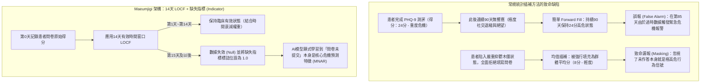
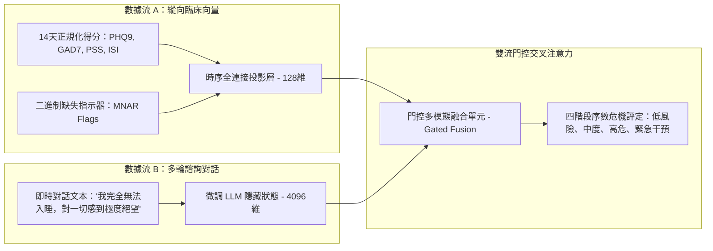

歡迎閱讀 **Maeumjigi 畢業設計項目開發日誌第24篇**。

繼今年6月順利完成第1學期畢業答辯評審並部署雙層安全護欄包裝器（Dual-layer Safety Wrapper）之後，我們團隊正式進入了 **第2學期（2026秋季學期）** 的工程開發階段。在第1學期中，我們工程核心主要集中在大語言模型（LLM）微調（Llama 3.1 8B、Qwen 2.5 32B/7B）、合成對話數據生成以及 Prompt 安全護欄的構建上。

然而，在臨床心理學和精神科分診（Triage）中，對話文本僅僅是診斷線索的一半。患者的危機風險隨著時間推移，通過**縱向數值標記物（Longitudinal Numerical Markers）**不斷演進——包括患者自評抑鬱量表（PHQ-9）、廣泛性焦慮量表（GAD-7）、知覺壓力量表（PSS）以及失眠嚴重程度指數（ISI）。

今天的開發日誌將詳細介紹我們在臨床數據工程上的架構突破：摒棄幼稚的常規統計插補方法，構建了一套嚴格限制在 **14天有效窗口內的末次觀測值前移法（LOCF, Last Observation Carried Forward）**，並引入 **資訊性缺失（Missing Not at Random / MNAR）指標**。

{/* truncate */}

---

### 1. 臨床問題定義：為什麼常規統計插補在精神醫學中必然失效

在常規機器學習的表格數據處理中，工程師通常習慣採用全局均值填充、K近鄰演算法（KNN）或無限前向填充（Infinite Forward-fill）來填補缺失的問卷行。

但在心理健康與自殺危機檢測流水線中，這種簡單假設會導致致命的系統性誤判：



在精神醫學臨床隊列中，數據缺失極少屬於**完全隨機缺失（MCAR, Missing Completely at Random）**。患者未能按時提交每日或每週的心理健康自評，往往直接反映了**行為迴避（Behavioral Avoidance）、嚴重精神運動遲滯（Psychomotor Retardation）或快感缺乏（Anhedonia）**等重度抑鬱惡化的核心臨床症狀。換言之，**數據缺失本身就是極具診斷價值的信號（非隨機缺失 / MNAR）**。

---

### 2. 異質心理量表的多通道正規化架構

Maeumjigi 數據集整合了4種評分區間與臨床截斷值（Cutoff）各不相同的異質心理量表：

| 臨床量表 | 原始得分區間 | 核心臨床截斷值 | 目標診斷領域 | 正規化策略 |
| :--- | :---: | :---: | :--- | :--- |
| **PHQ-9**（患者健康問卷抑鬱量表） | 0 – 27 | 10分以上（中度），20分以上（重度） | 重度抑鬱障礙 (MDD) | 針對單量表獨立 Min-Max 映射至 [0, 1] |
| **GAD-7**（廣泛性焦慮障礙量表） | 0 – 21 | 10分以上（中度），15分以上（重度） | 驚恐與廣泛性焦慮 | 針對單量表獨立 Min-Max 映射至 [0, 1] |
| **PSS**（知覺壓力量表） | 0 – 40 | 27分以上（高壓力狀態） | 慢性心理社會壓力 | 針對單量表獨立 Min-Max 映射至 [0, 1] |
| **ISI**（失眠嚴重程度指數） | 0 – 28 | 15分以上（臨床失眠症） | 睡眠障礙與生物鐘失調 | 針對單量表獨立 Min-Max 映射至 [0, 1] |

#### 規避單一合成指標的架構謬誤
在早期的學生原型設計中，曾有嘗試將4個量表得分簡單相加並壓縮為 0~1 的單一綜合指數。

然而經臨床導師評審確認，這徹底摧毀了模型的鑑別診斷能力：**一名處於急性極度驚恐狀態（GAD-7: 21分，PHQ-9: 2分）的患者，與一名毫無焦慮但臥床不起的重度遲滯抑鬱患者（GAD-7: 0分，PHQ-9: 23分），在簡單加權平均值下會得到完全相同的綜合評分**。然而驚恐發作與木僵型抑鬱在臨床危機干預方案上完全不同。因此，Maeumjigi 架構**嚴格保留了4個獨立的輸入通道**。

---

### 3. 實現 14天 LOCF 與 MNAR 缺失指標

為了在數據的時效有效性與無響應行為信號之間取得嚴格平衡，我們使用 Python 實現了以下時序預處理引擎：

```python
# clinical_preprocessor.py - 縱向臨床數據預處理引擎
import pandas as pd
import numpy as np

SCALE_BOUNDS = {
    "phq9": (0, 27),
    "gad7": (0, 21),
    "pss": (0, 40),
    "isi": (0, 28)
}

def process_patient_timeline(df: pd.DataFrame, max_locf_days: int = 14) -> pd.DataFrame:
    """
    應用14天有效窗口限制的 LOCF 插補，
    同時為下游神經網絡層生成顯式的二進制缺失指示器 (MNAR Indicator)。
    """
    df = df.sort_values("timestamp").copy()
    processed_cols = {}

    for scale, (min_val, max_val) in SCALE_BOUNDS.items():
        val_col = f"{scale}_score"
        
        # 1. 保留臨床零點基準的 Min-Max 正規化
        norm_series = (df[val_col] - min_val) / (max_val - min_val)
        
        # 2. 限制在14天內的末次觀測值前移 (LOCF)
        locf_series = norm_series.ffill(limit=max_locf_days)
        
        # 3. 缺失指標標誌：若從未填寫或已超過14天失效則為 1.0，有效觀測為 0.0
        missing_indicator = locf_series.isna().astype(np.float32)
        
        # 4. 殘留缺失值安全填充為 0.0（由於 missing_indicator 存在，模型已知其屬於未觀測狀態）
        final_scores = locf_series.fillna(0.0)
        
        processed_cols[f"{scale}_norm"] = final_scores
        processed_cols[f"{scale}_missing"] = missing_indicator

    return pd.DataFrame(processed_cols, index=df.index)
```

通過這一架構設計：
1. 若患者在5天前提交了問卷，模型接收其正規化得分，此時 `missing_indicator = 0.0`。
2. 若超過14天未提交問卷，特徵自動過期並將 `missing_indicator` 翻轉為 `1.0`，使危機分類模型能夠將長期斷更行為直接作為高風險徵兆予以評估。

---

### 4. 縱向數值特徵與對話大語言模型的多模態融合

在第2學期的生產級系統架構中，經過預處理的臨床數值向量並不是孤立運作的。它們通過**多模態交叉注意力融合橋樑（Multi-Modal Cross-Attention Fusion Bridge）**，與微調後的 Qwen 2.5 大語言模型對話隱藏層表徵緊密結合：



通過將患者即時的語言訴求與過去14天的臨床心理演進軌跡進行聯合評估，系統能夠徹底根除兩類常見失誤：因情緒化語言誇張而引發的虛警（False Positive），以及因「微笑抑鬱症（Smiling Depression）」而導致的致命漏報（False Negative）。

---

### 5. 第24天核心成果與後續規劃

1. **確立資訊性缺失 (MNAR) 建模範式**：構建了將問卷未提交視為主動作業預測變量而非單純噪聲的14天 LOCF 預處理流水線。
2. **堅持多量表多通道獨立性**：摒棄單一壓縮指標的缺陷，完整維護抑鬱、焦慮、壓力和失眠四大獨立維度。
3. **通過指導教授臨床技術評審**：提交的設計技術規範書（`문의_위기감지모델_숫자입력_전처리.docx`）在臨床與工程嚴密性上獲得高度認可。

在 **開發日誌 #25** 中，我們將深入介紹基於標準化精神科臨床評估集的 **序數邏輯迴歸（Ordinal Logistic Regression）與多模態危機分類器** 的基準微調訓練成果！

---

### 📌 執行摘要（3–5 行總結）
1. **臨床數據工程突破**：在畢業設計第2學期中，從單純的對話 NLP 邁向多模態精神健康危機評估，構建覆蓋 4 種心理量表（PHQ-9、GAD-7、PSS、ISI）的數據預處理流水線。
2. **資訊性缺失 (MNAR) 信號化**：將患者未填報問卷的行為建模為關鍵臨床風險特徵，引入 14 天上限 LOCF 插補及顯式二進制缺失指示器。
3. **保留多通道診斷鑑別力**：採用獨立 Min-Max 正規化，堅決規避均值合併，保障對驚恐發作與重度遲滯抑鬱的精準臨床區分。
4. **多模態交叉注意力融合**：將 14 天縱向數值向量與 LLM 對話表徵深度融合，大幅壓降危機誤報警與漏報風險。

### 參考文獻與項目資源
- **項目倉庫**：`D:\ai\antigravity\capde\` 與 `mental-health-backend`
- **醫學臨床文獻**：美國國家精神衛生研究所 (NIMH) 評估協議；Informative Missingness in Longitudinal Clinical Trials (Little & Rubin, 2019).
- **所屬院系**：首爾科技大學 計算機科學與工程系 人工智能畢業設計團隊。