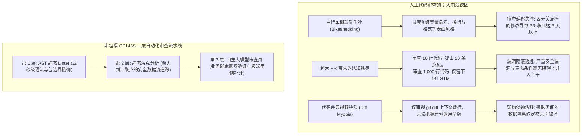
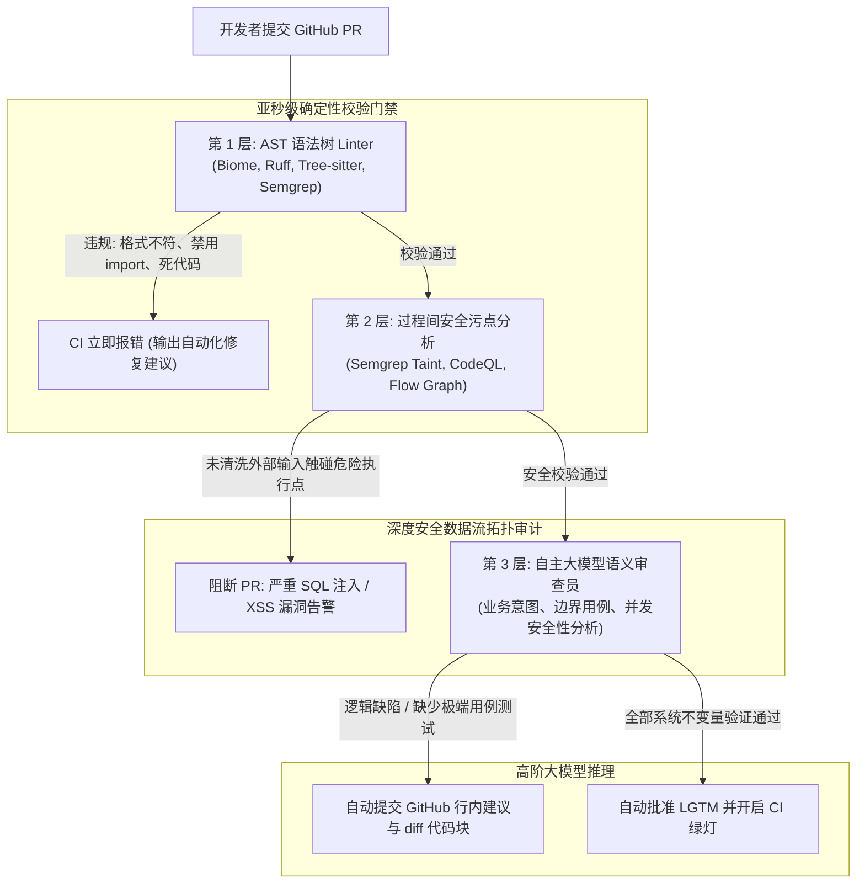

欢迎来到**斯坦福大学 CS146S（现代软件开发者：The Modern Software Developer）**系列深度解析第7讲。

在上一节课中，我们探讨了基于 eBPF 内核动态追踪与 AI SRE 智能体的生产环境实时故障自愈。然而正如资深技术工程专家所共识的那样：**最具成本效益的 Bug，是从一开始就未曾被合并入主干分支的代码缺陷**。

在高速演进的技术组织中，Pull Request（PR）代码审查是捍卫软件质量、安全红线与架构一致性的核心闸口。然而随着团队规模的扩张，完全依赖人工的人际代码审查必然退化为严重的组织效能瓶颈。资深工程师每周被迫花费 15 至 20 小时审查代码差异，将宝贵的认知精力消耗在缩进、命名规范、导入顺序等细枝末节的琐碎争论（Bikeshedding）上；而面对 1,000 行以上的超大 PR 时，又因**审查疲劳（Review Fatigue）**而不得不草草留下“LGTM（看起来不错）”，从而将并发竞态、SQL 注入及架构分层破坏等致命问题放行至生产环境。

在今天的课程中，斯坦福大学教学团队揭示了**大规模自动化代码审查（Automated Code Review at Scale）**的工程范式。通过构建融合 **抽象语法树（AST）Linter**、**过程间安全污点分析（Taint Analysis）** 与 **自主大模型 PR 审查员** 的三层防御体系，现代工程团队能够削减 90% 的机械审查负担，同时大幅提升关键漏洞的拦截率。

{/* truncate */}

---

### 1. 代码审查危机：人工审查在工程规模化下的必然崩溃

当数十个分布式团队向庞大代码库持续提交变更时，纯人工审查面临三大结构性失效：



1. **琐碎争执（Bikeshedding）与心理内耗**：人类天生倾向于对直观易懂的表面格式吹毛求疵，而非深入推导复杂的并发状态不变量。这种审查模式引发开发者之间的对立情绪，严重拖慢迭代周期。
2. **审查疲劳与“400行法则”**：实证软件工程研究表明，当 PR 超过 400 行时，人类缺陷检出率呈现断崖式下跌。面对 1,000 行的变更，审查者在认知超载下往往直接盲目合入。
3. **Diff 视野局限（Diff Myopia）**：GitHub 的 diff 视图默认仅展示修改行周围的数行上下文。审查者的大脑无法在脑海中追踪该改动是否会破坏五个调用层级之上的全局不变量。

---

### 2. 三层自动化代码审查架构

为了将工程师从机械审查中解脱并构筑无懈可击的代码防线，斯坦福 CS146S 确立了**三层审查阶梯架构（Tri-Tier Review Hierarchy）**：



#### 各层职责与边界清晰划分：
1. **第 1 层：AST 语法树 Linter（耗时：< 500ms）**
   - **工具链**：Tree-sitter, Biome, Ruff, Semgrep OSS。
   - **核心职责**：基于 AST 拓扑匹配执行格式化、死代码清除、命名规范及架构边界约束（如严格禁止 UI 视图层直接 import 数据库 ORM 实体）。
   - **斯坦福工程铁律**：**凡是 Linter 能自动判定的规则，人类绝对不要在审查中做任何评论。** 若人工审查中出现了代码格式建议，说明工程组织未能将该规则内化为第 1 层门禁。
2. **第 2 层：过程间安全污点分析（耗时：5s – 30s）**
   - **工具链**：Semgrep Pro, CodeQL, 静态数据流分析引擎。
   - **核心职责**：追踪不受信任的外部用户输入（“源点 / Sources”，如 HTTP 参数或请求头）沿函数调用链传播至高危执行点（“汇聚点 / Sinks”，如 `exec()` 或未经参数化的原始 SQL 语句）。
   - **强制原则**：若传播链路上缺乏经数学验证的清洗函数（Sanitizer），PR 将被立即挂起阻断。
3. **第 3 层：自主大模型语义审查员（耗时：15s – 60s）**
   - **推理引擎**：Claude 3.5 Sonnet, GPT-4o, 专用微调模型。
   - **核心职责**：评估复杂的业务逻辑契约、多线程竞态条件、向后兼容性以及极端用例的测试覆盖率。
   - **交付产物**：输出包含完整替换代码的 GitHub 行内修改建议块（````suggestion`），开发者可一键应用合并。

---

### 3. 安全污点分析（Taint Analysis）的数学底座

在第 2 层中，静态分析引擎如何通过数学模型形式化证明外部输入不可能触发漏洞？

斯坦福 CS146S 采用**有界格数据流分析（Bounded Lattice Dataflow Analysis）**：

``\mathcal{S} \xrightarrow{\text{Dataflow Edge } e} \mathcal{T} \quad \text{where } \text{Taint}(\mathcal{T}) = \begin{cases} \text{Clean} & \text{if } f_{\text{sanitizer}}(x) \in \text{Path}(\mathcal{S}, \mathcal{T}) \\ \text{Tainted} & \text{otherwise} \end{cases}``

```mermaid
flowchart LR
    Source["源点 (不受信输入)<br/>req.body.searchQuery"] -->|数据传递| VarA["let query = searchQuery.trim()"]
    VarA -->|数据流| Sanitizer{"是否存在清洗函数?<br/>例如: db.escape()"}
    
    Sanitizer -->|否 (直接字符串拼接)| Sink["汇聚点 (危险执行点)<br/>db.raw('SELECT * FROM users WHERE name = ' + query)"]
    Sink --> Alert["严重安全告警: 截获 SQL 注入高危漏洞"]
    
    Sanitizer -->|是 (参数化预编译绑定)| SafeSink["安全汇聚点<br/>db.query('SELECT * FROM users WHERE name = $1', [query])"]
```

#### 大模型在污点分析中的协同增强：
传统静态污点分析器在遇到开发者编写的**自定义清洗逻辑**（如自研复杂正则替换）时往往产生大量误报。在斯坦福架构中，当检测到可疑路径时，系统会将该清洗片段派发给大模型进行语义判定：“该自定义过滤函数能否在所有 Unicode 编码形态下彻底中和 SQL 注入风险？”

---

### 4. 工程实战：使用 Python 构建 GitHub PR 自动审查机器人

以下是基于 Python 实现的 PR 自动化审查调度脚本，集成了 AST 差异分析与大模型行内精准建议输出：

```python
# pr_review_bot.py - 3层自动化 Pull Request 审查调度引擎
import asyncio
import os
from typing import List, Optional
from pydantic import BaseModel, Field

class InlineReviewComment(BaseModel):
    file_path: str
    line_number: int
    severity: str = Field(pattern="^(CRITICAL|WARNING|SUGGESTION)$")
    critique: str
    suggested_diff: Optional[str] = None

class PRReviewSummary(BaseModel):
    pr_id: int
    verdict: str = Field(pattern="^(APPROVE|REQUEST_CHANGES|COMMENT)$")
    architectural_summary: str
    inline_comments: List[InlineReviewComment]

class AutonomousPRReviewer:
    def __init__(self, llm_client, semgrep_runner):
        self.llm = llm_client
        self.semgrep = semgrep_runner

    async def review_pull_request(self, pr_id: int, pr_diff: str, repo_context: str) -> PRReviewSummary:
        print(f"[PR-BOT] 正在启动 PR #{pr_id} 自动化审查流水线...")

        # 步骤 1: 调用 Semgrep 执行第 1、2 层的 AST 与污点审计
        print("[PR-BOT] 正在运行第 1 层 AST 语法检查与第 2 层安全污点分析...")
        taint_findings = await self.semgrep.run_taint_audit(pr_diff)
        
        # 步骤 2: 构建第 3 层大模型结构化语义审查提示词
        system_prompt = """
        你是一名要求极其严谨的首席软件架构师，正在执行 GitHub PR 评审。
        严格遵从斯坦福 CS146S 审查教条：
        1. 严禁对排版格式、缩进、命名等低级风格指手画脚（Linter 已全量覆盖）。
        2. 重点审查并发竞态、空指针边界、O(N^2) 性能退化及架构跨层违规。
        3. 对发现的每一个实质缺陷，必须提供可一键应用的 GitHub 行内 diff 替换建议块。
        """

        user_prompt = f"""
        [PULL REQUEST #{pr_id} 代码变动 DIFF]
        {pr_diff}

        [静态污点分析审计结论]
        {taint_findings}

        [代码仓库架构上下文]
        {repo_context}

        请严格评估并返回符合 PRReviewSummary 定义的结构化 JSON 审查报告。
        """

        print("[PR-BOT] 正在触发第 3 层大模型深度语义推演...")
        review_result: PRReviewSummary = await self.llm.generate_structured(
            system_prompt=system_prompt,
            user_prompt=user_prompt,
            schema=PRReviewSummary
        )

        return review_result

    def post_to_github(self, review: PRReviewSummary):
        """通过 GitHub PR API 自动回写行内建议与最终裁决"""
        print(f"\n================ [GITHUB PR #{review.pr_id} 审查裁决: {review.verdict}] ================")
        print(f"架构总结: {review.architectural_summary}\n")
        for comment in review.inline_comments:
            print(f"[{comment.severity}] {comment.file_path}:{comment.line_number}")
            print(f"审查意见: {comment.critique}")
            if comment.suggested_diff:
                print("替换代码建议:")
                print(comment.suggested_diff)
            print("-" * 60)
```

---

### 5. 第7讲核心精要与后续规划

1. **机械检查彻底交予系统门禁**：通过亚秒级 AST Linter 拦截全部格式与架构引用越界，避免人为消耗。
2. **污点分析严守安全红线**：利用数学格模型建立端到端数据流审计，杜绝危险输入触碰系统执行点。
3. **大模型聚焦高阶逻辑不变量**：将大模型定位于资深同行审查者，专注于死锁、业务漏洞推导及代码一键修复生成。

在**第8讲**中，我们将全面探讨 **AI 原生软件架构与重构：单体服务解耦、语义技术债（Semantic Debt）治理与大规模自动化迁移**！

---

### 📌 执行摘要（3–5 行总结）
1. **破解代码审查规模瓶颈**：通过三层自动化代码审查流水线，彻底破除琐碎风格争辩（Bikeshedding）与大 PR 审查疲劳困局。
2. **AST 与污点分析自动化拦截**：利用亚秒级 AST 解析器固化语法规范，结合源点-汇聚点数据流追踪在合并前数学阻断注入漏洞。
3. **大模型赋能高阶语义审查**：将大模型部署于业务逻辑推演、并发安全性核验与可一键合并的代码 diff 补丁生成。
4. **研发生产力指数级跃迁**：将机械审查工作全面移交 CI 门禁，将 PR 合并周期压缩高达 70%，并显著拔高缺陷拦截准确率。

### 参考文献与斯坦福 CS146S 课程信息
- **课程全称**：Stanford CS146S (The Modern Software Developer), Fall 2026.
- **教学单位**：斯坦福大学计算机科学系.
- **关联框架与技术**：Tree-sitter, Semgrep, CodeQL, Biome, GitHub Copilot PR Reviewer.
