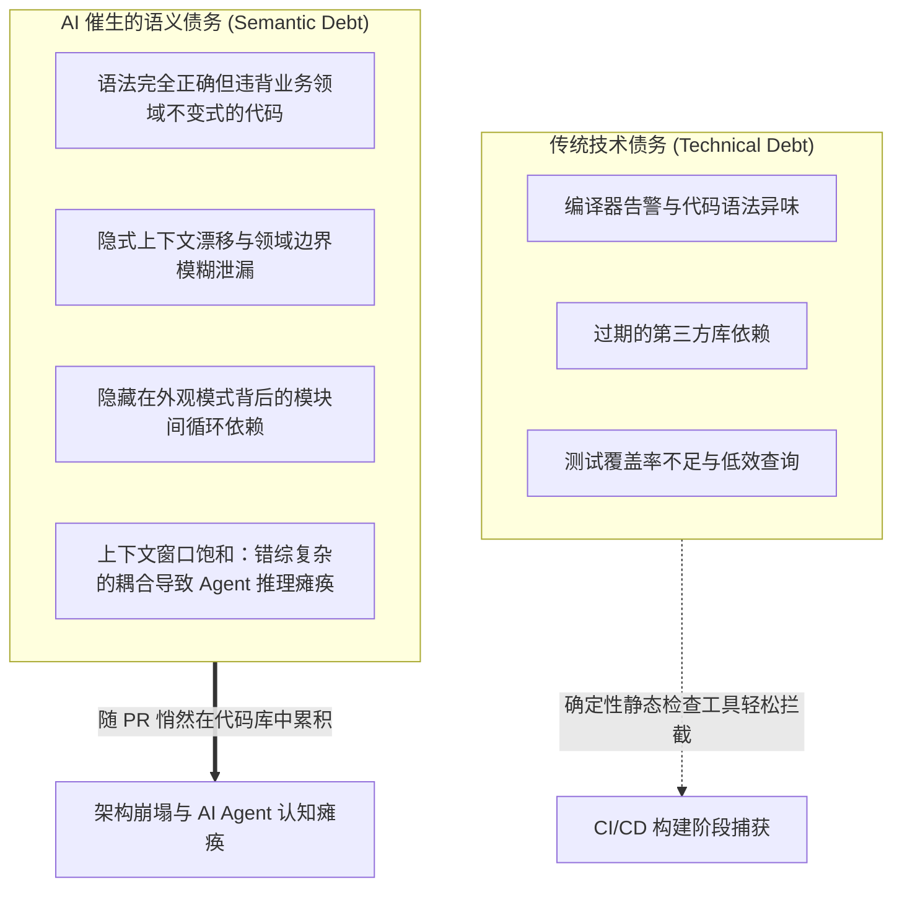
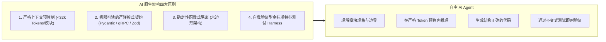

欢迎阅读斯坦福大学最新前沿软件工程课程 **CS146S: The Modern Software Developer（现代软件开发者）** 技术解析系列第八篇。

在前七讲中，我们先后探讨了代码大模型的 Prompt 工程（第 2 讲）、基于 Model Context Protocol（MCP）的自主工具调用（第 3 讲）、自愈式测试 Harness（第 4 讲）、多 Agent 群体协作编排（第 5 讲）、基于 eBPF 的生产环境动态追踪（第 6 讲）以及结合 AST 静态分析与污点分析的自动化代码审查（第 7 讲）。

进入**第 8 讲**，课程直击高阶工程团队在生产代码库中规模化引入 AI Agent 后必须面对的结构性挑战：**“我们应如何构建能被 AI Agent 自主探索、理解与重构的软件架构？又该如何利用 AI Agent 安全地拆解具有十年历史的复杂遗留单体系统？”**

斯坦福团队在讲座中首次形式化定义了**语义债务（Semantic Debt）**的数学与工程机理，提出了**AI 原生架构的四大不变原则**，并提供了一套基于 **AST 依赖图分析的自动化单体解耦**实战方案。

{/* truncate */}

---

### 1. 速度的悖论：技术债务 vs. 语义债务 (Semantic Debt)

传统软件工程通过**技术债务（Technical Debt）**来度量代码库的健康度：陈旧的第三方依赖、低效的 SQL 查询、缺失的单元测试以及各类代码异味（Code Smells）。这些问题能被静态 Linter 和 APM 准确捕捉。

然而，当自主代码生成 Agent 全面接入开发流程后，开发速度呈指数级爆发，但也催生了一种更为隐蔽的系统性危机：**语义债务（Semantic Debt）**。



#### 何为语义债务？
语义债务是指由 LLM 生成的代码**在语法上完美无瑕、且能通过局部的单元测试，但在全局架构层面破坏了系统的核心业务不变式，导致隐式耦合急剧上升，模块边界全面瓦解**：
1. **上下文窗口饱和 (Context Window Saturation)**：一个订单取消函数的修改，因隐式循环数据库查询而牵扯到结算、库存、通知三个模块，导致 Agent 必须阅读超过 10 万 Token 的代码，不可避免地产生严重幻觉。
2. **概念碎片化 (Concept Fragmentation)**：不同开发者在不同提示词下生成的代码，使同一业务状态（如用户活跃状态）在代码库中并存着枚举比较、位运算和布尔方法三种割裂的实现。
3. **幽灵抽象 (Ghost Abstractions)**：AI Agent 为快速满足局部需求，频繁引入与实际领域模型无关的空洞封装层，使依赖图变得极其紊乱。

---

### 2. AI 原生软件架构的四大不变原则

为了确保软件系统在长周期内持续被人类与 AI Agent 协同维护，斯坦福 CS146S 提出了 **AI 原生架构（AI-Native Architecture）**：

它指的不是“调用了 AI API 的系统”，而是**在底层架构上专为自主 AI Agent 的观察、修改与验证而设计的软件系统**。



1. **严格上下文预算制 (Strict Context Budgeting)**：每个自治模块、服务或有界上下文（Bounded Context），必须能在 **32k Token** 预算内被完整理解（包含模型、逻辑与测试）。超出该预算即视为边界失效，必须拆解。
2. **机器可读的显式模式契约 (Explicit Schema Contracts)**：全面废除含糊的自然语言文档，采用 TypeScript/Zod、Python/Pydantic、Protobuf 或 OpenAPI 3.1 定义强类型接口，并在数据层内置前置断言与不变式。
3. **六边形架构隔离 (Ports & Adapters)**：将纯粹的业务领域计算与产生副作用的 I/O（数据库、外部 API、消息队列）严格解耦。Agent 仅在纯函数式领域核心中重构代码，杜绝外部副作用污染。
4. **金标准特征测试 (Golden Master Characterization Tests)**：在重构前捕获生产环境数万条真实的请求入参和输出快照，作为 Agent 重构时的绝对基准真理（Ground Truth）。

---

### 3. 基于 AST 的单体系统自动化解耦

面对上百万行的遗留企业单体系统，斯坦福 CS146S 明确反对高风险的人工重写，推崇**基于 AST（抽象语法树）的自主解耦流水线**：
1. **AST 调用图构建与强连通分量（SCC）解环**：利用 Tarjan 算法分析依赖图中的环形依赖（`A \to B \to A`），优先注入事件驱动或依赖注入解开耦合。
2. **自动生成接口外观层 (Interface Facade)**：AI Agent 自动提取目标服务的外观接口，重写外部调用路径。
3. **影子双轨运行验证 (Shadow Dual-Run)**：复制真实只读流量并发路由至旧单体与新解耦模块，经 10 万次严格比对后实现零停机无缝切换。

---

### 4. 实战脚本：AST 依赖图分析与环形引用检测器

```python
"""
ast_dependency_analyzer.py
斯坦福 CS146S - 自主架构重构工具包
基于 Python AST 解析依赖图，采用 Tarjan 算法检测环形强连通分量，
并评估 AI Agent 的上下文 Token 预算。
"""

import ast
import os
import sys
from typing import Dict, Set, List
from collections import defaultdict


class DependencyVisitor(ast.NodeVisitor):
    def __init__(self, current_module: str):
        self.current_module = current_module
        self.dependencies: Set[str] = set()

    def visit_Import(self, node: ast.Import):
        for alias in node.names:
            self.dependencies.add(alias.name.split('.')[0])
        self.generic_visit(node)

    def visit_ImportFrom(self, node: ast.ImportFrom):
        if node.module:
            self.dependencies.add(node.module.split('.')[0])
        self.generic_visit(node)


class CodebaseGraphAnalyzer:
    def __init__(self, root_dir: str):
        self.root_dir = root_dir
        self.graph: Dict[str, Set[str]] = defaultdict(set)
        self.module_token_estimates: Dict[str, int] = {}

    def scan_codebase(self) -> None:
        for root, _, files in os.walk(self.root_dir):
            for file in files:
                if file.endswith('.py') and not file.startswith('__'):
                    filepath = os.path.join(root, file)
                    rel_path = os.path.relpath(filepath, self.root_dir)
                    module_name = rel_path.replace(os.path.sep, '.').replace('.py', '')

                    try:
                        with open(filepath, 'r', encoding='utf-8') as f:
                            content = f.read()
                            self.module_token_estimates[module_name] = len(content) // 4
                            tree = ast.parse(content, filename=filepath)

                        visitor = DependencyVisitor(module_name)
                        visitor.visit(tree)

                        for dep in visitor.dependencies:
                            if dep != module_name and os.path.exists(os.path.join(self.root_dir, dep + '.py')):
                                self.graph[module_name].add(dep)
                    except Exception as err:
                        print(f"Warning: 解析失败 {filepath}: {err}", file=sys.stderr)

    def find_strongly_connected_components(self) -> List[List[str]]:
        index = 0
        indices: Dict[str, int] = {}
        lowlinks: Dict[str, int] = {}
        on_stack: Dict[str, bool] = defaultdict(bool)
        stack: List[str] = []
        sccs: List[List[str]] = []

        nodes = list(self.graph.keys())
        for node in self.graph:
            for dep in self.graph[node]:
                if dep not in nodes:
                    nodes.append(dep)

        def strongconnect(node: str):
            nonlocal index
            indices[node] = index
            lowlinks[node] = index
            index += 1
            stack.append(node)
            on_stack[node] = True

            for successor in self.graph.get(node, []):
                if successor not in indices:
                    strongconnect(successor)
                    lowlinks[node] = min(lowlinks[node], lowlinks[successor])
                elif on_stack[successor]:
                    lowlinks[node] = min(lowlinks[node], indices[successor])

            if lowlinks[node] == indices[node]:
                scc = []
                while True:
                    w = stack.pop()
                    on_stack[w] = False
                    scc.append(w)
                    if w == node:
                        break
                if len(scc) > 1:
                    sccs.append(scc)

        for node in nodes:
            if node not in indices:
                strongconnect(node)

        return sccs

    def evaluate_ai_native_readiness(self, max_context_tokens: int = 8000) -> None:
        print("=" * 70)
        print("斯坦福 CS146S - AI 原生架构就绪度评估报告")
        print("=" * 70)

        sccs = self.find_strongly_connected_components()
        if sccs:
            print(f"⚠️  警告: 检测到 {len(sccs)} 个循环依赖强连通分量！")
            for idx, cycle in enumerate(sccs, 1):
                print(f"   集群 #{idx} (在 Agent 重构前必须解耦):")
                print(f"   --> {' <---> '.join(cycle)}")
        else:
            print("✅ 纯净架构: 未检测到任何循环依赖。")

        print("\n📊 上下文预算评估 (目标: 单模块 < 8,000 Token):")
        oversized = []
        for mod, tokens in sorted(self.module_token_estimates.items(), key=lambda x: x[1], reverse=True):
            status = "✅ 合格" if tokens <= max_context_tokens else "❌ 超标 (语义债务风险)"
            print(f" - {mod:&lt;35} : ~{tokens:>5} tokens [{status}]")
            if tokens > max_context_tokens:
                oversized.append((mod, tokens))

        if oversized:
            print(f"\n🚨 处置建议: {len(oversized)} 个模块超过单次 Prompt 上下文预算，建议利用绞杀者模式分解。")
        print("=" * 70)


if __name__ == "__main__":
    analyzer = CodebaseGraphAnalyzer(os.path.dirname(os.path.abspath(__file__)))
    analyzer.scan_codebase()
    analyzer.evaluate_ai_native_readiness()
```

---

### 5. 核心结论与下讲预告

1. **规避速度陷阱**：单纯追求代码生成速度而不设架构边界，必将导致语义债务泛滥，终结于 LLM 上下文饱和。
2. **顺应 Agent 认知规律设计**：确立严格上下文预算（< 32k Token）、显式模式契约与六边形纯净领域核心。
3. **借助 AST 依赖图科学解耦**：采用 Tarjan 算法排除循环强连通分量，借助影子运行实现遗留单体的零停机解构。

在**第 9 讲**中，我们将探索**自主测试驱动开发（ATDD）与形式化验证：结合 Z3 SMT 约束求解器与基于属性测试（PBT）证明 LLM 生成代码的数学完备性**。

---

### 📌 3–5 行要点速览
1. **形式化定义语义债务**：揭示了 AI 高速生成代码导致全局不变量瓦解、隐式耦合激增及 Agent 推理瘫痪的机理。
2. **确立 AI 原生架构四大准则**：提出上下文预算制（< 32k Token）、强类型契约、六边形副作用隔离与金标准测试。
3. **创立 AST 驱动自主解耦路径**：借助 AST 调用图分析、Tarjan 强连通分量消解与影子双轨无缝割接单体系统。
4. **提供全功能 Python 诊断套件**：实现了自动扫描依赖网络、捕获循环依赖及测算上下文预算的开箱即用脚本。

### 参考文献与斯坦福资料
- **课程**: Stanford CS146S (The Modern Software Developer), Fall 2026.
- **院系**: 斯坦福大学计算机科学系 (Department of Computer Science).