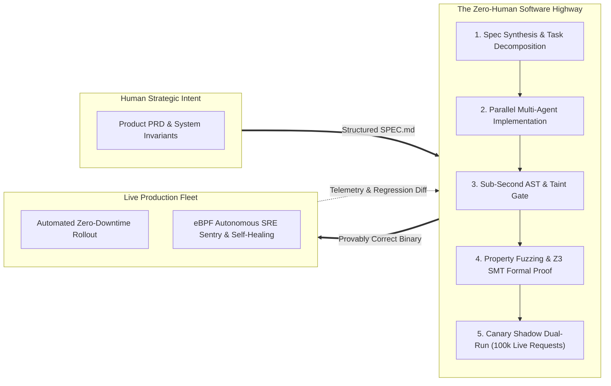
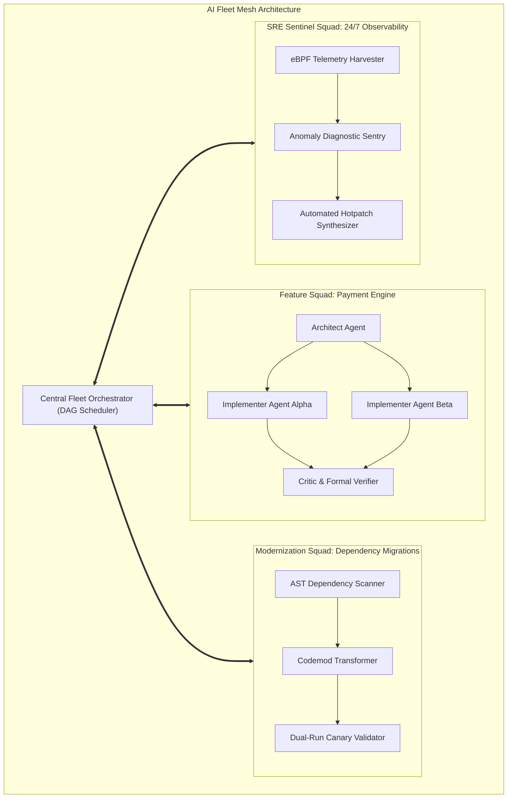
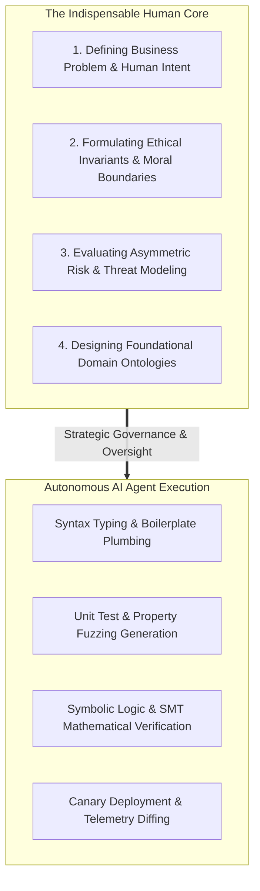

Welcome to the **tenth and final installment** of our comprehensive engineering series analyzing **Stanford University's CS146S: The Modern Software Developer**.

Over the preceding nine lectures, we dismantled the traditional paradigm of software development piece by piece:
- **Lecture 1**: The transition from syntax typist to system conductor.
- **Lecture 2**: Probabilistic token mechanics and prompt engineering.
- **Lecture 3**: Standardized tool execution via the Model Context Protocol (MCP).
- **Lecture 4**: Spec-Driven Development (SDD) and self-healing test loops.
- **Lecture 5**: Multi-agent swarms using the Architect-Implementer-Critic pattern.
- **Lecture 6**: Runtime dynamic tracing and incident mitigation with eBPF.
- **Lecture 7**: AST-aware linters and security taint analysis in CI/CD.
- **Lecture 8**: AI-native modularity, context budgets, and monolith decoupling.
- **Lecture 9**: Property-based invariants and mathematical proofs with Z3 SMT solvers.

In this **Capstone Finale**, the Stanford curriculum synthesizes these modular disciplines into a singular, unified vision: **The Autonomous Software Factory**. We explore how modern high-velocity organizations govern fleets of hundreds of concurrent AI agents, engineer zero-human continuous deployment pipelines, and define the enduring, indispensable role of the human engineer in an age of automated intelligence.

{/* truncate */}

---

### 1. The Zero-Human Continuous Deployment Pipeline: "Dark Factories" for Code

In manufacturing, a "Dark Factory" refers to an industrial production facility that operates fully automated with zero human labor on the factory floor, requiring neither lighting nor human climate control. 

Stanford CS146S introduces the software engineering equivalent: **The Zero-Human Deployment Highway**.



#### The 5 Automated Verification Gates
In a zero-human deployment pipeline, code is never committed to production based on subjective peer review or blind trust. Instead, code traverses five deterministic, machine-enforced gates:
1. **Contract Invariant Gate**: The PR must compile against strict machine-readable schemas (OpenAPI 3.1, Protobuf, Pydantic) with zero type hallucinations.
2. **Structural & Security AST Gate**: Sub-second AST parsers verify architectural boundary rules (no circular imports, context budget < 32k tokens) and execute taint analysis to guarantee that untrusted inputs cannot reach dangerous sinks.
3. **Stochastic Property-Based Gate (PBT)**: Hypothesis engines execute 100,000 randomized test cases over algebraic invariants (idempotence, round-trip symmetry).
4. **Mathematical SMT Theorem Prover Gate**: The Z3 SMT solver converts code semantics into first-order logic, returning `UNSAT` to prove the mathematical absence of integer overflows, deadlock races, or state invariant breaches.
5. **Shadow Dual-Run Canary Gate**: Production traffic is duplicated into an isolated sandbox where the refactored code executes alongside legacy services. If output telemetry matches across 100,000 live requests with identical latency, traffic switches automatically.

If any gate fails, the system does not page an on-call human. Instead, it extracts the minimal counterexample, feeds it into the autonomous agent swarm, synthesizes a patch, and re-executes the pipeline.

---

### 2. Fleet Orchestration: Managing 1,000 Concurrent AI Agents

As engineering organizations scale, they transition from a single developer chatting with a single AI assistant to orchestrating **Fleets of Autonomous AI Agents** working simultaneously across thousands of micro-repositories.



#### Key Challenges in AI Fleet Governance
1. **Context Drift & Semantic Collisions**: When 20 implementer agents modify adjacent modules concurrently, local diffs succeed but global abstractions drift. Fleet orchestrators enforce **Distributed Blackboard Architectures**, where agents publish immutable state events to a shared message bus.
2. **Token Economics & Compute Allocation**: Not all tasks justify expensive reasoning models. Fleet schedulers employ tiered routing: lightweight 8B parameter models for AST linting and boilerplate generation, mid-tier models for property test synthesis, and deep reasoning models (Claude 3.7 Sonnet, o3-mini) strictly for architectural decomposition and SMT invariant synthesis.
3. **Byzantine Agent Faults & Consensus**: When agents hallucinate conflicting architectural decisions, the orchestrator triggers majority-voting consensus protocols or falls back to formal contract specifications.

---

### 3. The Self-Evolving Codebase: Autonomous Continuous Modernization

In legacy software organizations, technical debt accumulates because engineers are perpetually pressured to deliver features rather than upgrade libraries, refactor deprecations, or optimize database indices.

Stanford CS146S demonstrates how AI fleets enable **The Self-Evolving Codebase**:
- **Continuous Overnight Upgrades**: When a new major version of Python, React, or Go is released, autonomous modernization agents wake up in isolated branches, parse breaking changelogs, run AST codemods, update deprecated APIs, satisfy test suites, verify shadow runs, and merge production-ready PRs before human engineers begin their workday.
- **Dynamic Performance Optimization**: Combining eBPF runtime profiling (Lecture 6) with AST refactoring (Lecture 8), sentinel agents identify hot CPU code paths, generate vector-optimized C/Rust extensions, formally verify algorithmic equivalence, and deploy runtime hotpatches.

---

### 4. The Redefined Role of the Human Engineer: From Typist to System Governor

Does the rise of autonomous software factories render the human software engineer obsolete? 

Stanford CS146S answers with an emphatic **NO**. The engineer’s role is elevated to the highest leverage position in history: **The System Governor and Chief Architect**.



#### What Remains Uniquely Human?
1. **Problem Definition ("Why" and "What")**: AI agents excel at optimizing toward a defined loss function or specification; they cannot determine which human problems are worth solving.
2. **Ethical Constraints & Moral Trade-offs**: In credit underwriting, autonomous healthcare, and criminal justice, balancing accuracy against fairness, privacy, and systemic bias requires human ethical judgment.
3. **Asymmetric Risk Management**: Determining how much risk an organization should accept when deploying high-stakes infrastructure is fundamentally a business and legal decision.
4. **Domain Ontology Architecture**: Defining the core entities, boundaries, and language of a business domain remains a deeply creative human endeavor.

The developer who spent 40 hours a week typing boilerplate Java syntax is being replaced. In their place stands the **Modern Software Developer**: an engineer who commands a fleet of intelligent agents, enforces mathematical guarantees, and designs resilient distributed architectures.

---

### 5. Executable Blueprint: Autonomous Fleet Orchestrator & Deployment Gatekeeper

Below is an executable Python framework simulating the multi-tier gatekeeper that governs autonomous AI agent PRs. It validates schema invariants, runs property checks, and simulates shadow dual-run deployment.

```python
"""
autonomous_fleet_gatekeeper.py
Stanford CS146S - Capstone Final Toolkit
Simulates an Autonomous Software Factory Gatekeeper that evaluates
AI-generated pull requests across Contract, AST, Property, and Shadow gates
before permitting zero-human production deployment.
"""

import time
import sys
from typing import Dict, Any, List


class VerificationGate:
    def __init__(self, name: str):
        self.name = name

    def evaluate(self, pr_payload: Dict[str, Any]) -> bool:
        raise NotImplementedError


class SchemaContractGate(VerificationGate):
    def evaluate(self, pr_payload: Dict[str, Any]) -> bool:
        print(f"[{self.name}] Validating machine-readable schema contracts...")
        # Check strict typing and explicit interface definitions
        has_schema = pr_payload.get("has_schema_contract", False)
        tokens = pr_payload.get("context_tokens", 0)
        if not has_schema:
            print(f" ❌ Failed: Missing machine-readable contract (Pydantic/Protobuf).")
            return False
        if tokens > 32000:
            print(f" ❌ Failed: Context tokens ({tokens}) exceed module budget (&lt;32k).")
            return False
        print(f" ✅ Passed: Explicit schema verified. Context budget: {tokens} tokens.")
        return True


class ASTSecurityGate(VerificationGate):
    def evaluate(self, pr_payload: Dict[str, Any]) -> bool:
        print(f"[{self.name}] Executing AST taint analysis and cyclic dependency scan...")
        taint_leaks = pr_payload.get("taint_violations", 0)
        cyclic_sccs = pr_payload.get("cyclic_dependencies", 0)
        if taint_leaks > 0:
            print(f" ❌ Failed: Detected {taint_leaks} untrusted taint dataflow leak(s).")
            return False
        if cyclic_sccs > 0:
            print(f" ❌ Failed: Detected {cyclic_sccs} cyclic dependency cluster(s).")
            return False
        print(" ✅ Passed: Sub-second AST scan clean. Zero security taint leaks.")
        return True


class PropertyVerificationGate(VerificationGate):
    def evaluate(self, pr_payload: Dict[str, Any]) -> bool:
        print(f"[{self.name}] Running 100,000 Hypothesis property fuzzing iterations...")
        pbt_passed = pr_payload.get("pbt_passed", False)
        smt_proved = pr_payload.get("smt_proved", False)
        if not pbt_passed:
            print(" ❌ Failed: Algebraic invariant violated (minimal counterexample extracted).")
            return False
        if not smt_proved:
            print(" ❌ Failed: Z3 SMT solver returned SAT (counterexample model found).")
            return False
        print(" ✅ Passed: 100% state-space invariant proven by Z3 (UNSAT).")
        return True


class ShadowDualRunGate(VerificationGate):
    def evaluate(self, pr_payload: Dict[str, Any]) -> bool:
        print(f"[{self.name}] Executing shadow dual-run on 100,000 live replicated requests...")
        diff_count = pr_payload.get("shadow_diff_count", 0)
        latency_drift_pct = pr_payload.get("latency_drift_pct", 0.0)
        if diff_count > 0:
            print(f" ❌ Failed: {diff_count} telemetry mismatch(es) detected in shadow execution.")
            return False
        if latency_drift_pct > 5.0:
            print(f" ❌ Failed: Latency regression of {latency_drift_pct}% exceeds 5% SLA.")
            return False
        print(f" ✅ Passed: Zero diffs across 100,000 requests. Latency drift: {latency_drift_pct}%.")
        return True


class AutonomousDeploymentOrchestrator:
    def __init__(self):
        self.pipeline: List[VerificationGate] = [
            SchemaContractGate("Gate 1: Contract Schema"),
            ASTSecurityGate("Gate 2: AST & Taint Analysis"),
            PropertyVerificationGate("Gate 3: PBT & Z3 Formal Proof"),
            ShadowDualRunGate("Gate 4: Shadow Dual-Run Canary"),
        ]

    def process_pr(self, pr_payload: Dict[str, Any]) -> bool:
        print("=" * 70)
        print(f"AUTONOMOUS DEPLOYMENT HIGHWAY - PR #{pr_payload.get('pr_id')}: {pr_payload.get('title')}")
        print("=" * 70)

        for gate in self.pipeline:
            success = gate.evaluate(pr_payload)
            if not success:
                print("\n🚨 PIPELINE HALTED: PR rejected by automated gatekeeper.")
                print("   Routing counterexample telemetry back to Autonomous Agent Swarm...")
                return False
            time.sleep(0.05)

        print("\n🎉 ALL GATES VERIFIED: PROMOTING DIRECTLY TO LIVE PRODUCTION FLEET.")
        print("   Zero-Human Deployment Complete. Status: LIVE.")
        print("=" * 70)
        return True


if __name__ == "__main__":
    orchestrator = AutonomousDeploymentOrchestrator()

    # Simulate an AI-generated PR that satisfies all mathematical and operational gates
    production_ready_pr = {
        "pr_id": 14610,
        "title": "Migrate Payment Gateway to Autonomous Micro-Service",
        "has_schema_contract": True,
        "context_tokens": 14200,
        "taint_violations": 0,
        "cyclic_dependencies": 0,
        "pbt_passed": True,
        "smt_proved": True,
        "shadow_diff_count": 0,
        "latency_drift_pct": -2.4  # 2.4% faster
    }

    orchestrator.process_pr(production_ready_pr)
```

---

### 6. Course Retrospective: The 10 Invariants of the Modern Software Developer

As we conclude this 10-week journey through Stanford CS146S, we crystallize the ten enduring laws of modern software development:

| Week | Lecture Topic | Enduring Engineering Invariant |
| :---: | :--- | :--- |
| **#1** | Course Foundations | The developer is a Conductor, not a Typist. Leverage defines impact. |
| **#2** | Inside Coding LLMs | Never trust probabilistic completions without deterministic verification. |
| **#3** | Model Context Protocol | Standardize tool protocols (Stdio/HTTP) to decouple agents from APIs. |
| **#4** | Spec-Driven Dev (SDD) | Invest 80% of effort in precise `SPEC.md` and self-healing test loops. |
| **#5** | Multi-Agent Swarms | Separate concerns into Architect, Implementer, and Adversarial Critic. |
| **#6** | eBPF Dynamic Tracing | Observe live runtime kernel telemetry to diagnose anomalies before they fail. |
| **#7** | Automated Code Review | Enforce AST and taint constraints in CI; reserve LLMs for semantic intent. |
| **#8** | AI-Native Architecture | Budget modules to < 32k tokens; eradicate cyclic coupling via AST graphs. |
| **#9** | Formal Verification | Empirical tests show bugs; Z3 SMT solvers mathematically prove correctness. |
| **#10**| The Autonomous Future | Build zero-human deployment highways; govern fleets with ethical boundaries. |

---

### 📌 3–5 Line Executive Summary
1. **The Autonomous Software Factory**: Synthesized the 10-week Stanford CS146S curriculum into zero-human deployment highways governed by five deterministic verification gates.
2. **AI Fleet Mesh Orchestration**: Established protocols for coordinating hundreds of concurrent agents using distributed blackboards, tiered compute routing, and Byzantine consensus.
3. **Continuous Modernization**: Outlined self-evolving codebases that execute autonomous overnight dependency migrations and eBPF-driven runtime performance hotpatching.
4. **The Conductor's Destiny**: Defined the elevated role of the human engineer—relieved of syntax typing to focus on problem ontology, ethical boundaries, and strategic systems governance.

### References & Stanford CS146S Materials
- **Course**: Stanford CS146S (The Modern Software Developer), Fall 2026.
- **Instructors**: Dept. of Computer Science, Stanford University.
- **Series Complete**: Lectures 1 through 10 fully published and documented on Global Dev Blog.