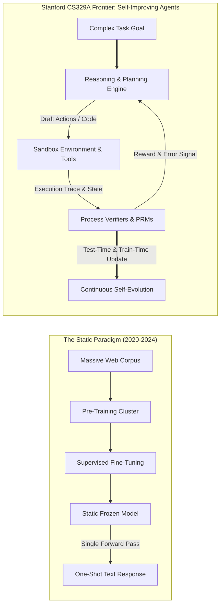

Welcome to the definitive technical breakdown of **Stanford University's CS329A: Self-Improving AI Agents (Autumn 2025)**.

Over the past four years, the artificial intelligence landscape has been dominated by a single, powerful dogma: *pre-training larger models on larger text corpora yields ever-increasing cognitive capabilities*. While this paradigm sparked the modern generative AI revolution—giving rise to GPT-4, Claude 3.5, and Gemini—the frontier of machine learning research has hit a pivotal inflection point. 

Static foundation models, however immense their parameter counts, remain fundamentally bounded: they are passive, autoregressive next-token predictors operating in an open-loop regime. Once their weights are frozen post-training, they cannot dynamically allocate compute to harder problems, cannot autonomously verify the factual correctness of their solutions, and cannot iteratively self-correct their errors based on environmental feedback.



Stanford CS329A addresses the central question of the next decade of AI: **How do we build software agents that do not merely generate text, but continuously inspect, verify, plan, and improve their own reasoning and code?**

In this inaugural overview lecture, we deconstruct the evolutionary trajectory from foundational LLMs to agentic systems, formalize the mathematics of scaling laws and inference-time compute allocation, analyze the four canonical agent workflow archetypes, and isolate the critical bottleneck of autonomous intelligence: the **Generator-Verifier Gap**.

{/* truncate */}

---

### 1. The Evolutionary Arc: How We Got Here

To understand where self-improving agents are heading, we must first analyze the three distinct historical phases of modern foundation model engineering:

```
  Phase 1: Pre-Training (Self-Supervised Next-Token Prediction)
  [Web Scrape / Trillions of Tokens] ────> Base LLM (Autoregressive Token Completion)
                                                    │
  Phase 2: Post-Training Alignment                  ▼
  [Curated Prompt-Response Pairs]    ────> SFT (Instruction Follower)
  [Human Preference Pairs (DPO/RLHF)]────> Aligned Conversational Chatbot
                                                    │
  Phase 3: The CS329A Frontier                      ▼
  [Execution Feedback + PRM Verification] ──> Autonomous Self-Improving Agent
```

#### Phase 1: Unsupervised Pre-Training
A base language model is trained on trillions of tokens with the maximum likelihood estimation (MLE) objective:
```text
L_MLE(θ) = - ∑ log P_θ(x_i | x_{1:i-1})
```
While this objective forces the model to encode syntax, world knowledge, and semantic associations into hundreds of billions of weights, the base model is essentially an unconstrained probabilistic mimic. If prompted with *"What is the capital of France?"*, it is just as likely to complete the string with *"What is the capital of Germany?"* as it is to answer the question, because both sequences frequently co-occur in web documents.

#### Phase 2: Instruction Tuning & RLHF (The "ChatGPT Recipe")
To transform an unconstrained completion engine into a helpful assistant, the industry developed the two-stage post-training pipeline:
1. **Supervised Fine-Tuning (SFT):** Training on high-quality `(x_prompt, y_response)` demonstration pairs, conditioning the model to adopt a helpful conversational persona.
2. **Reinforcement Learning from Human Feedback (RLHF) / DPO:** Optimizing an alignment objective against a learned reward model `r_ψ(x, y)` reflecting human preference:
```text
max_θ E_{(x, y) ~ D} [ r_ψ(x, y) ] - β · D_KL( π_θ(y | x) || π_ref(y | x) )
```
While RLHF solved conversational compliance and safety, it did not endow models with true problem-solving autonomy. An aligned chatbot still generates its answer sequentially in a single pass without deliberate verification, planning, or external tool execution.

#### Phase 3: The CS329A Frontier — Autonomous Agentic Loops
Self-improving agents break free from the single forward-pass constraint. By integrating tools (compilers, web search engines, Python REPLs), structured memory hierarchies, and automated verification loops, the system transforms into an active agent that observes its environment, executes discrete actions, evaluates intermediate outcomes, and refines its internal state until an objective is demonstrably satisfied.

---

### 2. The Mathematics of Scaling Laws: Train-Time vs. Inference-Time

A central foundation of modern machine learning is the **Scaling Hypothesis**. In 2020, Kaplan et al. (OpenAI) and later Hoffmann et al. (DeepMind Chinchilla, 2022) established that the test cross-entropy loss $L$ of an autoregressive language model follows a power-law relationship with respect to compute budget C, parameter count N, and training dataset size D:

```text
L(N, D) = E + A / N^α + B / D^β
```

where E represents the irreducible entropy of natural language, A and B are scaling coefficients, and α ≈ 0.34, β ≈ 0.28 are empirical scaling exponents.

```
Cross-Entropy Loss L
 ▲
 │ ╲  10^21 FLOPs (GPT-2 era)
 │  ╲
 │   ╲  10^23 FLOPs (GPT-3 era)
 │    ╲
 │     ╲  10^25 FLOPs (GPT-4 era)
 │      └─── Theoretical Pre-Training Wall (Synthetic Data Bottlenecks)
 └─────────────────────────────────────────────────────────────►
                       Compute Budget C (FLOPs)
```

However, pre-training scaling is encountering severe physical and economic headwinds:
- **The Data Wall:** High-quality human-generated text on the public internet is projected to be fully exhausted within this decade.
- **Capital & Power Density:** Training clusters exceeding 10²⁶ FLOPs require dedicated gigawatt-scale electrical substations and hundreds of millions of dollars in capital expenditure.

#### The Second Frontier: Inference-Time (Test-Time) Scaling
Rather than spending tens of millions of dollars updating model weights during training, **can we achieve superior reasoning by investing compute during inference?**

Consider a difficult coding or mathematical problem. A human expert does not write down the correct solution in a single burst of unbroken text; they draft hypotheses, verify intermediate lemmas, identify dead ends, and backtrack. 

In **Inference-Time Compute Scaling**, we allocate test-time FLOPs across three primary axes:
1. **Repeated Sampling (Best-of-N / Large Language Monkeys):** Generating N candidate trajectories from π_θ and selecting the optimal answer via a verifier. The probability of obtaining at least one correct solution follows the `Pass@k` metric:
```text
Pass@k = E[ 1 - C(n - c, k) / C(n, k) ]
```
where n is total samples and c is the count of correct trajectories.
2. **Step-Level Verification (PRM vs. ORM):** Outcome Reward Models (ORM) evaluate only the final output `r(x, y)`, which fails to localize errors in multi-step proofs. Process-supervised Reward Models (PRM) assign a scalar reward `r_t = R(x, y_{1:t})` to every single reasoning step, enabling fine-grained credit assignment.
3. **Tree Search Algorithms (MCTS, Beam Search):** Exploring the combinatorial reasoning graph using Monte Carlo Tree Search, balancing exploration of novel trajectories against exploitation of high-reward intermediate states.

As demonstrated by frontier reasoning architectures (e.g., OpenAI o1, DeepSeek-R1), scaling inference-time compute by 100x to 1,000x can yield performance breakthroughs on IMO-level mathematics and SWE-bench competitions that far surpass raw pre-training parameter expansion.

---

### 3. The Four Canonical Agentic Workflow Archetypes

When engineering autonomous AI systems, naive prompting often fails due to uncontrolled stochastic drift. Stanford CS329A formalizes agent architectures into four composable design patterns:

```mermaid
flowchart TD
    subgraph Pattern1 ["1. Prompt Chaining"]
        P1_In[Task Input] --> P1_M1[Model Step 1]
        P1_M1 -->|Intermediate Output| P1_M2[Model Step 2]
        P1_M2 --> P1_Out[Final Delivery]
    end

    subgraph Pattern2 ["2. Dynamic Routing"]
        P2_In[Query] --> P2_Router{Intent Router}
        P2_Router -->|Math| P2_Math[Symbolic Engine]
        P2_Router -->|Code| P2_Code[SWE Agent]
        P2_Router -->|General| P2_LLM[Standard LLM]
    end

    subgraph Pattern3 ["3. Parallelization"]
        P3_In[Prompt] --> P3_A[Agent 1: Conservative]
        P3_In --> P3_B[Agent 2: Creative]
        P3_In --> P3_C[Agent 3: Adversarial]
        P3_A --> P3_Agg[Consensus Aggregator]
        P3_B --> P3_Agg
        P3_C --> P3_Agg
    end

    subgraph Pattern4 ["4. Orchestrator-Worker"]
        P4_In[PRD / Epic] --> P4_Orch[Orchestrator Agent]
        P4_Orch -->|Sub-task 1| P4_W1[Worker 1]
        P4_Orch -->|Sub-task 2| P4_W2[Worker 2]
        P4_W1 -->|State Update| P4_Orch
        P4_W2 -->|State Update| P4_Orch
        P4_Orch --> P4_Out[Integrated Deliverable]
    end
```



#### 1. Prompt Chaining (Sequential Decomposition)
Decomposes a complex monolithic task into a series of deterministic steps where the output of step `k` becomes the structured context for step `k+1`. This architecture minimizes error amplification by inserting validation gates between stages (e.g., generating an outline `\to` verifying coverage `\to` writing draft `\to` proofreading).

#### 2. Dynamic Routing
Classifies the input query and dynamically dispatches execution to specialized models, fine-tuned adapters, or purpose-built tools. For example, routing an algebraic query to a SymPy/Python execution sandbox while routing a semantic search query to an embedding vector database.

#### 3. Parallelization (Sectioning & Voting)
Executes concurrent model instances in two distinct modalities:
- **Sectioning:** Splitting an independent task into orthogonal sub-problems processed simultaneously.
- **Voting / Ensembling:** Querying diverse prompts or temperature seeds simultaneously to filter out stochastic anomalies and identify majority consensus.

#### 4. Orchestrator-Worker (Hierarchical Delegation)
A central planning agent breaks down a high-level goal into an explicit Directed Acyclic Graph (DAG) of sub-tasks, assigns them to specialized worker agents, monitors runtime execution traces, handles exceptions, and aggregates the multi-agent artifacts into a unified deliverable.

---

### 4. The Critical Bottleneck: The Generator-Verifier Gap

Why is building self-improving agents so extraordinarily challenging?
The crux of the problem lies in the **Generator-Verifier Asymmetry**:

```text
Complexity(Verification) ≪ Complexity(Generation)   [Closed Formal Domains]
```
```text
Complexity(Verification) ≈ Complexity(Generation)   [Open-Ended Natural Domains]
```

```
Verification Capability
 ▲
 │   Formal Domains (Math, Code, Lean 4)
 │   ┌────────────────────────────────────────────────────────┐
 │   │ Verifier (Compiler / Unit Tests / Z3 SMT Prover)       │
 │   │ is deterministic, cheap, and 100% reliable!            │
 │   └────────────────────────────────────────────────────────┘
 │
 │   Open-Ended Domains (Essay Writing, Law, Strategic Planning)
 │   ┌────────────────────────────────────────────────────────┐
 │   │ Verifier (LLM-as-a-Judge) is noisy, prone to bias,     │
 │   │ and suffers from circular reasoning failures.          │
 │   └────────────────────────────────────────────────────────┘
 └─────────────────────────────────────────────────────────────►
                     Generation Complexity
```

In formal environments like programming (SWE-bench) and theorem proving (Lean 4, AlphaProof), verification is deterministic: a compiler either exits with code `0` or throws an error; a test suite either passes or fails. In these domains, self-improvement is straightforward: generate candidate patches, run the automated test harness, discard failures, and retain successful mutations.

However, in open-ended domains (e.g., creative writing, economic analysis, multi-agent negotiation), **evaluating whether a generated output is optimal requires nearly as much cognitive intelligence as generating it from scratch**. When we use an LLM to judge another LLM, we encounter the circular dilemma of stochastic supervision: the judge inherits the same hallucination, recency bias, and length heuristics as the generator.

Bridging this Generator-Verifier Gap through neuro-symbolic contracts, formal invariant compilation, and external ground-truth environments is the foundational quest of CS329A.

---

### 5. Stanford CS329A Course Syllabus & 4-Part Roadmap

The Stanford CS329A curriculum is structured into four progressive architectural tiers:

```
┌─────────────────────────────────────────────────────────────────────────────┐
│                    Stanford CS329A Architectural Stack                      │
├─────────────────────────────────────────────────────────────────────────────┤
│  Part 4 · Frontiers (L13 - L17)                                             │
│  - Mathematical Proofs (AlphaProof, Lean 4)                                 │
│  - Autonomous Reliability & AI Control Boundaries                           │
│  - Multimodal & Embodied Robotics (VLA, RT-2, π0)                           │
│  - Grand Finale: Future Open Problems & Alignment Erosion                   │
├─────────────────────────────────────────────────────────────────────────────┤
│  Part 3 · Agent Engineering (L10 - L12)                                     │
│  - Software Engineering Agents (SWE-bench, ASI Interface)                   │
│  - Hierarchical OS-Style Memory (MemGPT, CacheBlend)                        │
│  - Long-Horizon Evaluation & Economic Valuations (METR Time Horizons)        │
├─────────────────────────────────────────────────────────────────────────────┤
│  Part 2 · Training & Evolution (L6 - L9)                                     │
│  - Train-Time Scaling & Reinforcement Learning (DeepSeekMath & GRPO)        │
│  - Open-Ended Self-Evolution & Architecture Search (ADAS, AlphaEvolve)      │
│  - Autonomous Deep Research Workflows (AlphaCode, Search-o1)                │
│  - The Post-Training Evolution: SFT -> RLHF -> RLVR -> Agent RL             │
├─────────────────────────────────────────────────────────────────────────────┤
│  Part 1 · Foundation (L1 - L5)                                              │
│  - Test-Time Compute Scaling & Compute-Optimal Frontiers                    │
│  - Process-Supervised Verifiers & Error Localization (PRM800K)              │
│  - Tool Integration & Closed-Loop Code Feedback (ReAct, RLEF)               │
│  - Multi-Step Planning & Tree Search (LATS MCTS, A* Search)                 │
└─────────────────────────────────────────────────────────────────────────────┘
```

---

### 6. Key Takeaways & Academic Q&A

#### Key Takeaways
1. **The Paradigm Shift:** Modern AI has expanded beyond static, single-turn token completion into autonomous, multi-step feedback loops where execution, verification, and reflection operate continuously.
2. **Dual Scaling Frontiers:** Pre-training parameter scaling is now augmented by inference-time compute scaling (Best-of-N, process reward models, Monte Carlo tree search), enabling smaller models to outperform giant models through deliberate reasoning.
3. **The Core Loop:** Every effective agentic system embodies the universal tri-fold cycle: **Generate `\to` Verify `\to` Loop**.
4. **The Verification Bottleneck:** The rate of an agent's self-improvement is strictly throttled by the fidelity and objectivity of its verification signal.

---

#### Academic Q&A

**Q. How does inference-time compute scaling differ from standard prompt engineering or Chain-of-Thought (CoT)?**
**A.** Standard Chain-of-Thought prompts the model to generate intermediate rationales in a single, unverified linear sequence. If the model introduces an arithmetic or logical error in step 2, that error cascades unchecked through all subsequent tokens. Inference-time compute scaling introduces external search trees and verification checkpoints: candidate steps are scored by Process Reward Models (PRM) or compilers, allowing the agent to explore multiple reasoning paths, prune incorrect branches, and backtrack when a dead end is detected.

**Q. Why can't we simply train a massive LLM to act as the ultimate verifier for all human tasks?**
**A.** Because probabilistic neural networks cannot verify their own probabilistic failures without an objective ground-truth anchor. In unconstrained natural language, an LLM judge exhibits severe biases—favoring longer, verbose answers (verbosity bias), agreeing with assertive claims (sycophancy), and missing subtle factual omissions. True verification requires grounding: compiling natural language claims into deterministic, executable artifacts such as unit tests, database queries, formal Lean 4 theorems, or physical robot sensor feedback.

---

### Next Lecture Preview

In **Lecture 2**, we will dive straight into the deep mathematical mechanics of **Test-Time Compute Scaling**:
- Snell et al.'s compute-optimal scaling frontiers.
- The tradeoff between repeated sampling coverage and sequential search depth.
- How architectures like *Archon* and *Large Language Monkeys* optimize FLOP allocation across generation and verification budgets.

Stay tuned as we unlock the architectural blueprint of self-improving artificial intelligence!