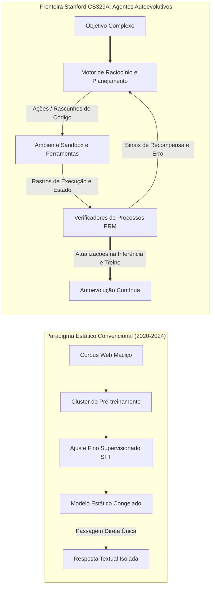

Bem-vindos à análise técnica detalhada do curso **CS329A da Universidade de Stanford: Self-Improving AI Agents (Agentes de IA Autoevolutivos, Outono de 2025)**.

Nos últimos quatro anos, o ecossistema de inteligência artificial foi conduzido por um dogma singular e dominante: *o pré-treinamento de modelos cada vez maiores sobre volumes colossais de texto gera capacidades cognitivas crescentes de maneira previsível*. Embora esse paradigma tenha deflagrado a moderna revolução da IA generativa — dando origem a sistemas como GPT-4, Claude 3.5 e Gemini —, a fronteira da pesquisa em aprendizado de máquina alcançou um ponto de inflexão decisivo.

Os modelos fundamentais estáticos (Static Foundation Models), independentemente de sua contagem estratosférica de parâmetros, possuem limitações intrínsecas inescapáveis: são preditores passivos e autorregressivos do próximo token operando em malha aberta (open-loop). Uma vez congelados seus pesos ao término do treinamento, eles não conseguem alocar dinamicamente mais processamento para problemas complexos, não verificam autonomamente a exatidão factual de suas deduções, nem corrigem seus próprios erros com base no feedback do ambiente.



Stanford CS329A enfrenta a questão basilar da próxima década da IA: **Como projetar agentes de software que não apenas gerem texto, mas inspecionem, verifiquem, planejem e aperfeiçoem continuamente seu próprio raciocínio e código-fonte?**

Nesta aula inaugural, decompomos a trajetória evolutiva dos LLMs fundamentais até as arquiteturas agênticas, formalizamos a matemática das leis de escala e a alocação de computação em tempo de inferência, analisamos os quatro arquétipos canônicos de fluxos de trabalho agênticos e isolamos o gargalo crítico da inteligência autônoma: a **Lacuna Gerador-Verificador (Generator-Verifier Gap)**.

{/* truncate */}

---

### 1. A Trajetória Evolutiva: Como Chegamos Aqui

Para compreender o futuro dos agentes autoevolutivos, é essencial examinar as três fases históricas do desenvolvimento de modelos fundamentais:

```
  Fase 1: Pré-treinamento (Predição Autorregressiva Não Supervisionada)
  [Coleta Web / Trilhões de Tokens] ────> LLM Base (Completador Probabilístico)
                                                   │
  Fase 2: Alinhamento Pós-Treinamento              ▼
  [Pares Selecionados Prompt-Resposta] ─> SFT (Seguidor de Instruções)
  [Preferências Humanas (RLHF/DPO)]   ─> Chatbot Conversacional Alinhado
                                                   │
  Fase 3: A Fronteira CS329A                       ▼
  [Feedback de Execução + Verificação PRM] ──> Agente Autônomo Autoevolutivo
```

#### Fase 1: Pré-treinamento Não Supervisionado (Unsupervised Pre-Training)
Um modelo de linguagem base é otimizado sobre trilhões de tokens minimizando a perda por estimativa de máxima verossimilhança (MLE):
```text
L_MLE(θ) = - ∑ log P_θ(x_i | x_{1:i-1})
```
Embora esse objetivo force a rede a compactar sintaxe, conhecimento de mundo e correlações semânticas em centenas de bilhões de parâmetros, o modelo base permanece um imitador estatístico irrestrito. Se provocado com *"Qual é a capital da França?"*, há tanta probabilidade de responder corretamente quanto de continuar com *"Qual é a capital da Alemanha?"*, pois tais sequências coabitam comumente a internet.

#### Fase 2: Ajuste de Instruções e RLHF (A "Receita ChatGPT")
Para converter um completador desordenado em um assistente colaborativo confiável, a indústria consolidou um pipeline em duas etapas:
1. **Supervised Fine-Tuning (SFT):** Treinamento sobre demonstrações curadas para atribuir ao modelo uma postura de assistência compreensiva.
2. **Aprendizado por Reforço com Feedback Humano (RLHF) / DPO:** Otimização orientada por um modelo de recompensa `r_ψ(x, y)` que espelha as preferências humanas:
```text
max_θ E_{(x, y) ~ D} [ r_ψ(x, y) ] - β · D_KL( π_θ(y | x) || π_ref(y | x) )
```
Embora o RLHF tenha sanado a complacência dialógica e a segurança, ele não outorgou aos modelos autonomia genuína de resolução. Um chatbot alinhado continua gerando respostas em uma única passada sequencial, sem deliberação, sem testes lógicos e sem ferramentas ativas.

#### Fase 3: A Fronteira CS329A — Loops Agênticos Autônomos
Os agentes autoevolutivos rompem o confinamento da passagem direta única. Ao integrar ferramentas externas (compiladores, navegadores web, interpretadores Python REPL), hierarquias de memória estruturada e ciclos de validação automatizados, o sistema transforma-se em um agente ativo: ele inspeciona o ambiente, executa ações práticas, avalia estados intermediários e recalibra hipóteses até comprovar que a meta foi formalmente atendida.

---

### 2. A Matemática das Leis de Escala: Treinamento vs. Inferência

O alicerce do aprendizado profundo contemporâneo é a **Hipótese de Escala (Scaling Hypothesis)**. Em 2020, Kaplan et al. (OpenAI) e subsequentemente Hoffmann et al. (DeepMind Chinchilla, 2022) provaram que a perda de entropia cruzada em teste $L$ de um modelo autorregressivo segue uma lei de potência em relação ao orçamento de computação C, aos parâmetros N e ao volume de dados D:

```text
L(N, D) = E + A / N^α + B / D^β
```

onde E traduz a entropia irredutível da linguagem natural, A e B são coeficientes de escala, e α ≈ 0.34, β ≈ 0.28 denotam expoentes empíricos.

```
Perda de Entropia Cruzada L
 ▲
 │ ╲  10^21 FLOPs (Era GPT-2)
 │  ╲
 │   ╲  10^23 FLOPs (Era GPT-3)
 │    ╲
 │     ╲  10^25 FLOPs (Era GPT-4)
 │      └─── Muralha do Pré-treinamento (Exaustão de dados e limites elétricos)
 └─────────────────────────────────────────────────────────────►
                       Orçamento de Computação C (FLOPs)
```

Contudo, a expansão do pré-treinamento colide agora com entraves físicos e econômicos severos:
- **A Muralha dos Dados:** Textos de alto nível redigidos por humanos na web aberta serão integralmente exauridos nesta década.
- **Custos de Capital e Matriz Energética:** Manter clusters acima de 10²⁶ FLOPs requer subestações de energia dedicadas na escala de gigawatts e vultosos investimentos de infraestrutura.

#### A Segunda Fronteira: Escala de Computação no Tempo de Inferência (Test-Time Scaling)
Em vez de aportar fortunas para retreinar pesos estáticos: **podemos manifestar inteligência superior alocando mais computação no exato momento da inferência (Test-Time)?**

Um especialista humano, ao formular um teorema ou planejar uma arquitetura distribuída, não escreve a solução definitiva em um impulso único; ele traça hipóteses, testa lemas intermediários, descobre impasses e retrocede (backtracking).

Na **Escala de Computação no Tempo de Inferência**, os FLOPs de teste são direcionados a três dimensões capitais:
1. **Amostragem Repetida (Best-of-N / Hipótese dos Grandes Macacos da Linguagem):** Gerar N trajetórias concorrentes a partir da política π_θ e eleger a melhor solução por meio de um verificador. A probabilidade de alcançar ao menos uma solução válida segue a métrica `Pass@k`:
```text
Pass@k = E[ 1 - C(n - c, k) / C(n, k) ]
```
onde n expressa o total de amostras e c a contagem de trajetórias corretas.
2. **Verificação Passo a Passo (PRM vs. ORM):** Modelos de Recompensa por Resultado (ORM) pontuam exclusivamente a resposta final `r(x, y)`, inviabilizando a localização de falhas no raciocínio. Já os Modelos de Recompensa de Processos (PRM) concedem uma recompensa escalar `r_t = R(x, y_{1:t})` para cada passo intermediário, viabilizando atribuição de crédito com exatidão cirúrgica.
3. **Algoritmos de Busca em Árvore (MCTS, Beam Search):** Navegar no grafo combinatório de raciocínios via Busca em Árvore de Monte Carlo, equilibrando o aproveitamento de nós intermediários promissores e a exploração de novas rotas.

Como atestam modelos de ponta (OpenAI o1, DeepSeek-R1), multiplicar a computação de inferência em 100× a 1.000× promove saltos de desempenho em olimpíadas matemáticas (IMO) e no SWE-bench que superam com folga o mero alargamento bruto de parâmetros.

---

### 3. Os Quatro Arquétipos Canônicos de Fluxos de Trabalho Agênticos

Ao erigir sistemas autônomos, apoiar-se em um prompt solitário conduz ao fracasso por dispersão estocástica. Stanford CS329A organiza as arquiteturas em quatro padrões modulares:

```mermaid
flowchart TD
    subgraph Arquétipo1 ["1. Encadeamento de Prompts (Prompt Chaining)"]
        P1_In[Entrada da Tarefa] --> P1_M1[Modelo Etapa 1]
        P1_M1 -->|Resultado Intermediário| P1_M2[Modelo Etapa 2]
        P1_M2 --> P1_Out[Entrega Concluída]
    end

    subgraph Arquétipo2 ["2. Roteamento Dinâmico (Dynamic Routing)"]
        P2_In[Consulta] --> P2_Router{Roteador de Intenção}
        P2_Router -->|Matemática| P2_Math[Motor Simbólico]
        P2_Router -->|Código-Fonte| P2_Code[Agente SWE]
        P2_Router -->|Geral| P2_LLM[LLM Genérico]
    end

    subgraph Arquétipo3 ["3. Paralelização (Parallelization)"]
        P3_In[Demanda] --> P3_A[Agente 1: Conservador]
        P3_In --> P3_B[Agente 2: Criativo]
        P3_In --> P3_C[Agente 3: Crítico Adverso]
        P3_A --> P3_Agg[Agregador de Consenso]
        P3_B --> P3_Agg
        P3_C --> P3_Agg
    end

    subgraph Arquétipo4 ["4. Orquestrador-Trabalhadores (Orchestrator-Worker)"]
        P4_In[Documento PRD] --> P4_Orch[Agente Orquestrador]
        P4_Orch -->|Subtarefa 1| P4_W1[Trabalhador 1]
        P4_Orch -->|Subtarefa 2| P4_W2[Trabalhador 2]
        P4_W1 -->|Atualização de Estado| P4_Orch
        P4_W2 -->|Atualização de Estado| P4_Orch
        P4_Orch --> P4_Out[Sistema Final Integrado]
    end
```



#### 1. Encadeamento de Prompts (Prompt Chaining: Decomposição Sequencial)
Fraciona uma tarefa densa em etapas determinísticas em que a saída do passo `k` atua como o contexto de entrada do passo `k+1`. Ao posicionar portões de validação entre os estágios (ex.: gerar sumário `\to` checar abrangência `\to` rascunhar `\to` revisar), neutraliza-se o efeito cascata de erros.

#### 2. Roteamento Dinâmico (Dynamic Routing: Atribuição por Especialidade)
Classifica a intenção da solicitação para despachá-la à ferramenta ou ao modelo especializado mais veloz e econômico. Consultas algébricas são dirigidas a um ambiente Python, ao passo que refatorações profundas seguem para um agente SWE específico.

#### 3. Paralelização (Parallelization: Fatiamento e Votação)
- **Fatiamento (Sectioning):** Execução concomitante de subtarefas ortogonais por múltiplas instâncias de agentes.
- **Votação e Consenso (Voting):** Geração paralela de respostas sob formulações ou temperaturas distintas para atenuar anomalias por maioria de votos.

#### 4. Orquestrador-Trabalhadores (Orchestrator-Worker: Delegação Hierárquica)
Um agente coordenador decompõe o objetivo global em um Grafo Acíclico Dirigido (DAG), delega subtarefas a agentes trabalhadores focados, gerencia exceções em tempo real e consolida a entrega final.

---

### 4. O Gargalo Crítico: A Lacuna Gerador-Verificador

Por que a construção de agentes autoevolutivos impõe barreiras tão formidáveis?
O nó central reside na **Assimetria Gerador-Verificador**:

```text
Complexidade(Verificação) ≪ Complexidade(Geração)   [Domínios Formais Fechados]
```
```text
Complexidade(Verificação) ≈ Complexidade(Geração)   [Domínios Abertos de Linguagem Natural]
```

```
Capacidade de Verificação
 ▲
 │   Domínios Formais (Matemática, Código Python, Tipagem Lean 4)
 │   ┌────────────────────────────────────────────────────────┐
 │   │ Verificador (Compilador / Bateria de Testes / Solver Z3)│
 │   │ Determinístico, computacionalmente barato e 100% fiel  │
 │   └────────────────────────────────────────────────────────┘
 │
 │   Domínios Abertos (Redação, Pareceres Estratégicos, Direito)
 │   ┌────────────────────────────────────────────────────────┐
 │   │ Verificador (Juiz LLM)                                 │
 │   │ Ruidoso, sujeito a viés de verbosidade e condescendência│
 │   └────────────────────────────────────────────────────────┘
 └─────────────────────────────────────────────────────────────►
                     Complexidade de Geração
```

Em ambientes formais como programação e provas de teoremas, a verificação é binária e incontestável: o código compila ou gera erro; a bateria de testes unitários passa ou falha. Nesse cenário, o ciclo autoevolutivo é límpido: gerar soluções, rodar testes, descartar falhas e fixar apenas as alterações aprovadas.

Por outro lado, em domínios abertos em linguagem natural, **julgar a perfeição de uma resposta demanda capacidade cognitiva idêntica à de elaborá-la do início**. Usar um LLM para auditar outro LLM incorre em armadilhas de supervisão estocástica: o avaliador supervaloriza respostas prolixas (viés de verbosidade) e chancela raciocínios equivocados por afinidade probabilística.

Superar essa lacuna traduzindo intenções textuais em restrições determinísticas e ancorando-as em ambientes de execução externos compõe a espinha dorsal de CS329A.

---

### 5. Currículo de Stanford CS329A: Roteiro em 4 Partes

A grade programática de CS329A articula-se em quatro níveis progressivos de engenharia:

```
┌─────────────────────────────────────────────────────────────────────────────┐
│                    Pilha Arquitetural de Stanford CS329A                    │
├─────────────────────────────────────────────────────────────────────────────┤
│  Parte 4 · Fronteiras (L13 - L17)                                           │
│  - Provas Matemáticas Formais (AlphaProof, Lean 4)                          │
│  - Confiabilidade de Sistemas Autônomos e Fronteiras de AI Control         │
│  - Agentes Robóticos Multimodais e Concretizados (VLA, RT-2, π0)            │
│  - Grande Final: Problemas Abertos Futuros e Erosão de Alinhamento          │
├─────────────────────────────────────────────────────────────────────────────┤
│  Parte 3 · Engenharia de Agentes (L10 - L12)                                │
│  - Agentes de Engenharia de Software (SWE-bench, Interface ASI)             │
│  - Memória Hierárquica Estilo Sistema Operacional (MemGPT, CacheBlend)      │
│  - Avaliação de Longo Horizonte e Métricas Econômicas (Horizontes METR)     │
├─────────────────────────────────────────────────────────────────────────────┤
│  Parte 2 · Treinamento e Evolução (L6 - L9)                                 │
│  - Escala no Treinamento e RL (DeepSeekMath & GRPO)                         │
│  - Autoevolução Aberta e Busca de Arquiteturas (ADAS, AlphaEvolve)          │
│  - Fluxos Autônomos de Pesquisa Profunda (AlphaCode, Search-o1)             │
│  - A Mudança Pós-Treinamento: SFT -> RLHF -> RLVR -> Agent RL               │
├─────────────────────────────────────────────────────────────────────────────┤
│  Parte 1 · Fundamentos (L1 - L5)                                            │
│  - Escala na Inferência e Fronteiras Ótimas de Snell                        │
│  - Verificadores Supervisionados por Processo (PRM800K)                     │
│  - Integração de Ferramentas e Feedback de Código (ReAct, RLEF)             │
│  - Planejamento Multietapas e Busca em Árvore (LATS MCTS)                   │
└─────────────────────────────────────────────────────────────────────────────┘
```

---

### 6. Síntese dos Conceitos e Perguntas Acadêmicas

#### Síntese dos Conceitos
1. **Virada de Paradigma:** A IA avança da predição pontual e passiva de texto para ciclos autônomos de retroalimentação em que execução, verificação e autoanálise agem continuamente.
2. **Dupla Fronteira de Escala:** A expansão de parâmetros no pré-treinamento caminha lado a lado com a computação na inferência (Best-of-N, PRMs, busca em árvore), habilitando modelos compactos a superar gigantes por deliberação aprofundada.
3. **O Eixo Universal:** Todo sistema agêntico eficaz manifesta o ciclo basilar: **Gerar `\to` Verificar `\to` Repetir**.
4. **O Gargalo da Validação:** A taxa de autoaperfeiçoamento de um agente é estritamente delimitada pela fidelidade e pela firmeza do seu sinal de verificação.

---

#### Perguntas Acadêmicas Frequentes

**P. Qual é a real distinção entre escala na inferência e o Chain-of-Thought (CoT) convencional?**
**R.** O CoT convencional apenas compele o modelo a emitir raciocínios em um fluxo unidirecional e desprovido de checagem. Caso haja uma falha de cálculo no passo 2, essa inconsistência contamina todos os tokens subsequentes. A escala na inferência incorpora árvores de busca externas e pontos de checagem: cada fase é pontuada por Modelos de Recompensa de Processos (PRM) ou compiladores, viabilizando o aprofundamento em caminhos corretos e a poda ativa de ramificações incorretas.

**P. Não seria mais viável simplesmente treinar um LLM colossal para servir de verificador infalível para qualquer tarefa?**
**R.** Porque redes neurais estatísticas não superam suas próprias falhas sem uma âncora objetiva no mundo físico ou determinístico (Ground-truth Anchor). Em texto aberto, juízes LLM são propensos a privilegiar respostas prolixas e a concordar passivamente com alegações enfáticas. Uma auditoria sólida só é consumada ao transpor declarações para elementos executáveis: baterias de testes unitários, transações de banco de dados, lemas formais em Lean 4 ou leituras de sensores robóticos.

---

### Prévia da Próxima Aula

Na **Aula 2**, dissecaremos a engrenagem matemática da **Escala de Computação em Tempo de Inferência (Test-Time Compute Scaling)**:
- As fronteiras de computação ótima delineadas por Snell et al.
- O equilíbrio entre amplitude amostral e profundidade na busca sequencial.
- Como propostas como *Archon* e *Large Language Monkeys* harmonizam os orçamentos de geração e verificação.

Junte-se a nós para desvendar os pilares da inteligência artificial autoevolutiva!