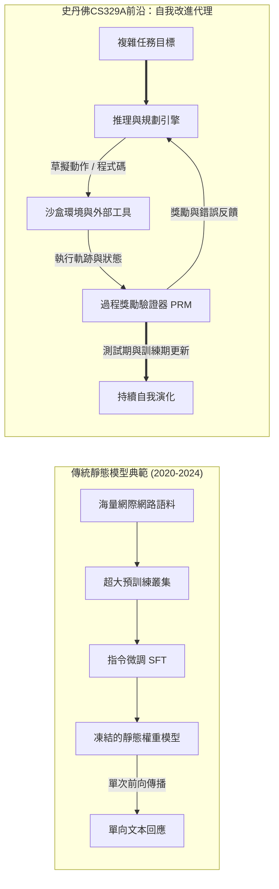
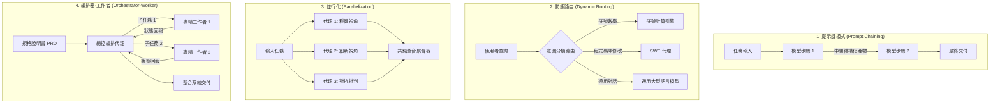

歡迎閱讀**史丹佛大學（Stanford University）CS329A：Self-Improving AI Agents（自我改進AI代理，2025秋季學期）**的核心技術解析。

在過去的四年中，人工智慧領域一直被一條強大而單一的教條所主導：*在海量文本語料庫上預訓練更大規模的模型，能夠以可預測的規律持續提升認知能力*。儘管這一典範催生了現代生成式AI革命，孕育出GPT-4、Claude 3.5與Gemini等突破性模型，但機器學習的研究前沿已經迎來了決定性的轉折點。

靜態基底模型（Static Foundation Model）無論參數規模多麼龐大，都存在著根本性的結構侷限：它們是在預訓練完成、權重凍結（Frozen）之後，在開環（Open-loop）體系下運行的被動、自迴歸（Autoregressive）下一標記預測器。面對棘手難題時，它們無法動態分配更多的算力，無法自主驗證自身推導的真實正確性，也無法藉助環境反饋自發糾錯。



史丹佛CS329A致力於解答未來十年AI的核心命題：**「我們該如何建構不僅能生成文本，更能在動態環境中持續自我檢查、自我驗證、自我規劃並完善自身推理與程式碼的軟體代理？」**

在本次開篇總覽課中，我們將解構從基底模型邁向代理系統的演進軌跡，形式化拆解擴展定律與推理期算力分配的數學機制，分析四大標準代理工作流程架構，並剖析制約自主智能演進的核心瓶頸——**生成器-驗證器差距（Generator-Verifier Gap）**。

{/* truncate */}

---

### 1. 演進軌跡：我們是如何走到這裡的

要理解自我改進代理未來的發展脈絡，必須首先梳理現代基底模型工程經歷的三個歷史階段：

```
  第1階段：無監督預訓練（自監督下一Token預測）
  [擷取海量網際網路文本 / 數兆Token] ───> 基礎LLM（自迴歸文本補全器）
                                                      │
  第2階段：事後對齊與指令微調                        ▼
  [精選Prompt-Response示範對]       ───> SFT（遵循指令的對話助手）
  [人類偏好數據（RLHF/DPO）]        ───> 對齊的安全對話模型
                                                      │
  第3階段：CS329A學術前沿                           ▼
  [工具執行反饋 + PRM形式化驗證]     ───> 自主自我改進代理
```

#### 第1階段：無監督預訓練（Unsupervised Pre-Training）
基礎語言模型在數兆Token上透過最大概似估計（MLE）目標進行訓練：
```text
L_MLE(θ) = - ∑ log P_θ(x_i | x_{1:i-1})
```
儘管該目標驅動模型將語法、世界常識和語意關聯壓縮進數千億參數中，但基礎模型本質上只是一個未受約束的機率模擬器。若輸入「法國的首都是哪裡？」，它很可能不會作答，而是順應網路文件的常見排版，接著輸出「德國的首都是柏林」。

#### 第2階段：指令微調與RLHF（「ChatGPT配方」）
為了將無序的補全器改造為得力的互動助手，工業界確立了兩階段後訓練管線：
1. **監督微調（SFT）：** 在高品質示範問答對上進行微調，為模型注入得體、合規的對話角色。
2. **基於人類反饋的強化學習（RLHF）/ DPO：** 藉助反映人類偏好的獎勵模型 `r_ψ(x, y)` 優化策略：
```text
max_θ E_{(x, y) ~ D} [ r_ψ(x, y) ] - β · D_KL( π_θ(y | x) || π_ref(y | x) )
```
RLHF解決了模型的遵從性與安全性，但並未賦予其真正的解題自主性。即便是高度對齊的聊天機器人，本質上仍然受困於單次前向傳播，無法進行外部工具互動、嚴密驗證或多步回溯。

#### 第3階段：CS329A前沿 —— 自主代理閉環
自我改進代理徹底打破了單次前向計算的枷鎖。透過深度融合編譯器、Web檢索器、Python REPL等外部工具、分層記憶系統和自動化驗證閉環，系統演變為一個主動的實體：感知環境、執行具體動作、評估中間狀態，並根據確定性反饋持續演化內部認知，直至目標在形式上被嚴格滿足。

---

### 2. 擴展定律的數學：訓練期算力 vs. 推理期算力

現代深度學習的奠基石是**擴展假說（Scaling Hypothesis）**。2020年Kaplan等人（OpenAI）與2022年Hoffmann等人（DeepMind Chinchilla）證實，自迴歸語言模型的測試交叉熵損失 $L$ 與算力預算 C、參數量 N 以及訓練數據量 D 之間呈現嚴格的冪律（Power Law）關係：

```text
L(N, D) = E + A / N^α + B / D^β
```

其中 E 代表自然語言不可約簡的內在熵，$A, B$ 為尺度係數，α ≈ 0.34, β ≈ 0.28 為實證經驗指數。

```
交叉熵損失 L
 ▲
 │ ╲  10^21 FLOPs (GPT-2時代)
 │  ╲
 │   ╲  10^23 FLOPs (GPT-3時代)
 │    ╲
 │     ╲  10^25 FLOPs (GPT-4時代)
 │      └─── 預訓練物理牆（公開數據耗盡與電網功率極限）
 └─────────────────────────────────────────────────────────────►
                       計算預算 C (FLOPs)
```

然而，純粹依靠擴大預訓練規模正撞上一面嚴峻的物理與經濟高牆：
- **數據枯竭之牆：** 公開網際網路上由人類編寫的高品質文本預計將在本年代內徹底耗盡。
- **能源與資本門檻：** 建構超過 10²⁶ FLOPs 的超算叢集需要百萬瓩級（GW）專用變電所和數以億美元計的龐大基建開銷。

#### 第二前沿：推理期（Inference-Time）算力擴展
與其斥巨資在訓練階段微調靜態權重，**我們能否在模型給出最終答案的推理時刻（Test-Time），透過傾注更多運算量來激發更深層的智能？**

人類專家在解答複雜的高等數學證明或編寫分散式系統架構時，絕不會一筆呵成。人們會構想假說、草擬引理、發現矛盾並主動回溯（Backtracking）。

在**推理期算力擴展**中，測試階段的FLOPs主要沿三大維度進行動態分配：
1. **重複採樣（Best-of-N / 大語言猴子假說）：** 從策略 π_θ 中並行生成 N 條候選軌跡，並由驗證器挑選最佳解。至少產生一個正確解的機率遵循 `Pass@k` 指標：
```text
Pass@k = E[ 1 - C(n - c, k) / C(n, k) ]
```
其中 n 為總採樣數，c 為正解軌跡數。
2. **步驟級過程驗證（PRM vs. ORM）：** 結果獎勵模型（ORM）僅評估最終輸出 `r(x, y)`，無法在冗長的多步推導中精準歸因局部錯誤。過程監督獎勵模型（PRM）則為每一個推導步驟賦予純量獎勵 `r_t = R(x, y_{1:t})`，實現精細化的信用分配（Credit Assignment）。
3. **樹搜尋演算法（MCTS，Beam Search）：** 利用蒙地卡羅樹搜尋在龐大的離散推導圖譜中展開搜尋，平衡高收益中間狀態的利用（Exploitation）與未知路徑的探索（Exploration）。

正如OpenAI o1與DeepSeek-R1等前沿模型所證明的那樣，將推理階段算力放大100至1,000倍，可以在國際數學奧林匹克（IMO）競賽題和SWE-bench程式碼基準上取得遠超單純擴展模型尺寸的顛覆性突破。

---

### 3. 代理工作流程的四大經典架構

建構自主代理系統時，僅憑單條Prompt往往會因隨機漂移而崩塌。史丹佛CS329A將代理拓撲提煉為四大可組合的設計模式：



#### 1. 提示鏈模式（Prompt Chaining：順序分解）
將單體複雜任務切分為若干確定性子步驟，步驟 `k` 的輸出作為步驟 `k+1` 的上下文輸入。在各階段之間設置驗證閘道（例如：生成大綱 `\to` 校驗覆蓋率 `\to` 撰寫初稿 `\to` 潤色校對），從根源上截斷誤差擴散。

#### 2. 動態路由（Dynamic Routing：專業分派）
對輸入的請求意圖進行分類，分發至最合適的高效專用模型或外部工具。例如，代數運算路由至Python計算沙盒，大型軟體重構路由至專有SWE代理，大幅優化整體系統延遲與開銷。

#### 3. 並行化（Parallelization：並發切片與投票）
- **任務切片（Sectioning）：** 將彼此正交、無上下文依賴的子任務分派給多個代理實例並發處理。
- **投票整合（Voting）：** 採用不同Prompt設定或隨機種子並行生成多個候選方案，藉助多數投票或批判模組過濾隨機異常。

#### 4. 編排器-工作者（Orchestrator-Worker：分層指派）
中央編排器將高階任務分解為有向無環圖（DAG），向專精工作者代理分發子任務，即時監控運行異常，最終匯聚各方產物形成完整系統交付。

---

### 4. 核心瓶頸：生成器-驗證器差距（Generator-Verifier Gap）

建構自我改進代理之所以充滿挑戰，根源在於**生成與驗證的內在不對稱性**：

```text
複雜度(驗證) ≪ 複雜度(生成)   [封閉形式化領域: 數學、程式碼]
```
```text
複雜度(驗證) ≈ 複雜度(生成)   [開放自然語言領域: 文章、戰略、談判]
```

```
驗證能力
 ▲
 │   形式化領域（數學定理、Python程式碼、Lean 4）
 │   ┌────────────────────────────────────────────────────────┐
 │   │ 驗證器（編譯器 / 單元測試套件 / Z3 SMT證明器）         │
 │   │ 具備確定性、計算成本低廉且100%可靠                     │
 │   └────────────────────────────────────────────────────────┘
 │
 │   開放自然語言領域（創意寫作、商業分析、法律建議）
 │   ┌────────────────────────────────────────────────────────┐
 │   │ 驗證器（LLM 裁判）                                     │
 │   │ 雜訊巨大、容易受到長度偏見與附和傾向的影響             │
 │   └────────────────────────────────────────────────────────┘
 └─────────────────────────────────────────────────────────────►
                     生成複雜度
```

在程式設計與形式定理證明等形式化領域，驗證是絕對確定性的：程式碼要麼順利編譯，要麼拋出例外；單元測試要麼全數通過，要麼觸發斷言報錯。在此類場景中，自我進化是閉環成立的：生成候選方案、調用測試套件、淘汰錯誤項、僅吸收成功程式碼進行權重或Prompt進化。

但在開放的自然語言領域中，**評估一段文本是否盡善盡美，其認知難度幾乎與從頭創作該文本旗鼓相當**。當使用大模型擔任另一大模型的裁判（LLM-as-a-judge）時，評判者往往表現出對冗長回覆的偏好（Verbosity Bias），並繼承了生成者的幻覺盲區。

如何藉助神經-符號編譯將自然語言意圖編譯為確定性約束，建立真實世界的客觀錨點（Ground-truth Anchor），是貫穿CS329A的核心研究主線。

---

### 5. 史丹佛CS329A 四階段課程路線圖

史丹佛CS329A的課程大綱由淺入深，涵蓋四大工程與學術梯隊：

```
┌─────────────────────────────────────────────────────────────────────────────┐
│                    史丹佛CS329A 完整技術能力棧                              │
├─────────────────────────────────────────────────────────────────────────────┤
│  第4部分 · 前沿攻堅 (L13 - L17)                                             │
│  - 形式化數學證明與 AlphaProof、Lean 4                                       │
│  - 自主系統高可靠三層體系與 AI Control 信任邊界                             │
│  - 多模態與具身機器人代理 (VLA, RT-2, π0)                                   │
│  - 總結篇：未來開放難題與自我進化的對齊侵蝕                                 │
├─────────────────────────────────────────────────────────────────────────────┤
│  第3部分 · 代理系統工程 (L10 - L12)                                         │
│  - 軟體工程代理 (SWE-bench 與 ASI 介面設計)                                 │
│  - 作業系統級分層記憶體系 (MemGPT, CacheBlend)                              │
│  - 長程任務評測與真實經濟價值評估 (METR Time Horizons)                      │
├─────────────────────────────────────────────────────────────────────────────┤
│  第2部分 · 訓練與進化 (L6 - L9)                                             │
│  - 訓練期算力擴展與強化學習 (DeepSeekMath 與 GRPO)                           │
│  - 開放式自我進化與架構搜尋 (ADAS, AlphaEvolve)                             │
│  - 自主深度研究工作流程 (AlphaCode, Search-o1)                               │
│  - 後訓練範式演進：SFT -> RLHF -> RLVR -> Agent RL                          │
├─────────────────────────────────────────────────────────────────────────────┤
│  第1部分 · 基礎與探索 (L1 - L5)                                             │
│  - 推理期計算擴展與算力最佳配置法則                                         │
│  - 過程獎勵模型與嚴密答案驗證 (PRM800K)                                     │
│  - 工具調用與程式碼執行閉環反饋 (ReAct, RLEF)                                 │
│  - 多步規劃與蒙地卡羅樹搜尋 (LATS MCTS)                                     │
└─────────────────────────────────────────────────────────────────────────────┘
```

---

### 6. 核心要點總結與學術Q&A

#### 核心要點總結
1. **範式躍遷：** 人工智慧的演進核心已從單次、靜態的文本預測，升級為「感知-行動-驗證-反思」閉環循環的自主系統。
2. **雙重擴展前沿：** 傳統的預訓練參數擴展，正與推理期算力擴展（Best-of-N、過程驗證、樹搜尋）形成雙輪驅動，使小型模型也能憑藉深思熟慮攻克高階難題。
3. **統一核心主線：** 所有卓越的代理系統都在底層實踐著統一的骨架：**《生成 `\to` 驗證 `\to` 循環》**。
4. **驗證瓶頸：** 代理自我進化的速度，最終取決於其驗證機制的客觀度、嚴密性與確定性。

---

#### 學術深度Q&A

**問：推理期算力擴展與常規的Prompt技巧或單鏈思維鏈（CoT）有何本質區別？**
**答：** 常規思維鏈僅引導模型在單次無回溯的線性序列中吐出思考步驟。如果模型在第二步發生算術或概念偏離，該錯誤會隨後續Token如雪崩般級聯放大。而推理期算力擴展引入了外置搜尋樹和驗證哨卡：每個中間步驟均由過程獎勵模型（PRM）或沙盒編譯器打分，從而實現深入探索優質路徑、及時剪枝回溯錯誤分支的能動算力調度。

**問：難道我們不能直接訓練一個超大的LLM作為通曉萬物的終極驗證裁判嗎？**
**答：** 機率神經網路在缺乏物理和確定性環境錨點（Ground-truth Anchor）的情況下，無法徹底自我消除機率錯覺。在開放文本中，LLM裁判普遍具有附和傾向和長度偏見。真正的可靠性驗證，必須將自然語言主張錨定在可執行的程式碼單元測試、資料庫交易、Lean 4形式化數學定理或真實機器人感測器反饋之中。

---

### 下節預告

在**第2講（Lecture 2）**中，我們將全面切入**推理期算力擴展（Test-Time Compute Scaling）**的硬核數學機理：
- Snell等人揭示的算力最佳擴展前沿（Compute-Optimal Scaling Frontiers）
- 廣度並發採樣覆蓋率與深度順序搜尋之間的權衡曲線
- *Archon*與*Large Language Monkeys*如何科學平衡生成與驗證的算力配比

讓我們一起步入自我演化代理的技術核心！