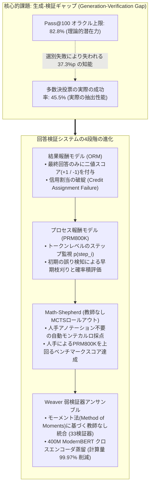
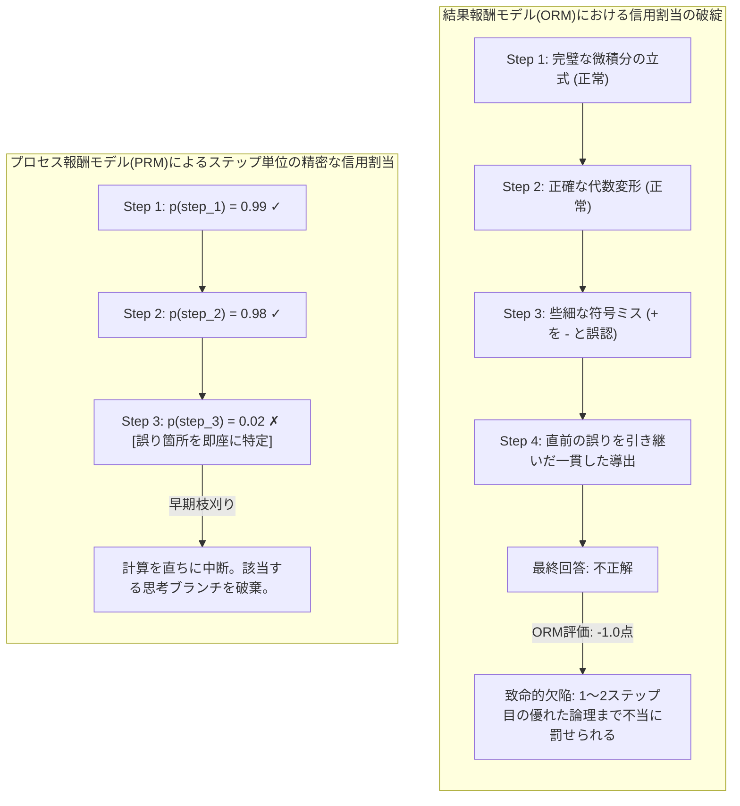
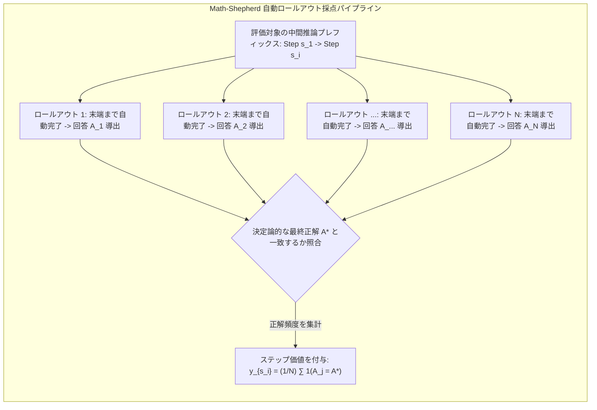
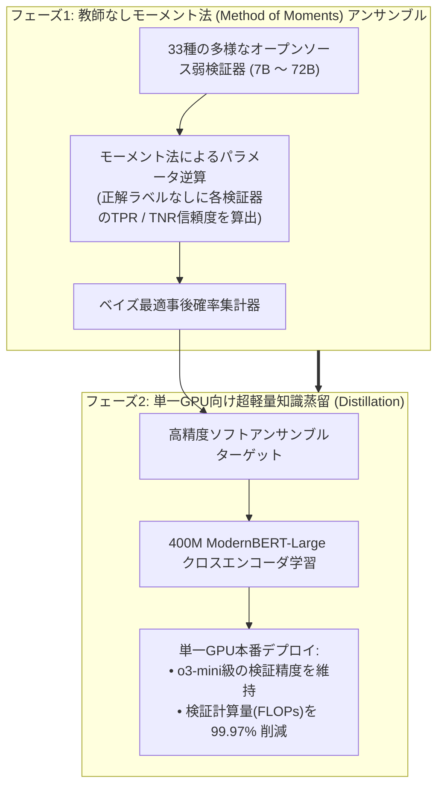

スタンフォード大学の2025年秋学期・最新大学院講座、**CS329A: Self-Improving AI Agents（自己改善AIエージェント）**の第3回エンジニアリング解説へようこそ。

前回の第2講で、私たちは推論時計算量スケーリング（Test-time Compute Scaling）を学び、極めて示唆に富む結論に達しました。モデルに数千の候補回答（$pass@k$）を生成させれば、正解の網羅率（カバーレッジ）は99%を超えます。しかし、**「無数の誤答の中から真の正解を選び抜く高精度な検証器（Verifier）がなければ、多数決投票（Majority Voting）を行っても性能は完全に頭打ち（Plateau）になる」**という現実でした。

第3講では、この本質的なボトルネックを打ち破る中核システム技術、**堅牢な回答検証（Robust Verification）**を徹底解明します。

人間の数学者やソフトウェアエンジニアであっても、複雑な問題を解く際に一直線の思考だけで正解に至ることは稀です。1行の論理を展開し、数式の整合性を確かめ、微小な符号の誤りを見つければ直ちに前のステップへと戻り（バックトラッキング）、修正を重ねます。これに対し、従来の自己回帰（Autoregressive）言語モデルは未来方向へとのみトークンを生成します。初期の推論でわずかな論理破綻が生じると、モデルは自らの誤りを正当化するために、さらに複雑なハルシネーション（幻覚）を連鎖させてしまいます。

では、**「モデルが生成した中間推論ステップを、別のモデルが1歩ずつ厳格に検査し、誤った思考枝を早期に刈り取る（Pruning）ことはできないか？」**

OpenAIの金字塔であるCobbeのGSM8K検証器から、Lightmanによるステップ単位の過程監視（PRM800K）、人間のアノテーションなしにモンテカルロ・ロールアウトで自己採点するMath-Shepherd、そして複数の弱検証器を統計学的に統合してo3-mini級の精度を引き出す最新のWeaver（NeurIPS 2025）まで、**検証器エンジニアリング（Verifier Engineering）の極致**を体系的にマスターしていきましょう。



{/* truncate */}

---

### 1. 生成-検証ギャップ (Generation-Verification Gap): ボトルネックの数理的定義

具体的な検証器アーキテクチャを検証する前に、モデルが潜在的に生成できる能力と、エージェントが実際に回収できる性能との解離を数理的に定式化します：

```text
Gap(K) = Pass@K - Actual_Success_Rate
```

最新の難関ベンチマークであるGPQA Diamondにおいて、オープンウェイトモデル`Llama-3.3-70B-Instruct`の$Pass@100$は**82.8%**に達します。すなわち、100個の解法候補をサンプリングすれば、10問中8問以上で少なくとも1つの完璧な正解解法が含まれています。

しかし、この100個の候補に対し、最も一般的な**多数決投票（Majority Voting）**を適用すると、実際に得られる正解率は**45.5%**へと急落します。

```
正解率 (%)
 ▲
100│                                     ┌────────────── Pass@100 オラクル上限 (82.8%)
 90│                                ┌────┘
 80│                           ┌────┘
 70│                      ┌────┘
 60│                 ┌────┘
 50│            ┌────┘ ◄── 選別エラーにより消滅する 37.3%p の潜在知能
 40│  ──────────┴──────────────────────── 多数決投票のプラトー (45.5%)
 30│
 20│
 10│
  0└┴────────────────────────────────────────────────► サンプル試行予算 K
```

実に**37.3ポイントもの潜在能力**が、単に「正解候補を正しく選び出せない」という理由だけで消滅してしまいます。複数の欠陥のある思考プロセスが、同じもっともらしい誤答（Plausible Distractor）へと収束する場合、頻度のみに頼る多数決は必然的に偽陽性（False Positive）を選択してしまいます。

#### 独立検証器の原点: Cobbe et al. (GSM8K, 2021)
この溝を埋めるため、OpenAIのKarl Cobbeらの研究チームは基礎的な算数ベンチマーク**GSM8K**を提案し、生成器と完全に分離された**独立検証器（Verifier）**アーキテクチャを確立しました：

1. **重みの分離 (Decoupled Architecture):** 生成器と検証器は推論時に順伝播の重みを共有しません。生成器は多様性を維持するために2エポックのみファインチューニングされ、検証器は生成器が出力した回答群を学習データとして訓練されます。
2. **トークンレベル価値ヘッド (Token-Level Value Heads):** 解法の終端だけで単一のスカラーを評価するのではなく、Transformerの各トークン位置に線形分類ヘッドを接続し、その時点での正解到達確率を予測させます：
   ```text
   V(t_i) = W_v · h_L(t_i) + b_v
   ```
   損失関数は言語モデリング損失と検証誤差（MSE）の結合によって最適化されます：
   ```text
   L_total = L_LM(θ) + λ · || V(t_end) - y_true ||^2
   ```
3. **30倍パラメータの恩恵:**
   * わずか**6Bパラメータの小型検証器**を用いて100個の候補から最善解を選別させた結果、単一実行の**175B巨大モデルの正解率に匹敵する性能**を達成しました。
   * 生成と検証を切り離すだけで、実質的に**約30倍のモデルパラメータ拡張効果**が得られることが実証されたのです。

---

### 2. 結果監視 vs 過程監視: LightmanらのPRM800K

Cobbeらの検証器は先駆的でしたが、本質的には**結果監視（Outcome Reward Models, ORMs）**の枠組みにとどまっていました。

2023年5月、Hunter Lightman率いるOpenAIの研究チームは、AI研究史における画期的な論文を発表しました：**《Let's Verify Step by Step》**（Lightmanら、2023）。



#### 推論における信用割当問題 (Credit Assignment Problem)
10ステップに及ぶ複雑な数学証明を考えてみましょう：
* **偽陰性の悲劇:** モデルがステップ1から6まで完璧な数学的演繹を展開したものの、ステップ7で単純な計算ミスを犯し、最終回答を誤ったとします。
  * *ORMの判定:* 「最終回答が間違っているため、この回答全体が減点（-1点）」。
  * ステップ1〜6の卓越した論理的推論までが処罰され、学習信号が汚染されます。
* **偽陽性の悲劇 (まぐれの正解、Lucky Error):** ステップ3で深刻な論理破綻を犯したものの、ステップ8で別の誤りを犯し、偶然にも最終数値が一致したとします。
  * *ORMの判定:* 「正解したため、完璧な推論（+1点）」。
  * モデルは破綻した論理に対して報酬を受け取り、報酬ハッキング（Reward Hacking）が助長されます。

このように、時間的な信用割当の失敗こそが、結果ベース検証器のスケーリングを阻む最大の障壁でした。

#### PRMの数理設計
Lightmanらは人間の専門家を動員し、MATHデータセットの75,000解法に含まれる80万の推論ステップに対し、正当/誤り/中立をラベル付けした**PRM800K**を構築しました。

コスト抑制のために導入された画期的な手法が**「初回エラー打ち切り規則（First-Error Termination Rule）」**でした。無効な前提から導出された後続ステップを評価することは無意味であるため、最初のエラーが検出された時点でアノテーションを即時終了させました。

PRMは各推論ステップの末尾（改行トークン）において、そのステップが論理的に正しい確率を予測します：

```text
p(s_i) = σ( W_p · h_L( Token_{\text{newline}, i} ) )
```

解法全体$S = (s_1, s_2, ..., s_M)$に対する総合検証スコアは、**確率の積の法則（Product Rule）**によって算出されます：

```text
Score_PRM(S) = ∏_{i=1}^M p(s_i \text{ is correct})
```

#### PRMの実証的優位性
MATHベンチマークにおいて、最大$N = 1,860$までのBest-of-N探索を行った結果は極めて明瞭でした：

```text
┌───────────────────────────────┬──────────────┬──────────────┬─────────────┐
│ 回答選別戦略                  │ Best-of-1    │ Best-of-100  │ Best-of-1860│
├───────────────────────────────┼──────────────┼──────────────┼─────────────┤
│ 多数決投票 (Majority Vote)    │ 52.4%        │ 68.3%        │ 69.6%       │
│ 結果報酬モデル (ORM)          │ 52.4%        │ 70.1%        │ 72.4%       │
│ プロセス報酬モデル (PRM)      │ 52.4%        │ 74.8%        │ 78.2%       │
└───────────────────────────────┴──────────────┴──────────────┴─────────────┘
```

1. **発散するスケーリング曲線:** 多数決とORMが$N = 100$前後で頭打ちになる一方、PRMは数千サンプルに達するまで単調増加（Monotonic Scaling）を持続しました。
2. **負のアライメント税 (Negative Alignment Tax):** 従来の安全性ファインチューニング（RLHF）が純粋な数学的推論力を低下させる「アライメント税」を課していたのに対し、過程監視は推論の透明性と安全性を高めながら、同時に性能も大幅に向上させる理想的な整合技術であることが証明されました。

---

### 3. 人手不要の自動過程監視: Math-Shepherdによるモンテカルロ・ロールアウト

PRMの圧倒的な性能にもかかわらず、産業界への普及を阻んでいた最大の要因は**「80万ステップに及ぶ莫大な人手アノテーション費用」**でした。

2023年末、Yu、Shen、Zhouらの研究チームは、モンテカルロ木探索（MCTS）の手法を応用した**Math-Shepherd**フレームワークを発表し、この障壁を打ち破りました。



#### アルゴリズムの核心的着想
AlphaGoが局面の価値を評価するように、機械が機械の中間ステップを採点します：
> 「ある中間推論ステップ$s_i$が正当かどうかを知りたければ、そのステップから言語モデルに解法を$N$回最後まで完了させてみよ（Rollout）。もし完了した解法群が高頻度で最終正解$A^*$に到達するならば、その中間ステップは堅実な足場であったはずである！」

#### ハード推定 vs ソフト推定
Math-Shepherdは2種類のステップ価値関数を定義しました：

1. **ハード推定 (Hard Estimation, HE):** $N$回のロールアウトのうち、少なくとも1つが正解に到達した場合に$+1$、それ以外は$0$を付与：
   ```text
   y^{HE}_{s_i} = 1( ∃ j \in {1, ..., N} : A_j = A^* )
   ```
2. **ソフト推定 (Soft Estimation, SE):** $N$回のロールアウトのうち正解に到達した頻度の割合を連続値の確率として付与：
   ```text
   y^{SE}_{s_i} = (1 / N) · ∑_{j=1}^N 1( A_j = A^* )
   ```

#### 衝撃的結果: 機械ラベルが人間ラベルを凌駕する
研究チームはラベルなし問題コーパスから自動ロールアウトを行い、PRM800Kの2倍以上にあたる**170万ステップのアノテーションデータ**を人件費ゼロで生成しました。

* **人手ラベル vs 機械ラベル:** オープンソースLLaMA上で評価した結果、Math-Shepherdの機械データで訓練されたPRMは、**人間がアノテーションしたPRM800KよりもMATHベンチマークで高い正解率**を記録しました。
* **逆転の理由:** PRM800Kの人手評価者はGPT-4が書いた解法のみを検査していたため、オープンソースモデル特有の誤り分布に対応できませんでした。対してMath-Shepherdは対象モデル自身のサンプリング分布から直接学習したため、完全に適合した検証器を低コストで構築できたのです。
* **ステップ単位強化学習 (PPO):** Math-Shepherdのステップ報酬を用いてPPO強化学習を実施したところ、`Mistral-7B`のMATHスコアは28.6%から**43.5%へと急上昇**しました。

---

### 4. アンサンブル理論: Weaverフレームワーク (NeurIPS 2025)

Math-ShepherdによってPRMを自動構築できたとしても、単一の7B〜13B小型検証器だけでは微細な誤判定が発生します。かといって、70B以上の巨大検証器を本番環境で毎回実行することはレイテンシやコストの面から現実的ではありません。

スタンフォード大学とウィスコンシン大学マディソン校の研究陣は、NeurIPS 2025において、この難題を統計力学的に解決した画期的な論文を発表しました：**《Weaver: Shrinking the Generation-Verification Gap with Weak Verifiers》**（Zhangら、2025）。



#### 正解ラベルなしに各検証器の信頼度を逆算するモーメント法 (Method of Moments)
Weaverは7Bから72Bまでの33種類の多様なオープンソース弱検証器（Weak Verifier）を結集します。正解ラベルが一切存在しないテスト環境において、**どの検証器をどれだけ信頼すべきでしょうか？**

Weaverはこの問題を**潜在変数ナイーブベイズモデル（Latent Variable Naive Bayes）**として定式化しました：
* 候補回答の真の正誤`Y in {0, 1}`は観測不能な潜在変数です。
* 各検証器`k`は未知の真陽性率（感度、``w_{k,1}``）と真陰性率（特異度、``w_{k,0}``）を持ちます：
  ```text
  `w_{k,1}` = P(S_k = 1 | Y = 1), \quad `w_{k,0}` = P(S_k = 0 | Y = 0)
  ```
* $Y$が与えられたとき検証器群が条件付き独立であると仮定すると、2つの検証器$i, j$が同時に正解と判定する同時確率は以下のように展開されます：
  ```text
  P(S_i = 1, S_j = 1) = π · w_{i,1} · w_{j,1} + (1 - π) · (1 - w_{i,0}) · (1 - w_{j,0})
  ```
  ここで`\pi = P(Y=1)`は問題全体の真の正解基底率です。

Weaverは観測された予測値群の共分散モーメント方程式を数学的に逆算することで、**正解ラベルを1つも使わずに、33の検証器それぞれの正確度ウェイト``(`w_{k,1}`, `w_{k,0}`)``を完全に特定**することに成功しました。

この信頼性パラメータに基づき、最適なベイズ事後合意確率は以下のように計算されます：

```text
P( Y=1 | S_1, ..., S_K ) = 1 / ( 1 + exp( - ( l_0 + ∑_{k=1}^K l_k(S_k) ) ) )
```

#### Weaverの驚くべき成果
1. **OpenAI o3-miniを凌駕:**
   * 純粋なテキスト生成器`Llama-3.3-70B-Instruct`にWeaverアンサンブルを組み合わせた結果、最高難度のSTEM競技ベンチマークにおいて**87.7%**を記録しました。
   * これは当時最高峰であった**OpenAI o3-mini (86.7%)およびGPT-4o (69.0%)を完全に上回る**結果でした。
2. **400M超軽量クロスエンコーダへの蒸留:**
   * 本番環境で33個のモデルを常時稼働させるのは計算資源の無駄です。研究チームはWeaverのアンサンブル予測値をソフトターゲットとして、わずか**400Mパラメータの`ModernBERT-Large`クロスエンコーダ**へと知識蒸留しました。
   * その結果、アンサンブル性能の**98.7%を維持しながら、検証計算量（FLOPs）を99.97%削減**し、一般的な研究室の単一GPU環境でもリアルタイムにo3-mini級の選別が可能となりました。

---

### 5. アーキテクチャ実践: エンタープライズ検証パイプライン設計指針

スタンフォードCS329A第3講の理論を実用システムに応用するための設計チェックリストです：

```text
┌────────────────────────────────────────────────────────────────────────┐
│             エンタープライズ検証パイプライン設計チェックリスト         │
├────────────────────────────────────────────────────────────────────────┤
│ 1. 形式的な閉じた領域 (コード、形式数学証明):                          │
│    • コンパイラおよび単体テスト実行環境を決定論的オラクルとして配置。 │
│    • Docker / gVisor を用いた実行フィードバックORMの適用。             │
│                                                                        │
│ 2. 半形式・多段階推論領域 (金融分析、法務レビュー、システム設計):     │
│    • 自動ロールアウト(Math-Shepherd方式)で訓練されたPRMを導入。        │
│    • 確率の積の法則(Product Rule)による候補解の精密スコアリング。      │
│    • ステップ確率 p < 0.2 の思考枝は早期に切り捨てる(Pruning)。        │
│                                                                        │
│ 3. レイテンシおよびインフラコストの最適化:                             │
│    • オフラインでモーメント法(Weaver)に基づく弱検証器アンサンブルを    │
│      構築。                                                            │
│    • 1B未満の軽量クロスエンコーダへの蒸留(Distillation)を実施。        │
│    • 単一エッジGPU上で10ms以内の高速検証を実現。                       │
└────────────────────────────────────────────────────────────────────────┘
```

---

### 6. まとめと核心的エンジニアリング知見

1. **検証ボトルネックの法則:** 知能向上の障壁は生成ではなく選別にあります。30%以上の生成-検証ギャップを解消するには、生成器から独立した専用検証器が不可欠です。
2. **信用割当の優位性:** 結果報酬モデル（ORM）は多段階推論において深刻な信用割当の破綻を招きます。各推論ステップを評価するプロセス報酬モデル（PRM）のみが、Best-of-N探索の持続的なスケーリングを可能にします。
3. **教師なし監視の革新:** 人手によるステップアノテーションは過去のものとなりました。モンテカルロ・ロールアウト（Math-Shepherd）を用いれば、モデル自身の分布に最適化された学習データを無尽蔵に自動生成できます。
4. **アンサンブルと蒸留のシナジー:** 正解ラベル不要の統計的モーメントアンサンブル（Weaver）は巨大商用モデルを凌駕し、400Mモデルへの蒸留によって推論コストを99.97%削減できます。

---

### スタンフォードCS329A 次回予告:
続く**第4講**では、テキストの確率を超え、外部環境の冷徹なフィードバックへと進みます：**《Tool Use & Code Feedback: コンパイラ、実行サンドボックス、そして自律型自己修正ループ》**。PythonインタプリタやBashターミナルと対話し、エラーから自ら立ち直る真のコーディングエージェントの全貌をお届けします。ご期待ください！